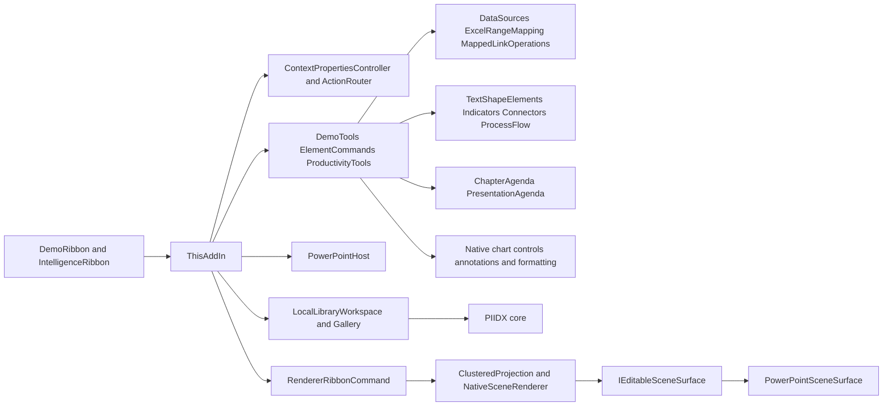

# Component architecture

The graph shows principal call direction, not exhaustive dependency injection. Most features are static/helper classes receiving a PowerPoint Application/Shape/Selection; there is no general DI container, plugin discovery framework or durable command-bus service. The host interface and editable-surface interface provide narrower test seams. `apps/powerpoint-vsto/Contracts.cs:7`; `src/Chart.Renderers/NativeRenderingCore.cs:136`.

`Demo` names are historical implementation identifiers in active production compile items, not proof a source is unused. Conversely V3 model files and the AI schema are not evidence of a running product capability. COM automation exposure is explicitly limited to `IDemoAutomation`; it is a local add-in automation object, not a REST API. `apps/powerpoint-vsto/DemoApi.cs:12`.

See [module inventory](../03-modules/module-inventory.md) for every coherent module and [dependency matrix](../03-modules/module-dependency-matrix.md) for evidence and test seams. Package namespaces preserve `PowerPointIntelligence` for compatibility while visible branding is NexWave.
