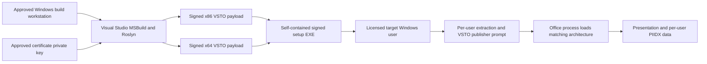

# Deployment architecture

The bootstrapper detects target Office architecture, validates/extracts its embedded bundle and invokes the VSTO installation path. Existing prerequisite .NET Framework 4.8/VSTO runtime and PowerPoint are required. It does not silently fetch or install prerequisites. The private key belongs to the build identity, never to the distributable. Exact mechanics and rollback paths are in `easySetup/Bootstrapper.cs:1` and `easySetup/Build-EasySetup.ps1:1`.

Local development installation uses `scripts/Install-Local.ps1`, a separate path from distributed easySetup extraction. Both require appropriate publisher trust. The exporter performs no installation and treats prior deployment receipts as historical evidence. A local-development signer trusted on one machine is not evidence of an enterprise publisher trusted elsewhere. `scripts/Install-Local.ps1:1`.

No cloud/on-prem API container is deployed by these scripts. Network identity, enterprise database and Azure topology remain open decisions. Keep installed extraction locations because VSTO may continue referring to them; rebuilding/removing artifacts indiscriminately can break local registrations. [Packaging details](../11-build-deployment/packaging-installation.md).
