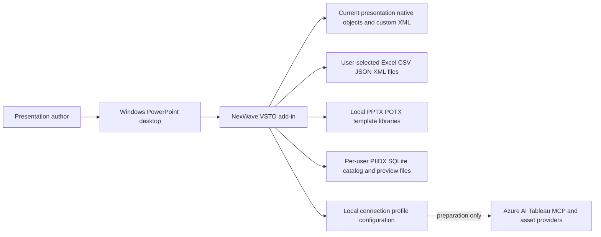

# Enterprise architecture

**VERIFIED — source architecture, not enterprise deployment certification.** The running product is a Windows desktop add-in hosted in the interactive PowerPoint process. Authors invoke ribbon callbacks, dialogs, a task pane and selection-following properties. Its primary data boundary is the active presentation, with user-selected files and a per-user local catalog as supporting stores. The Microsoft Office process, its COM apartment, VSTO loader, .NET Framework and Windows filesystem are platform dependencies. `apps/powerpoint-vsto/ThisAddIn.cs:37`; `apps/powerpoint-vsto/PowerPointHost.cs:48`.

The context diagram's dotted provider edge is configuration preparation, not a live inference or integration path. `services/ai-gateway` contains a schema and README; no deployable web service, database migration service, tenant middleware or identity server exists there. `services/ai-gateway/README.md:1`. Treat on-prem hosting and Azure OpenAI as approved intentions whose implementation and network/data-classification decisions remain open. `docs/DECISIONS.md:1`.

Trust boundaries are (1) signed installation into an Office user session; (2) file parsing and canonical model validation before mutation; (3) COM UI/STA ownership; (4) presentation metadata and native-object reconciliation; and (5) package/index integrity checks for local libraries. The cross-process mutation mutex coordinates cooperating add-in/test writers, not malicious processes or Office's own internal operations. `apps/powerpoint-vsto/PowerPointHost.cs:14`.

No RBAC/SSO/tenant isolation or encrypted enterprise storage can be inferred from local profile configuration. Sharing generated reports, licensed assets and source workbooks remains an organizational process. See [security](../09-security/security-architecture.md), [AI](../06-ai-architecture/ai-solution-architecture.md) and [deployment](../11-build-deployment/deployment-guide.md).
