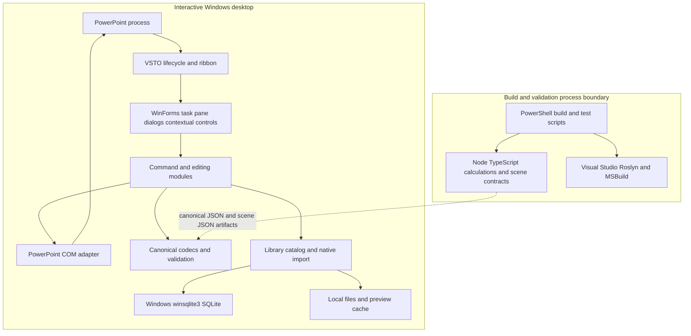

# Solution and container architecture

The unit of desktop deployment is the signed VSTO manifest/payload, loaded by PowerPoint. C# source is compiled from explicit project items, including linked domain/rendering/library sources. There is no `.sln` in this baseline; the two `.csproj` files are the build entry points. A source folder's presence does not establish inclusion: V3 contracts are absent from both active C# project compile lists. `src/Chart.Domain/Chart.Domain.csproj:12`; `apps/powerpoint-vsto/PowerPointIntelligence.csproj:39`.

Node tooling validates deterministic calculations and emits a geometry-only scene when its CLI is invoked. The production VSTO adapter is not documented as launching Node on every chart command; C# supplies its own validated clustered projection. `packages/chart-engine/tools/render-chart-v2.mjs:9`; `src/Chart.Renderers/NativeRenderingCore.cs:18`.

State is split across PPTX custom XML/tags, linked local input files, local JSON/XML configuration, PIIDX SQLite and PNG previews, plus build/cache receipts. There is no deployed on-prem application database in the repository. Local PIIDX is implemented and is separate from the unresolved enterprise database choice. `src/Library.Core/PiidxSchema.cs:1`; `docs/DECISIONS.md:1`.
