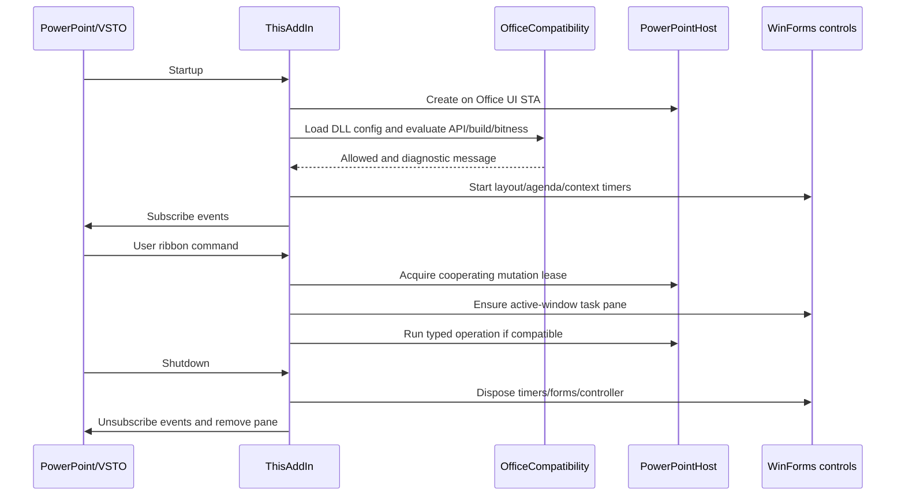

# Add-in lifecycle and event ownership

## Initialization

`apps/powerpoint-vsto/ThisAddIn.Designer.cs:19` binds generated VSTO host lifecycle; `apps/powerpoint-vsto/ThisAddIn.cs:328` attaches Startup/Shutdown. The project declares a PowerPoint HostItem (`apps/powerpoint-vsto/PowerPointIntelligence.csproj:76`).

Startup creates the native host and UI timers, loads explicit DLL config for compatibility, constructs context-property controller, subscribes selection/double-click/open/before-save/window-activate/close callbacks and invalidates a loaded ribbon (`apps/powerpoint-vsto/ThisAddIn.cs:37`). Invalid compatibility configuration disables chart commands with explanatory status rather than guessing host support.

## Reentrancy and mutation coordination

`ThisAddIn.Run` (`:133`) uses a busy flag and `OfficeMutationLease.TryEnter(currentProcessId)`. Native automation tests can acquire the same named kernel mutex using the PowerPoint HWND->PID; installed automatic writes then defer instead of racing the test. This is cooperating serialization, not access control or protection from arbitrary other add-ins.

Event callbacks use `RunHostEvent` (`:301`), `OfficeEventBoundary.Run` (`apps/powerpoint-vsto/PowerPointHost.cs:34`) and the same lease. They do not let managed exceptions escape native event dispatch. Selection marks contextual refresh dirty and restarts650ms agenda/element debounce. The750ms layout timer pauses on invalid dependency/reflow errors. BeforeSave only processes the currently active presentation, refreshing chapter views/layout and capturing supported S0 chart edits; it does not rewrite every chart from stale sample data.

## Per-window UI

EnsurePane compares active HWND and paneNeedsRefresh (`:88`). It removes/recreates the pane on the next user action when the active window changes. WindowActivate intentionally avoids pane disposal or metadata rewriting inside the Office activation callback. The pane is330px wide, docked through CustomTaskPanes, and shows insert/check-sync/compatibility actions plus status. PresentationClose hides context properties and marks pane refresh.

## Shutdown/cleanup and failures

Shutdown (`:77`) disposes context/timers/modeless layout controls, unsubscribes every explicitly registered Office event and calls RemovePane (`:122`). RemovePane detaches host status callback before removal and tolerates COM/disposed controls. Typed operations handle cancellation/data/selection errors as inspector messages; unexpected errors become a generic status without workbook content. Some deferred timer actions can be paused and require a user to correct metadata/geometry and resume; this is deliberate failure containment, not guaranteed recovery.

No background unattended Office server is part of startup. Source analysis cannot establish whether a target machine has accepted publisher trust, loaded VSTO, shown ribbon or retained native edits after reopen.
