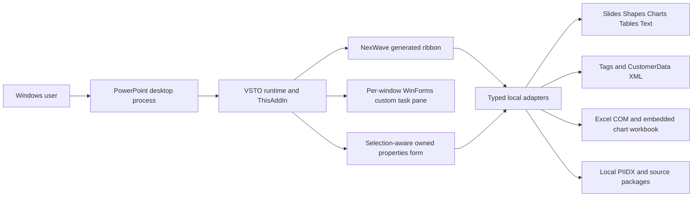

# PowerPoint integration overview

## Verified integration technology

NexWave is an in-process Windows **VSTO add-in for .NET Framework4.8/C#7.3**, not an Office.js/web add-in. `apps/powerpoint-vsto/PowerPointIntelligence.csproj:9` targets v4.8 and embeds Office/PowerPoint15interop types (`:30`); runtime compatibility accepts the common16.0 API for configured Office2016/2019/Microsoft365 profiles. Edition labels express deployment intent and are not automatic edition detection (`apps/powerpoint-vsto/OfficeCompatibility.cs:61`). Native runtime behavior still requires the target Office installation/architecture.

The visible ribbon/task-pane/product label is NexWave; assembly, COM IDs, metadata namespaces, cache folders and many class names retain PowerPointIntelligence for compatibility. Branding does not migrate native identities by renaming files.

## Host and boundaries

References: `apps/powerpoint-vsto/ThisAddIn.cs:37`, `apps/powerpoint-vsto/ThisAddIn.cs:88`, `apps/powerpoint-vsto/DemoRibbon.cs:12`. Neither an architecture diagram nor a successfully compiled PIA reference proves activation on a machine.

## Host operations by owner

| Native operation | Responsible source |
|---|---|
| Startup/events/task panes/command mutation lease | `apps/powerpoint-vsto/ThisAddIn.cs:37`, `apps/powerpoint-vsto/PowerPointHost.cs:14` |
| Native S0 chart insertion/update/edit capture | `apps/powerpoint-vsto/PowerPointHost.cs:166`, `apps/powerpoint-vsto/PowerPointHost.cs:296` |
| Linked native chart/table/editable shape diagrams | `apps/powerpoint-vsto/DemoTools.cs:165`, `apps/powerpoint-vsto/DemoTools.cs:197`, `apps/powerpoint-vsto/DemoTools.cs:252` |
| Canonical native scene shape insertion | `apps/powerpoint-vsto/RendererRibbonCommand.cs:60` and core surface/renderer |
| Managed text/process/indicator/connector | [shape and slide operations](shape-and-slide-operations.md) |
| Source-original preview/slide/design/layout insertion | `apps/powerpoint-vsto/TemplateLibrary.cs:462` |
| Configured generated templates/palettes/builds | `apps/powerpoint-vsto/TemplateLibrary.cs:63` |
| Native chart series/axes/reference/difference annotations | `apps/powerpoint-vsto/NativeSeriesControls.cs:13`, `apps/powerpoint-vsto/NativeChartControls.cs:49`, `apps/powerpoint-vsto/ChartAnnotations.cs:28` |
| Selection-aware properties/formatting | `apps/powerpoint-vsto/ContextPropertiesController.cs:33` |
| Agenda hierarchy/page links/native fields | `apps/powerpoint-vsto/ChapterAgenda.cs:70` |
| PDF export/image/template import | `apps/powerpoint-vsto/NativeSeriesControls.cs:33`, `apps/powerpoint-vsto/DemoTools.cs:1` |

## Explicit absences and verification level

No Office JavaScript API, HTML task-pane host, SmartArt graph authoring or generic arbitrary-native-object conversion is wired into the compiled project. Native charts retain embedded workbooks; editable custom diagrams are shape groups. Generated previews may be bitmaps, but insertion uses native objects, not the preview image. Original licensed slide assets are separate from independently generated templates. Live AI/network connections are not executed by the service-configuration component (`apps/powerpoint-vsto/ServiceConnections.cs:29`).

This chapter verifies source design only. Consult the export testing chapter for current executed checks; historical Office decks/logs are evidence of their recorded runs, not a current pass.
