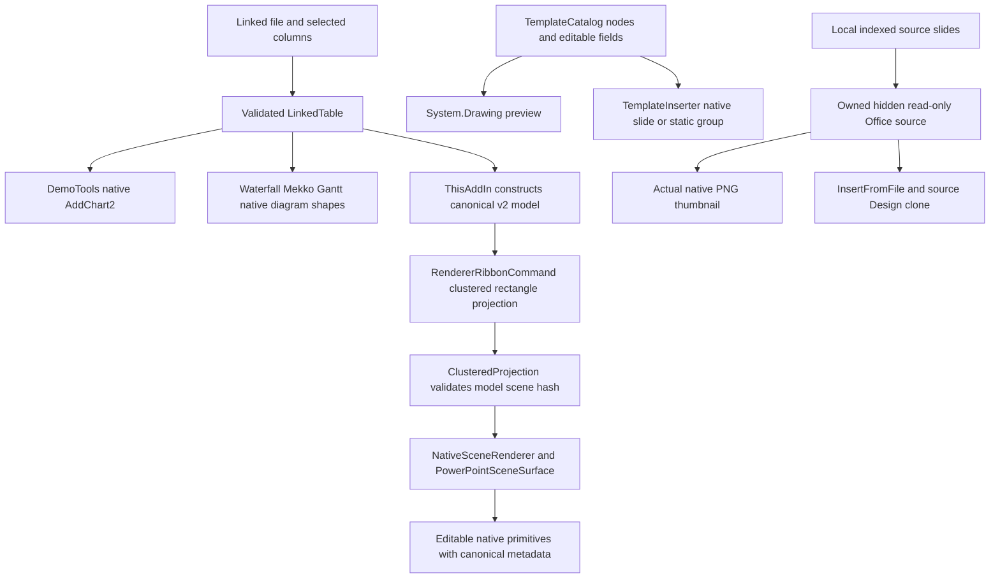

# Rendering engines and the ribbon projection

## Separate pipelines

`apps/powerpoint-vsto/DemoTools.cs:165`, `apps/powerpoint-vsto/DemoTools.cs:197`, `apps/powerpoint-vsto/ThisAddIn.cs:152`, `apps/powerpoint-vsto/RendererRibbonCommand.cs:44`, `apps/powerpoint-vsto/TemplateLibrary.cs:22`, `apps/powerpoint-vsto/TemplateLibrary.cs:484`.

The TypeScript chart engine and C# strict scene/canonical contracts are documented in the core module/data chapters. The current VSTO project does not spawn Node to run TypeScript when a chart button is clicked. The linked shape ribbon adapter itself computes the clustered rectangle scene; existence of broader TypeScript algorithms does not establish production ribbon coverage for every family.

## Active scene projection details

Prepare(model) validates canonical v2. It computes signed min/max including zero, uses[-1,1] when constant zero range, rejects infinite range, divides category span/series slots, skips missing values and emits box geometry per present value. Scene hash is recomputed and ClusteredProjection validates consistency before COM. It intentionally adds AXES_NOT_RENDERED and, if requested, LEGEND_NOT_RENDERED diagnostics (`apps/powerpoint-vsto/RendererRibbonCommand.cs:54`). Labels/axes/legend should not be claimed present in this path.

A parameterless Prepare helper validates embedded canonical/scene fixture pair before assigning a fresh chart GUID and remapping node IDs (`:21`). The visible linked shape command calls Prepare(model), not an undisclosed sample fallback. Embedded fixtures are test/sample resources, not linked business data.

## Native charts versus custom diagrams

Native charts use ChartData.Activate and embedded Excel source data with literal labels, acknowledged real series values and preserved local source reference. XY/bubble series assign typed X/Y/size arrays; families and blank rules differ. Custom waterfall uses cumulative signed changes from zero; Mekko widths follow category totals and percent/unit height semantics; Gantt expects Task/numeric Start/positive Duration. Grouped shapes remain editable but do not acquire full native chart-engine semantics. Table and diagram linked snapshots are persisted, but mapped automatic refresh for them is absent.

## Preview fidelity

Generated designed-template previews use the same logical node catalog, System.Drawing and editable field values. They are illustrative previews, not pixel equality proof with Office fonts/metrics. Original thumbnails come from native Slide.Export on the owned hidden source. Source identity is revalidated before preview/insertion; an unchanged metadata index is not a substitute for native rendering.

## Error, performance and extension limits

Renderers validate finite bounds/counts/hash/schema before touching COM. Native adapter rollback addresses newly owned primitives only; Office disconnection can make restoration incomplete. Large native object counts increase Office/metadata work; there is no server-side render farm or scalability SLA. Extend new family projections with strict canonical/scene equivalence, diagnostic handling, primitive tests and desktop save/reopen evidence.
