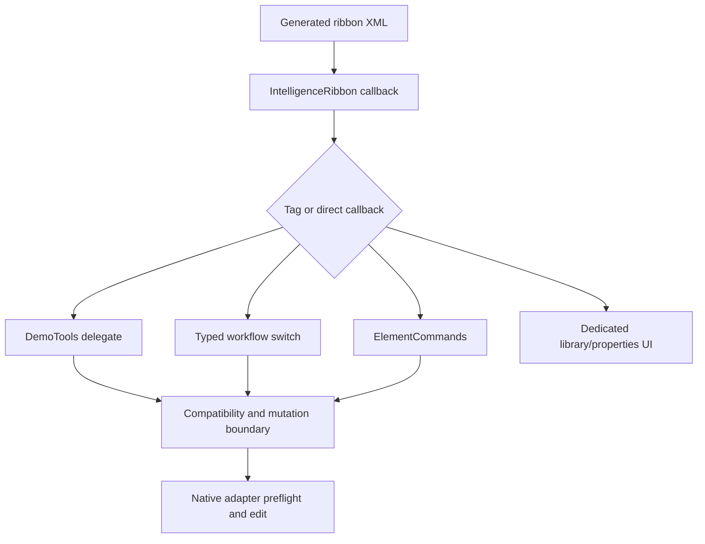

# Ribbon architecture and command routing

## Definition and registration

`apps/powerpoint-vsto/DemoRibbon.cs:12` builds XML with XmlWriter using Office customUI2009 namespace, `onLoad=OnLoad` and `loadImage=LoadImage`. The tab ID is stable ppiTab, visible label NexWave, keytip NW. `ThisAddIn.CreateRibbonExtensibilityObject` returns IntelligenceRibbon (`apps/powerpoint-vsto/ThisAddIn.cs:326`), which implements Office.IRibbonExtensibility, forwards handlers and invalidates IRibbonUI when state changes (`:332`).

Ten groups are created: Structure, Elements, AI, Data, Text, Layout, Color, Quality, Collaboration and More. Charts is a large menu beside Library with CH keytip; Agenda/Data Source are large menus, Check & Sync/Generate Linked Report are large buttons. Palette/alignment shortcuts are CP/TA. Local bitmap icons are rendered/cached by `apps/powerpoint-vsto/RibbonIcons.cs:13`; AxHost bridges Office picture format. Icon existence/visual quality needs its own tests rather than guessing from a resource name.

## Dispatch contract

| Source control family | Callback | Tag destination |
|---|---|---|
| Catalog categories | RunDemoTool | ThisAddIn.RunDemo -> DemoTools.Catalog delegate |
| Agenda/chart/format/data workflow | RunWorkflowCommand | RunWorkflow typed switch/prefix mapping |
| Element Controls | RunElementCommand | ElementCommands.Enabled/Run |
| Tools | RunProductivityTool | Local tool, help or explicit alias routing |
| Data Source four formats | LinkDataSource | Extension picker and presentation registry |
| Library/properties/palette/alignment/layout | Dedicated handlers | Corresponding owned dialog/controller |
| S0 automation insertion | COMAddIn.Object.InsertChartJson | Validated UI-STA-only S0 adapter, not a ribbon arbitrary-code path |

`apps/powerpoint-vsto/DemoRibbon.cs:94` is the button helper; dedicated callback/tag records are preserved in the [feature CSV](../05-features/feature-source-mapping.csv). The feature catalog counts172 command routes, not172 separate rendering engines; direct linked-report and multiple menu aliases are explicitly reconciled.

## Availability versus execution

The common command gate is host-created and compatibilityAllowed. Data-source/dialog gates also require an open presentation. Workflow gate adds relevant selected chart/annotation/multi-chart checks. ElementEnabled requires a known ID, Normal view and owned native element. Context controls use a stronger opaque live selection key and capability intersection. UI enablement is not a security boundary; adapters revalidate inputs/ownership before mutation.

## Status and limits

BuildMarker identifies current source/deployed payload (`apps/powerpoint-vsto/DemoRibbon.cs:11`). It is separate from assembly version and source fingerprint. The browser also displays103 FeatureInventory requirement records whose Partial demo/Not configured labels can lag newer source. They are not automatically converted into verified features. AI currently exposes Configure services; that form never sends a request. Ribbon XML/source checks do not prove the installed Office UI loaded that payload.
