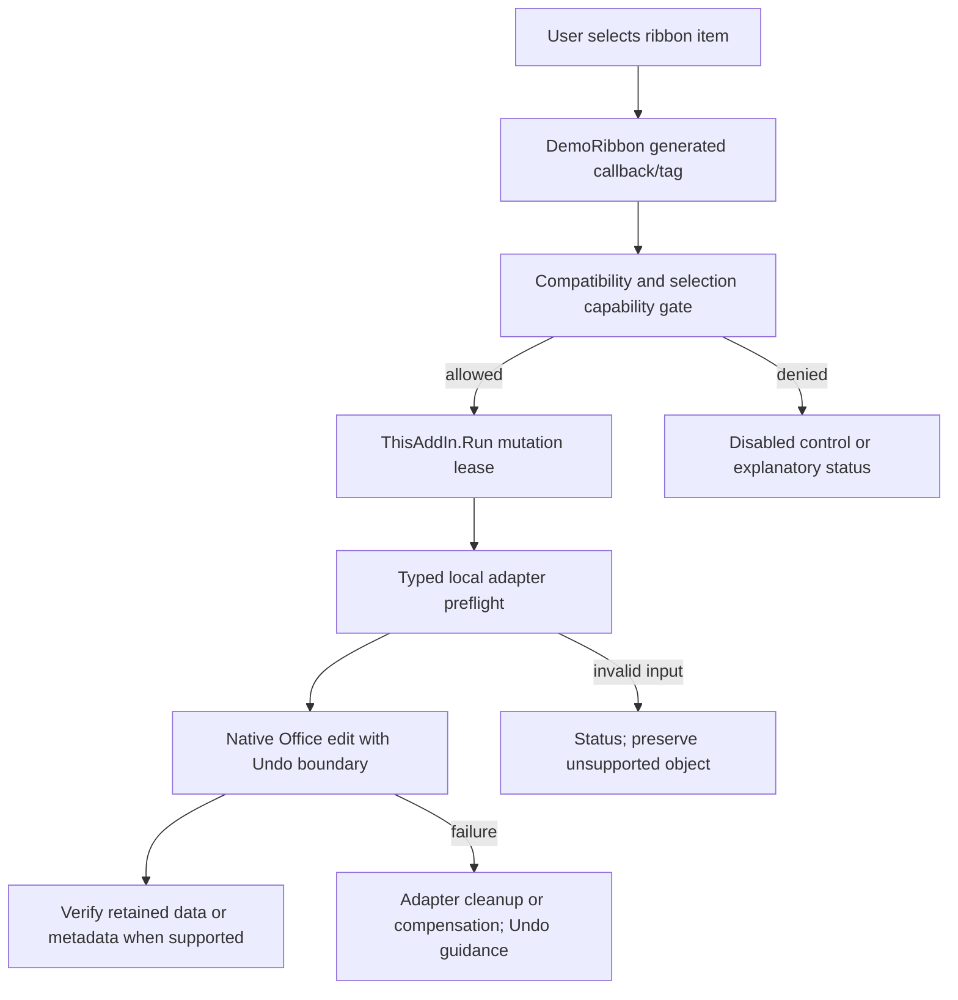

# Feature execution workflows

Evidence baseline: current inspected checkout, HEAD `ffaec352cbdca666f69f3c402d334108e4115933` plus parent export hash inventory. **VERIFIED** means source implementation here; current native runtime acceptance is not implied. Source analysis levels and limitations are in `04-powerpoint-integration/vsto-source-review.csv`.

## Ribbon/native operation



`apps/powerpoint-vsto/DemoRibbon.cs:12`, `apps/powerpoint-vsto/ThisAddIn.cs:133`. Some native delegates rely on Undo rather than a compensating transaction; do not infer atomic all-command rollback.

## Linked native chart

```mermaid
sequenceDiagram
  actor User
  participant Ribbon
  participant Sources as DataSources
  participant Reader as LinkedChartData
  participant PPT as PowerPoint chart
  participant Excel as Embedded workbook
  User->>Ribbon: Link source; choose chart
  Ribbon->>Sources: Choose registry source
  Sources-->>Reader: DataSourceLink
  Reader->>Reader: Validate/read source and selected columns
  Reader->>PPT: AddChart2 through DemoTools
  PPT->>Excel: Activate embedded workbook
  Reader->>Excel: Literal labels and Value2 matrix
  Reader->>Excel: Verify readback; calculate
  Reader->>PPT: SetSourceData; wait actual series values
  Reader->>Excel: Close with bounded rejected-call handling
  Reader->>PPT: Persist source reference; verify committed values
```

`apps/powerpoint-vsto/DataSources.cs:166`. A failed acknowledgement is not success; no sample fallback. Numeric XY uses typed Series assignment; mapped refresh has stricter rejection rules.

## Local originals versus designed templates

Originals: index/filter -> verify source fingerprint -> hidden owned read-only presentation -> native PNG thumbnail -> select -> size/identity validation -> InsertFromFile -> clone Design/CustomLayout -> select inserted slide. The destination remains the existing presentation. Source session closes only its owned hidden source.

Designed templates: choose category/layout -> field drafts/palette/alignment -> pure node build/validation -> fit960x540canvas -> native shape/text insertion -> per-instance metadata -> optional staged native effects/transition. Static object-only mode is a separate validated option. Source-original palette transformation is not implied.

## Contextual and managed updates

Selection event marks dirty ->300 ms foreground/identity capture -> classify shared capabilities -> show owned no-activate form -> user command -> identity recheck -> typed adapter -> metadata/native compensation. Agendas/managed text/connectors also refresh through650ms debounce; layout links use750ms timer. All automatic writes use the same cooperating mutation lease. See [native editing](../04-powerpoint-integration/native-editing-engine.md) and [lifecycle](../04-powerpoint-integration/addin-lifecycle.md).
