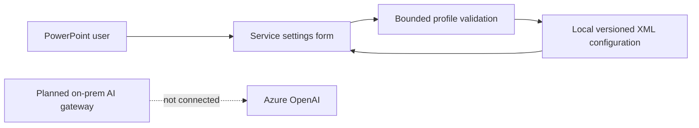

# AI solution architecture

**VERIFIED (source):** The running add-in is local VSTO/COM software. Azure connectivity, AI inference and enterprise identity enforcement are not implemented. Service profiles are preparation metadata only. Runtime UI tests were not executed for this documentation export.

## Implemented boundary

`ServiceConnections` offers three profiles: AzureOpenAI, OnPremDataService and AssetProvider. A profile contains a service enum, a bounded endpoint string, a deployment identifier and a selected authentication **mode**, not a token or authenticated session. `Status` deliberately says “Configured, not connectivity-tested” after required metadata is present. Saving cannot cause an outbound request. `apps/powerpoint-vsto/ServiceConnections.cs:29` `apps/powerpoint-vsto/ServiceConnections.cs:53`.

The visible configuration workflow is routed by `ThisAddIn.RunWorkflow("connections")` to `ServiceConnections.ShowConfiguration`. This is an implemented desktop settings form. It is not an AI chat panel or gateway client. `apps/powerpoint-vsto/ThisAddIn.cs:252`

## Gateway boundary

The entire `services/ai-gateway` authored directory contains a README and action-plan JSON schema. There is no service executable, project, controller, HTTP listener, database, authentication middleware or provider SDK. Its README labels the gateway “not implemented.” The on-prem gateway, Azure inference, RBAC, minimized context and human approval pipeline are **PLANNED**. `services/ai-gateway/README.md:1` `docs/DECISIONS.md:17`.

## Status by capability

| Capability | Evidence-based status |
|---|---|
| Profile configuration and local persistence | VERIFIED implementation |
| Azure endpoint reachability or model deployment discovery | NOT IMPLEMENTED |
| Prompt templates, conversation state, retrieval and tool calling | NOT IMPLEMENTED |
| Token acquisition, SSO, API-key vault and RBAC | NOT IMPLEMENTED |
| AI response validation/execution | PLANNED schema only |
| Live Tableau/MCP/Morningstar/asset-provider results | NOT IMPLEMENTED; descriptive inventory says Not configured |

The descriptive AI rows in `FeatureInventory` do not make their implementations reachable. No inference sequence diagram is presented as implemented. See [AI workflows](ai-workflows.md) and [contracts](../07-api-design/request-response-contracts.md).
