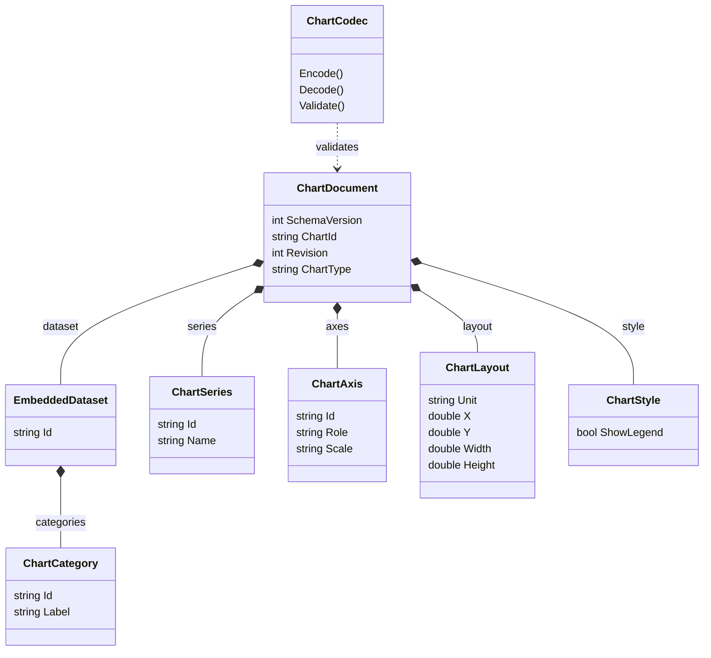
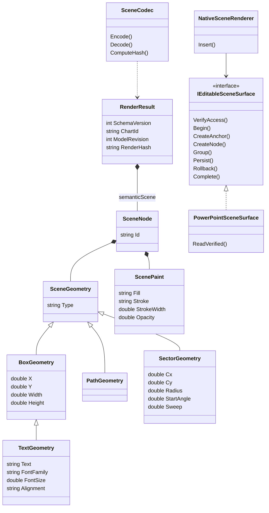
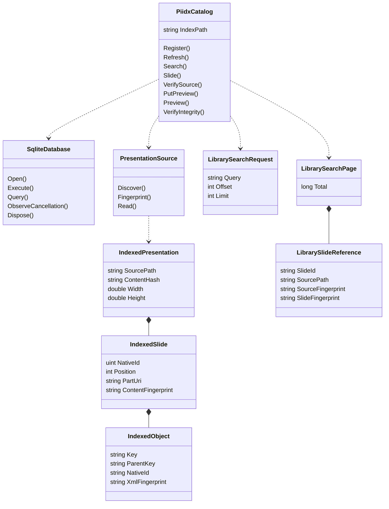

# Class and relationship diagrams

<!-- generated-toc -->
## Contents

- [Canonical v2 domain](#canonical-v2-domain)
- [Scene and editable host boundary](#scene-and-editable-host-boundary)
- [Catalog extraction and query objects](#catalog-extraction-and-query-objects)
- [Storage ERD](#storage-erd)
<!-- end-generated-toc -->

**VERIFIED structural reconstruction.** Diagrams show actual authored classes and relationships; compile status and runtime capability are called out separately. Field subsets keep diagrams readable; the dictionary contains complete opt-in wire fields and SQL columns.

## Canonical v2 domain

Evidence: `src/Chart.Domain/ChartDocument.cs:8`; `src/Chart.Domain/ChartCodec.cs:15`. ChartSeries.Values is an ordered list of nullable doubles with exactly the category count. Style.SeriesColors cardinality matches series. This v2 model is compiled into VSTO; authored ChartDocumentV3/ChartOptions are deliberately not conflated here because explicit production compile items omit them.

## Scene and editable host boundary

Evidence: `src/Chart.Renderers/SceneContracts.cs:7`; `src/Chart.Renderers/NativeRenderingCore.cs:136`; `src/Chart.Renderers/PowerPointSceneSurface.cs:15`. PathGeometry carries ordered points; sector angles/radius are bounded. The interface does not authorize arbitrary scene execution. ClusteredProjection validates a narrow canonical rectangle profile before Begin. Native adapter does not implement text/polygon/sector rendering despite their DTO presence.

## Catalog extraction and query objects

Evidence: `src/Library.Core/PiidxCatalog.cs:14`; `src/Library.Core/PresentationSource.cs:17`; `src/Library.Core/LibraryModels.cs:55`. PiidxCatalog is one partial class across catalog/search/navigation/preview source files, not four independent databases. Extracted object transforms remain native parent-coordinate metadata; group parent references are structural strings rather than relational FKs.

## Storage ERD

See [persistence design](persistence-design.md) for actual SQL relationships. No application-server ERD is provided because the inspected implementation contains no such database. Native PowerPoint objects/tags/XML are host persistence, not fictitious relational tables.
