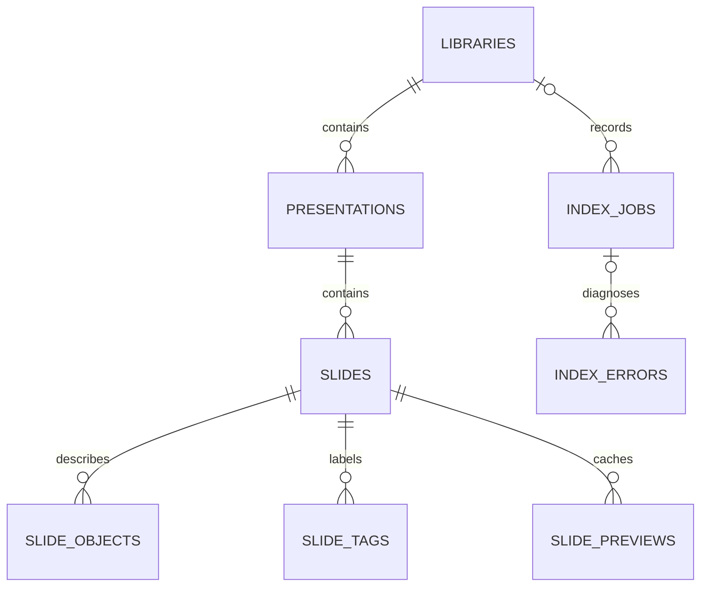

# Persistence design

**VERIFIED source reconstruction.** Data lives in the presentation, local library index, derivative caches, source documents and configuration. There is no single application database encompassing all runtime features and no implemented remote persistence API established here.

## Storage ownership

| Store | Authority and lifecycle | Evidence |
|---|---|---|
| PowerPoint Shape.CustomerData / presentation CustomXMLParts | Versioned canonical feature state, attached identities and associations travel with a deck. Code requires unique matching namespace/identity and validates round trips; damaged/ambiguous state is preserved and rejected. | `apps/powerpoint-vsto/MetadataCodec.cs:12`; `src/Chart.Renderers/PowerPointSceneSurface.cs:99` |
| Shape/slide Tags | Managed ownership, root/node/operation tokens and native identity hints. Tags are not a substitute for full XML validation. | `src/Chart.Renderers/PowerPointSceneSurface.cs:16` |
| Native chart embedded workbook | Actual editable chart data; linked-source refresh commits native values and stores association separately. Source file is not the embedded workbook. | `apps/powerpoint-vsto/DataSources.cs:162` |
| .piidx SQLite database | Independently extracted local catalog metadata, registrations, jobs/errors, FTS search and validated derivative previews. | `src/Library.Core/PiidxSchema.cs:10` |
| .writer.lock sidecar | Exclusive OS file handle for one compliant catalog writer; not a security credential. | `src/Library.Core/PiidxCatalog.cs:40` |
| App/enterprise XML configuration | Approved source roots and refresh/watch/index locations. | `src/Library.Core/LibraryConfiguration.cs:30` |
| Legacy XML library cache and migration receipt | Read folder registration only; do not trust/import cached text. Fresh extraction plus post-check creates a new migration receipt; original cache retained. | `src/Library.Core/LibraryConfiguration.cs:78` |
| Original PPTX/POTX files | Read-only source authority for library extraction/insertion. Content hashes rechecked; no arbitrary ZIP extraction or external target retrieval. | `src/Library.Core/PresentationSource.cs:121` |

## Actual PIIDX schema



The diagram shows only actual foreign-key relationships. SLIDE_SEARCH is an FTS5 virtual mirror keyed by an UNINDEXED slide_id field but has no SQL foreign key. A SLIDES_DELETE_SEARCH trigger removes matching FTS rows; consistency is also verified by count, field equality and duplicate checks. INDEX_METADATA is a singleton header; its library_id field is a consistency value for exactly one registered library, not an enforced foreign key. All exact columns and constraints are listed in [data dictionary](data-dictionary.md). Nine ordinary tables plus one virtual FTS entity are the logical schema; SQLite's FTS shadow tables are implementation details.

## Index creation and open

PiidxCatalog.OpenOrCreate only initializes an empty/unversioned empty database. Existing unknown bytes, future/foreign versions and weakened schemas reject without replacing the file. The schema records application_id0x50494958, user_version1, format_idPowerPointIntelligence.PIIDX, schema_version1 and engine_version0.1.0. Exact required-column order and sqlite_master definition strings are checked. Deep open verification also runs SQLite integrity_check and foreign_key_check. It does not automatically migrate an unknown index.

Index path must use .piidx; owned index/config/lock paths reject linked ancestors. Windows native SQLite is loaded from System32, not a user library root. Foreign keys are enabled, trusted_schema disabled, statements parameterized, and only one SQL statement per database call is allowed.

## Transaction and refresh sequence

```mermaid
sequenceDiagram
    participant W as Refresh worker
    participant L as OS writer handle
    participant D as PIIDX SQLite
    participant P as PPTX/POTX reader
    W->>L: Exclusive .writer.lock (cancellable, max five seconds)
    W->>D: Verify prior logical content
    W->>D: Mark interrupted jobs; insert running job
    W->>P: Discover and hash source files
    W->>D: BEGIN IMMEDIATE
    loop Every source
        W->>P: Read changed file or verify unchanged hash
        P-->>W: Metadata with native slide identities
        W->>D: Upsert presentation; replace changed slide descendants
    end
    W->>P: Rehash all captured files
    alt Unchanged and not cancelled
        W->>D: Digest, FTS integrity-check, job completed, COMMIT
    else Race, parser error or cancellation
        W->>D: ROLLBACK; record failed/cancelled job and sanitized error
    end
    W->>L: Release handle
```

Unchanged files still have bytes hashed. If a missing old path uniquely matches the current content hash, a rename preserves presentation identity; otherwise a new GUID is allocated. Slide ID is derived from presentation identity plus native slide ID, preserving identity across reordering. A changed presentation deletes/recreates slide children inside the transaction. Missing presentation rows are marked missing and excluded from normal browsing, rather than fabricated or permanently discarded immediately. Remove(libraryId) cascades catalog/search rows and leaves source files intact.

The job record is created outside the snapshot transaction so failure can be recorded after rollback. A running marker alone does not permit recovery: only exclusive OS lock ownership lets a new writer mark old running jobs interrupted. Readers use their own connections; read transactions observe committed snapshots while a writer builds the next state.

## Integrity and its limits

Logical SHA-256 digests cover ordered authoritative library/presentation/slide/object/tag rows and the FTS mirror; header source_fingerprint separately covers presentation/source/hash/status. The digest includes typed null/string/int64/double encodings. Preview bytes, jobs/errors and the metadata header itself are not part of the authoritative DigestQueries; preview rows have independent hash/PNG checks. This is local consistency/tamper detection, not a keyed MAC, publisher signature or adversary-proof database authentication. A user who can rewrite data and recompute metadata is outside that guarantee. No database encryption or enterprise RBAC is implemented in this layer.

## Preview lifecycle

PutPreview clones bytes, validates PNG framing/CRC/dimensions/encoding and compares source/slide selection to current indexed metadata inside its transaction. Per-size key is slide_id,width,height. Aggregate logical image bytes above256MiB evict oldest rendered rows. Read returns null for missing/stale derivative and throws on altered hash/PNG; it never invents a sample preview. Changing/force-reextracting source slides removes descendant preview rows. PNG validation does not decompress IDAT or prove that native rendering matched the source. Physical SQLite size may exceed the logical preview quota after row deletion.

## Configuration/migration lifecycle

Default index is under current user's LocalAppData/PowerPointIntelligence/Library/catalog.piidx. TemplateLibraryFolder registers a managed source relative to configured base; LibrarySourcesConfig can add up to1000 version1 enterprise roots. Legacy cache migration only accepts a folder already independently approved by configured/catalog roots. It refreshes original packages, verifies integrity and unchanged legacy fingerprint, then writes a create-new XML receipt beside the index. It does not delete the legacy cache or interpret cached slide text as source authority.

## Backup, recovery and extension guidance

A .piidx file is a local index, but registrations and state still need explicit recovery policy. Stop writers or use a SQLite-aware backup method before copying a live file; no turnkey database backup service is implemented. Corrupt index is preserved; do not silently recreate it in troubleshooting. Sources can be independently reindexed through an approved new index. Preserve original source files and per-user configuration. Versioned migrations need schema compatibility and rollback tests. No data retention/enterprise encryption promises should be inferred from a local cache implementation.
