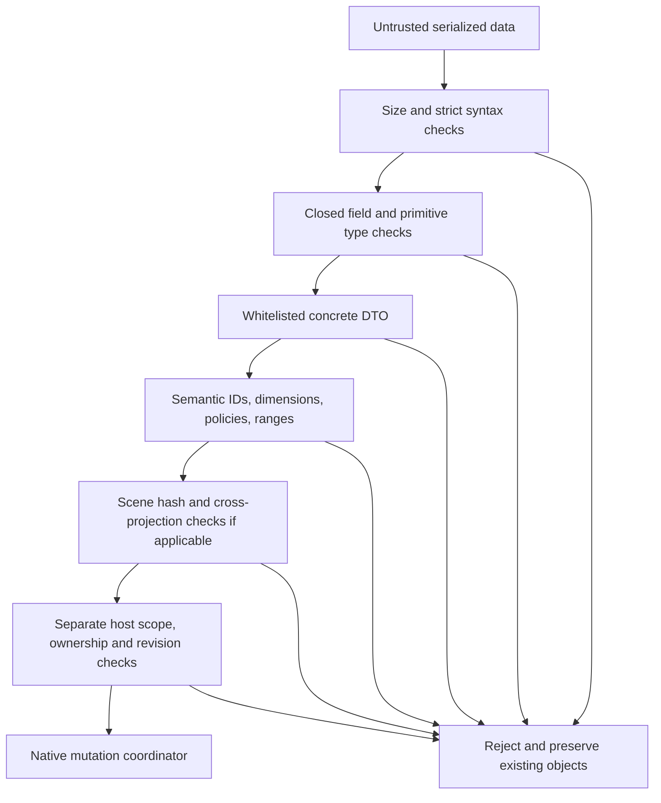

# Serialization and compatibility contracts

<!-- generated-toc -->
## Contents

- [Contract registry](#contract-registry)
- [Canonical v2 example](#canonical-v2-example)
- [Decoder processing order](#decoder-processing-order)
- [Scene canonical bytes and hash](#scene-canonical-bytes-and-hash)
- [XML persistence profile](#xml-persistence-profile)
- [Host metadata adjuncts](#host-metadata-adjuncts)
- [Migration and forward compatibility](#migration-and-forward-compatibility)
- [Tests and limitations](#tests-and-limitations)
<!-- end-generated-toc -->

**VERIFIED implementation.** Distinguish format/schema/version, structural schema validation, semantic validation, integrity validation and authorization. Passing one does not imply the others. The code does not implicitly migrate every chart to the newest authored DTO.

## Contract registry

| Boundary | Version and media | Consumer/producer | Limits and semantics |
|---|---|---|---|
| Legacy native chart | XML1, urn:powerpoint-intelligence:s0:chart:v1 | Host.MetadataCodec, IPowerPointHost | 1,048,576 characters, clustered-column, valid nonempty GUID/revision>=0; ordered string categories/identified series and nullable doubles. |
| Canonical chart | JSON2, urn:powerpoint-intelligence:chart-document:v2 | ChartCodec / AJV validateChart / local renderChartV2 | Closed object, semantic IDs/dimensions/axes/colors and finite pt layout,1 MiB character cap at codec/adapter. |
| Authored canonical extension | JSON3 | ChartV3Codec / ChartDocumentV3 | Authored only; not in inspected production compile lists. Explicit options; no installed-v3 claim. |
| Semantic renderer | JSON1, urn:powerpoint-intelligence:render-result:v1 | TS scene-contract and C# SceneCodec | Closed schema, pt coordinates, exact scoped identities/revision, geometry whitelist and verified lowercaseSHA256;8 MiB chars. |
| Native rendered record | XML1, urn:powerpoint-intelligence:rendered-chart:v1 | RenderedChartMetadata / PowerPointSceneSurface | CanonicalJSON+SceneJSON+orderedBindings; max12,582,912 chars and2000 bindings for narrow clustered profile. |
| Independent local index | SQLite format1, PowerPointIntelligence.PIIDX | PiidxSchema/PiidxCatalog | application_id0x50494958/user_version1, exact required DDL/columns and logical consistency; no unknown-file overwrite/migration. |
| Enterprise library definitions | XML1, urn:powerpoint-intelligence:libraries:v1 | LibraryRuntimeProfile.ParseSources | Libraries root/version, Library path/name/recursive only;<=1000 independent roots. |

Evidence: `apps/powerpoint-vsto/MetadataCodec.cs:12`; `src/Chart.Domain/ChartCodec.cs:17`; `src/Chart.Domain/ChartV3Codec.cs:16`; `src/Chart.Renderers/SceneCodec.cs:18`; `src/Chart.Renderers/NativeRenderingCore.cs:65`; `src/Library.Core/PiidxSchema.cs:12`; `src/Library.Core/LibraryConfiguration.cs:55`.

## Canonical v2 example

This is the repository's synthetic golden test contract, not extracted business data. Labels/values demonstrate signed numbers, real zero, missing null and escaped text. It is a schema/codec example, not an HTTP request.

```json
{
  "schemaVersion": 2,
  "chartId": "73c68f66-4226-47ef-93b7-187fdf2fb9af",
  "revision": 4,
  "chartType": "clustered-column",
  "dataset": {
    "id": "dataset:sales",
    "categories": [
      {
        "id": "category:q1",
        "label": "Q1"
      },
      {
        "id": "category:q2",
        "label": "Q2 & <forecast>"
      },
      {
        "id": "category:q3",
        "label": "日本語"
      }
    ]
  },
  "series": [
    {
      "id": "series:actual",
      "name": "Actual",
      "values": [
        -1.25,
        0.0,
        30.0
      ]
    },
    {
      "id": "series:plan",
      "name": "Plan",
      "values": [
        15.0,
        null,
        35.0
      ]
    }
  ],
  "axes": [
    {
      "id": "axis:category",
      "role": "category",
      "scale": "category",
      "numberFormat": "General"
    },
    {
      "id": "axis:value",
      "role": "value",
      "scale": "linear",
      "numberFormat": "0.00"
    }
  ],
  "layout": {
    "unit": "pt",
    "x": 60.0,
    "y": 90.0,
    "width": 600.0,
    "height": 340.0
  },
  "style": {
    "showLegend": true,
    "seriesColors": [
      "#4472C4",
      "#ED7D31"
    ]
  }
}
```

Evidence: `tests/s1/fixtures/clustered-column.v2.json:1`. The shared contract requires all listed properties, not optional silently defaulted fields. Dataset/category/series/axis IDs share one uniqueness set including chartId. Series cardinality equals categories. Series colors cardinality equals series. Axis roles are exactly category/value with category/linear scales; arbitrary units, unknown nested fields and numeric strings reject. Layout may start negative within bounds but width/height must be positive. Null means missing; zero remains a real value.

## Decoder processing order



The diagram summarizes the combined boundary, not a single universal function. V2 ChartCodec uses its own Json.NET token reader and exact CheckShape; scene and authored v3 additionally use the handwritten bounded strict grammar. Json.NET TypeNameHandling is None; geometry/options polymorphism uses explicit whitelists. Native mutation is downstream of validation and does not run arbitrary serialized commands. The local file CLI is a separate boundary and does not edit presentations.

## Scene canonical bytes and hash

PPI-SCENE-1 separates the hash domain. Scene content excludes only the outer renderHash. Object keys are ordinally sorted; array order is significant. Typed tags encode null0, false1, true2, number3, string4, array5 and object6. Counts/string byte lengths use four-byte big-endian integers. Numbers are IEEE-754 doubles in big-endian order with -0 normalized to0. Strings are valid UTF-8 with byte length, rejecting unpaired surrogates. SHA-256 is encoded lowercase hex. The C# serializer and TypeScript implementation share independent fixture/producer validation rather than relying on JSON whitespace or locale number formatting.

`SceneCodec.ComputeHash` accepts a valid draft, while Encode/Decode verify the sealed hash. TS sealScene/verifyScene clone before asynchronous WebCrypto so a caller cannot mutate pending data and race hashing. Structural JSON Schema only checks the hash's format; codecs recompute value and validate node references. Unkeyed hash cannot authenticate a sender or authorize document changes. It also does not grant broad native geometry support.

Scene grammar bounds include depth32,200000 nodes,10000 pathpoints,10000 diagnostics,4096 codepoint text and128codepoint nonblank font family. Rendered metadata native cap is much narrower at2000nodes. Rectangle/ellipse/text dimensions may be zero; sector sweep must be strictlypositive and<=360. Text alignment whitelist is left/center/right. Paint fill/stroke are null or six-digit hex, opacity[0,1], strokeWidth[0,1000]. All diagnostics reference known node IDs or null.

Evidence: `src/Chart.Renderers/SceneCodec.cs:125`; `packages/chart-engine/src/scene-contract.ts:99`; `tests/s3/scene-fixtures.mjs:8`.

## XML persistence profile

RenderedChart contains version/chartId attributes, Canonical text, Scene text and Bindings. Each Binding has nodeId, token and shapeId; an empty shapeId is allowed only when canonical projection has no native area. Tokens are uppercase SHA-256 of exact node ID, avoiding case-folded Office tags. Shape IDs can change on reopen; ReadVerified rematches owned shapes by tokens and validates geometry/style before updating in-memory binding hints. Canonical JSON and sealed scene stay unchanged when a native user edit diverges; verification fails instead of rewriting canonical values.

The XSD is structural and allows at most2000 bindings. Runtime validation additionally checks projection identity/revision/numeric geometry/paint, binding order/token uniqueness and native ownership. XML readers prohibit DTDs and external resolvers. Unknown XML fields/attributes, duplicate matching parts, invalid versions and oversized payloads reject. VSTO feature codecs use their own namespace/version contracts; do not repurpose the rendered-chart envelope for agenda, connector or linked source state.

## Host metadata adjuncts

Data-source XML namespace remains urn:powerpoint-intelligence:data-source:v1 while root version can be1 (unmapped file link) or2 (ExcelRangeMapping child). Mapping header/dimension drift requires confirmed reselection. Chapter agenda uses agenda:v2; indicators use indicator:v1; universal connectors use connector:v1; process grids use process-grid:v1; generated templates use template:v1. Their native ownership/tags and contextual editing rules are documented in the PowerPoint/feature sections. Shared names do not imply a database foreign-key relationship.

## Migration and forward compatibility

S0Migration.FromXml requires explicit layout/style because legacy XML never stored them. IDs are deterministic from chart identity and positions; clone through codec avoids aliasing. ChartV3Codec.FromV2 requires explicit gapRatio and returns a validated independent snapshot, but is not part of inspected installed build. Scene v1 is a projection of chart data, not a replacement canonical schema version. Unknown PIIDX schemas are preserved and rejected, not downgraded. Legacy library migration uses independently approved registration roots and re-extracts original PPTX/POTX packages; it does not adopt an old proprietary index or import cached text.

## Tests and limitations

DomainTests exercises golden round-trip, invariant culture, invalid dimensions/fields/IDs/numbers, Unicode boundaries and explicit S0 migration. SceneContractTests plus scene-fixtures/validate-roundtrip compare strict syntax, semantics and exact TS/.NET hashes including independently produced doubles/Unicode/subnormals. NativeRendererTests injects before/after mutation failures and verifies rollback preserves user objects; separate --interactive-office branches define edit/save/reopen checks. PIIDX schema/catalog/source/preview/workspace tests exercise persistence/races/constraints but are not native rendering proof. See parent test report for actual current commands and results; this leaf only reviewed definitions.

Security source review does not establish Checkmarx clearance or dependency vulnerability freshness. No current scan was requested/executed here, and documentation does not change implementation to close gaps.
