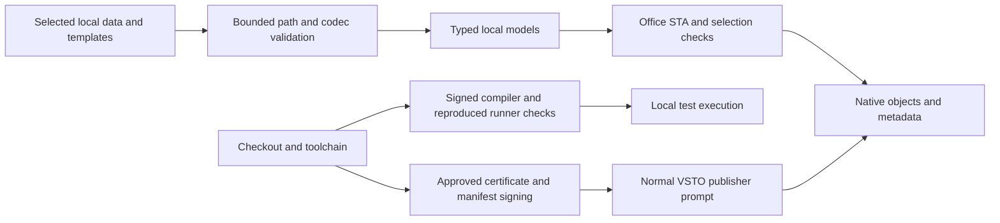

# Security architecture

## Trust boundaries and implemented controls

**VERIFIED (source)**, not penetration-test certification. NexWave runs with the interactive Windows user's permissions inside PowerPoint, .NET Framework 4.8 and VSTO. Signed VSTO/publisher trust controls loading; UI-thread/selection/model checks control safe operation. There is no implemented network service identity boundary or RBAC engine.

| Surface | Implemented control | Limit |
|---|---|---|
| Native mutation | Creating thread plus STA, reentrancy/active-document checks and OfficeMutationLease | Selection/concurrency safety, not RBAC |
| Metadata/XML | Namespace/version/shape checks, bounded size, explicit no-DTD/resolver-null readers | Metadata can be deleted/changed; recovery must fail safely |
| JSON | BoundedJson grammar/depth/duplicate-key/finite-number checks plus semantic codecs | Does not authorize an absent AI executor |
| Filesystem | Selected absolute inputs versus Within-reconstructed outputs and owned-path reparse checks | Selected inputs intentionally differ from owned output authority |
| Recovery | Checkout-artifacts containment, ADS/dot/reparse rejection, bounded locked JSON | Scanner scope/freshness need independent review |
| Cached code | Receipt/hash plus independent current-source reproduction; verified files locked during load/launch | Checkout/compiler/build user remain trusted |
| Windows SQLite loading | DefaultDllImportSearchPaths(System32), SafeHandle resources and parameter binding in NativeSqlite | Inbox Windows capability, not a server database identity |
| Signing | Approved thumbprint/private key/validity/code-signing EKU/chain; Valid signature before publish | Development trust is not enterprise target approval |
| Bootstrap | Fixed bundle and entry SHA256, bounded inventory/expansion, SafePath, refusal to overwrite modified versions | Inherits local user filesystem boundary |
| Service profiles | Nonsecret schema, HTTPS syntax and atomic local replacement | Plaintext metadata; no egress allowlist/authentication |

Evidence: `apps/powerpoint-vsto/PowerPointHost.cs:58` `src/Library.Core/PathPolicy.cs:56` `src/Shared.Contracts/BoundedJson.cs:19` `scripts/Build-Integrity.ps1:21` `scripts/Build-Integrity.ps1:39` `easySetup/Bootstrapper.cs:36`.

No centralized immutable audit, database-at-rest encryption, cloud secret vault, tenant isolation, remote authentication, token refresh or policy service is implemented. OS/Office trust must not be mislabeled as these capabilities. See [gap register](security-gap-register.md).
