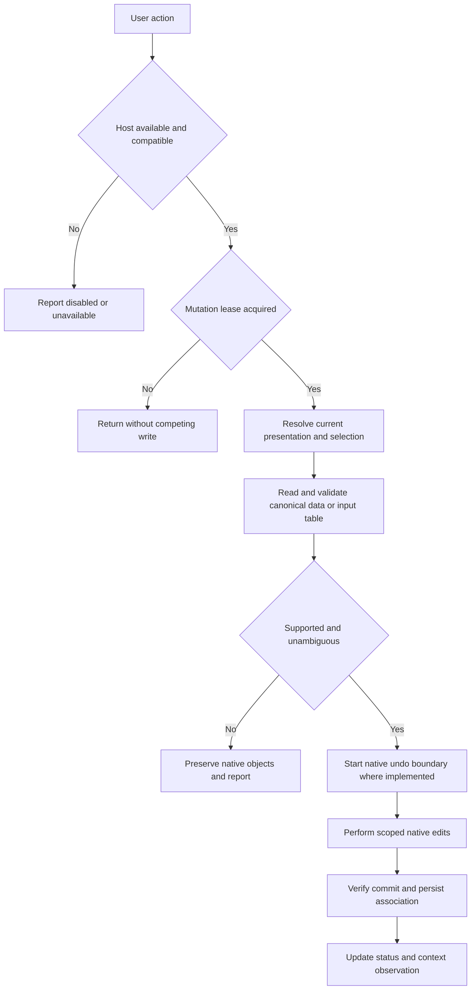
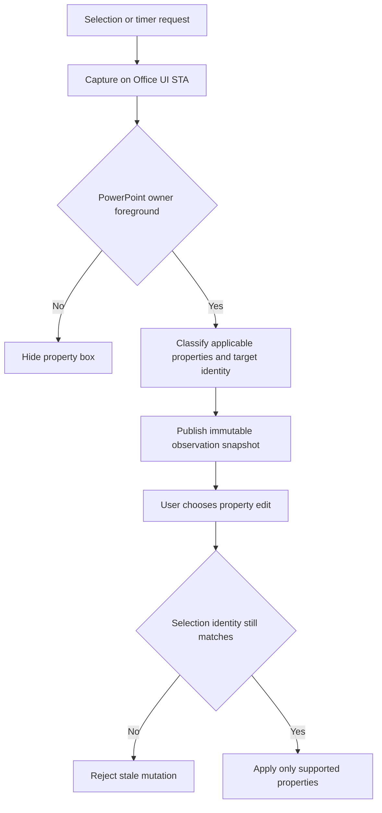
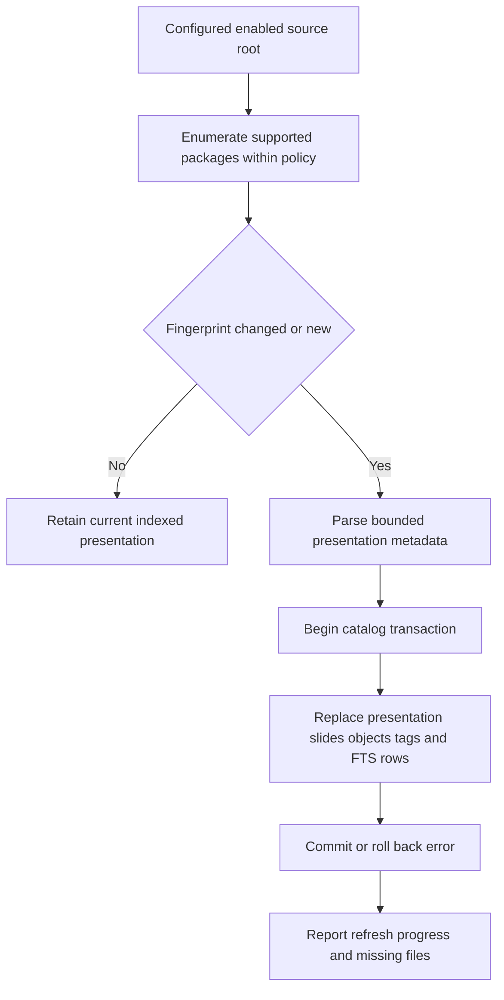

# Activity diagrams

## Validation before document mutation

`apps/powerpoint-vsto/ThisAddIn.cs:133`; `apps/powerpoint-vsto/PowerPointHost.cs:48`. Undo grouping and transaction rollback differ by module; the graph is a shared validation pattern, not a claim every handler implements the same atomicity.

## Context properties and stale target prevention

`apps/powerpoint-vsto/ContextPropertiesController.cs:1`; `apps/powerpoint-vsto/ContextSelectionBridge.cs:1`; `apps/powerpoint-vsto/ContextActionRouter.cs:1`. Foreground focus is a Windows prerequisite, not a reason to change focus/security policy. Table cell text, group text, chart properties and indicators have different applicability.

## Local catalog refresh

`src/Library.Core/PiidxCatalog.cs:1`; `src/Library.Core/PresentationSource.cs:1`. Watch notifications/debounce request refresh; they are not a guarantee of enterprise scheduled updates or real-time external synchronization.
