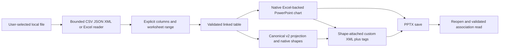
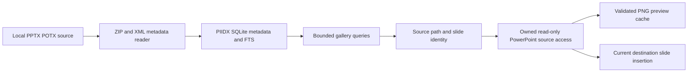

# Data-flow and trust-boundary diagrams

The embedded workbook may contain actual linked data. Canonical metadata and source path provenance are persisted locally with the presentation; encryption/redaction policy is not invented by the codec. Diagnostics intentionally avoid logging workbook values but do not encrypt the deck. `apps/powerpoint-vsto/DataSources.cs:39`; `apps/powerpoint-vsto/MetadataCodec.cs:1`; `src/Chart.Renderers/NativeRenderingCore.cs:71`.

The index can contain slide text, author names, paths and other document metadata. Its purpose is local search, not content anonymization. Preview cache integrity and source-fingerprint checks do not establish confidentiality. `src/Library.Core/PiidxCatalog.cs:1`; `src/Library.Core/PiidxPreviewCache.cs:1`.

There is no verified data flow from presentation content to Azure OpenAI. Do not draw or document an authenticated AI request sequence until the gateway/client actually exists. Local configured-provider profiles are shown separately in [AI data flow](../06-ai-architecture/ai-data-flow.md).
