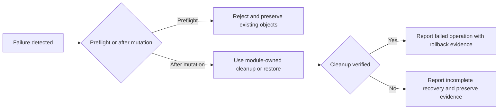

# Error handling and recovery flows

**VERIFIED:** the application has several scoped failure policies rather than one global transaction manager.

| Boundary | Error policy | Preserved state | Consequence |
|---|---|---|---|
| Ribbon/user action | Catch cancellation/specific validation and generic operation failures; reset busy/request context | Existing user document when preflight rejects | Generic UI message can hide detailed root cause; use diagnostic tests |
| Office event callback | Catch all and emit exception type/HRESULT | Prevent managed exception escaping native event | Event survival is not proof no partial mutation |
| S0 metadata inspection | Missing/ambiguous/schema-incompatible metadata produces diagnostics | Native chart/object | Manual recovery may be needed |
| XML attachment replacement | Verify replacement association and attempt restore/cleanup | Prior metadata/native objects where rollback succeeds | Explicit replacement-verification failure must remain visible |
| Native scene insertion | Track and rollback newly owned objects; report cleanup completeness | Unrelated objects and original records | Partial rollback never counts as success |
| Embedded Excel | Wait for native values before/after close; fixed stage diagnostics | No invented sample fallback | RPC loss/busy Office is not repaired by retrying arbitrary COM actions |
| Linked source refresh | Stop on changed headers/missing source/unsupported chart | Existing native chart | User must confirm relink/mapping |
| PIIDX | Exact schema/integrity checks and transactional writes | Previous committed catalog rows | Invalid/corrupt file is not silently trusted |
| Context properties | Hide or reject on stale target/foreground mismatch | Selection that is not the observed target | Visual UI prerequisite can block appearance tests |
| Installer | Reject stale/hash/signature failure before publish; retain previous artifact | Prior published package | Requires approved signer/trust, not policy bypass |

Sources: `apps/powerpoint-vsto/PowerPointHost.cs:34`; `apps/powerpoint-vsto/XmlPartUpdates.cs:1`; `apps/powerpoint-vsto/DataSources.cs:166`; `src/Chart.Renderers/NativeRenderingCore.cs:158`; `src/Library.Core/PiidxCatalog.cs:1`; `easySetup/Build-EasySetup.ps1:1`.

There is no implemented universal COM retry policy. Bounded waits are local to specific operations. Retry must respect target lifetime, STA ownership and identity; catching `0x800706BA` cannot safely recreate a disconnected object by itself.
