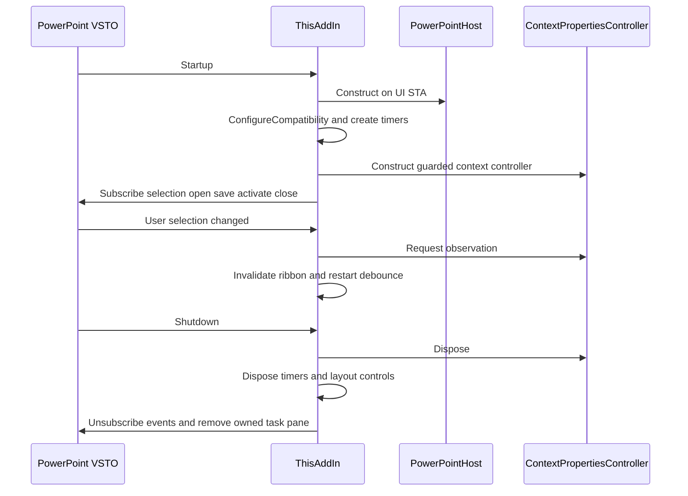
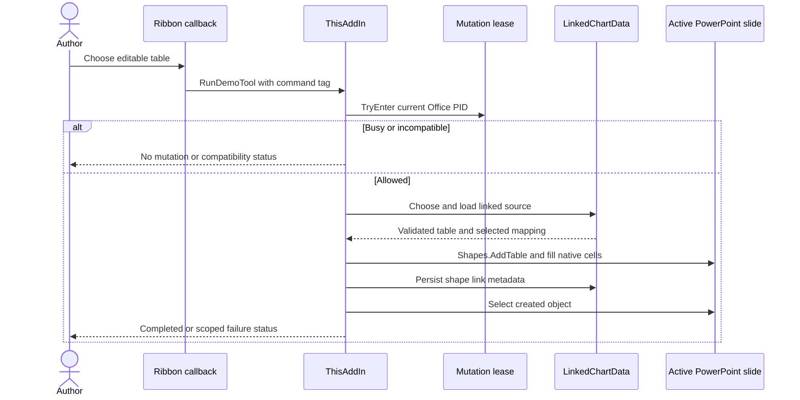
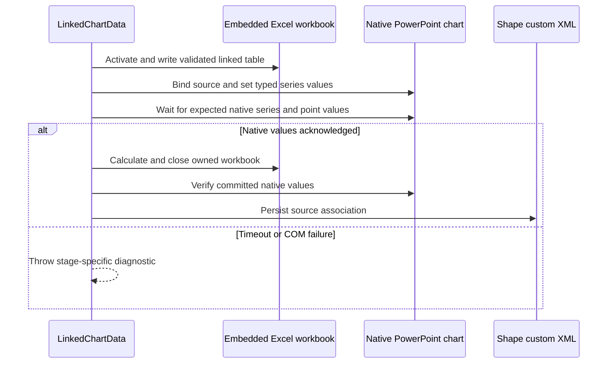
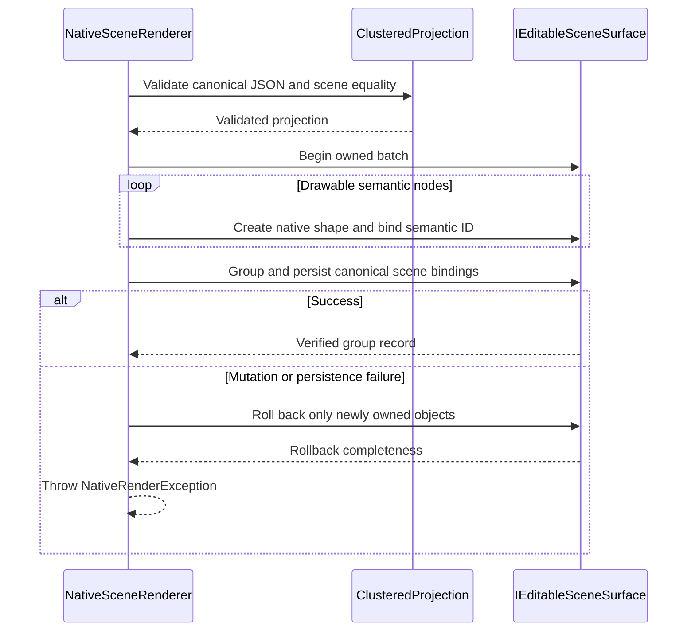
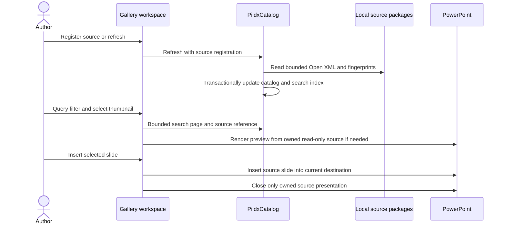
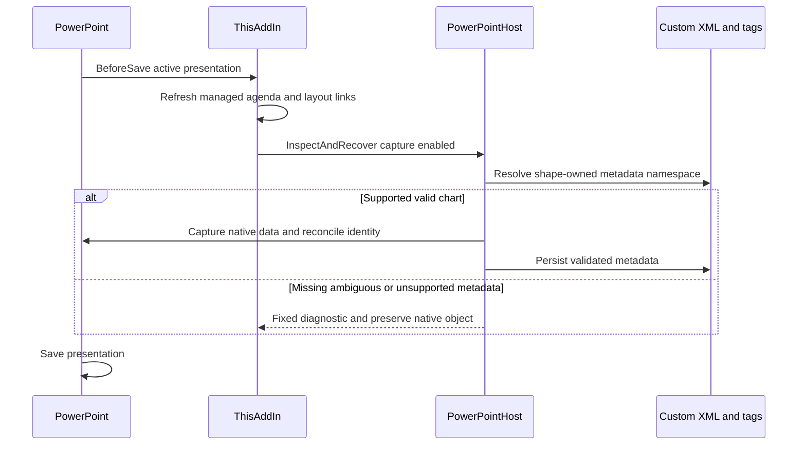

# Execution sequence diagrams

<!-- generated-toc -->
## Contents

- [Add-in initialization and teardown](#add-in-initialization-and-teardown)
- [Ribbon action and native table](#ribbon-action-and-native-table)
- [Linked chart workbook commit](#linked-chart-workbook-commit)
- [Grouped-shape renderer transaction](#grouped-shape-renderer-transaction)
- [Library refresh, query and insertion](#library-refresh-query-and-insertion)
- [Save and recovery](#save-and-recovery)
<!-- end-generated-toc -->

## Add-in initialization and teardown

Source: `apps/powerpoint-vsto/ThisAddIn.cs:37`, `apps/powerpoint-vsto/ThisAddIn.cs:77`. Compatibility does not validate Office edition licensing. Context observation and host mutation have different permissions/lifetimes.

## Ribbon action and native table

The native table path writes editable cells with central vertical anchoring and centered paragraphs. It does not rasterize the result or create another report presentation. `apps/powerpoint-vsto/DemoTools.cs:247`; `apps/powerpoint-vsto/ThisAddIn.cs:133`.

## Linked chart workbook commit

`apps/powerpoint-vsto/DataSources.cs:166`. Closing an Excel workbook alone is not evidence that PowerPoint committed values; native chart observation is the acceptance condition. Fixed diagnostics deliberately omit source values. No sample-data fallback is permitted.

## Grouped-shape renderer transaction

`src/Chart.Renderers/NativeRenderingCore.cs:158`; `src/Chart.Renderers/PowerPointSceneSurface.cs:14`. Zero/missing values can have semantic bindings without drawable bars. Incomplete cleanup remains an error, rather than a success or permission to delete unrelated shapes.

## Library refresh, query and insertion

`src/Library.Core/PiidxCatalog.cs:1`; `src/Library.Core/PresentationSource.cs:1`; `apps/powerpoint-vsto/LocalLibraryGallery.cs:1`. PIIDX extraction does not itself render Office pixels. Source freshness and native-format fidelity are separate checks.

## Save and recovery

`apps/powerpoint-vsto/ThisAddIn.cs:318`; `apps/powerpoint-vsto/PowerPointHost.cs:48`. Open/window activation do not unconditionally mutate all decks. Do not infer that event-level catching means a failed mutation was fully transactional.
