# NexWave — Master Technical Design

Standalone evidence-grounded engineering handover. This document includes all46module designs and the complete190entry feature design; supporting CSV inventories preserve exhaustive mappings. Implementation source is not redistributed.

## Contents

- [1. Document control and baseline](#1-document-control-and-baseline)
- [2. Executive technical overview](#2-executive-technical-overview)
- [3. System context and scope](#3-system-context-and-scope)
- [4. Verified technology stack and dependencies](#4-verified-technology-stack-and-dependencies)
- [5. Architecture principles and decisions](#5-architecture-principles-and-decisions)
- [6. Enterprise and solution architecture](#6-enterprise-and-solution-architecture)
- [7. Application lifecycle and UI architecture](#7-application-lifecycle-and-ui-architecture)
- [8. Component and module architecture](#8-component-and-module-architecture)
- [9. Detailed feature design](#9-detailed-feature-design)
- [10. PowerPoint integration](#10-powerpoint-integration)
- [11. Rendering and native editing](#11-rendering-and-native-editing)
- [12. AI integration architecture](#12-ai-integration-architecture)
- [13. API and interface specifications](#13-api-and-interface-specifications)
- [14. Data models and persistence](#14-data-models-and-persistence)
- [15. Security architecture](#15-security-architecture)
- [16. Runtime and deployment architecture](#16-runtime-and-deployment-architecture)
- [17. Build installation configuration and release](#17-build-installation-configuration-and-release)
- [18. Execution sequences and activity diagrams](#18-execution-sequences-and-activity-diagrams)
- [19. Error handling and observability](#19-error-handling-and-observability)
- [20. Testing architecture and results](#20-testing-architecture-and-results)
- [21. Performance and scalability](#21-performance-and-scalability)
- [22. Operational maintenance](#22-operational-maintenance)
- [23. Known limitations and technical debt](#23-known-limitations-and-technical-debt)
- [24. Extension and development guidance](#24-extension-and-development-guidance)
- [25. Implementation and documentation traceability](#25-implementation-and-documentation-traceability)
- [26. Assumptions unknowns and unresolved questions](#26-assumptions-unknowns-and-unresolved-questions)
- [27. Appendices and supporting references](#27-appendices-and-supporting-references)

## 1. Document control and baseline

Export1.0; generated13-Nov-2026, Asia/Dubai; UTC 2026-11-13T06:32:02.175860+00:00. Repository baseline commit `ffaec352cbdca666f69f3c402d334108e4115933`. Exact byte/source preservation is in14-audit/source-preservation.json;234 tracked byte differences are GitEOL normalization only and generated easySetup/README.md is the sole non-EOLtracked difference. Source references use repository-relative path:line. No application code/config/dependency was changed. VERIFIED source/currentexecution, INFERRED, PLANNED, UNKNOWN and NOTIMPLEMENTED are distinct evidence labels. Review caveats are substantive: file accounting is not line-by-line proof or native acceptance.

## 2. Executive technical overview


### Executive technical summary

#### Actual system

NexWave is a Windows desktop PowerPoint add-in, hosted inside Office through VSTO/COM and .NETFramework4.8. WinForms provides taskpane/dialog/context controls. Native charts/tables/shapes remain PowerPoint-editable, with versioned CustomXMLPart/tag associations. Local Excel/CSV/JSON/XML links and explicit worksheet/range mappings feed chart/table operations. A local PIIDX SQLite/FTS catalog indexes PPTX/POTX metadata and native preview/source-import workflows. PureJS/TS calculations and strict scene contracts are separate developer tooling.

#### Implementation distinctions

V3 chart source exists but is not in active compile lists. Generic scene DTOs and the six-family TS engine do not establish native renderer coverage: the semantic native surface is a bounded clustered rectangle profile with explicit omissions. Source-original497slides, procedural520layouts and16sampled original fidelity cases measure different things. Managed elements and contextual controls have explicit selection/metadata/geometry limits.

No authenticated Azure client, running on-prem service/API, enterprise RBAC/SSO, governed model-action executor or central scheduler is implemented. Profiles/schema and approved architecture intentions remain scaffolds/planning.

#### Engineering priorities

The audit identifies an independently unverified NuGet fallback download in TestS1; scanner-evidence scope excludingPIIDX; related implicitXML readers; source/procedural/proprietary-content provenance distinctions; native acceptance/DPI/Office-estate gaps; host-dependent package fingerprints; and test-oracle/cleanup weaknesses. These are documented, not fixed, in this assignment.

Current constrained validation passes229assertions, TypeScript type checking and50PowerShell syntax parses. No new Office integration, signed deployment or vulnerability scan was run. Complete source-preservation hashes, source/test/module maps and explicit metric denominators support engineering handover without implying complete product acceptance.


## 3. System context and scope


### Repository overview

**VERIFIED:** baseline commit `ffaec352cbdca666f69f3c402d334108e4115933` (3-Nov-2026), inspected live checkout `C:/Srini/powerpoint-intelligence/powerpoint-intelligence` on13-Nov-2026. The inventory excludes project-export to avoid recursively documenting itself. Every discovered regular file is listed; links are classified without traversal. Git/compiled/vendor/artifact data is counted but not confused with authored implementations.

- Repository inventory: **30,301 file/link records**, **2,736,823,893 bytes**.
- Authored code: **204** `.cs/.ps1/.py/.ts/.mjs/.tsx` files outside generated/vendor/VCS/export areas.
- Relevant decoded source/config/schema/documentation text: **339** files.
- Symbol locator: **1,833 lexical candidates**, not an AST-derived API count.
- Inventory read/hash errors: **0**.

| Area | Actual responsibility | Evidence interpretation |
|---|---|---|
| apps/powerpoint-vsto | VSTO Framework4.8 add-in, WinForms UI, COM features, codecs, local gallery | Active project compile items determine production inclusion |
| src/Chart.Domain | v2 canonical JSON, S0 import; authored V3 files | V3 excluded from active projects |
| src/Chart.Renderers and Shared.Contracts | strict scene contracts/hash, clustered native feasibility renderer, bounded JSON | Native capabilities narrower than generic scene DTO types |
| src/Library.Core | independent PIIDX SQLite/catalog, source extraction, preview/config/watch | Local searchable catalog, not proprietary index loading |
| packages/chart-core/domain/engine | deterministicJS/TS, schema validation and offline scene/SVG tools | Not an OfficeJS frontend or deployed network worker |
| services/ai-gateway | JSON schema and explicit unimplemented README | Planned service only |
| scripts and easySetup | compilation/test/cache/security/diagnostics and dual-bitness signed setup | Some paths write artifacts/install state and are not run during this export |
| tests/.github | custom Console, Node and unittest suites and limited CI | Test existence is not execution/line coverage |
| docs | requirements, decisions, prior evidence and remediation records | Historical/design records are secondary to source |
| artifacts | cached runners, receipts, snapshots, prior evidence/build products | Generated and historical; not additional source modules |

`git-baseline.json` distinguishes235 byte differences from HEAD:234 are CRLF-only; the sole remaining tracked difference is generated `easySetup/README.md`. Source is therefore pinned by actual per-file SHA256 as well as commit, without implying functional uncommitted changes. Untracked ignored deployment assets/dependencies remain in the inventory. No existing export was present, so no prior export was overwritten.


## 4. Verified technology stack and dependencies


### Verified technology stack

| Technology | Version/target | Role and limitation | Source |
|---|---|---|---|
| C# | 7.3; .NET Framework4.8 | VSTO and standalone domain projects, explicit compile lists | apps/powerpoint-vsto/PowerPointIntelligence.csproj:9 |
| Office | PowerPoint COM and VSTO; Office15 PIAs embedded | Desktop Office16 API baseline policy; profiles do not certify2016/2019/365 builds | apps/powerpoint-vsto/OfficeCompatibility.cs:1 |
| UI | Windows Forms/System.Drawing | Taskpane, dialogs, floating properties, procedural icons | apps/powerpoint-vsto/ThisAddIn.cs:88 |
| TypeScript/JS | Node engine>=24; chart-core/domain>=20 | Pure deterministic calculations/strict schemas and offlineCLI; current Nodev24.14.0 | packages/chart-engine/package.json:1 |
| SQLite | OS winsqlite3.dll; FTS5 capability required | Native bridge and exact PIIDX schema checks; not shippedsqlitebundle | src/Library.Core/NativeSqlite.cs:1 |
| JSON | Newtonsoft.Json13.0.3; AJV8.20.0 | Runtime domain decoding vs Node schema developer validation | src/Chart.Domain/Chart.Domain.csproj:12 |
| Build | VisualStudio/MSBuild/Roslyn, PowerShell | WindowsOffice tools and signing trust; no solutionfile | scripts/Install-Local.ps1:1 |
| AI/API | Schema/profile scaffold only | No HTTP server, SDK client, liveAzure calls or identity middleware | services/ai-gateway/README.md:1 |

No React/Electron/browser frontend, Office.js add-in, SmartArt authoring engine, cloud function, ASP.NET runtime service or enterprise database implementation was found in production source. Their presence in requirements does not establish implementation. Dependency currency/CVE status was not queried online; versions below are the inspected lock/project declarations.


### Dependency inventory

| Manifest | Kind | Name | Version | Resolution/integrity |
|---|---|---|---|---|
| apps/powerpoint-vsto/PowerPointIntelligence.csproj | Reference | Newtonsoft.Json | project/reference identity | ..\..\artifacts\refs\newtonsoft\lib\net45\Newtonsoft.Json.dll |
| apps/powerpoint-vsto/PowerPointIntelligence.csproj | Reference | System.IO.Compression | project/reference identity | framework/tooling resolution |
| apps/powerpoint-vsto/PowerPointIntelligence.csproj | Reference | System.IO.Compression.FileSystem | project/reference identity | framework/tooling resolution |
| apps/powerpoint-vsto/PowerPointIntelligence.csproj | Reference | System | project/reference identity | framework/tooling resolution |
| apps/powerpoint-vsto/PowerPointIntelligence.csproj | Reference | System.Core | project/reference identity | framework/tooling resolution |
| apps/powerpoint-vsto/PowerPointIntelligence.csproj | Reference | System.Xml | project/reference identity | framework/tooling resolution |
| apps/powerpoint-vsto/PowerPointIntelligence.csproj | Reference | System.Xml.Linq | project/reference identity | framework/tooling resolution |
| apps/powerpoint-vsto/PowerPointIntelligence.csproj | Reference | System.Configuration | project/reference identity | framework/tooling resolution |
| apps/powerpoint-vsto/PowerPointIntelligence.csproj | Reference | System.Runtime.Serialization | project/reference identity | framework/tooling resolution |
| apps/powerpoint-vsto/PowerPointIntelligence.csproj | Reference | System.Windows.Forms | project/reference identity | framework/tooling resolution |
| apps/powerpoint-vsto/PowerPointIntelligence.csproj | Reference | System.Drawing | project/reference identity | framework/tooling resolution |
| apps/powerpoint-vsto/PowerPointIntelligence.csproj | Reference | Microsoft.CSharp | project/reference identity | framework/tooling resolution |
| apps/powerpoint-vsto/PowerPointIntelligence.csproj | Reference | office, Version=15.0.0.0, Culture=neutral, PublicKeyToken=71 e9bce111e9429c | project/reference identity | framework/tooling resolution |
| apps/powerpoint-vsto/PowerPointIntelligence.csproj | Reference | Microsoft.Office.Interop.PowerPoint, Version=15.0.0.0, Culture=neutral, PublicKeyToken=71 e9bce111e9429c | project/reference identity | framework/tooling resolution |
| apps/powerpoint-vsto/PowerPointIntelligence.csproj | Reference | Microsoft.Office.Tools.Common, Version=10.0.0.0, Culture=neutral, PublicKeyToken=b03f5f7f11d50a3a | project/reference identity | framework/tooling resolution |
| apps/powerpoint-vsto/PowerPointIntelligence.csproj | Reference | Microsoft.Office.Tools, Version=10.0.0.0, Culture=neutral, PublicKeyToken=b03f5f7f11d50a3a | project/reference identity | framework/tooling resolution |
| apps/powerpoint-vsto/PowerPointIntelligence.csproj | Reference | Microsoft.Office.Tools.v4.0.Framework, Version=10.0.0.0, Culture=neutral, PublicKeyToken=b03f5f7f11d50a3a | project/reference identity | framework/tooling resolution |
| apps/powerpoint-vsto/PowerPointIntelligence.csproj | Reference | Microsoft.Office.Tools.Common.v4.0.Utilities | project/reference identity | framework/tooling resolution |
| apps/powerpoint-vsto/PowerPointIntelligence.csproj | Reference | Microsoft.VisualStudio.Tools.Applications.Runtime, Version=10.0.0.0, Culture=neutral, PublicKeyToken=b03f5f7f11d50a3a | project/reference identity | framework/tooling resolution |
| src/Chart.Domain/Chart.Domain.csproj | Reference | System | project/reference identity | framework/tooling resolution |
| src/Chart.Domain/Chart.Domain.csproj | Reference | System.Core | project/reference identity | framework/tooling resolution |
| src/Chart.Domain/Chart.Domain.csproj | Reference | System.Xml | project/reference identity | framework/tooling resolution |
| src/Chart.Domain/Chart.Domain.csproj | PackageReference | Newtonsoft.Json | 13.0.3 | framework/tooling resolution |
| packages/chart-domain/package-lock.json | locked npm | node_modules/ajv | 8.20.0 | integrity recorded |
| packages/chart-domain/package-lock.json | locked npm | node_modules/fast-deep-equal | 3.1.3 | integrity recorded |
| packages/chart-domain/package-lock.json | locked npm | node_modules/fast-uri | 3.1.9 | integrity recorded |
| packages/chart-domain/package-lock.json | locked npm | node_modules/json-schema-traverse | 1.0.0 | integrity recorded |
| packages/chart-domain/package-lock.json | locked npm | node_modules/require-from-string | 2.0.2 | integrity recorded |
| packages/chart-engine/package-lock.json | locked npm | node_modules/ajv | 8.20.0 | integrity recorded |
| packages/chart-engine/package-lock.json | locked npm | node_modules/fast-deep-equal | 3.1.3 | integrity recorded |
| packages/chart-engine/package-lock.json | locked npm | node_modules/fast-uri | 3.1.9 | integrity recorded |
| packages/chart-engine/package-lock.json | locked npm | node_modules/json-schema-traverse | 1.0.0 | integrity recorded |
| packages/chart-engine/package-lock.json | locked npm | node_modules/require-from-string | 2.0.2 | integrity recorded |
| packages/chart-engine/package-lock.json | locked npm | node_modules/typescript | 5.9.3 | integrity recorded |

Installed dependency trees and DLLs are separately inventoried as binary/vendor material, not source-authored features. Office/VSTO and winsqlite3 are platform/runtime prerequisites. CI uses actions/checkout@v4 and actions/setup-node@v4; immutable action commit pinning is not present. Lockfiles pin npm versions/integrity but do not authenticate every NuGet/Office/platform dependency. Test-S1 has an independent NuGet download path requiring review (security gap SEC-01), so a lockfile elsewhere must not be generalized to all consumers. No dependencies were updated/installed during this export.


## 5. Architecture principles and decisions


### Implemented decisions and unresolved architecture

The controlling decision register is `docs/DECISIONS.md:1`. This export does not update or silently resolve it.

| Decision family | Observed implementation | Boundary |
|---|---|---|
| AD-001/006 Windows VSTO | Framework 4.8 C# add-in and Office COM adapters | Actual estate/version certification is not established by a profile string |
| AD-004/009 native editability/metadata | Native Office charts/shapes and CustomXMLPart plus tags | Metadata validity is checked; native edits can create detectable divergence |
| AD-008 deterministic TypeScript | Six basic engine families, strict scene contracts, offline CLI | Not a complete native renderer for all required chart families |
| AD-013 grouped shapes | Native scene surface and original template compositions | Grouped shapes are editable drawing objects, not native Excel-backed chart types |
| AD-014/017 explicit linked data | Local source selection and confirmed worksheet/range mapping | Changed headers/missing files stop refresh; no enterprise scheduling |
| AD-015/016/019 libraries | Procedural 520-layout catalog and local original-file source library | Different content modes; licensed source reuse is not independently authored parity |
| AD-018 raster tolerance | Bounded edge-local antialias comparison plus native geometry/format checks | Sixteen original slides are a sampled historical fidelity test, not all 497 |
| AD-020/021 setup and brand | Dual-bitness self-contained VSTO setup and NexWave display name | Compatibility IDs/storage names remain PowerPointIntelligence |
| AD-002/003/007 on-prem and AI | Service schema/profile scaffolds | Production service, Azure invocation, RBAC/SSO remain unimplemented |

Open Q-001..Q-012 include exact tested Office builds, identity, Azure resource/networking/data policies, enterprise infrastructure, signing distribution trust, licensing and performance/locale policy. Local SQLite implementation does not resolve enterprise Q-006. Configurable URLs do not resolve auth/data-governance Q-003..Q-005. Historical owner S0 acceptance is a project decision, not fresh runtime evidence in this export.

Design tension: active procedural/native/original-library paths and legacy S0/v2/V3 contracts coexist. Extension work must choose a production representation and codec intentionally, preserve source compatibility identities and add explicit migration/round-trip tests before claiming a new persisted version. `src/Chart.Domain/Chart.Domain.csproj:12`; `src/Chart.Domain/S0Migration.cs:1`.


## 6. Enterprise and solution architecture


### Enterprise architecture

**VERIFIED — source architecture, not enterprise deployment certification.** The running product is a Windows desktop add-in hosted in the interactive PowerPoint process. Authors invoke ribbon callbacks, dialogs, a task pane and selection-following properties. Its primary data boundary is the active presentation, with user-selected files and a per-user local catalog as supporting stores. The Microsoft Office process, its COM apartment, VSTO loader, .NET Framework and Windows filesystem are platform dependencies. `apps/powerpoint-vsto/ThisAddIn.cs:37`; `apps/powerpoint-vsto/PowerPointHost.cs:48`.

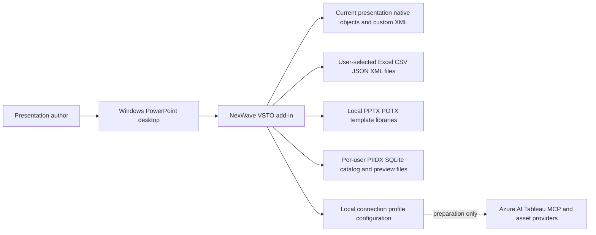

The context diagram's dotted provider edge is configuration preparation, not a live inference or integration path. `services/ai-gateway` contains a schema and README; no deployable web service, database migration service, tenant middleware or identity server exists there. `services/ai-gateway/README.md:1`. Treat on-prem hosting and Azure OpenAI as approved intentions whose implementation and network/data-classification decisions remain open. `docs/DECISIONS.md:1`.

Trust boundaries are (1) signed installation into an Office user session; (2) file parsing and canonical model validation before mutation; (3) COM UI/STA ownership; (4) presentation metadata and native-object reconciliation; and (5) package/index integrity checks for local libraries. The cross-process mutation mutex coordinates cooperating add-in/test writers, not malicious processes or Office's own internal operations. `apps/powerpoint-vsto/PowerPointHost.cs:14`.

No RBAC/SSO/tenant isolation or encrypted enterprise storage can be inferred from local profile configuration. Sharing generated reports, licensed assets and source workbooks remains an organizational process. See [security](../09-security/security-architecture.md), [AI](../06-ai-architecture/ai-solution-architecture.md) and [deployment](../11-build-deployment/deployment-guide.md).


### Solution and container architecture

The unit of desktop deployment is the signed VSTO manifest/payload, loaded by PowerPoint. C# source is compiled from explicit project items, including linked domain/rendering/library sources. There is no `.sln` in this baseline; the two `.csproj` files are the build entry points. A source folder's presence does not establish inclusion: V3 contracts are absent from both active C# project compile lists. `src/Chart.Domain/Chart.Domain.csproj:12`; `apps/powerpoint-vsto/PowerPointIntelligence.csproj:39`.

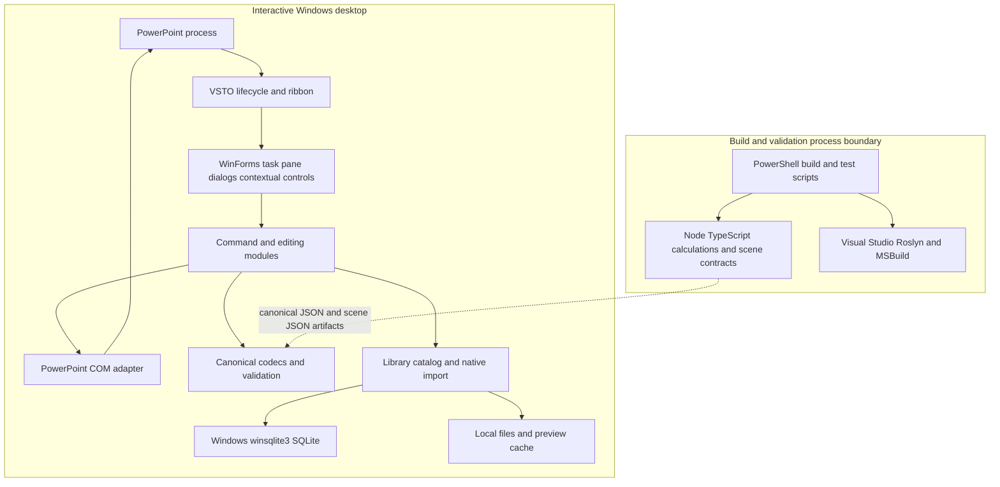

Node tooling validates deterministic calculations and emits a geometry-only scene when its CLI is invoked. The production VSTO adapter is not documented as launching Node on every chart command; C# supplies its own validated clustered projection. `packages/chart-engine/tools/render-chart-v2.mjs:9`; `src/Chart.Renderers/NativeRenderingCore.cs:18`.

State is split across PPTX custom XML/tags, linked local input files, local JSON/XML configuration, PIIDX SQLite and PNG previews, plus build/cache receipts. There is no deployed on-prem application database in the repository. Local PIIDX is implemented and is separate from the unresolved enterprise database choice. `src/Library.Core/PiidxSchema.cs:1`; `docs/DECISIONS.md:1`.


## 7. Application lifecycle and UI architecture


### Application architecture

#### Startup and lifecycle

VSTO creates the generated `ThisAddIn` host item and calls the application's startup handler. That handler constructs the host adapter, starts layout timing, prepares an agenda timer, evaluates Office compatibility, creates the context-property controller, subscribes selection/double-click/open/save/activate/close events and invalidates an existing ribbon. The 750 ms layout and 650 ms agenda intervals are WinForms UI scheduling, not backend workers. `apps/powerpoint-vsto/ThisAddIn.cs:37`.

Compatibility loads the deployed DLL configuration and compares API major 16, requested architecture and optional executable build floor. An Office API string of 16.0 cannot distinguish 2016, 2019 and Microsoft 365 licensing/update channels. Invalid configuration disables document commands rather than guessing. `apps/powerpoint-vsto/ThisAddIn.cs:52`; `apps/powerpoint-vsto/OfficeCompatibility.cs:1`.

#### Command execution

Ribbon callback objects forward to `ThisAddIn`, which applies `busy`, host, compatibility and mutation-lease checks. `EnsurePane` creates/rebinds a task pane to the current window on demand. User action code executes while holding a named mutex for the PowerPoint PID. Specific failures become status text; a generic catch reports operation unavailability. Cancellation is a no-op. The `finally` path resets busy and requests a context refresh. `apps/powerpoint-vsto/ThisAddIn.cs:133`.

Selection changes request a property snapshot, invalidate controls and restart the debounce timer. Activation avoids creating/discarding panes or rewriting metadata directly in the COM callback; it marks pane refresh. Before-save work targets only the active presentation and refreshes managed agenda/layout/chart state. These handlers use an exception boundary to prevent managed exceptions escaping Office callbacks. `apps/powerpoint-vsto/ThisAddIn.cs:318`; `apps/powerpoint-vsto/PowerPointHost.cs:34`.

#### Shutdown and resource ownership

Shutdown disposes the context controller, timers and layout form, unsubscribes all registered application events and removes the task pane. Native COM object lifetime is handled locally in modules; the repository does not implement a general reference-count tracker proving every RCW release. Never release shared Office application objects indiscriminately. `apps/powerpoint-vsto/ThisAddIn.cs:77`. See [interoperability](../04-powerpoint-integration/interoperability.md).

#### Runtime limits

The floating property box is foreground/selection-sensitive and can hide while Excel owns focus. Mutation coordination does not make COM calls thread-safe. Live service operations, enterprise scheduling, authorization and model invocation are not implemented merely because command labels exist. Details are mapped in [feature status](../05-features/feature-status-matrix.md).


## 8. Component and module architecture


### Component architecture

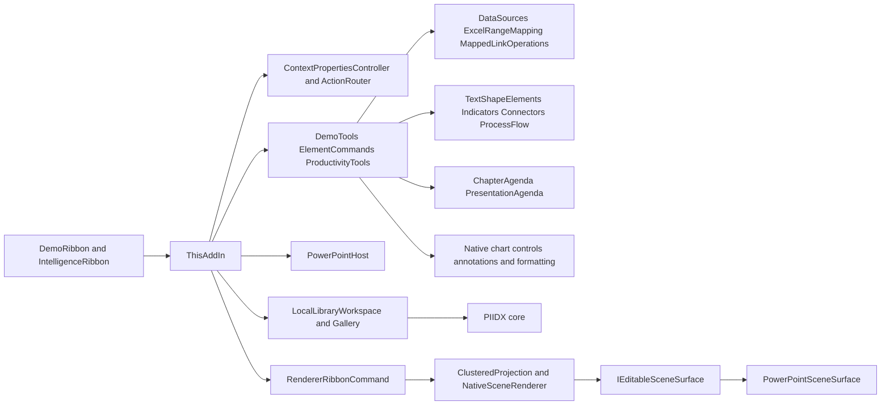

The graph shows principal call direction, not exhaustive dependency injection. Most features are static/helper classes receiving a PowerPoint Application/Shape/Selection; there is no general DI container, plugin discovery framework or durable command-bus service. The host interface and editable-surface interface provide narrower test seams. `apps/powerpoint-vsto/Contracts.cs:7`; `src/Chart.Renderers/NativeRenderingCore.cs:136`.

`Demo` names are historical implementation identifiers in active production compile items, not proof a source is unused. Conversely V3 model files and the AI schema are not evidence of a running product capability. COM automation exposure is explicitly limited to `IDemoAutomation`; it is a local add-in automation object, not a REST API. `apps/powerpoint-vsto/DemoApi.cs:12`.

See [module inventory](../03-modules/module-inventory.md) for every coherent module and [dependency matrix](../03-modules/module-dependency-matrix.md) for evidence and test seams. Package namespaces preserve `PowerPointIntelligence` for compatibility while visible branding is NexWave.


### Module inventory

**VERIFIED source designs:** coherent modules are counted by design document, not class or directory count. A source file may serve several related modules; the source mapping preserves that many-to-many relationship. Each design addresses the17 required dimensions. Runtime evidence and unsupported paths are explicitly separate.

| ID | Module | Design | Sources |
|---|---|---|---|
| VSTO-01 | VSTO lifecycle, compatibility and S0 native host | [vsto/lifecycle-host](../03-modules/individual-module-designs/vsto/lifecycle-host.md) | 9 |
| VSTO-02 | Ribbon catalog, dispatch, icons, browser and automation facade | [vsto/commands-ribbon](../03-modules/individual-module-designs/vsto/commands-ribbon.md) | 7 |
| VSTO-03 | Linked files, Excel mapping and source manager | [vsto/linked-data](../03-modules/individual-module-designs/vsto/linked-data.md) | 5 |
| VSTO-04 | Native axes, series and annotations | [vsto/native-chart-controls](../03-modules/individual-module-designs/vsto/native-chart-controls.md) | 3 |
| VSTO-05 | Selection-aware floating property box | [vsto/context-properties](../03-modules/individual-module-designs/vsto/context-properties.md) | 7 |
| VSTO-06 | Native formatting plans and restoration transactions | [vsto/native-formatting](../03-modules/individual-module-designs/vsto/native-formatting.md) | 1 |
| VSTO-07 | Text box, pentagon, chevron and rounded native elements | [vsto/managed-text](../03-modules/individual-module-designs/vsto/managed-text.md) | 2 |
| VSTO-08 | Process-grid layout and retained structural history | [vsto/process-grid](../03-modules/individual-module-designs/vsto/process-grid.md) | 1 |
| VSTO-09 | Harvey-ball and checkbox editable vectors | [vsto/indicators](../03-modules/individual-module-designs/vsto/indicators.md) | 1 |
| VSTO-10 | Universal connector geometry and endpoint bindings | [vsto/connectors](../03-modules/individual-module-designs/vsto/connectors.md) | 1 |
| VSTO-11 | Managed chapters/contents and legacy presentation agenda | [vsto/agendas](../03-modules/individual-module-designs/vsto/agendas.md) | 3 |
| VSTO-12 | Designed template layouts, editable fields and palettes | [vsto/template-catalog](../03-modules/individual-module-designs/vsto/template-catalog.md) | 1 |
| VSTO-13 | Template insertion, source-original sessions and layout links | [vsto/template-insertion](../03-modules/individual-module-designs/vsto/template-insertion.md) | 1 |
| VSTO-14 | Thumbnail gallery and PIIDX workspace UI | [vsto/library-gallery](../03-modules/individual-module-designs/vsto/library-gallery.md) | 2 |
| VSTO-15 | Local symbol, decimal, picture-copy and chart workbook tools | [vsto/productivity](../03-modules/individual-module-designs/vsto/productivity.md) | 1 |
| VSTO-16 | Read-only presentation heuristics and navigation | [vsto/quality](../03-modules/individual-module-designs/vsto/quality.md) | 1 |
| VSTO-17 | Canonical XML ownership and compensating replacement | [vsto/xml-attachments](../03-modules/individual-module-designs/vsto/xml-attachments.md) | 1 |
| VSTO-18 | Nonsecret external-service configuration UI | [vsto/service-config](../03-modules/individual-module-designs/vsto/service-config.md) | 1 |
| VSTO-19 | Native scene-renderer ribbon adapter | [vsto/renderer-bridge](../03-modules/individual-module-designs/vsto/renderer-bridge.md) | 1 |
| domain-v2 | Canonical chart v2 and explicit S0 migration | [core/domain-v2](../03-modules/individual-module-designs/core/domain-v2.md) | 4 |
| domain-v3 | Authored chart v3 options and codec | [core/domain-v3](../03-modules/individual-module-designs/core/domain-v3.md) | 2 |
| strict-json | Bounded JSON and Unicode utilities | [core/strict-json](../03-modules/individual-module-designs/core/strict-json.md) | 1 |
| scene-contract | Scene DTOs and cross-language hash boundary | [core/scene-contract](../03-modules/individual-module-designs/core/scene-contract.md) | 3 |
| native-renderer | Canonical projection and owned native shape renderer | [core/native-renderer](../03-modules/individual-module-designs/core/native-renderer.md) | 2 |
| sqlite | Windows native SQLite bridge | [core/sqlite](../03-modules/individual-module-designs/core/sqlite.md) | 1 |
| piidx-schema | Versioned independent PIIDX schema | [core/piidx-schema](../03-modules/individual-module-designs/core/piidx-schema.md) | 1 |
| source-extraction | Read-only PPTX/POTX metadata extraction | [core/source-extraction](../03-modules/individual-module-designs/core/source-extraction.md) | 1 |
| catalog | Transactional PIIDX registration and refresh | [core/catalog](../03-modules/individual-module-designs/core/catalog.md) | 1 |
| catalog-query | PIIDX query models, search and navigation | [core/catalog-query](../03-modules/individual-module-designs/core/catalog-query.md) | 3 |
| preview-cache | Validated PNG derivative cache | [core/preview-cache](../03-modules/individual-module-designs/core/preview-cache.md) | 1 |
| library-config | Library profile and explicit legacy registration migration | [core/library-config](../03-modules/individual-module-designs/core/library-config.md) | 1 |
| library-refresh | Background filesystem refresh coordinator | [core/library-refresh](../03-modules/individual-module-designs/core/library-refresh.md) | 1 |
| path-policy | Shared selected-input and generated-output policy | [core/path-policy](../03-modules/individual-module-designs/core/path-policy.md) | 1 |
| chart-calculations | Pure JavaScript and TypeScript numerical engines | [core/chart-calculations](../03-modules/individual-module-designs/core/chart-calculations.md) | 5 |
| ts-scene | TypeScript scene construction and v2 file adapter | [core/ts-scene](../03-modules/individual-module-designs/core/ts-scene.md) | 6 |
| svg-preview | Internal SVG geometry inspection | [core/svg-preview](../03-modules/individual-module-designs/core/svg-preview.md) | 2 |
| published-schemas | Published chart, scene and rendered-record schemas | [core/published-schemas](../03-modules/individual-module-designs/core/published-schemas.md) | 3 |
| OPS-01 | service-profiles | [operations/service-profiles](../03-modules/individual-module-designs/operations/service-profiles.md) | 4 |
| OPS-02 | com-automation | [operations/com-automation](../03-modules/individual-module-designs/operations/com-automation.md) | 2 |
| OPS-03 | packaging-build | [operations/packaging-build](../03-modules/individual-module-designs/operations/packaging-build.md) | 12 |
| OPS-04 | deployment-bootstrap | [operations/deployment-bootstrap](../03-modules/individual-module-designs/operations/deployment-bootstrap.md) | 1 |
| OPS-05 | build-provenance | [operations/build-provenance](../03-modules/individual-module-designs/operations/build-provenance.md) | 13 |
| OPS-06 | diagnostics | [operations/diagnostics](../03-modules/individual-module-designs/operations/diagnostics.md) | 4 |
| OPS-07 | validation-orchestration | [operations/validation-orchestration](../03-modules/individual-module-designs/operations/validation-orchestration.md) | 27 |
| OPS-08 | offline-alignment-repair | [operations/offline-alignment-repair](../03-modules/individual-module-designs/operations/offline-alignment-repair.md) | 3 |
| OPS-09 | artifact-maintenance | [operations/artifact-maintenance](../03-modules/individual-module-designs/operations/artifact-maintenance.md) | 4 |

The core map includes authored-but-uncompiled V3 and published schemas rather than hiding them. Operations designs include build/test/diagnostic tooling separately from runtime modules. No web backend is invented. See [source mapping](../03-modules/source-module-map.csv).


### VSTO lifecycle, compatibility and S0 native host

**VERIFIED — source implementation. Current runtime acceptance is not established by this design review.**

#### Purpose and implementation status

Create the in-process add-in, gate Office capabilities, manage per-window task panes and retain S0 clustered-column identity while preserving supported native edits.

Implemented local source is distinguished from supported subset/absent external behavior below. See current test evidence in the export testing chapter; do not treat historical logs or method existence as a current runtime pass.

#### Source locations and internal components

- `apps/powerpoint-vsto/ThisAddIn.cs:1` — ThisAddIn, IntelligenceRibbon.
- `apps/powerpoint-vsto/ThisAddIn.Designer.cs:1` — ThisAddIn.
- `apps/powerpoint-vsto/ThisAddIn.Designer.xml:1` — project/configuration/generated lifecycle metadata.
- `apps/powerpoint-vsto/OfficeCompatibility.cs:1` — OfficeSettings, OfficeCompatibilityResult, OfficeCompatibility.
- `apps/powerpoint-vsto/PowerPointHost.cs:1` — OfficeMutationLease, OfficeEventBoundary, PowerPointHost.
- `apps/powerpoint-vsto/Contracts.cs:1` — IPowerPointHost, ChartDocument, ChartSeries.
- `apps/powerpoint-vsto/MetadataCodec.cs:1` — MetadataCodec.
- `apps/powerpoint-vsto/PowerPointIntelligence.csproj:1` — project/configuration/generated lifecycle metadata.
- `apps/powerpoint-vsto/App.config:1` — project/configuration/generated lifecycle metadata.

#### Inputs, outputs, data structures and dependencies

Input: Office Application/selection, config, validated S0 ChartDocument. Output: chart, pane/status, CustomerData XML and PPI_CHART_ID tag. Dependencies: Office/VSTO PIAs, .NET Framework4.8, WinForms, System.Configuration and routed modules.

#### Internal execution and external integration

Startup creates PowerPointHost, a 750 ms layout timer and 650 ms debounced agenda/element timer. Compatibility loads the add-in DLL config and compares Office 16.0 API/build and process bitness. It subscribes selection/double-click/open/save/activation/close; Shutdown unsubscribes/disposes. Run acquires a process-specific named mutation lease, creates/rebinds the active-window pane, applies compatibility gating and catches failures. S0 AddChart2 writes literal-label embedded workbook values and attaches XML/identity. Check & Sync captures native edits and repairs valid duplicate GUIDs. BeforeSave only processes the active deck.

#### Configuration, validation and failure behavior

OfficeProfile auto/office2016/office2019/microsoft365, OfficeArchitecture any/x86/x64, OfficeMinimumVersion16.0. Profiles express policy, not automatic edition discovery. Project embeds Office15 interop types but runtime gates on16.0. STA enforced in host; explicitly rejected COM calls0x80010001 retry at100ms. Event exceptions contained; damaged metadata preserved.

#### Security considerations and cleanup

Local native calls run in the current Office user process and require supported selection/ownership; a mutex/selection key is not authentication or RBAC. File/metadata content must remain bounded and error text must not expose data or credentials. Explicit owned-resource cleanup and error/rollback paths are part of the cited implementation, not a guarantee that a failed COM server can always be restored.

#### Test references

Lexical module-class matches in test source (not instrumentation coverage; no test is claimed executed here):

- `tests/compatibility/OfficeCompatibilityTests.cs:13`.
- `tests/s0/DemoOfficeTests.cs:36`.
- `tests/s0/DemoScenario.cs:114`.
- `tests/s0/HostIntegrationTests.cs:111`.
- `tests/s0/LinkedChartDiagnostic.cs:27`.
- `tests/s0/MappedExcelOfficeTests.cs:23`.
- `tests/s0/MetadataTests.cs:21`.
- `tests/s0/WorkflowOfficeTests.cs:37`.
- `tests/s0/XmlPartUpdateTests.cs:36`.
- `tests/s1/DomainTests.cs:77`.

#### Known limitations and technical debt

S0 supports clustered-column only, <=1000 categories, <=100 series, <=1 MiB XML and top-level shape traversal. Structural native type/count/category changes are not migrated. Compensation can fail; use Undo. No separate command-bus/API service startup is wired by this module.

#### Extension points

Extend versioned host contracts with active-deck/UI-STA enforcement and native roundtrip tests; named mutex coordination is not an authorization boundary.

#### Classes, interfaces and method navigation

Method names below are source declarations; private/internal members are not public API promises. The source hash/review manifest gives exact reviewed bytes.

| Declaration | Kind | Source |
|---|---|---|
| `ThisAddIn` | class | `apps/powerpoint-vsto/ThisAddIn.cs:13` |
| `RequestComAddInAutomationService` | method | `apps/powerpoint-vsto/ThisAddIn.cs:29` |
| `OnStartup` | method | `apps/powerpoint-vsto/ThisAddIn.cs:37` |
| `ConfigureCompatibility` | method | `apps/powerpoint-vsto/ThisAddIn.cs:52` |
| `OnShutdown` | method | `apps/powerpoint-vsto/ThisAddIn.cs:77` |
| `EnsurePane` | method | `apps/powerpoint-vsto/ThisAddIn.cs:88` |
| `RemovePane` | method | `apps/powerpoint-vsto/ThisAddIn.cs:122` |
| `Run` | method | `apps/powerpoint-vsto/ThisAddIn.cs:133` |
| `InsertRenderedShapes` | method | `apps/powerpoint-vsto/ThisAddIn.cs:152` |
| `Insert` | method | `apps/powerpoint-vsto/ThisAddIn.cs:175` |
| `LinkDataSource` | method | `apps/powerpoint-vsto/ThisAddIn.cs:176` |
| `ChangeTemplatePalette` | method | `apps/powerpoint-vsto/ThisAddIn.cs:190` |
| `ChangeTemplateAlignment` | method | `apps/powerpoint-vsto/ThisAddIn.cs:195` |
| `OpenTemplateLibrary` | method | `apps/powerpoint-vsto/ThisAddIn.cs:196` |
| `OpenDemo` | method | `apps/powerpoint-vsto/ThisAddIn.cs:197` |
| `ShowContextProperties` | method | `apps/powerpoint-vsto/ThisAddIn.cs:212` |
| `RunProductivity` | method | `apps/powerpoint-vsto/ThisAddIn.cs:213` |
| `ElementEnabled` | method | `apps/powerpoint-vsto/ThisAddIn.cs:221` |
| `RunElement` | method | `apps/powerpoint-vsto/ThisAddIn.cs:222` |
| `ElementDoubleClick` | method | `apps/powerpoint-vsto/ThisAddIn.cs:223` |
| `WorkflowEnabled` | method | `apps/powerpoint-vsto/ThisAddIn.cs:229` |
| `RunWorkflow` | method | `apps/powerpoint-vsto/ThisAddIn.cs:242` |
| `RunDemo` | method | `apps/powerpoint-vsto/ThisAddIn.cs:270` |
| `OpenLayoutControls` | method | `apps/powerpoint-vsto/ThisAddIn.cs:276` |
| `OpenWorkspace` | method | `apps/powerpoint-vsto/ThisAddIn.cs:277` |
| `Inspect` | method | `apps/powerpoint-vsto/ThisAddIn.cs:278` |
| `ShowCompatibility` | method | `apps/powerpoint-vsto/ThisAddIn.cs:279` |
| `ShowSelection` | method | `apps/powerpoint-vsto/ThisAddIn.cs:286` |
| `SelectionChanged` | method | `apps/powerpoint-vsto/ThisAddIn.cs:296` |
| `RunHostEvent` | method | `apps/powerpoint-vsto/ThisAddIn.cs:301` |
| `Opened` | method | `apps/powerpoint-vsto/ThisAddIn.cs:308` |
| `Activated` | method | `apps/powerpoint-vsto/ThisAddIn.cs:310` |
| `Closed` | method | `apps/powerpoint-vsto/ThisAddIn.cs:316` |
| `BeforeSave` | method | `apps/powerpoint-vsto/ThisAddIn.cs:318` |
| `CreateRibbonExtensibilityObject` | method | `apps/powerpoint-vsto/ThisAddIn.cs:326` |
| `InternalStartup` | method | `apps/powerpoint-vsto/ThisAddIn.cs:328` |
| `IntelligenceRibbon` | class | `apps/powerpoint-vsto/ThisAddIn.cs:332` |
| `GetCustomUI` | method | `apps/powerpoint-vsto/ThisAddIn.cs:338` |
| `LoadImage` | method | `apps/powerpoint-vsto/ThisAddIn.cs:339` |
| `InsertRenderedShapes` | method | `apps/powerpoint-vsto/ThisAddIn.cs:340` |
| `InsertSample` | method | `apps/powerpoint-vsto/ThisAddIn.cs:341` |
| `LinkDataSource` | method | `apps/powerpoint-vsto/ThisAddIn.cs:342` |
| `GetDataSourceEnabled` | method | `apps/powerpoint-vsto/ThisAddIn.cs:343` |
| `InspectChart` | method | `apps/powerpoint-vsto/ThisAddIn.cs:344` |
| `ShowCompatibility` | method | `apps/powerpoint-vsto/ThisAddIn.cs:345` |
| `ShowWorkspace` | method | `apps/powerpoint-vsto/ThisAddIn.cs:346` |
| `ChangeTemplatePalette` | method | `apps/powerpoint-vsto/ThisAddIn.cs:347` |
| `ChangeTemplateAlignment` | method | `apps/powerpoint-vsto/ThisAddIn.cs:348` |
| `ShowLibraryLayout` | method | `apps/powerpoint-vsto/ThisAddIn.cs:349` |
| `ShowTemplateLibrary` | method | `apps/powerpoint-vsto/ThisAddIn.cs:350` |
| `ShowContextProperties` | method | `apps/powerpoint-vsto/ThisAddIn.cs:351` |
| `ShowDemo` | method | `apps/powerpoint-vsto/ThisAddIn.cs:352` |
| `GetWorkflowEnabled` | method | `apps/powerpoint-vsto/ThisAddIn.cs:353` |
| `RunWorkflowCommand` | method | `apps/powerpoint-vsto/ThisAddIn.cs:354` |
| `RunProductivityTool` | method | `apps/powerpoint-vsto/ThisAddIn.cs:355` |
| `GetElementEnabled` | method | `apps/powerpoint-vsto/ThisAddIn.cs:356` |
| `RunElementCommand` | method | `apps/powerpoint-vsto/ThisAddIn.cs:357` |
| `RunDemoTool` | method | `apps/powerpoint-vsto/ThisAddIn.cs:358` |
| `GetCommandEnabled` | method | `apps/powerpoint-vsto/ThisAddIn.cs:359` |
| `OnLoad` | method | `apps/powerpoint-vsto/ThisAddIn.cs:360` |
| `Refresh` | method | `apps/powerpoint-vsto/ThisAddIn.cs:361` |
| `ThisAddIn` | class | `apps/powerpoint-vsto/ThisAddIn.Designer.cs:9` |
| `Initialize` | method | `apps/powerpoint-vsto/ThisAddIn.Designer.cs:19` |
| `FinishInitialization` | method | `apps/powerpoint-vsto/ThisAddIn.Designer.cs:26` |
| `InitializeDataBindings` | method | `apps/powerpoint-vsto/ThisAddIn.Designer.cs:28` |
| `OnShutdown` | method | `apps/powerpoint-vsto/ThisAddIn.Designer.cs:35` |
| `OfficeSettings` | class | `apps/powerpoint-vsto/OfficeCompatibility.cs:9` |
| `Parse` | method | `apps/powerpoint-vsto/OfficeCompatibility.cs:15` |
| `Load` | method | `apps/powerpoint-vsto/OfficeCompatibility.cs:31` |
| `OfficeCompatibilityResult` | class | `apps/powerpoint-vsto/OfficeCompatibility.cs:50` |
| `OfficeCompatibility` | class | `apps/powerpoint-vsto/OfficeCompatibility.cs:59` |
| `Evaluate` | method | `apps/powerpoint-vsto/OfficeCompatibility.cs:61` |
| `Normalize` | method | `apps/powerpoint-vsto/OfficeCompatibility.cs:88` |
| `Deny` | method | `apps/powerpoint-vsto/OfficeCompatibility.cs:90` |
| `OfficeMutationLease` | class | `apps/powerpoint-vsto/PowerPointHost.cs:14` |
| `GetWindowThreadProcessId` | method | `apps/powerpoint-vsto/PowerPointHost.cs:19` |
| `TryEnter` | method | `apps/powerpoint-vsto/PowerPointHost.cs:20` |
| `ForAutomation` | method | `apps/powerpoint-vsto/PowerPointHost.cs:27` |
| `Dispose` | method | `apps/powerpoint-vsto/PowerPointHost.cs:32` |
| `OfficeEventBoundary` | class | `apps/powerpoint-vsto/PowerPointHost.cs:34` |
| `Run` | method | `apps/powerpoint-vsto/PowerPointHost.cs:37` |
| `PowerPointHost` | class | `apps/powerpoint-vsto/PowerPointHost.cs:48` |
| `CheckThread` | method | `apps/powerpoint-vsto/PowerPointHost.cs:58` |
| `GetSelectedSlideId` | method | `apps/powerpoint-vsto/PowerPointHost.cs:65` |
| `GetSelectedObjectIds` | method | `apps/powerpoint-vsto/PowerPointHost.cs:66` |
| `Shapes` | method | `apps/powerpoint-vsto/PowerPointHost.cs:80` |
| `Part` | method | `apps/powerpoint-vsto/PowerPointHost.cs:90` |
| `Read` | method | `apps/powerpoint-vsto/PowerPointHost.cs:105` |
| `Write` | method | `apps/powerpoint-vsto/PowerPointHost.cs:116` |
| `InsertEditableChart` | method | `apps/powerpoint-vsto/PowerPointHost.cs:166` |
| `SetData` | method | `apps/powerpoint-vsto/PowerPointHost.cs:185` |
| `Find` | method | `apps/powerpoint-vsto/PowerPointHost.cs:220` |
| `ReadChartMetadata` | method | `apps/powerpoint-vsto/PowerPointHost.cs:226` |
| `CopyEditableChartToActiveSlide` | method | `apps/powerpoint-vsto/PowerPointHost.cs:231` |
| `SaveChartMetadata` | method | `apps/powerpoint-vsto/PowerPointHost.cs:275` |
| `UpdateEditableChart` | method | `apps/powerpoint-vsto/PowerPointHost.cs:282` |
| `Capture` | method | `apps/powerpoint-vsto/PowerPointHost.cs:296` |
| `NativeSeriesValues` | method | `apps/powerpoint-vsto/PowerPointHost.cs:331` |
| `SeriesVector` | method | `apps/powerpoint-vsto/PowerPointHost.cs:335` |
| `RetryRejectedCall` | method | `apps/powerpoint-vsto/PowerPointHost.cs:345` |
| `InspectAndRecover` | method | `apps/powerpoint-vsto/PowerPointHost.cs:360` |
| `IPowerPointHost` | interface | `apps/powerpoint-vsto/Contracts.cs:7` |
| `ChartDocument` | class | `apps/powerpoint-vsto/Contracts.cs:17` |
| `ChartSeries` | class | `apps/powerpoint-vsto/Contracts.cs:27` |
| `MetadataCodec` | class | `apps/powerpoint-vsto/MetadataCodec.cs:10` |
| `Validate` | method | `apps/powerpoint-vsto/MetadataCodec.cs:16` |
| `Encode` | method | `apps/powerpoint-vsto/MetadataCodec.cs:34` |
| `Decode` | method | `apps/powerpoint-vsto/MetadataCodec.cs:46` |
| `Sample` | method | `apps/powerpoint-vsto/MetadataCodec.cs:60` |


### Ribbon catalog, dispatch, icons, browser and automation facade

**VERIFIED — source implementation. Current runtime acceptance is not established by this design review.**

#### Purpose and implementation status

Expose NexWave commands and searchable local tools while keeping descriptive requirements separate from executable commands.

Implemented local source is distinguished from supported subset/absent external behavior below. See current test evidence in the export testing chapter; do not treat historical logs or method existence as a current runtime pass.

#### Source locations and internal components

- `apps/powerpoint-vsto/DemoRibbon.cs:1` — DemoRibbon.
- `apps/powerpoint-vsto/DemoTools.cs:1` — GridPlanner, DemoTool, DemoTools, DemoStyle.
- `apps/powerpoint-vsto/RibbonIcons.cs:1` — RibbonIcons, PictureBridge.
- `apps/powerpoint-vsto/DemoWorkspace.cs:1` — DemoWorkspace.
- `apps/powerpoint-vsto/FeatureInventory.cs:1` — FeatureInventoryEntry, FeatureInventory.
- `apps/powerpoint-vsto/DemoInputs.cs:1` — DemoInputs.
- `apps/powerpoint-vsto/DemoApi.cs:1` — IDemoAutomation, DemoAutomation.

#### Inputs, outputs, data structures and dependencies

Inputs: command tags, current selection, prompts/files or fixture delegates and S0 JSON. Outputs: native edits, forms, local exports and COM observation. Dependencies: managed element/data/template/format/quality adapters and S0 host.

#### Internal execution and external integration

DemoRibbon.Create builds Office2009 customUI XML; IntelligenceRibbon forwards callbacks/tags. DemoTools.BuildCatalog binds IDs/delegates and generated arrange modes; Execute opens a native undo boundary. DemoWorkspace displays tools and requirement statuses. RibbonIcons draws local16/32px bitmap glyphs and bridges IPictureDisp. DemoInputs supplies per-instance fixture/UI ports. IDemoAutomation exposes build/version/ribbon/immutable properties state and bounded S0 JSON insertion, not HTTP.

#### Configuration, validation and failure behavior

BuildMarker is deployment freshness data. GetContextPropertiesState reads a volatile UI-published string. InsertChartJson requires the creating UI STA, validates <=1 MiB JSON/model and assigns fresh GUID/revision. No arbitrary AI-to-COM dispatch is present.

#### Security considerations and cleanup

Local native calls run in the current Office user process and require supported selection/ownership; a mutex/selection key is not authentication or RBAC. File/metadata content must remain bounded and error text must not expose data or credentials. Explicit owned-resource cleanup and error/rollback paths are part of the cited implementation, not a guarantee that a failed COM server can always be restored.

#### Test references

Lexical module-class matches in test source (not instrumentation coverage; no test is claimed executed here):

- `tests/library/LibraryBrowserTests.cs:30`.
- `tests/s0/ContextPropertiesOfficeTests.cs:60`.
- `tests/s0/ContextPropertiesTests.cs:29`.
- `tests/s0/DemoContractTests.cs:76`.
- `tests/s0/DemoOfficeTests.cs:35`.
- `tests/s0/DemoScenario.cs:107`.

#### Known limitations and technical debt

FeatureInventory labels are historical descriptive claims, not runtime proof. Simple arrange operations may rely on Undo rather than complete per-object rollback. Linked report adds seven chart slides to the same active deck with one linked source and no sample fallback. Office JavaScript/HTML task pane and SmartArt authoring are absent from the compiled graph.

#### Extension points

Add catalog/callback/icon/test entries together. Maintain separate counts for executable routes and requirement inventory; preserve stable internal names while visible brand is NexWave.

#### Classes, interfaces and method navigation

Method names below are source declarations; private/internal members are not public API promises. The source hash/review manifest gives exact reviewed bytes.

| Declaration | Kind | Source |
|---|---|---|
| `DemoRibbon` | class | `apps/powerpoint-vsto/DemoRibbon.cs:9` |
| `Create` | method | `apps/powerpoint-vsto/DemoRibbon.cs:12` |
| `ProductivityMenu` | method | `apps/powerpoint-vsto/DemoRibbon.cs:49` |
| `ElementMenu` | method | `apps/powerpoint-vsto/DemoRibbon.cs:55` |
| `Workflow` | method | `apps/powerpoint-vsto/DemoRibbon.cs:67` |
| `Tools` | method | `apps/powerpoint-vsto/DemoRibbon.cs:68` |
| `Group` | method | `apps/powerpoint-vsto/DemoRibbon.cs:75` |
| `Button` | method | `apps/powerpoint-vsto/DemoRibbon.cs:94` |
| `GridPlanner` | class | `apps/powerpoint-vsto/DemoTools.cs:11` |
| `Plan` | method | `apps/powerpoint-vsto/DemoTools.cs:13` |
| `Finite` | method | `apps/powerpoint-vsto/DemoTools.cs:27` |
| `DemoTool` | class | `apps/powerpoint-vsto/DemoTools.cs:29` |
| `ToString` | method | `apps/powerpoint-vsto/DemoTools.cs:33` |
| `DemoTools` | class | `apps/powerpoint-vsto/DemoTools.cs:38` |
| `Selected` | method | `apps/powerpoint-vsto/DemoTools.cs:44` |
| `Chart` | method | `apps/powerpoint-vsto/DemoTools.cs:52` |
| `BuildCatalog` | method | `apps/powerpoint-vsto/DemoTools.cs:59` |
| `Execute` | method | `apps/powerpoint-vsto/DemoTools.cs:138` |
| `CreateTour` | method | `apps/powerpoint-vsto/DemoTools.cs:139` |
| `Source` | method | `apps/powerpoint-vsto/DemoTools.cs:151` |
| `Text` | method | `apps/powerpoint-vsto/DemoTools.cs:153` |
| `Box` | method | `apps/powerpoint-vsto/DemoTools.cs:159` |
| `InsertChart` | method | `apps/powerpoint-vsto/DemoTools.cs:165` |
| `InsertCombo` | method | `apps/powerpoint-vsto/DemoTools.cs:186` |
| `GroupNew` | method | `apps/powerpoint-vsto/DemoTools.cs:187` |
| `ProcessFlow` | method | `apps/powerpoint-vsto/DemoTools.cs:196` |
| `Diagram` | method | `apps/powerpoint-vsto/DemoTools.cs:197` |
| `InsertGantt` | method | `apps/powerpoint-vsto/DemoTools.cs:219` |
| `InsertMekko` | method | `apps/powerpoint-vsto/DemoTools.cs:220` |
| `InsertWaterfall` | method | `apps/powerpoint-vsto/DemoTools.cs:221` |
| `Arrange` | method | `apps/powerpoint-vsto/DemoTools.cs:222` |
| `Grid` | method | `apps/powerpoint-vsto/DemoTools.cs:245` |
| `InsertTable` | method | `apps/powerpoint-vsto/DemoTools.cs:252` |
| `Agenda` | method | `apps/powerpoint-vsto/DemoTools.cs:258` |
| `PasteText` | method | `apps/powerpoint-vsto/DemoTools.cs:259` |
| `Font` | method | `apps/powerpoint-vsto/DemoTools.cs:260` |
| `SwitchDecimals` | method | `apps/powerpoint-vsto/DemoTools.cs:261` |
| `Language` | method | `apps/powerpoint-vsto/DemoTools.cs:262` |
| `ChartStyle` | method | `apps/powerpoint-vsto/DemoTools.cs:263` |
| `ValueLine` | method | `apps/powerpoint-vsto/DemoTools.cs:264` |
| `Difference` | method | `apps/powerpoint-vsto/DemoTools.cs:265` |
| `Cagr` | method | `apps/powerpoint-vsto/DemoTools.cs:266` |
| `Scan` | method | `apps/powerpoint-vsto/DemoTools.cs:267` |
| `InsertImage` | method | `apps/powerpoint-vsto/DemoTools.cs:268` |
| `ImportSlides` | method | `apps/powerpoint-vsto/DemoTools.cs:269` |
| `ApplyTemplate` | method | `apps/powerpoint-vsto/DemoTools.cs:270` |
| `ExportSlide` | method | `apps/powerpoint-vsto/DemoTools.cs:271` |
| `Brand` | method | `apps/powerpoint-vsto/DemoTools.cs:272` |
| `AxisTitle` | method | `apps/powerpoint-vsto/DemoTools.cs:273` |
| `CleanComments` | method | `apps/powerpoint-vsto/DemoTools.cs:274` |
| `SaveSlides` | method | `apps/powerpoint-vsto/DemoTools.cs:280` |
| `RoundData` | method | `apps/powerpoint-vsto/DemoTools.cs:292` |
| `StyleSheet` | method | `apps/powerpoint-vsto/DemoTools.cs:301` |
| `ImportJson` | method | `apps/powerpoint-vsto/DemoTools.cs:302` |
| `ExportJson` | method | `apps/powerpoint-vsto/DemoTools.cs:314` |
| `MiniToolbar` | method | `apps/powerpoint-vsto/DemoTools.cs:321` |
| `TableData` | method | `apps/powerpoint-vsto/DemoTools.cs:328` |
| `Library` | method | `apps/powerpoint-vsto/DemoTools.cs:348` |
| `AgendaCurrent` | method | `apps/powerpoint-vsto/DemoTools.cs:362` |
| `StyleFile` | method | `apps/powerpoint-vsto/DemoTools.cs:363` |
| `ExcelCagr` | method | `apps/powerpoint-vsto/DemoTools.cs:373` |
| `Prompt` | method | `apps/powerpoint-vsto/DemoTools.cs:379` |
| `OpenFile` | method | `apps/powerpoint-vsto/DemoTools.cs:389` |
| `SaveFile` | method | `apps/powerpoint-vsto/DemoTools.cs:394` |
| `ChooseFolder` | method | `apps/powerpoint-vsto/DemoTools.cs:399` |
| `Confirm` | method | `apps/powerpoint-vsto/DemoTools.cs:404` |
| `Notify` | method | `apps/powerpoint-vsto/DemoTools.cs:406` |
| `InsertAsset` | method | `apps/powerpoint-vsto/DemoTools.cs:408` |
| `DemoStyle` | class | `apps/powerpoint-vsto/DemoTools.cs:416` |
| `RibbonIcons` | class | `apps/powerpoint-vsto/RibbonIcons.cs:13` |
| `Key` | method | `apps/powerpoint-vsto/RibbonIcons.cs:22` |
| `Load` | method | `apps/powerpoint-vsto/RibbonIcons.cs:23` |
| `PictureBridge` | class | `apps/powerpoint-vsto/RibbonIcons.cs:44` |
| `Convert` | method | `apps/powerpoint-vsto/RibbonIcons.cs:47` |
| `Render` | method | `apps/powerpoint-vsto/RibbonIcons.cs:49` |
| `Line` | method | `apps/powerpoint-vsto/RibbonIcons.cs:65` |
| `Rect` | method | `apps/powerpoint-vsto/RibbonIcons.cs:67` |
| `Outline` | method | `apps/powerpoint-vsto/RibbonIcons.cs:69` |
| `Circle` | method | `apps/powerpoint-vsto/RibbonIcons.cs:71` |
| `Polygon` | method | `apps/powerpoint-vsto/RibbonIcons.cs:73` |
| `Letter` | method | `apps/powerpoint-vsto/RibbonIcons.cs:75` |
| `Arrow` | method | `apps/powerpoint-vsto/RibbonIcons.cs:81` |
| `Axes` | method | `apps/powerpoint-vsto/RibbonIcons.cs:91` |
| `Chart` | method | `apps/powerpoint-vsto/RibbonIcons.cs:92` |
| `Grid` | method | `apps/powerpoint-vsto/RibbonIcons.cs:151` |
| `Document` | method | `apps/powerpoint-vsto/RibbonIcons.cs:158` |
| `Slides` | method | `apps/powerpoint-vsto/RibbonIcons.cs:160` |
| `Folder` | method | `apps/powerpoint-vsto/RibbonIcons.cs:162` |
| `Palette` | method | `apps/powerpoint-vsto/RibbonIcons.cs:164` |
| `Refresh` | method | `apps/powerpoint-vsto/RibbonIcons.cs:166` |
| `Magnify` | method | `apps/powerpoint-vsto/RibbonIcons.cs:168` |
| `Chain` | method | `apps/powerpoint-vsto/RibbonIcons.cs:170` |
| `Align` | method | `apps/powerpoint-vsto/RibbonIcons.cs:172` |
| `TextLines` | method | `apps/powerpoint-vsto/RibbonIcons.cs:189` |
| `TextFrameIcon` | method | `apps/powerpoint-vsto/RibbonIcons.cs:194` |
| `Gallery` | method | `apps/powerpoint-vsto/RibbonIcons.cs:206` |
| `Gear` | method | `apps/powerpoint-vsto/RibbonIcons.cs:211` |
| `WorkflowIcon` | method | `apps/powerpoint-vsto/RibbonIcons.cs:216` |
| `Draw` | method | `apps/powerpoint-vsto/RibbonIcons.cs:246` |
| `DemoWorkspace` | class | `apps/powerpoint-vsto/DemoWorkspace.cs:8` |
| `RefreshList` | method | `apps/powerpoint-vsto/DemoWorkspace.cs:40` |
| `Selection` | method | `apps/powerpoint-vsto/DemoWorkspace.cs:53` |
| `FeatureInventoryEntry` | class | `apps/powerpoint-vsto/FeatureInventory.cs:2` |
| `FeatureInventory` | class | `apps/powerpoint-vsto/FeatureInventory.cs:3` |
| `DemoInputs` | class | `apps/powerpoint-vsto/DemoInputs.cs:9` |
| `IDemoAutomation` | interface | `apps/powerpoint-vsto/DemoApi.cs:12` |
| `DemoAutomation` | class | `apps/powerpoint-vsto/DemoApi.cs:22` |
| `GetVersion` | method | `apps/powerpoint-vsto/DemoApi.cs:29` |
| `GetBuildInfo` | method | `apps/powerpoint-vsto/DemoApi.cs:30` |
| `GetRibbonXml` | method | `apps/powerpoint-vsto/DemoApi.cs:31` |
| `GetRibbonLoaded` | method | `apps/powerpoint-vsto/DemoApi.cs:32` |
| `GetContextPropertiesState` | method | `apps/powerpoint-vsto/DemoApi.cs:34` |
| `InsertChartJson` | method | `apps/powerpoint-vsto/DemoApi.cs:35` |

#### Per-instance input ports (testability boundary)

`apps/powerpoint-vsto/DemoInputs.cs:9` defines these delegate ports. Null means use the production native dialog or behavior, rather than simulated success. Supplying a port exercises command logic, not the native picker's appearance.

| Port | Input / output contract |
|---|---|
| Prompt | prompt/default strings -> chosen string or cancellation |
| OpenFile | extension-filter string -> selected path |
| SaveFile | filter/default filename -> output path |
| Folder | no arguments -> selected folder |
| Confirm | message/caption -> boolean |
| Notify | message/caption -> void |
| EditTable | two-dimensional string values -> edited matrix |
| ChooseAsset | candidate string list -> selected index |
| ShowToolbar | Form -> void (test/UI handoff) |
| PresentationCreated | native Presentation -> void (observation hook) |

These are internal dependency-injection seams, not a generalized plugin execution engine or externally authenticated API.


### Linked files, Excel mapping and source manager

**VERIFIED — source implementation. Current runtime acceptance is not established by this design review.**

#### Purpose and implementation status

Link local files, select categories/series, render native editable objects and explicitly refresh eligible mapped charts.

Implemented local source is distinguished from supported subset/absent external behavior below. See current test evidence in the export testing chapter; do not treat historical logs or method existence as a current runtime pass.

#### Source locations and internal components

- `apps/powerpoint-vsto/DataSources.cs:1` — LinkedTable, LinkedTableProjection, LinkedChartData, DataSourceOption, DataSourceLink, DataSources.
- `apps/powerpoint-vsto/ExcelRangeMapping.cs:1` — ExcelRangeMapping, MappedExcelData.
- `apps/powerpoint-vsto/MappedLinkOperations.cs:1` — MappedLinkOperations.
- `apps/powerpoint-vsto/DataLinkManager.cs:1` — LocalLinkFileState, LocalLinkFileStatus, LinkObjectReference, LocalLinkSource, LocalLinkInventory, DataLinkInventory, DataLinkManager.
- `apps/powerpoint-vsto/DemoLinks.cs:1` — DemoWorkbookLink, DemoLinks.

#### Inputs, outputs, data structures and dependencies

Inputs: Excel/CSV/JSON/XML path, LinkedTable, mapping and native chart. Outputs: registered and shape-attached DataSourceLink, embedded workbook or native table/diagram. Dependencies: PathPolicy, Excel/PowerPoint COM, XmlPartUpdates and DataLinkInventory. Legacy DemoLinks uses a separate first-sheet .xlsx WorkbookLink namespace.

#### Internal execution and external integration

Data Source saves format/path/UTC/GUID after an extension-specific picker without parsing file data. At chart creation Load reads CSV, JSON headers/rows, XML table/header/row/cell or read-only Excel. Unmapped Excel reads first-sheet UsedRange then asks category/series; mapped Excel persists worksheet/A1 rectangle/header signature/zero-based columns. Write activates embedded workbook, performs a single Value2 matrix write, checks cells, binds source and waits for real native series values before and after close. Manager inventories registry/object references including groups, damaged/ambiguous states and local-file metadata; it locates and explicitly refreshes eligible objects. Relink confirms the replacement and retains old registry records.

#### Configuration, validation and failure behavior

Source <=20 MiB,1–49 data rows,2–15 columns, <=256 source records; mapped rectangle2–50 rows including headers; table<=400 cells. Current Excel reader is hidden/read-only, AutomationSecurity=3 and UpdateLinks=0. Labels are literal text. XML DTD/resolver disabled. Manager does not probe UNC/network drives. Chart acknowledgement bounded to8sec.

#### Security considerations and cleanup

Local native calls run in the current Office user process and require supported selection/ownership; a mutex/selection key is not authentication or RBAC. File/metadata content must remain bounded and error text must not expose data or credentials. Explicit owned-resource cleanup and error/rollback paths are part of the cited implementation, not a guarantee that a failed COM server can always be restored.

#### Test references

Lexical module-class matches in test source (not instrumentation coverage; no test is claimed executed here):

- `tests/s0/DataLinkManagerTests.cs:11`.
- `tests/s0/DataSourceTests.cs:26`.
- `tests/s0/DemoContractTests.cs:59`.
- `tests/s0/DemoScenario.cs:118`.
- `tests/s0/ExcelRangeMappingTests.cs:11`.
- `tests/s0/LinkedChartDiagnostic.cs:41`.
- `tests/s0/MappedExcelOfficeTests.cs:23`.
- `tests/s0/XmlPartUpdateTests.cs:25`.

#### Known limitations and technical debt

Mapped refresh rejects unmapped/old orientation metadata, tables/diagrams, XY/bubble/pie/doughnut and mixed/secondary-axis charts. Changed headers/dimensions stop refresh, never guess relinking. Registry separates attached XML parts after reopen. Child Excel RCWs are not uniformly explicitly released; cleanup is not a proven process-leak guarantee.

#### Extension points

Introduce additional projections only with exact typed mappings, explicit confirmation, formatting retention and native save/reopen/rollback acceptance. Never equate file metadata availability with successful refresh.

#### Classes, interfaces and method navigation

Method names below are source declarations; private/internal members are not public API promises. The source hash/review manifest gives exact reviewed bytes.

| Declaration | Kind | Source |
|---|---|---|
| `LinkedTable` | class | `apps/powerpoint-vsto/DataSources.cs:15` |
| `Number` | method | `apps/powerpoint-vsto/DataSources.cs:19` |
| `Validate` | method | `apps/powerpoint-vsto/DataSources.cs:25` |
| `LinkedTableProjection` | class | `apps/powerpoint-vsto/DataSources.cs:32` |
| `Cells` | method | `apps/powerpoint-vsto/DataSources.cs:34` |
| `LinkedChartData` | class | `apps/powerpoint-vsto/DataSources.cs:39` |
| `SelectColumns` | method | `apps/powerpoint-vsto/DataSources.cs:41` |
| `ChooseColumns` | method | `apps/powerpoint-vsto/DataSources.cs:48` |
| `PickMappedColumns` | method | `apps/powerpoint-vsto/DataSources.cs:55` |
| `PickColumns` | method | `apps/powerpoint-vsto/DataSources.cs:56` |
| `Choose` | method | `apps/powerpoint-vsto/DataSources.cs:84` |
| `Load` | method | `apps/powerpoint-vsto/DataSources.cs:94` |
| `FromRows` | method | `apps/powerpoint-vsto/DataSources.cs:114` |
| `Csv` | method | `apps/powerpoint-vsto/DataSources.cs:116` |
| `Excel` | method | `apps/powerpoint-vsto/DataSources.cs:127` |
| `WorkbookValues` | method | `apps/powerpoint-vsto/DataSources.cs:133` |
| `ValidateWorkbookValues` | method | `apps/powerpoint-vsto/DataSources.cs:141` |
| `EmbeddedSourceAddress` | method | `apps/powerpoint-vsto/DataSources.cs:152` |
| `AwaitEmbeddedWorkbook` | method | `apps/powerpoint-vsto/DataSources.cs:157` |
| `ObserveWrite` | method | `apps/powerpoint-vsto/DataSources.cs:165` |
| `Write` | method | `apps/powerpoint-vsto/DataSources.cs:166` |
| `CloseNativeWorkbook` | method | `apps/powerpoint-vsto/DataSources.cs:200` |
| `CloseWorkbook` | method | `apps/powerpoint-vsto/DataSources.cs:206` |
| `WaitForChartValues` | method | `apps/powerpoint-vsto/DataSources.cs:215` |
| `Persist` | method | `apps/powerpoint-vsto/DataSources.cs:233` |
| `DataSourceOption` | class | `apps/powerpoint-vsto/DataSources.cs:240` |
| `DataSourceLink` | class | `apps/powerpoint-vsto/DataSources.cs:254` |
| `DataSources` | class | `apps/powerpoint-vsto/DataSources.cs:262` |
| `Option` | method | `apps/powerpoint-vsto/DataSources.cs:272` |
| `Require` | method | `apps/powerpoint-vsto/DataSources.cs:274` |
| `Validate` | method | `apps/powerpoint-vsto/DataSources.cs:275` |
| `Create` | method | `apps/powerpoint-vsto/DataSources.cs:286` |
| `ChooseAndLink` | method | `apps/powerpoint-vsto/DataSources.cs:297` |
| `PickFile` | method | `apps/powerpoint-vsto/DataSources.cs:303` |
| `Encode` | method | `apps/powerpoint-vsto/DataSources.cs:310` |
| `Decode` | method | `apps/powerpoint-vsto/DataSources.cs:325` |
| `Read` | method | `apps/powerpoint-vsto/DataSources.cs:349` |
| `ReadRegistry` | method | `apps/powerpoint-vsto/DataSources.cs:365` |
| `Save` | method | `apps/powerpoint-vsto/DataSources.cs:371` |
| `ExcelRangeMapping` | class | `apps/powerpoint-vsto/ExcelRangeMapping.cs:13` |
| `Validate` | method | `apps/powerpoint-vsto/ExcelRangeMapping.cs:19` |
| `Dimensions` | method | `apps/powerpoint-vsto/ExcelRangeMapping.cs:26` |
| `Project` | method | `apps/powerpoint-vsto/ExcelRangeMapping.cs:33` |
| `Write` | method | `apps/powerpoint-vsto/ExcelRangeMapping.cs:40` |
| `Read` | method | `apps/powerpoint-vsto/ExcelRangeMapping.cs:42` |
| `MappedExcelData` | class | `apps/powerpoint-vsto/ExcelRangeMapping.cs:50` |
| `Read` | method | `apps/powerpoint-vsto/ExcelRangeMapping.cs:52` |
| `ReadRange` | method | `apps/powerpoint-vsto/ExcelRangeMapping.cs:61` |
| `Choose` | method | `apps/powerpoint-vsto/ExcelRangeMapping.cs:65` |
| `MappedLinkOperations` | class | `apps/powerpoint-vsto/MappedLinkOperations.cs:10` |
| `Parts` | method | `apps/powerpoint-vsto/MappedLinkOperations.cs:12` |
| `ValidateRefresh` | method | `apps/powerpoint-vsto/MappedLinkOperations.cs:14` |
| `Refresh` | method | `apps/powerpoint-vsto/MappedLinkOperations.cs:22` |
| `RelinkSelected` | method | `apps/powerpoint-vsto/MappedLinkOperations.cs:34` |
| `LocalLinkFileState` | enum | `apps/powerpoint-vsto/DataLinkManager.cs:12` |
| `LocalLinkFileStatus` | class | `apps/powerpoint-vsto/DataLinkManager.cs:13` |
| `LinkObjectReference` | class | `apps/powerpoint-vsto/DataLinkManager.cs:19` |
| `LocalLinkSource` | class | `apps/powerpoint-vsto/DataLinkManager.cs:28` |
| `CanRefresh` | method | `apps/powerpoint-vsto/DataLinkManager.cs:35` |
| `LocalLinkInventory` | class | `apps/powerpoint-vsto/DataLinkManager.cs:38` |
| `DataLinkInventory` | class | `apps/powerpoint-vsto/DataLinkManager.cs:45` |
| `Same` | method | `apps/powerpoint-vsto/DataLinkManager.cs:48` |
| `DecodeReferences` | method | `apps/powerpoint-vsto/DataLinkManager.cs:50` |
| `Copy` | method | `apps/powerpoint-vsto/DataLinkManager.cs:56` |
| `Key` | method | `apps/powerpoint-vsto/DataLinkManager.cs:57` |
| `Build` | method | `apps/powerpoint-vsto/DataLinkManager.cs:58` |
| `ProbeLocal` | method | `apps/powerpoint-vsto/DataLinkManager.cs:75` |
| `Capture` | method | `apps/powerpoint-vsto/DataLinkManager.cs:84` |
| `Find` | method | `apps/powerpoint-vsto/DataLinkManager.cs:96` |
| `DataLinkManager` | class | `apps/powerpoint-vsto/DataLinkManager.cs:101` |
| `Grid` | method | `apps/powerpoint-vsto/DataLinkManager.cs:111` |
| `Rescan` | method | `apps/powerpoint-vsto/DataLinkManager.cs:121` |
| `ShowObjects` | method | `apps/powerpoint-vsto/DataLinkManager.cs:127` |
| `UpdateEnabled` | method | `apps/powerpoint-vsto/DataLinkManager.cs:131` |
| `Locate` | method | `apps/powerpoint-vsto/DataLinkManager.cs:132` |
| `RefreshObject` | method | `apps/powerpoint-vsto/DataLinkManager.cs:137` |
| `DemoWorkbookLink` | class | `apps/powerpoint-vsto/DemoLinks.cs:13` |
| `DemoLinks` | class | `apps/powerpoint-vsto/DemoLinks.cs:14` |
| `Insert` | method | `apps/powerpoint-vsto/DemoLinks.cs:17` |
| `Selected` | method | `apps/powerpoint-vsto/DemoLinks.cs:32` |
| `Refresh` | method | `apps/powerpoint-vsto/DemoLinks.cs:38` |
| `Describe` | method | `apps/powerpoint-vsto/DemoLinks.cs:45` |
| `Transfer` | method | `apps/powerpoint-vsto/DemoLinks.cs:50` |


### Native axes, series and annotations

**VERIFIED — source implementation. Current runtime acceptance is not established by this design review.**

#### Purpose and implementation status

Edit native axes/series and add editable reference/difference annotations without flattening charts.

Implemented local source is distinguished from supported subset/absent external behavior below. See current test evidence in the export testing chapter; do not treat historical logs or method existence as a current runtime pass.

#### Source locations and internal components

- `apps/powerpoint-vsto/NativeChartControls.cs:1` — NativeAxisSettings, NativeChartControls, Snapshot.
- `apps/powerpoint-vsto/NativeSeriesControls.cs:1` — NativeSeriesControls, NativePdfExport.
- `apps/powerpoint-vsto/ChartAnnotations.cs:1` — ChartAnnotationSpec, ChartAnnotationPlan, ChartAnnotations, Context.

#### Inputs, outputs, data structures and dependencies

Inputs: selected charts, NativeAxisSettings, series index/type/group, annotation value/indices or PDF destination. Outputs: native chart settings, editable annotation shapes or PDF. Dependencies: PowerPoint Chart/Axis/SeriesCollection, geometry plans and rollback patterns.

#### Internal execution and external integration

Axis settings snapshot primary axis, validate finite bounds/number format and positive log data, reset auto bounds then apply and restore on error. MatchScales preflights2–30 charts with matching linear/log type and preserves individual reversal/format. Series controls allow existing unstacked2D column/line/line-markers/area with primary/secondary grouping, but reject S0 metadata. Annotations map reference value or selected point differences through native plot/axis geometry, draw owned groups and refresh explicitly. NativePdfExport exports all slides with ExportAsFixedFormat.

#### Configuration, validation and failure behavior

NumberFormat1–100 chars; series<=100; scale matching2–30 charts. Log preflight requires all present primary values positive. Native chart capabilities determine axis availability. StartNewUndoEntry precedes mutation.

#### Security considerations and cleanup

Local native calls run in the current Office user process and require supported selection/ownership; a mutex/selection key is not authentication or RBAC. File/metadata content must remain bounded and error text must not expose data or credentials. Explicit owned-resource cleanup and error/rollback paths are part of the cited implementation, not a guarantee that a failed COM server can always be restored.

#### Test references

Lexical module-class matches in test source (not instrumentation coverage; no test is claimed executed here):

- `tests/library/GalleryTests.cs:28`.
- `tests/s0/ChartAnnotationTests.cs:35`.
- `tests/s0/ContextPanelModelTests.cs:7`.
- `tests/s0/ContextPropertiesOfficeTests.cs:54`.
- `tests/s0/ContextPropertiesTests.cs:15`.
- `tests/s0/DemoContractTests.cs:22`.
- `tests/s0/DemoScenario.cs:170`.
- `tests/s0/NativeChartControlTests.cs:13`.
- `tests/s0/WorkflowOfficeTests.cs:72`.

#### Known limitations and technical debt

Unsupported types/axes, date-category difference geometry and out-of-range annotations are rejected. Annotations are grouped shapes, not chart-internal adornments, and require refresh. Complete automatic label collision/layout optimization is not implemented. Rollback errors aggregate and request Undo.

#### Extension points

Extend explicit capability predicates and pure plans before widening native adapters; add geometry, rollback, secondary-axis and save/reopen scenarios.

#### Classes, interfaces and method navigation

Method names below are source declarations; private/internal members are not public API promises. The source hash/review manifest gives exact reviewed bytes.

| Declaration | Kind | Source |
|---|---|---|
| `NativeAxisSettings` | class | `apps/powerpoint-vsto/NativeChartControls.cs:10` |
| `Validate` | method | `apps/powerpoint-vsto/NativeChartControls.cs:15` |
| `Finite` | method | `apps/powerpoint-vsto/NativeChartControls.cs:22` |
| `ValidateLogValues` | method | `apps/powerpoint-vsto/NativeChartControls.cs:23` |
| `NativeChartControls` | class | `apps/powerpoint-vsto/NativeChartControls.cs:29` |
| `Selected` | method | `apps/powerpoint-vsto/NativeChartControls.cs:31` |
| `Axis` | method | `apps/powerpoint-vsto/NativeChartControls.cs:33` |
| `Snapshot` | class | `apps/powerpoint-vsto/NativeChartControls.cs:35` |
| `Restore` | method | `apps/powerpoint-vsto/NativeChartControls.cs:39` |
| `Apply` | method | `apps/powerpoint-vsto/NativeChartControls.cs:41` |
| `SetAxis` | method | `apps/powerpoint-vsto/NativeChartControls.cs:49` |
| `ShowAxis` | method | `apps/powerpoint-vsto/NativeChartControls.cs:55` |
| `MatchScales` | method | `apps/powerpoint-vsto/NativeChartControls.cs:69` |
| `NativeSeriesControls` | class | `apps/powerpoint-vsto/NativeSeriesControls.cs:9` |
| `Validate` | method | `apps/powerpoint-vsto/NativeSeriesControls.cs:12` |
| `Apply` | method | `apps/powerpoint-vsto/NativeSeriesControls.cs:13` |
| `Show` | method | `apps/powerpoint-vsto/NativeSeriesControls.cs:20` |
| `NativePdfExport` | class | `apps/powerpoint-vsto/NativeSeriesControls.cs:31` |
| `Export` | method | `apps/powerpoint-vsto/NativeSeriesControls.cs:33` |
| `Show` | method | `apps/powerpoint-vsto/NativeSeriesControls.cs:39` |
| `ChartAnnotationSpec` | class | `apps/powerpoint-vsto/ChartAnnotations.cs:11` |
| `Validate` | method | `apps/powerpoint-vsto/ChartAnnotations.cs:14` |
| `Tags` | method | `apps/powerpoint-vsto/ChartAnnotations.cs:15` |
| `Read` | method | `apps/powerpoint-vsto/ChartAnnotations.cs:16` |
| `ChartAnnotationPlan` | class | `apps/powerpoint-vsto/ChartAnnotations.cs:18` |
| `Number` | method | `apps/powerpoint-vsto/ChartAnnotations.cs:21` |
| `Finite` | method | `apps/powerpoint-vsto/ChartAnnotations.cs:22` |
| `Bounds` | method | `apps/powerpoint-vsto/ChartAnnotations.cs:23` |
| `Position` | method | `apps/powerpoint-vsto/ChartAnnotations.cs:24` |
| `Reference` | method | `apps/powerpoint-vsto/ChartAnnotations.cs:25` |
| `Difference` | method | `apps/powerpoint-vsto/ChartAnnotations.cs:26` |
| `ChartAnnotations` | class | `apps/powerpoint-vsto/ChartAnnotations.cs:28` |
| `Context` | class | `apps/powerpoint-vsto/ChartAnnotations.cs:31` |
| `Selected` | method | `apps/powerpoint-vsto/ChartAnnotations.cs:32` |
| `Inspect` | method | `apps/powerpoint-vsto/ChartAnnotations.cs:33` |
| `Values` | method | `apps/powerpoint-vsto/ChartAnnotations.cs:38` |
| `Plan` | method | `apps/powerpoint-vsto/ChartAnnotations.cs:39` |
| `Canvas` | method | `apps/powerpoint-vsto/ChartAnnotations.cs:40` |
| `Draw` | method | `apps/powerpoint-vsto/ChartAnnotations.cs:41` |
| `Reference` | method | `apps/powerpoint-vsto/ChartAnnotations.cs:45` |
| `Difference` | method | `apps/powerpoint-vsto/ChartAnnotations.cs:46` |
| `Insert` | method | `apps/powerpoint-vsto/ChartAnnotations.cs:47` |
| `RefreshSelected` | method | `apps/powerpoint-vsto/ChartAnnotations.cs:51` |


### Selection-aware floating property box

**VERIFIED — source implementation. Current runtime acceptance is not established by this design review.**

#### Purpose and implementation status

Inspect live selection and expose applicable native properties/actions without stealing focus or editing stale targets.

Implemented local source is distinguished from supported subset/absent external behavior below. See current test evidence in the export testing chapter; do not treat historical logs or method existence as a current runtime pass.

#### Source locations and internal components

- `apps/powerpoint-vsto/ContextPanelModel.cs:1` — ContextKind, ContextDescriptor, ContextSnapshot, MixedValueKind, MixedValue, ContextPanelModel.
- `apps/powerpoint-vsto/ContextSelectionBridge.cs:1` — ContextNativeState, ContextSelectionBridge, Rect, Targets.
- `apps/powerpoint-vsto/ContextPropertiesController.cs:1` — ContextPropertiesController, Owner.
- `apps/powerpoint-vsto/ContextPropertiesView.cs:1` — PropertySwatch, ContextPropertiesView.
- `apps/powerpoint-vsto/ContextFormatting.cs:1` — FontSelectionState, ContextFontPlan, ContextFormatting, Collector.
- `apps/powerpoint-vsto/ContextChartFormatting.cs:1` — ContextChartFontPlan, ContextChartFormatting.
- `apps/powerpoint-vsto/ContextActionRouter.cs:1` — ContextActionRouter.

#### Inputs, outputs, data structures and dependencies

Inputs: selection, owner/foreground metrics and user edits. Outputs: ContextSnapshot/ContextNativeState, floating WinForms controls and native changes. Dependencies: user32 geometry/foreground calls, balanced IUnknown pointer release, NativeFormatting and managed adapters.

#### Internal execution and external integration

A300ms UI timer plus selection dirtiness checks availability/foreground. Selection identity includes presentation IUnknown/window/slide/shapes/text or table cells. Capture aggregates capabilities/mixed values, rechecks identity and places an owned modeless form within monitor/window bounds. Every property edit revalidates the key, including after ColorDialog. Managed indicator/connector color changes update their canonical state; chart fonts/fill use chart-specific adapters. Only requested font properties are mutated; volatile XML observation is produced on UI and read from automation without COM.

#### Configuration, validation and failure behavior

Inspection<=500 native parts/selected objects, group depth16,<=2000 text characters and<=400 tablecells. Read-only/slideshow/no-supported-selection hides or disables controls. Mixed property values stay mixed. Exceptions report type/HRESULT/stage rather than document values.

#### Security considerations and cleanup

Local native calls run in the current Office user process and require supported selection/ownership; a mutex/selection key is not authentication or RBAC. File/metadata content must remain bounded and error text must not expose data or credentials. Explicit owned-resource cleanup and error/rollback paths are part of the cited implementation, not a guarantee that a failed COM server can always be restored.

#### Test references

Lexical module-class matches in test source (not instrumentation coverage; no test is claimed executed here):

- `tests/s0/ContextChartFormattingTests.cs:4`.
- `tests/s0/ContextFormattingOfficeTests.cs:8`.
- `tests/s0/ContextFormattingTests.cs:6`.
- `tests/s0/ContextPanelModelTests.cs:13`.
- `tests/s0/ContextPropertiesOfficeTests.cs:24`.
- `tests/s0/ContextPropertiesTests.cs:15`.

#### Known limitations and technical debt

Per-monitor DPI, native color picker, every chart family and all focus interactions need desktop manual coverage. Overview fallback may classify while withholding edits. Inspection bounds can make larger selections noneditable; this is not complete reference-product contextual-toolbar parity.

#### Extension points

Add descriptors/capabilities/collection/action routing consistently and test stale selection, read-only, mixed state, native formatting and focus preservation.

#### Classes, interfaces and method navigation

Method names below are source declarations; private/internal members are not public API promises. The source hash/review manifest gives exact reviewed bytes.

| Declaration | Kind | Source |
|---|---|---|
| `ContextKind` | enum | `apps/powerpoint-vsto/ContextPanelModel.cs:10` |
| `ContextDescriptor` | class | `apps/powerpoint-vsto/ContextPanelModel.cs:11` |
| `ContextSnapshot` | class | `apps/powerpoint-vsto/ContextPanelModel.cs:19` |
| `MixedValueKind` | enum | `apps/powerpoint-vsto/ContextPanelModel.cs:31` |
| `MixedValue` | class | `apps/powerpoint-vsto/ContextPanelModel.cs:32` |
| `From` | method | `apps/powerpoint-vsto/ContextPanelModel.cs:39` |
| `ContextPanelModel` | class | `apps/powerpoint-vsto/ContextPanelModel.cs:44` |
| `Managed` | method | `apps/powerpoint-vsto/ContextPanelModel.cs:49` |
| `Classify` | method | `apps/powerpoint-vsto/ContextPanelModel.cs:50` |
| `Actions` | method | `apps/powerpoint-vsto/ContextPanelModel.cs:57` |
| `Build` | method | `apps/powerpoint-vsto/ContextPanelModel.cs:62` |
| `SelectionKey` | method | `apps/powerpoint-vsto/ContextPanelModel.cs:74` |
| `IsCurrent` | method | `apps/powerpoint-vsto/ContextPanelModel.cs:79` |
| `CanExecute` | method | `apps/powerpoint-vsto/ContextPanelModel.cs:80` |
| `RectangleBounds` | method | `apps/powerpoint-vsto/ContextPanelModel.cs:81` |
| `Clamp` | method | `apps/powerpoint-vsto/ContextPanelModel.cs:85` |
| `Area` | method | `apps/powerpoint-vsto/ContextPanelModel.cs:86` |
| `Place` | method | `apps/powerpoint-vsto/ContextPanelModel.cs:87` |
| `ContextNativeState` | class | `apps/powerpoint-vsto/ContextSelectionBridge.cs:12` |
| `ContextSelectionBridge` | class | `apps/powerpoint-vsto/ContextSelectionBridge.cs:22` |
| `Rect` | struct | `apps/powerpoint-vsto/ContextSelectionBridge.cs:25` |
| `Shapes` | method | `apps/powerpoint-vsto/ContextSelectionBridge.cs:29` |
| `ObjectKey` | method | `apps/powerpoint-vsto/ContextSelectionBridge.cs:30` |
| `Key` | method | `apps/powerpoint-vsto/ContextSelectionBridge.cs:31` |
| `Ensure` | method | `apps/powerpoint-vsto/ContextSelectionBridge.cs:39` |
| `Targets` | class | `apps/powerpoint-vsto/ContextSelectionBridge.cs:40` |
| `TargetsOf` | method | `apps/powerpoint-vsto/ContextSelectionBridge.cs:41` |
| `Common` | method | `apps/powerpoint-vsto/ContextSelectionBridge.cs:51` |
| `Common` | method | `apps/powerpoint-vsto/ContextSelectionBridge.cs:52` |
| `Frame` | method | `apps/powerpoint-vsto/ContextSelectionBridge.cs:53` |
| `Paragraph` | method | `apps/powerpoint-vsto/ContextSelectionBridge.cs:54` |
| `Vertical` | method | `apps/powerpoint-vsto/ContextSelectionBridge.cs:55` |
| `Direction` | method | `apps/powerpoint-vsto/ContextSelectionBridge.cs:56` |
| `Capture` | method | `apps/powerpoint-vsto/ContextSelectionBridge.cs:57` |
| `ApplyColor` | method | `apps/powerpoint-vsto/ContextSelectionBridge.cs:86` |
| `ContextPropertiesController` | class | `apps/powerpoint-vsto/ContextPropertiesController.cs:9` |
| `Owner` | class | `apps/powerpoint-vsto/ContextPropertiesController.cs:27` |
| `Request` | method | `apps/powerpoint-vsto/ContextPropertiesController.cs:30` |
| `Hide` | method | `apps/powerpoint-vsto/ContextPropertiesController.cs:31` |
| `ShowCurrent` | method | `apps/powerpoint-vsto/ContextPropertiesController.cs:32` |
| `Refresh` | method | `apps/powerpoint-vsto/ContextPropertiesController.cs:33` |
| `IsInspectionFailure` | method | `apps/powerpoint-vsto/ContextPropertiesController.cs:57` |
| `Failure` | method | `apps/powerpoint-vsto/ContextPropertiesController.cs:58` |
| `Apply` | method | `apps/powerpoint-vsto/ContextPropertiesController.cs:59` |
| `PublishObservation` | method | `apps/powerpoint-vsto/ContextPropertiesController.cs:84` |
| `AutomationState` | method | `apps/powerpoint-vsto/ContextPropertiesController.cs:88` |
| `Dispose` | method | `apps/powerpoint-vsto/ContextPropertiesController.cs:89` |
| `PropertySwatch` | class | `apps/powerpoint-vsto/ContextPropertiesView.cs:8` |
| `OnPaint` | method | `apps/powerpoint-vsto/ContextPropertiesView.cs:11` |
| `ContextPropertiesView` | class | `apps/powerpoint-vsto/ContextPropertiesView.cs:13` |
| `Choices` | method | `apps/powerpoint-vsto/ContextPropertiesView.cs:42` |
| `SizeCommand` | method | `apps/powerpoint-vsto/ContextPropertiesView.cs:43` |
| `Send` | method | `apps/powerpoint-vsto/ContextPropertiesView.cs:44` |
| `Dismiss` | method | `apps/powerpoint-vsto/ContextPropertiesView.cs:45` |
| `Select` | method | `apps/powerpoint-vsto/ContextPropertiesView.cs:46` |
| `Render` | method | `apps/powerpoint-vsto/ContextPropertiesView.cs:47` |
| `Preview` | method | `apps/powerpoint-vsto/ContextPropertiesView.cs:54` |
| `Descendants` | method | `apps/powerpoint-vsto/ContextPropertiesView.cs:64` |
| `Error` | method | `apps/powerpoint-vsto/ContextPropertiesView.cs:65` |
| `Caption` | method | `apps/powerpoint-vsto/ContextPropertiesView.cs:66` |
| `Dispose` | method | `apps/powerpoint-vsto/ContextPropertiesView.cs:67` |
| `FontSelectionState` | class | `apps/powerpoint-vsto/ContextFormatting.cs:8` |
| `ContextFontPlan` | class | `apps/powerpoint-vsto/ContextFormatting.cs:9` |
| `Validate` | method | `apps/powerpoint-vsto/ContextFormatting.cs:10` |
| `Merge` | method | `apps/powerpoint-vsto/ContextFormatting.cs:11` |
| `ContextFormatting` | class | `apps/powerpoint-vsto/ContextFormatting.cs:13` |
| `Collector` | class | `apps/powerpoint-vsto/ContextFormatting.cs:14` |
| `Read` | method | `apps/powerpoint-vsto/ContextFormatting.cs:20` |
| `ApplyFont` | method | `apps/powerpoint-vsto/ContextFormatting.cs:21` |
| `ContextChartFontPlan` | class | `apps/powerpoint-vsto/ContextChartFormatting.cs:8` |
| `Family` | method | `apps/powerpoint-vsto/ContextChartFormatting.cs:9` |
| `Size` | method | `apps/powerpoint-vsto/ContextChartFormatting.cs:10` |
| `Flag` | method | `apps/powerpoint-vsto/ContextChartFormatting.cs:11` |
| `Color` | method | `apps/powerpoint-vsto/ContextChartFormatting.cs:12` |
| `ContextChartFormatting` | class | `apps/powerpoint-vsto/ContextChartFormatting.cs:14` |
| `Read` | method | `apps/powerpoint-vsto/ContextChartFormatting.cs:16` |
| `ApplyFont` | method | `apps/powerpoint-vsto/ContextChartFormatting.cs:17` |
| `ReadTextColor` | method | `apps/powerpoint-vsto/ContextChartFormatting.cs:19` |
| `ApplyColor` | method | `apps/powerpoint-vsto/ContextChartFormatting.cs:20` |
| `ContextActionRouter` | class | `apps/powerpoint-vsto/ContextActionRouter.cs:7` |
| `Run` | method | `apps/powerpoint-vsto/ContextActionRouter.cs:9` |


### Native formatting plans and restoration transactions

**VERIFIED — source implementation. Current runtime acceptance is not established by this design review.**

#### Purpose and implementation status

Apply alignment/orientation/color to bounded native text/group/table selections while retaining unrequested formatting.

Implemented local source is distinguished from supported subset/absent external behavior below. See current test evidence in the export testing chapter; do not treat historical logs or method existence as a current runtime pass.

#### Source locations and internal components

- `apps/powerpoint-vsto/NativeFormatting.cs:1` — NativeFormattingPlan, NativeFormattingChange, NativeFormattingTransaction, NativeFormatting, Owner, Target, SelectionPlan, ColorState.

#### Inputs, outputs, data structures and dependencies

Inputs: native selection, text mode or RGB. Outputs: formatting under one Undo boundary. Dependencies: PowerPoint TextFrame/TextRange/Cell/LineFormat/FillFormat; reused by context and ribbon.

#### Internal execution and external integration

Collect preflights selected character ranges, group leaves and table selected cells (or whole table if none selected). Text modes map horizontal, vertical and direction settings. Color supports solid fills, outlines and per-character text color; snapshots preserve theme/tint and table borders. NativeFormattingTransaction applies changes and restores prior changes after failure.

#### Configuration, validation and failure behavior

NativeFormattingPlan bounds nodes/characters/depth and limits selection500targets. RGB0–0 xFFFFFF. Unsupported/mixed nonrestorable states are rejected before mutation where possible; incomplete restoration directs Undo.

#### Security considerations and cleanup

Local native calls run in the current Office user process and require supported selection/ownership; a mutex/selection key is not authentication or RBAC. File/metadata content must remain bounded and error text must not expose data or credentials. Explicit owned-resource cleanup and error/rollback paths are part of the cited implementation, not a guarantee that a failed COM server can always be restored.

#### Test references

Lexical module-class matches in test source (not instrumentation coverage; no test is claimed executed here):

- `tests/library/LibraryBrowserTests.cs:54`.
- `tests/library/TemplateFidelity.cs:71`.
- `tests/library/TemplateFidelityTests.cs:63`.
- `tests/s0/ContextFormattingTests.cs:6`.
- `tests/s0/ContextPropertiesOfficeTests.cs:64`.
- `tests/s0/DataSourceTests.cs:27`.
- `tests/s0/NativeFormattingTests.cs:11`.
- `tests/s0/TextShapeOfficeTests.cs:31`.
- `tests/s0/WorkflowOfficeTests.cs:88`.
- `tests/library/piidx/PiidxEdgeTests.cs:18`.
- `tests/library/piidx/PiidxSourceTests.cs:24`.

#### Known limitations and technical debt

SmartArt, arbitrary embedded objects, gradient/pattern/texture fills and advanced rich-text document serialization are not implemented as generic conversions.

#### Extension points

Add properties as validated snapshot/apply/restore operations with group/table/selected-character tests.

#### Classes, interfaces and method navigation

Method names below are source declarations; private/internal members are not public API promises. The source hash/review manifest gives exact reviewed bytes.

| Declaration | Kind | Source |
|---|---|---|
| `NativeFormattingPlan` | class | `apps/powerpoint-vsto/NativeFormatting.cs:12` |
| `ColorKind` | method | `apps/powerpoint-vsto/NativeFormatting.cs:15` |
| `TextMode` | method | `apps/powerpoint-vsto/NativeFormatting.cs:16` |
| `ColorValue` | method | `apps/powerpoint-vsto/NativeFormatting.cs:17` |
| `Rgb` | method | `apps/powerpoint-vsto/NativeFormatting.cs:18` |
| `Bounds` | method | `apps/powerpoint-vsto/NativeFormatting.cs:19` |
| `HorizontalAlignment` | method | `apps/powerpoint-vsto/NativeFormatting.cs:20` |
| `VerticalAlignment` | method | `apps/powerpoint-vsto/NativeFormatting.cs:21` |
| `Paragraph` | method | `apps/powerpoint-vsto/NativeFormatting.cs:22` |
| `Anchor` | method | `apps/powerpoint-vsto/NativeFormatting.cs:23` |
| `Orientation` | method | `apps/powerpoint-vsto/NativeFormatting.cs:24` |
| `NativeFormattingChange` | class | `apps/powerpoint-vsto/NativeFormatting.cs:26` |
| `NativeFormattingTransaction` | class | `apps/powerpoint-vsto/NativeFormatting.cs:31` |
| `Run` | method | `apps/powerpoint-vsto/NativeFormatting.cs:33` |
| `NativeFormatting` | class | `apps/powerpoint-vsto/NativeFormatting.cs:40` |
| `Owner` | class | `apps/powerpoint-vsto/NativeFormatting.cs:42` |
| `Target` | class | `apps/powerpoint-vsto/NativeFormatting.cs:43` |
| `SelectionPlan` | class | `apps/powerpoint-vsto/NativeFormatting.cs:44` |
| `ColorState` | class | `apps/powerpoint-vsto/NativeFormatting.cs:45` |
| `Restore` | method | `apps/powerpoint-vsto/NativeFormatting.cs:49` |
| `CanApply` | method | `apps/powerpoint-vsto/NativeFormatting.cs:51` |
| `SelectedShapes` | method | `apps/powerpoint-vsto/NativeFormatting.cs:53` |
| `Selection` | method | `apps/powerpoint-vsto/NativeFormatting.cs:54` |
| `Geometry` | method | `apps/powerpoint-vsto/NativeFormatting.cs:56` |
| `Add` | method | `apps/powerpoint-vsto/NativeFormatting.cs:58` |
| `Collect` | method | `apps/powerpoint-vsto/NativeFormatting.cs:66` |
| `Color` | method | `apps/powerpoint-vsto/NativeFormatting.cs:72` |
| `ApplyColor` | method | `apps/powerpoint-vsto/NativeFormatting.cs:76` |
| `Outline` | method | `apps/powerpoint-vsto/NativeFormatting.cs:86` |
| `Text` | method | `apps/powerpoint-vsto/NativeFormatting.cs:88` |


### Text box, pentagon, chevron and rounded native elements

**VERIFIED — source implementation. Current runtime acceptance is not established by this design review.**

#### Purpose and implementation status

Provide editable shapes with canonical geometry/edge locks, fit, convert, adjacent duplication and contextual settings.

Implemented local source is distinguished from supported subset/absent external behavior below. See current test evidence in the export testing chapter; do not treat historical logs or method existence as a current runtime pass.

#### Source locations and internal components

- `apps/powerpoint-vsto/TextShapeElements.cs:1` — TextEdgeLocks, TextShapeSpec, TextShapePlan, TextShapeCodec, TextShapeElements.
- `apps/powerpoint-vsto/ElementCommands.cs:1` — ElementCommands.

#### Inputs, outputs, data structures and dependencies

Inputs: kind, TextShapeSpec, edge locks/adjustment/autofit and selection. Outputs: native editable shape, PPI_TEXT_ELEMENT and versioned XML. Dependencies: TextShapePlan/Codec, native metrics, XmlPartUpdates and lifecycle timers.

#### Internal execution and external integration

Insert creates a centered200x70pt native AutoShape, SegoeUI20, center/middle alignment, manual sizing/margins and canonical shape XML/tag. Configure validates kind/adjustment and measures text against unlocked edges and slide bounds, then replaces XML and geometry with rollback. FitSelected precomputes1–100 managed shape plans. Conversion/duplication preserve supported native formatting and independent metadata. ElementCommands gates Normal-view/current ownership; automatic fit runs via add-in timer.

#### Configuration, validation and failure behavior

Edge flags Left/Right/Top/Bottom; adjustment.05–.5. Geometry must be supported unrotated/unflipped/native orientation. All-locked fit requires content to fit existing bounds. Temporary preflight duplicates never attach canonical metadata.

#### Security considerations and cleanup

Local native calls run in the current Office user process and require supported selection/ownership; a mutex/selection key is not authentication or RBAC. File/metadata content must remain bounded and error text must not expose data or credentials. Explicit owned-resource cleanup and error/rollback paths are part of the cited implementation, not a guarantee that a failed COM server can always be restored.

#### Test references

Lexical module-class matches in test source (not instrumentation coverage; no test is claimed executed here):

- `tests/s0/ContextPropertiesOfficeTests.cs:66`.
- `tests/s0/DemoContractTests.cs:49`.
- `tests/s0/DemoScenario.cs:142`.
- `tests/s0/ProcessFlowOfficeTests.cs:20`.
- `tests/s0/TextShapeElementTests.cs:27`.
- `tests/s0/TextShapeOfficeTests.cs:21`.

#### Known limitations and technical debt

Rotated/flipped/manually changed-kind objects and copied grid cells can fail closed. Text layout uses native metrics, not independent typography. Missing/ambiguous XML and unfittable geometry are preserved/rejected; incomplete rollback surfaces Undo.

#### Extension points

Add shape kinds through native mapping, spec/codec, fit/convert geometry, commands/icons and native persistence tests.

#### Classes, interfaces and method navigation

Method names below are source declarations; private/internal members are not public API promises. The source hash/review manifest gives exact reviewed bytes.

| Declaration | Kind | Source |
|---|---|---|
| `TextEdgeLocks` | enum | `apps/powerpoint-vsto/TextShapeElements.cs:15` |
| `TextShapeSpec` | class | `apps/powerpoint-vsto/TextShapeElements.cs:16` |
| `Copy` | method | `apps/powerpoint-vsto/TextShapeElements.cs:22` |
| `TextShapePlan` | class | `apps/powerpoint-vsto/TextShapeElements.cs:24` |
| `Kind` | method | `apps/powerpoint-vsto/TextShapeElements.cs:26` |
| `Finite` | method | `apps/powerpoint-vsto/TextShapeElements.cs:32` |
| `Validate` | method | `apps/powerpoint-vsto/TextShapeElements.cs:33` |
| `ParseLength` | method | `apps/powerpoint-vsto/TextShapeElements.cs:34` |
| `Fit` | method | `apps/powerpoint-vsto/TextShapeElements.cs:45` |
| `TextShapeCodec` | class | `apps/powerpoint-vsto/TextShapeElements.cs:55` |
| `Encode` | method | `apps/powerpoint-vsto/TextShapeElements.cs:58` |
| `Decode` | method | `apps/powerpoint-vsto/TextShapeElements.cs:59` |
| `TextShapeElements` | class | `apps/powerpoint-vsto/TextShapeElements.cs:68` |
| `IsManaged` | method | `apps/powerpoint-vsto/TextShapeElements.cs:71` |
| `Active` | method | `apps/powerpoint-vsto/TextShapeElements.cs:72` |
| `Selected` | method | `apps/powerpoint-vsto/TextShapeElements.cs:73` |
| `Geometry` | method | `apps/powerpoint-vsto/TextShapeElements.cs:74` |
| `Native` | method | `apps/powerpoint-vsto/TextShapeElements.cs:75` |
| `Part` | method | `apps/powerpoint-vsto/TextShapeElements.cs:76` |
| `Read` | method | `apps/powerpoint-vsto/TextShapeElements.cs:77` |
| `Bounds` | method | `apps/powerpoint-vsto/TextShapeElements.cs:78` |
| `Bounds` | method | `apps/powerpoint-vsto/TextShapeElements.cs:79` |
| `Adjust` | method | `apps/powerpoint-vsto/TextShapeElements.cs:80` |
| `Measure` | method | `apps/powerpoint-vsto/TextShapeElements.cs:81` |
| `Plan` | method | `apps/powerpoint-vsto/TextShapeElements.cs:89` |
| `InitializeNewShape` | method | `apps/powerpoint-vsto/TextShapeElements.cs:90` |
| `Insert` | method | `apps/powerpoint-vsto/TextShapeElements.cs:103` |
| `PreflightGridGeometry` | method | `apps/powerpoint-vsto/TextShapeElements.cs:107` |
| `Configure` | method | `apps/powerpoint-vsto/TextShapeElements.cs:117` |
| `FitSelected` | method | `apps/powerpoint-vsto/TextShapeElements.cs:121` |
| `DuplicateSelected` | method | `apps/powerpoint-vsto/TextShapeElements.cs:126` |
| `ConvertSelected` | method | `apps/powerpoint-vsto/TextShapeElements.cs:134` |
| `FitSnapshot` | method | `apps/powerpoint-vsto/TextShapeElements.cs:139` |
| `AutoReflow` | method | `apps/powerpoint-vsto/TextShapeElements.cs:141` |
| `DialogAction` | method | `apps/powerpoint-vsto/TextShapeElements.cs:145` |
| `Edit` | method | `apps/powerpoint-vsto/TextShapeElements.cs:146` |
| `ElementCommands` | class | `apps/powerpoint-vsto/ElementCommands.cs:11` |
| `Enabled` | method | `apps/powerpoint-vsto/ElementCommands.cs:15` |
| `Run` | method | `apps/powerpoint-vsto/ElementCommands.cs:20` |
| `Stripe` | method | `apps/powerpoint-vsto/ElementCommands.cs:48` |
| `Resize` | method | `apps/powerpoint-vsto/ElementCommands.cs:50` |
| `IndicatorKeys` | method | `apps/powerpoint-vsto/ElementCommands.cs:52` |

#### Length and edge-lock contract examples

The pure parser supports points, mm, cm, inches, explicit relative slide units/percentages and fractions of slide dimensions. Tests establish `25.4mm` and `1 IN` as72pt, `20%w` as192pt on960ptwidth and `1/2 sh` as270pt on540ptheight (`tests/s0/TextShapeElementTests.cs:13`). Unitless input is points. Ambiguous pixel/scientific/comma-decimal formats, zero denominator and fractions of physical units are rejected. Unlocked edges grow or shrink according to measured native text; fully locked bounds stay unchanged only when content fits. This typed parser never evaluates an expression or script string.


### Process-grid layout and retained structural history

**VERIFIED — source implementation. Current runtime acceptance is not established by this design review.**

#### Purpose and implementation status

Compose process layouts from managed native text cells with row/column operations and explicit retained history.

Implemented local source is distinguished from supported subset/absent external behavior below. See current test evidence in the export testing chapter; do not treat historical logs or method existence as a current runtime pass.

#### Source locations and internal components

- `apps/powerpoint-vsto/ProcessFlowTools.cs:1` — ProcessGridCell, ProcessGridSpec, ProcessGridPlan, ProcessGridCodec, ProcessFlowTools, Context, Saved.

#### Inputs, outputs, data structures and dependencies

Inputs: ProcessGridSpec/cell selection, structural action or geometry/colors. Outputs: native cell shapes, deck XML and grid/row/column tags. Dependencies: TextShapeElements, XmlPartUpdates and NativeFormattingTransaction.

#### Internal execution and external integration

Planner creates bounded rows/columns/geometry and cell assignments. Create inserts cells, copies supported style before attaching new XML and stores deck registry. Change verifies exact ownership/coordinates/visibility, preflights geometry on temporary native duplicates, snapshots native state and applies new cells/state. Hide operations retain inactive invisible cells; move swaps columns. Resize adjusts whole grid; striping uses rollback transactions.

#### Configuration, validation and failure behavior

<=20 rows/12columns,<=100 grids/deck, decoded<=1000 cells, XML<=150000 chars; lookup<=2000 slide shapes. Last row/column cannot be hidden. Cell style transfer copies supported properties rather than PickUp/Apply (which can transfer CustomerData).

#### Security considerations and cleanup

Local native calls run in the current Office user process and require supported selection/ownership; a mutex/selection key is not authentication or RBAC. File/metadata content must remain bounded and error text must not expose data or credentials. Explicit owned-resource cleanup and error/rollback paths are part of the cited implementation, not a guarantee that a failed COM server can always be restored.

#### Test references

Lexical module-class matches in test source (not instrumentation coverage; no test is claimed executed here):

- `tests/s0/ContextPanelModelTests.cs:7`.
- `tests/s0/ContextPropertiesOfficeTests.cs:66`.
- `tests/s0/DemoScenario.cs:144`.
- `tests/s0/ProcessFlowOfficeTests.cs:12`.
- `tests/s0/ProcessFlowTests.cs:20`.

#### Known limitations and technical debt

Independent manual geometry changes must be undone before grid editing. Copied grids need fresh registry. Inactive history increases content until a separately designed compaction. Missing/foreign cells or changed history stop edits; failure restores geometry/XML/tags or explicitly requests Undo.

#### Extension points

Add structural actions to pure planner before adapters; verify active/inactive history, source-style metadata isolation and save/reopen.

#### Classes, interfaces and method navigation

Method names below are source declarations; private/internal members are not public API promises. The source hash/review manifest gives exact reviewed bytes.

| Declaration | Kind | Source |
|---|---|---|
| `ProcessGridCell` | class | `apps/powerpoint-vsto/ProcessFlowTools.cs:13` |
| `ProcessGridSpec` | class | `apps/powerpoint-vsto/ProcessFlowTools.cs:14` |
| `Copy` | method | `apps/powerpoint-vsto/ProcessFlowTools.cs:19` |
| `ProcessGridPlan` | class | `apps/powerpoint-vsto/ProcessFlowTools.cs:21` |
| `Validate` | method | `apps/powerpoint-vsto/ProcessFlowTools.cs:23` |
| `Kind` | method | `apps/powerpoint-vsto/ProcessFlowTools.cs:29` |
| `Bounds` | method | `apps/powerpoint-vsto/ProcessFlowTools.cs:30` |
| `Create` | method | `apps/powerpoint-vsto/ProcessFlowTools.cs:31` |
| `Change` | method | `apps/powerpoint-vsto/ProcessFlowTools.cs:35` |
| `Resize` | method | `apps/powerpoint-vsto/ProcessFlowTools.cs:44` |
| `Stripe` | method | `apps/powerpoint-vsto/ProcessFlowTools.cs:48` |
| `ProcessGridCodec` | class | `apps/powerpoint-vsto/ProcessFlowTools.cs:50` |
| `Encode` | method | `apps/powerpoint-vsto/ProcessFlowTools.cs:53` |
| `F` | method | `apps/powerpoint-vsto/ProcessFlowTools.cs:54` |
| `I` | method | `apps/powerpoint-vsto/ProcessFlowTools.cs:55` |
| `N` | method | `apps/powerpoint-vsto/ProcessFlowTools.cs:56` |
| `Fields` | method | `apps/powerpoint-vsto/ProcessFlowTools.cs:57` |
| `Decode` | method | `apps/powerpoint-vsto/ProcessFlowTools.cs:58` |
| `ProcessFlowTools` | class | `apps/powerpoint-vsto/ProcessFlowTools.cs:63` |
| `Context` | class | `apps/powerpoint-vsto/ProcessFlowTools.cs:66` |
| `Saved` | class | `apps/powerpoint-vsto/ProcessFlowTools.cs:67` |
| `Active` | method | `apps/powerpoint-vsto/ProcessFlowTools.cs:68` |
| `TextPart` | method | `apps/powerpoint-vsto/ProcessFlowTools.cs:69` |
| `Read` | method | `apps/powerpoint-vsto/ProcessFlowTools.cs:70` |
| `Place` | method | `apps/powerpoint-vsto/ProcessFlowTools.cs:74` |
| `Tags` | method | `apps/powerpoint-vsto/ProcessFlowTools.cs:75` |
| `CopyColor` | method | `apps/powerpoint-vsto/ProcessFlowTools.cs:76` |
| `CopyCellStyle` | method | `apps/powerpoint-vsto/ProcessFlowTools.cs:78` |
| `New` | method | `apps/powerpoint-vsto/ProcessFlowTools.cs:90` |
| `Create` | method | `apps/powerpoint-vsto/ProcessFlowTools.cs:95` |
| `Change` | method | `apps/powerpoint-vsto/ProcessFlowTools.cs:100` |
| `Resize` | method | `apps/powerpoint-vsto/ProcessFlowTools.cs:111` |
| `AddRow` | method | `apps/powerpoint-vsto/ProcessFlowTools.cs:112` |
| `AddColumn` | method | `apps/powerpoint-vsto/ProcessFlowTools.cs:113` |
| `DeleteSelectedRowOrColumn` | method | `apps/powerpoint-vsto/ProcessFlowTools.cs:114` |
| `ReorderColumn` | method | `apps/powerpoint-vsto/ProcessFlowTools.cs:115` |
| `Refresh` | method | `apps/powerpoint-vsto/ProcessFlowTools.cs:116` |
| `Stripe` | method | `apps/powerpoint-vsto/ProcessFlowTools.cs:117` |


### Harvey-ball and checkbox editable vectors

**VERIFIED — source implementation. Current runtime acceptance is not established by this design review.**

#### Purpose and implementation status

Render editable grouped indicators with typed canonical state, conversion, colors, rotation and focused keyboard shortcuts.

Implemented local source is distinguished from supported subset/absent external behavior below. See current test evidence in the export testing chapter; do not treat historical logs or method existence as a current runtime pass.

#### Source locations and internal components

- `apps/powerpoint-vsto/IndicatorElements.cs:1` — IndicatorSpec, IndicatorCodec, IndicatorElements.

#### Inputs, outputs, data structures and dependencies

Inputs: IndicatorSpec and native group selection. Output: tagged editable group and XML. Dependencies: native shapes/freeform/grouping, XmlPartUpdates attachment lookup and ElementCommands keyboard form.

#### Internal execution and external integration

Render creates owned native background/outline/freeform-sector or checkbox strokes/text, groups and attaches IndicatorCodec XML. Configure renders replacement at supported original bounds and then removes old group. Step clamps Harvey fill or cycles three checkbox states. Numeric shortcuts map fill/state; focused keyboard controls re-find original slide/shape; double-click intercepts only owned indicators.

#### Configuration, validation and failure behavior

Segments1–100,fill0–segments,checkbox0/1/2,size6–720 pt,rotation[0,360),customsymbol<=8 printablechars,RGB24bit; groups expect2–6 ownedchildren. Bounds must fit slide.

#### Security considerations and cleanup

Local native calls run in the current Office user process and require supported selection/ownership; a mutex/selection key is not authentication or RBAC. File/metadata content must remain bounded and error text must not expose data or credentials. Explicit owned-resource cleanup and error/rollback paths are part of the cited implementation, not a guarantee that a failed COM server can always be restored.

#### Test references

Lexical module-class matches in test source (not instrumentation coverage; no test is claimed executed here):

- `tests/s0/ContextPropertiesOfficeTests.cs:68`.
- `tests/s0/DemoScenario.cs:145`.
- `tests/s0/IndicatorElementTests.cs:6`.
- `tests/s0/IndicatorOfficeTests.cs:14`.

#### Known limitations and technical debt

Canonical updates replace managed group, not foreign child content. External data-linked indicators are absent; SetValueSelected is a direct local helper. Unowned children/ambiguous XML fail preserved; incomplete replacement cleanup retains objects and requests Undo.

#### Extension points

Add indicator kinds through versioned state/owned vectors/keyboard semantics and conversion/native-persistence tests.

#### Classes, interfaces and method navigation

Method names below are source declarations; private/internal members are not public API promises. The source hash/review manifest gives exact reviewed bytes.

| Declaration | Kind | Source |
|---|---|---|
| `IndicatorSpec` | class | `apps/powerpoint-vsto/IndicatorElements.cs:11` |
| `Copy` | method | `apps/powerpoint-vsto/IndicatorElements.cs:13` |
| `Validate` | method | `apps/powerpoint-vsto/IndicatorElements.cs:14` |
| `Step` | method | `apps/powerpoint-vsto/IndicatorElements.cs:16` |
| `Shortcut` | method | `apps/powerpoint-vsto/IndicatorElements.cs:17` |
| `IndicatorCodec` | class | `apps/powerpoint-vsto/IndicatorElements.cs:19` |
| `Encode` | method | `apps/powerpoint-vsto/IndicatorElements.cs:21` |
| `Decode` | method | `apps/powerpoint-vsto/IndicatorElements.cs:22` |
| `IndicatorElements` | class | `apps/powerpoint-vsto/IndicatorElements.cs:25` |
| `IsIndicator` | method | `apps/powerpoint-vsto/IndicatorElements.cs:27` |
| `Read` | method | `apps/powerpoint-vsto/IndicatorElements.cs:29` |
| `Insert` | method | `apps/powerpoint-vsto/IndicatorElements.cs:30` |
| `Configure` | method | `apps/powerpoint-vsto/IndicatorElements.cs:32` |
| `Step` | method | `apps/powerpoint-vsto/IndicatorElements.cs:33` |
| `SetShortcut` | method | `apps/powerpoint-vsto/IndicatorElements.cs:34` |
| `CycleSelected` | method | `apps/powerpoint-vsto/IndicatorElements.cs:35` |
| `ConvertSelected` | method | `apps/powerpoint-vsto/IndicatorElements.cs:36` |
| `SetValueSelected` | method | `apps/powerpoint-vsto/IndicatorElements.cs:37` |
| `Edit` | method | `apps/powerpoint-vsto/IndicatorElements.cs:38` |


### Universal connector geometry and endpoint bindings

**VERIFIED — source implementation. Current runtime acceptance is not established by this design review.**

#### Purpose and implementation status

Create native straight/elbow/curve connectors with canonical endpoint/style state and explicit reflow.

Implemented local source is distinguished from supported subset/absent external behavior below. See current test evidence in the export testing chapter; do not treat historical logs or method existence as a current runtime pass.

#### Source locations and internal components

- `apps/powerpoint-vsto/UniversalConnectors.cs:1` — ConnectorEndpoint, ConnectorSpec, ConnectorCodec, ConnectorBindingPlan, ConnectorGeometryPlan, UniversalConnectors, Saved, EndpointEditor.

#### Inputs, outputs, data structures and dependencies

Inputs: endpoint shape/site/series/point/free coordinate, route/dash/arrows/color/weight. Outputs: native ConnectorFormat bindings and ConnectorCodec XML. Dependencies: PowerPoint chart point/shape geometry, pure binding/geometry plans, XmlPartUpdates.

#### Internal execution and external integration

Create validates ConnectorSpec, resolves site/chart-point/free endpoints and slide bounds, inserts native connector, binds sites and attaches XML/tag. Live capture reconciles native connections with prior metadata and transforms native rotated/flipped geometry into slide coordinates. Reflow preflights all managed connectors, snapshots geometry/bindings/XML and applies/restores updates. Native rotation is retained during capture.

#### Configuration, validation and failure behavior

Anchors center/top/right/bottom/left; site<=1024,series<=100,point<=10000; explicit allowed routes/styles and finite coordinates inside slide. Endpoint target identities must resolve uniquely.

#### Security considerations and cleanup

Local native calls run in the current Office user process and require supported selection/ownership; a mutex/selection key is not authentication or RBAC. File/metadata content must remain bounded and error text must not expose data or credentials. Explicit owned-resource cleanup and error/rollback paths are part of the cited implementation, not a guarantee that a failed COM server can always be restored.

#### Test references

Lexical module-class matches in test source (not instrumentation coverage; no test is claimed executed here):

- `tests/s0/ContextPropertiesOfficeTests.cs:72`.
- `tests/s0/UniversalConnectorOfficeTests.cs:31`.
- `tests/s0/UniversalConnectorTests.cs:23`.

#### Known limitations and technical debt

Only owned connectors reflow. Unsupported geometry/missing targets/ambiguous metadata reject without guessing. Chart-point anchors depend on supported accessible chart geometry. Automatic obstacle avoidance and arbitrary routing constraints are not implemented. Compensating restoration can fail and requests Undo.

#### Extension points

Extend pure geometry/binding plans before native adapters; test rotated/flipped attached endpoints and XML after save/reopen.

#### Classes, interfaces and method navigation

Method names below are source declarations; private/internal members are not public API promises. The source hash/review manifest gives exact reviewed bytes.

| Declaration | Kind | Source |
|---|---|---|
| `ConnectorEndpoint` | class | `apps/powerpoint-vsto/UniversalConnectors.cs:14` |
| `Copy` | method | `apps/powerpoint-vsto/UniversalConnectors.cs:19` |
| `Validate` | method | `apps/powerpoint-vsto/UniversalConnectors.cs:20` |
| `ConnectorSpec` | class | `apps/powerpoint-vsto/UniversalConnectors.cs:22` |
| `Finite` | method | `apps/powerpoint-vsto/UniversalConnectors.cs:29` |
| `Validate` | method | `apps/powerpoint-vsto/UniversalConnectors.cs:30` |
| `Copy` | method | `apps/powerpoint-vsto/UniversalConnectors.cs:31` |
| `AnchorAt` | method | `apps/powerpoint-vsto/UniversalConnectors.cs:32` |
| `ConnectorCodec` | class | `apps/powerpoint-vsto/UniversalConnectors.cs:35` |
| `Encode` | method | `apps/powerpoint-vsto/UniversalConnectors.cs:39` |
| `Shape` | method | `apps/powerpoint-vsto/UniversalConnectors.cs:41` |
| `Decode` | method | `apps/powerpoint-vsto/UniversalConnectors.cs:42` |
| `ConnectorBindingPlan` | class | `apps/powerpoint-vsto/UniversalConnectors.cs:47` |
| `Reconcile` | method | `apps/powerpoint-vsto/UniversalConnectors.cs:49` |
| `ConnectorGeometryPlan` | class | `apps/powerpoint-vsto/UniversalConnectors.cs:60` |
| `Position` | method | `apps/powerpoint-vsto/UniversalConnectors.cs:62` |
| `UniversalConnectors` | class | `apps/powerpoint-vsto/UniversalConnectors.cs:70` |
| `Active` | method | `apps/powerpoint-vsto/UniversalConnectors.cs:72` |
| `IsManaged` | method | `apps/powerpoint-vsto/UniversalConnectors.cs:73` |
| `Read` | method | `apps/powerpoint-vsto/UniversalConnectors.cs:74` |
| `Find` | method | `apps/powerpoint-vsto/UniversalConnectors.cs:75` |
| `Locate` | method | `apps/powerpoint-vsto/UniversalConnectors.cs:76` |
| `Route` | method | `apps/powerpoint-vsto/UniversalConnectors.cs:81` |
| `Arrow` | method | `apps/powerpoint-vsto/UniversalConnectors.cs:82` |
| `Style` | method | `apps/powerpoint-vsto/UniversalConnectors.cs:83` |
| `Geometry` | method | `apps/powerpoint-vsto/UniversalConnectors.cs:84` |
| `Bounds` | method | `apps/powerpoint-vsto/UniversalConnectors.cs:89` |
| `Position` | method | `apps/powerpoint-vsto/UniversalConnectors.cs:90` |
| `Live` | method | `apps/powerpoint-vsto/UniversalConnectors.cs:95` |
| `Snapshot` | method | `apps/powerpoint-vsto/UniversalConnectors.cs:101` |
| `Part` | method | `apps/powerpoint-vsto/UniversalConnectors.cs:105` |
| `Saved` | class | `apps/powerpoint-vsto/UniversalConnectors.cs:106` |
| `Capture` | method | `apps/powerpoint-vsto/UniversalConnectors.cs:111` |
| `Restore` | method | `apps/powerpoint-vsto/UniversalConnectors.cs:112` |
| `Create` | method | `apps/powerpoint-vsto/UniversalConnectors.cs:114` |
| `Selected` | method | `apps/powerpoint-vsto/UniversalConnectors.cs:118` |
| `Update` | method | `apps/powerpoint-vsto/UniversalConnectors.cs:119` |
| `Reflow` | method | `apps/powerpoint-vsto/UniversalConnectors.cs:123` |
| `Insert` | method | `apps/powerpoint-vsto/UniversalConnectors.cs:132` |
| `Edit` | method | `apps/powerpoint-vsto/UniversalConnectors.cs:133` |
| `EndpointEditor` | class | `apps/powerpoint-vsto/UniversalConnectors.cs:134` |
| `Read` | method | `apps/powerpoint-vsto/UniversalConnectors.cs:144` |
| `Show` | method | `apps/powerpoint-vsto/UniversalConnectors.cs:146` |


### Managed chapters/contents and legacy presentation agenda

**VERIFIED — source implementation. Current runtime acceptance is not established by this design review.**

#### Purpose and implementation status

Keep editable agenda slides synchronized with chapter hierarchy, page references, hyperlinks, scope and native formatting.

Implemented local source is distinguished from supported subset/absent external behavior below. See current test evidence in the export testing chapter; do not treat historical logs or method existence as a current runtime pass.

#### Source locations and internal components

- `apps/powerpoint-vsto/ChapterAgenda.cs:1` — ChapterAgenda, Stamp, ViewState, CaptureState.
- `apps/powerpoint-vsto/ChapterAgendaModel.cs:1` — ChapterRecord, AgendaView, ChapterCaptionEdit, ChapterAgendaState, ChapterAgendaEntry, ChapterAgendaPlan, ChapterMovePlan, ChapterAgendaPlanner, ChapterAgendaCodec.
- `apps/powerpoint-vsto/PresentationAgenda.cs:1` — AgendaSlideInfo, AgendaSectionInfo, AgendaEntry, AgendaPlan, AgendaPlanner, PresentationAgenda.

#### Inputs, outputs, data structures and dependencies

Inputs: managed slides/field captions, hierarchy1–4, scope divider/order. Outputs: editable fields, native hyperlinks, slide tags and deck-level ChapterAgendaCodec XML. Dependencies: pure planners/codecs, XmlPartUpdates, slide duplicate/move and add-in debounce/BeforeSave.

#### Internal execution and external integration

ChapterAgenda captures schema2managed chapter/views, resolves caption changes against baseline and validates owned fields. RefreshAll plans all views before writes, applies rows/page/hyperlink changes and verifies deck registry; immediate parent-child agenda ordering can auto-hide parent chapter views. Insert duplicates a managed prototype with new owner or creates blank using active Design. Manager edits captions/levels/show-all/layout frame and moves chapter/content subtrees. SplitHere marks a separate non-agenda divider. Legacy schema1 PresentationAgenda derives from slide titles/sections and refreshes through a separate dispatch path.

#### Configuration, validation and failure behavior

Caption<=240 chars; <=4000 synchronized fields; layout frame must fit slide/minimum geometry. Automatic refresh skips active text editing. Scope anchors use stable native SlideID, not slide index alone.

#### Security considerations and cleanup

Local native calls run in the current Office user process and require supported selection/ownership; a mutex/selection key is not authentication or RBAC. File/metadata content must remain bounded and error text must not expose data or credentials. Explicit owned-resource cleanup and error/rollback paths are part of the cited implementation, not a guarantee that a failed COM server can always be restored.

#### Test references

Lexical module-class matches in test source (not instrumentation coverage; no test is claimed executed here):

- `tests/s0/ChapterAgendaOfficeTests.cs:41`.
- `tests/s0/ChapterAgendaTests.cs:11`.
- `tests/s0/DemoScenario.cs:147`.
- `tests/s0/PresentationAgendaTests.cs:11`.
- `tests/s0/WorkflowOfficeTests.cs:20`.

#### Known limitations and technical debt

Caption conflicts, owned fields grouped/foreign/missing and invalid hierarchy/layout fail closed. Two agenda schemas coexist. Moves/updates compensate ordering/fields/XML; incomplete restoration directs Undo. Full reference-product agenda parity is not established.

#### Extension points

Extend hierarchy/planner and schema migration first; test copied views, conflicts, scopes, page/hyperlink updates, formatting, movement rollback and save/reopen.

#### Classes, interfaces and method navigation

Method names below are source declarations; private/internal members are not public API promises. The source hash/review manifest gives exact reviewed bytes.

| Declaration | Kind | Source |
|---|---|---|
| `ChapterAgenda` | class | `apps/powerpoint-vsto/ChapterAgenda.cs:12` |
| `Stamp` | class | `apps/powerpoint-vsto/ChapterAgenda.cs:16` |
| `ViewState` | class | `apps/powerpoint-vsto/ChapterAgenda.cs:18` |
| `CaptureState` | class | `apps/powerpoint-vsto/ChapterAgenda.cs:19` |
| `Active` | method | `apps/powerpoint-vsto/ChapterAgenda.cs:20` |
| `IsManaged` | method | `apps/powerpoint-vsto/ChapterAgenda.cs:22` |
| `GroupContainsOwned` | method | `apps/powerpoint-vsto/ChapterAgenda.cs:23` |
| `Fields` | method | `apps/powerpoint-vsto/ChapterAgenda.cs:28` |
| `Capture` | method | `apps/powerpoint-vsto/ChapterAgenda.cs:33` |
| `NewField` | method | `apps/powerpoint-vsto/ChapterAgenda.cs:48` |
| `Retain` | method | `apps/powerpoint-vsto/ChapterAgenda.cs:52` |
| `Apply` | method | `apps/powerpoint-vsto/ChapterAgenda.cs:57` |
| `RefreshAll` | method | `apps/powerpoint-vsto/ChapterAgenda.cs:70` |
| `InsertChapter` | method | `apps/powerpoint-vsto/ChapterAgenda.cs:84` |
| `InsertContents` | method | `apps/powerpoint-vsto/ChapterAgenda.cs:85` |
| `Insert` | method | `apps/powerpoint-vsto/ChapterAgenda.cs:86` |
| `SplitHere` | method | `apps/powerpoint-vsto/ChapterAgenda.cs:95` |
| `Read` | method | `apps/powerpoint-vsto/ChapterAgenda.cs:97` |
| `ChangeChapter` | method | `apps/powerpoint-vsto/ChapterAgenda.cs:98` |
| `ShowManager` | method | `apps/powerpoint-vsto/ChapterAgenda.cs:105` |
| `Move` | method | `apps/powerpoint-vsto/ChapterAgenda.cs:120` |
| `Automatic` | method | `apps/powerpoint-vsto/ChapterAgenda.cs:125` |
| `ChapterRecord` | class | `apps/powerpoint-vsto/ChapterAgendaModel.cs:10` |
| `AgendaView` | class | `apps/powerpoint-vsto/ChapterAgendaModel.cs:11` |
| `ChapterCaptionEdit` | class | `apps/powerpoint-vsto/ChapterAgendaModel.cs:12` |
| `ChapterAgendaState` | class | `apps/powerpoint-vsto/ChapterAgendaModel.cs:13` |
| `ChapterAgendaEntry` | class | `apps/powerpoint-vsto/ChapterAgendaModel.cs:18` |
| `ChapterAgendaPlan` | class | `apps/powerpoint-vsto/ChapterAgendaModel.cs:25` |
| `ChapterMovePlan` | class | `apps/powerpoint-vsto/ChapterAgendaModel.cs:26` |
| `ChapterAgendaPlanner` | class | `apps/powerpoint-vsto/ChapterAgendaModel.cs:27` |
| `Move` | method | `apps/powerpoint-vsto/ChapterAgendaModel.cs:29` |
| `Caption` | method | `apps/powerpoint-vsto/ChapterAgendaModel.cs:52` |
| `Validate` | method | `apps/powerpoint-vsto/ChapterAgendaModel.cs:58` |
| `Build` | method | `apps/powerpoint-vsto/ChapterAgendaModel.cs:66` |
| `ResolveEdits` | method | `apps/powerpoint-vsto/ChapterAgendaModel.cs:82` |
| `ChapterAgendaCodec` | class | `apps/powerpoint-vsto/ChapterAgendaModel.cs:90` |
| `State` | method | `apps/powerpoint-vsto/ChapterAgendaModel.cs:94` |
| `Encode` | method | `apps/powerpoint-vsto/ChapterAgendaModel.cs:98` |
| `Shape` | method | `apps/powerpoint-vsto/ChapterAgendaModel.cs:102` |
| `Number` | method | `apps/powerpoint-vsto/ChapterAgendaModel.cs:106` |
| `Decode` | method | `apps/powerpoint-vsto/ChapterAgendaModel.cs:107` |
| `AgendaSlideInfo` | class | `apps/powerpoint-vsto/PresentationAgenda.cs:10` |
| `AgendaSectionInfo` | class | `apps/powerpoint-vsto/PresentationAgenda.cs:16` |
| `AgendaEntry` | class | `apps/powerpoint-vsto/PresentationAgenda.cs:21` |
| `AgendaPlan` | class | `apps/powerpoint-vsto/PresentationAgenda.cs:29` |
| `AgendaPlanner` | class | `apps/powerpoint-vsto/PresentationAgenda.cs:35` |
| `Build` | method | `apps/powerpoint-vsto/PresentationAgenda.cs:37` |
| `Entry` | method | `apps/powerpoint-vsto/PresentationAgenda.cs:55` |
| `Finite` | method | `apps/powerpoint-vsto/PresentationAgenda.cs:57` |
| `PresentationAgenda` | class | `apps/powerpoint-vsto/PresentationAgenda.cs:59` |
| `Capture` | method | `apps/powerpoint-vsto/PresentationAgenda.cs:62` |
| `Insert` | method | `apps/powerpoint-vsto/PresentationAgenda.cs:69` |
| `RefreshSelected` | method | `apps/powerpoint-vsto/PresentationAgenda.cs:75` |
| `Active` | method | `apps/powerpoint-vsto/PresentationAgenda.cs:79` |
| `ContainsOwnedField` | method | `apps/powerpoint-vsto/PresentationAgenda.cs:81` |
| `Apply` | method | `apps/powerpoint-vsto/PresentationAgenda.cs:83` |
| `Upsert` | method | `apps/powerpoint-vsto/PresentationAgenda.cs:96` |


### Designed template layouts, editable fields and palettes

**VERIFIED — source implementation. Current runtime acceptance is not established by this design review.**

#### Purpose and implementation status

Generate deterministic native-oriented layout specifications, fields and palettes separately from licensed original slide packages.

Implemented local source is distinguished from supported subset/absent external behavior below. See current test evidence in the export testing chapter; do not treat historical logs or method existence as a current runtime pass.

#### Source locations and internal components

- `apps/powerpoint-vsto/TemplateCatalog.cs:1` — LibraryDrafts, TemplateTheme, TemplateAlignment, TemplatePalette, TemplatePalettes, TemplateNode, SlideTemplate, TemplateCatalog, Composer.

#### Inputs, outputs, data structures and dependencies

Inputs: template/palette and draft field values. Outputs: SlideTemplate/TemplateNode geometry for preview/native insertion. Dependencies: TemplateLibrary/Inserter and System.Drawing preview; no COM in pure catalog.

#### Internal execution and external integration

Catalog enumerates categories/variants and composes text/box/line/polygon nodes on960x540canvas, with unique IDs/field keys and staged builds. Validators check geometry/bounds/keys. Palette mapping remaps semantic colors and derives text contrast against inferred background; default is Executive Slate01. Draft values are per-template form-lifetime state. Alignment validation/preparation distinguishes horizontal and vertical modes.

#### Configuration, validation and failure behavior

Twenty supplied palettes; default ID01; contrast target4.5 uses local-node background heuristic. Node validators constrain supported primitives/points; insertion fields<=2000 chars.

#### Security considerations and cleanup

Local native calls run in the current Office user process and require supported selection/ownership; a mutex/selection key is not authentication or RBAC. File/metadata content must remain bounded and error text must not expose data or credentials. Explicit owned-resource cleanup and error/rollback paths are part of the cited implementation, not a guarantee that a failed COM server can always be restored.

#### Test references

Lexical module-class matches in test source (not instrumentation coverage; no test is claimed executed here):

- `tests/library/LibraryBrowserTests.cs:36`.
- `tests/library/TemplateLibraryTests.cs:30`.

#### Known limitations and technical debt

Historical tests enumerate520layouts and10400palette/layout combinations; this leaf does not re-run tests. Distinct IDs/geometry do not prove every layout has a unique business function or source-original fidelity. Drafts are not a durable remote template service.

#### Extension points

Add unique IDs/fields and explicit layout geometry, bounds/preview/contrast tests and independent semantic design review. Do not inflate feature counts with palette variations.

#### Classes, interfaces and method navigation

Method names below are source declarations; private/internal members are not public API promises. The source hash/review manifest gives exact reviewed bytes.

| Declaration | Kind | Source |
|---|---|---|
| `LibraryDrafts` | class | `apps/powerpoint-vsto/TemplateCatalog.cs:7` |
| `Load` | method | `apps/powerpoint-vsto/TemplateCatalog.cs:10` |
| `Save` | method | `apps/powerpoint-vsto/TemplateCatalog.cs:16` |
| `TemplateTheme` | class | `apps/powerpoint-vsto/TemplateCatalog.cs:23` |
| `Binding` | method | `apps/powerpoint-vsto/TemplateCatalog.cs:26` |
| `TemplateAlignment` | class | `apps/powerpoint-vsto/TemplateCatalog.cs:35` |
| `Validate` | method | `apps/powerpoint-vsto/TemplateCatalog.cs:39` |
| `Prepare` | method | `apps/powerpoint-vsto/TemplateCatalog.cs:41` |
| `TemplatePalette` | class | `apps/powerpoint-vsto/TemplateCatalog.cs:55` |
| `ToString` | method | `apps/powerpoint-vsto/TemplateCatalog.cs:59` |
| `TemplatePalettes` | class | `apps/powerpoint-vsto/TemplateCatalog.cs:61` |
| `Get` | method | `apps/powerpoint-vsto/TemplateCatalog.cs:86` |
| `Map` | method | `apps/powerpoint-vsto/TemplateCatalog.cs:87` |
| `Luminance` | method | `apps/powerpoint-vsto/TemplateCatalog.cs:94` |
| `Contrast` | method | `apps/powerpoint-vsto/TemplateCatalog.cs:96` |
| `TextColor` | method | `apps/powerpoint-vsto/TemplateCatalog.cs:97` |
| `Apply` | method | `apps/powerpoint-vsto/TemplateCatalog.cs:99` |
| `TemplateNode` | class | `apps/powerpoint-vsto/TemplateCatalog.cs:112` |
| `SlideTemplate` | class | `apps/powerpoint-vsto/TemplateCatalog.cs:120` |
| `Build` | method | `apps/powerpoint-vsto/TemplateCatalog.cs:124` |
| `ToString` | method | `apps/powerpoint-vsto/TemplateCatalog.cs:125` |
| `TemplateCatalog` | class | `apps/powerpoint-vsto/TemplateCatalog.cs:129` |
| `Create` | method | `apps/powerpoint-vsto/TemplateCatalog.cs:162` |
| `Search` | method | `apps/powerpoint-vsto/TemplateCatalog.cs:169` |
| `Build` | method | `apps/powerpoint-vsto/TemplateCatalog.cs:175` |
| `Validate` | method | `apps/powerpoint-vsto/TemplateCatalog.cs:278` |
| `Composer` | class | `apps/powerpoint-vsto/TemplateCatalog.cs:284` |
| `Text` | method | `apps/powerpoint-vsto/TemplateCatalog.cs:287` |
| `Shape` | method | `apps/powerpoint-vsto/TemplateCatalog.cs:288` |
| `Line` | method | `apps/powerpoint-vsto/TemplateCatalog.cs:289` |
| `Polygon` | method | `apps/powerpoint-vsto/TemplateCatalog.cs:290` |


### Template insertion, source-original sessions and layout links

**VERIFIED — source implementation. Current runtime acceptance is not established by this design review.**

#### Purpose and implementation status

Insert editable designed templates or licensed original slides and expose palette/alignment/native-animation controls.

Implemented local source is distinguished from supported subset/absent external behavior below. See current test evidence in the export testing chapter; do not treat historical logs or method existence as a current runtime pass.

#### Source locations and internal components

- `apps/powerpoint-vsto/TemplateLibrary.cs:1` — TemplatePreview, TemplateInserter, AlignmentPicker, PalettePicker, TemplateLibrary, LocalSlideAsset, LocalSlideIndex, LayoutRule, LibraryLayoutLinks, TemplateSources, SourceTemplateSession.

#### Inputs, outputs, data structures and dependencies

Inputs: catalog template/fields/palette/alignment/build options or LocalSlideAsset; outputs: editable slide/group, provenance/XML and optional native effects. Dependencies: TemplateCatalog, Office Slides/Shapes/Designs, PIIDX references and System.Drawing.

#### Internal execution and external integration

Designed insertion validates fields/options and scales960x540nodes into active presentation. New slide follows active Design; native text/shapes/freeforms get instance/node/field tags and XML. Optional grouped stages use click-triggered Fade/Wipe/Fly-in0.35s; transitions None/Fade/Wipe, click advance only. Object-only mode groups into active slide and rejects staged builds. Palette updates target instance/whole designed slide while preserving text; alignment updates native paragraphs/anchors. SourceTemplateSession opens owned hidden read-only source, rejects destination/already-user-open source, validates fingerprint/native identity and exports PNG. Keep-source insertion requires matching size, uses InsertFromFile, clones Design and retains CustomLayout/background. Layout links encode edge/offset dependency rules and reflow followers.

#### Configuration, validation and failure behavior

TemplateLibraryFolder resolves beside DLL or explicitly configured folder; no vendor-install fallback. Keep-source size tolerance.05pt. Original assets require the owner license. Preview temp PNG is removed; Dispose closes only owned hidden source.

#### Security considerations and cleanup

Local native calls run in the current Office user process and require supported selection/ownership; a mutex/selection key is not authentication or RBAC. File/metadata content must remain bounded and error text must not expose data or credentials. Explicit owned-resource cleanup and error/rollback paths are part of the cited implementation, not a guarantee that a failed COM server can always be restored.

#### Test references

Lexical module-class matches in test source (not instrumentation coverage; no test is claimed executed here):

- `tests/library/GalleryTests.cs:17`.
- `tests/library/LegacyLibraryCacheFixture.cs:11`.
- `tests/library/LibraryBrowserTests.cs:57`.
- `tests/library/PiidxGalleryTests.cs:35`.
- `tests/library/TemplateLibraryTests.cs:140`.

#### Known limitations and technical debt

Palette/alignment features target generated tagged templates, not arbitrary originals. Source changes/layout mismatch stop insertion; rollback deletes only owned inserted slide/design/group and reports incomplete cleanup. Grouped stage ownership/fidelity requires native testing across assets; historical16slide fidelity sample is not universal certification.

#### Extension points

Add modes only with explicit source/destination ownership, native editability and design/layout/hash/save-reopen regression tests.

#### Classes, interfaces and method navigation

Method names below are source declarations; private/internal members are not public API promises. The source hash/review manifest gives exact reviewed bytes.

| Declaration | Kind | Source |
|---|---|---|
| `TemplatePreview` | class | `apps/powerpoint-vsto/TemplateLibrary.cs:19` |
| `ColorOf` | method | `apps/powerpoint-vsto/TemplateLibrary.cs:21` |
| `Render` | method | `apps/powerpoint-vsto/TemplateLibrary.cs:22` |
| `TemplateInserter` | class | `apps/powerpoint-vsto/TemplateLibrary.cs:60` |
| `Insert` | method | `apps/powerpoint-vsto/TemplateLibrary.cs:63` |
| `ApplyTheme` | method | `apps/powerpoint-vsto/TemplateLibrary.cs:122` |
| `ThemeColor` | method | `apps/powerpoint-vsto/TemplateLibrary.cs:127` |
| `Paragraph` | method | `apps/powerpoint-vsto/TemplateLibrary.cs:131` |
| `Anchor` | method | `apps/powerpoint-vsto/TemplateLibrary.cs:132` |
| `ChangeAlignment` | method | `apps/powerpoint-vsto/TemplateLibrary.cs:133` |
| `CollectAll` | method | `apps/powerpoint-vsto/TemplateLibrary.cs:152` |
| `ChangePalette` | method | `apps/powerpoint-vsto/TemplateLibrary.cs:153` |
| `SelectedInstance` | method | `apps/powerpoint-vsto/TemplateLibrary.cs:195` |
| `Collect` | method | `apps/powerpoint-vsto/TemplateLibrary.cs:203` |
| `Rgb` | method | `apps/powerpoint-vsto/TemplateLibrary.cs:211` |
| `AlignmentPicker` | class | `apps/powerpoint-vsto/TemplateLibrary.cs:213` |
| `Choose` | method | `apps/powerpoint-vsto/TemplateLibrary.cs:215` |
| `PalettePicker` | class | `apps/powerpoint-vsto/TemplateLibrary.cs:226` |
| `Configure` | method | `apps/powerpoint-vsto/TemplateLibrary.cs:228` |
| `Choose` | method | `apps/powerpoint-vsto/TemplateLibrary.cs:234` |
| `TemplateLibrary` | class | `apps/powerpoint-vsto/TemplateLibrary.cs:245` |
| `SaveDraft` | method | `apps/powerpoint-vsto/TemplateLibrary.cs:292` |
| `Filter` | method | `apps/powerpoint-vsto/TemplateLibrary.cs:293` |
| `ShowPage` | method | `apps/powerpoint-vsto/TemplateLibrary.cs:302` |
| `SelectTemplate` | method | `apps/powerpoint-vsto/TemplateLibrary.cs:311` |
| `ShowTemplate` | method | `apps/powerpoint-vsto/TemplateLibrary.cs:313` |
| `Values` | method | `apps/powerpoint-vsto/TemplateLibrary.cs:318` |
| `ReplacePreview` | method | `apps/powerpoint-vsto/TemplateLibrary.cs:319` |
| `UpdatePreview` | method | `apps/powerpoint-vsto/TemplateLibrary.cs:320` |
| `Insert` | method | `apps/powerpoint-vsto/TemplateLibrary.cs:321` |
| `Dispose` | method | `apps/powerpoint-vsto/TemplateLibrary.cs:327` |
| `LocalSlideAsset` | class | `apps/powerpoint-vsto/TemplateLibrary.cs:334` |
| `ToString` | method | `apps/powerpoint-vsto/TemplateLibrary.cs:341` |
| `LocalSlideIndex` | class | `apps/powerpoint-vsto/TemplateLibrary.cs:343` |
| `Read` | method | `apps/powerpoint-vsto/TemplateLibrary.cs:345` |
| `SlideText` | method | `apps/powerpoint-vsto/TemplateLibrary.cs:351` |
| `Value` | method | `apps/powerpoint-vsto/TemplateLibrary.cs:357` |
| `Resolve` | method | `apps/powerpoint-vsto/TemplateLibrary.cs:358` |
| `Relation` | method | `apps/powerpoint-vsto/TemplateLibrary.cs:363` |
| `IsWithin` | method | `apps/powerpoint-vsto/TemplateLibrary.cs:367` |
| `Discover` | method | `apps/powerpoint-vsto/TemplateLibrary.cs:368` |
| `ReadFile` | method | `apps/powerpoint-vsto/TemplateLibrary.cs:374` |
| `Filter` | method | `apps/powerpoint-vsto/TemplateLibrary.cs:390` |
| `LayoutRule` | class | `apps/powerpoint-vsto/TemplateLibrary.cs:400` |
| `Encode` | method | `apps/powerpoint-vsto/TemplateLibrary.cs:404` |
| `Decode` | method | `apps/powerpoint-vsto/TemplateLibrary.cs:405` |
| `Validate` | method | `apps/powerpoint-vsto/TemplateLibrary.cs:406` |
| `Horizontal` | method | `apps/powerpoint-vsto/TemplateLibrary.cs:407` |
| `Edge` | method | `apps/powerpoint-vsto/TemplateLibrary.cs:408` |
| `Position` | method | `apps/powerpoint-vsto/TemplateLibrary.cs:409` |
| `LibraryLayoutLinks` | class | `apps/powerpoint-vsto/TemplateLibrary.cs:411` |
| `Rect` | method | `apps/powerpoint-vsto/TemplateLibrary.cs:414` |
| `Set` | method | `apps/powerpoint-vsto/TemplateLibrary.cs:415` |
| `Reflow` | method | `apps/powerpoint-vsto/TemplateLibrary.cs:428` |
| `Controls` | method | `apps/powerpoint-vsto/TemplateLibrary.cs:435` |
| `TemplateSources` | class | `apps/powerpoint-vsto/TemplateLibrary.cs:444` |
| `ReadFolderSetting` | method | `apps/powerpoint-vsto/TemplateLibrary.cs:446` |
| `ResolveFolder` | method | `apps/powerpoint-vsto/TemplateLibrary.cs:450` |
| `RequireSameSize` | method | `apps/powerpoint-vsto/TemplateLibrary.cs:459` |
| `SourceTemplateSession` | class | `apps/powerpoint-vsto/TemplateLibrary.cs:462` |
| `Source` | method | `apps/powerpoint-vsto/TemplateLibrary.cs:476` |
| `Preview` | method | `apps/powerpoint-vsto/TemplateLibrary.cs:484` |
| `InsertOriginal` | method | `apps/powerpoint-vsto/TemplateLibrary.cs:489` |
| `Dispose` | method | `apps/powerpoint-vsto/TemplateLibrary.cs:499` |


### Thumbnail gallery and PIIDX workspace UI

**VERIFIED — source implementation. Current runtime acceptance is not established by this design review.**

#### Purpose and implementation status

Browse indexed local slides with thumbnails, filters/navigation and controlled insertion in the current presentation.

Implemented local source is distinguished from supported subset/absent external behavior below. See current test evidence in the export testing chapter; do not treat historical logs or method existence as a current runtime pass.

#### Source locations and internal components

- `apps/powerpoint-vsto/LocalLibraryGallery.cs:1` — LibraryGallery, LocalLibraryForm.
- `apps/powerpoint-vsto/LocalLibraryWorkspace.cs:1` — LocalLibraryForm, UiAwaiter, LibraryChoice.

#### Inputs, outputs, data structures and dependencies

Inputs: local configured sources, search/filter/page selections and SourceReference. Outputs: gallery, catalog/navigation changes and inserted native slides. Dependencies: Library.Core PIIDX/source/preview/refresh APIs and SourceTemplateSession; no proprietary index runtime.

#### Internal execution and external integration

LocalLibraryForm uses large-icon ListView/paging and selected larger preview. Workspace loads profile/catalog, indexes configured sources on background tasks and exposes library/presentation/search/tag controls and coalesced refresh signals. Catalog/file work uses cancellation and background tasks; native preview/insertion returns to captured UI thread through explicit awaiter. Queue renders one preview at a time, caches up to96thumbnails and shows placeholders/errors. Insertion revalidates fingerprint and selection before keep-source/destination-design path. Dispose cancels work and releases monitor/catalog/source/images/timers.

#### Configuration, validation and failure behavior

LibraryIndexPath, LibrarySourcesConfig, LibraryRefreshSeconds, LibraryWatchRootLimit and TemplateLibraryFolder. Cache identities include source revisions. Native preview uses Office; indexed metadata alone does not establish rendering.

#### Security considerations and cleanup

Local native calls run in the current Office user process and require supported selection/ownership; a mutex/selection key is not authentication or RBAC. File/metadata content must remain bounded and error text must not expose data or credentials. Explicit owned-resource cleanup and error/rollback paths are part of the cited implementation, not a guarantee that a failed COM server can always be restored.

#### Test references

Lexical module-class matches in test source (not instrumentation coverage; no test is claimed executed here):

- `tests/library/GalleryTests.cs:19`.
- `tests/library/PiidxGalleryTests.cs:30`.

#### Known limitations and technical debt

Disposal/UI-thread fallback races need stress tests. File watchers are hints, not atomic snapshots. Native previews can be denied under restricted token. Cancellation/source revision mismatch prevents stale navigation/insertion; errors remain explicit per-thumbnail.

#### Extension points

Extend typed search modes/pagination with cancellation and STA-boundary tests; retain distinction between package extraction and native Office rendering.

#### Classes, interfaces and method navigation

Method names below are source declarations; private/internal members are not public API promises. The source hash/review manifest gives exact reviewed bytes.

| Declaration | Kind | Source |
|---|---|---|
| `LibraryGallery` | class | `apps/powerpoint-vsto/LocalLibraryGallery.cs:16` |
| `Caption` | method | `apps/powerpoint-vsto/LocalLibraryGallery.cs:19` |
| `Page` | method | `apps/powerpoint-vsto/LocalLibraryGallery.cs:21` |
| `LocalLibraryForm` | class | `apps/powerpoint-vsto/LocalLibraryGallery.cs:24` |
| `ShowAssets` | method | `apps/powerpoint-vsto/LocalLibraryGallery.cs:79` |
| `Filter` | method | `apps/powerpoint-vsto/LocalLibraryGallery.cs:88` |
| `MovePage` | method | `apps/powerpoint-vsto/LocalLibraryGallery.cs:94` |
| `Key` | method | `apps/powerpoint-vsto/LocalLibraryGallery.cs:96` |
| `Frame` | method | `apps/powerpoint-vsto/LocalLibraryGallery.cs:97` |
| `ShowPage` | method | `apps/powerpoint-vsto/LocalLibraryGallery.cs:106` |
| `UpdateDetails` | method | `apps/powerpoint-vsto/LocalLibraryGallery.cs:116` |
| `RememberThumbnail` | method | `apps/powerpoint-vsto/LocalLibraryGallery.cs:121` |
| `RenderNextPreview` | method | `apps/powerpoint-vsto/LocalLibraryGallery.cs:126` |
| `RefreshIndex` | method | `apps/powerpoint-vsto/LocalLibraryGallery.cs:135` |
| `Insert` | method | `apps/powerpoint-vsto/LocalLibraryGallery.cs:136` |
| `Dispose` | method | `apps/powerpoint-vsto/LocalLibraryGallery.cs:143` |
| `LocalLibraryForm` | class | `apps/powerpoint-vsto/LocalLibraryWorkspace.cs:14` |
| `UiAwaiter` | struct | `apps/powerpoint-vsto/LocalLibraryWorkspace.cs:17` |
| `GetAwaiter` | method | `apps/powerpoint-vsto/LocalLibraryWorkspace.cs:21` |
| `GetResult` | method | `apps/powerpoint-vsto/LocalLibraryWorkspace.cs:23` |
| `OnCompleted` | method | `apps/powerpoint-vsto/LocalLibraryWorkspace.cs:24` |
| `LibraryChoice` | class | `apps/powerpoint-vsto/LocalLibraryWorkspace.cs:46` |
| `ToString` | method | `apps/powerpoint-vsto/LocalLibraryWorkspace.cs:49` |


### Local symbol, decimal, picture-copy and chart workbook tools

**VERIFIED — source implementation. Current runtime acceptance is not established by this design review.**

#### Purpose and implementation status

Provide bounded local selection tools with explicit user intent and original-object retention.

Implemented local source is distinguished from supported subset/absent external behavior below. See current test evidence in the export testing chapter; do not treat historical logs or method existence as a current runtime pass.

#### Source locations and internal components

- `apps/powerpoint-vsto/ProductivityTools.cs:1` — ProductivitySymbol, DecimalCharacterChange, ProductivityTools, TextEdit, WorkbookItem.

#### Inputs, outputs, data structures and dependencies

Inputs: symbol/query, native selection/confirmation. Outputs: editable text, picture copy or open embedded chart workbook. Dependencies: PowerPoint COM, System.Drawing and dialogs; no email/cloud asset service.

#### Internal execution and external integration

Symbol picker searches finite Unicode catalog and inserts/replaces selected text or adds textbox. Decimal tool plans digit-adjacent dots/commas across selected text/group leaves, confirms, changes individual characters and restores on failure. RasterCopy accepts one unrotated object/group, exports/validates PNG, embeds picture at same bounds and retains original. Workbook list navigates top-level chart objects and opens each separate embedded Edit Data workbook. Routed manager/style/save/review aliases are handled elsewhere.

#### Configuration, validation and failure behavior

Query<=100 chars; decimal<=20000 chars/100shape visits/depth8; image<=4096 px/side and64MiB; chart list<=500 slides/2000shapes. Temporary raster folder is removed when possible.

#### Security considerations and cleanup

Local native calls run in the current Office user process and require supported selection/ownership; a mutex/selection key is not authentication or RBAC. File/metadata content must remain bounded and error text must not expose data or credentials. Explicit owned-resource cleanup and error/rollback paths are part of the cited implementation, not a guarantee that a failed COM server can always be restored.

#### Test references

Lexical module-class matches in test source (not instrumentation coverage; no test is claimed executed here):

- `tests/s0/DemoContractTests.cs:50`.
- `tests/s0/ProductivityToolOfficeTests.cs:14`.
- `tests/s0/ProductivityToolTests.cs:10`.

#### Known limitations and technical debt

Table cells/chart labels excluded from decimal substitution; digit-separated dates/thousands separators also change after confirmation. Raster is intentionally a picture copy. No shared slide workbook exists. Cleanup/rollback failures are visible rather than swallowed as successful edits.

#### Extension points

Add tools with explicit budgets/selection semantics, retention/confirmation policy and native/source regression tests.

#### Classes, interfaces and method navigation

Method names below are source declarations; private/internal members are not public API promises. The source hash/review manifest gives exact reviewed bytes.

| Declaration | Kind | Source |
|---|---|---|
| `ProductivitySymbol` | class | `apps/powerpoint-vsto/ProductivityTools.cs:11` |
| `ToString` | method | `apps/powerpoint-vsto/ProductivityTools.cs:15` |
| `DecimalCharacterChange` | class | `apps/powerpoint-vsto/ProductivityTools.cs:17` |
| `ProductivityTools` | class | `apps/powerpoint-vsto/ProductivityTools.cs:21` |
| `SearchSymbols` | method | `apps/powerpoint-vsto/ProductivityTools.cs:27` |
| `DecimalChanges` | method | `apps/powerpoint-vsto/ProductivityTools.cs:29` |
| `Run` | method | `apps/powerpoint-vsto/ProductivityTools.cs:34` |
| `ActiveSlide` | method | `apps/powerpoint-vsto/ProductivityTools.cs:39` |
| `InsertSymbol` | method | `apps/powerpoint-vsto/ProductivityTools.cs:44` |
| `ShowSymbols` | method | `apps/powerpoint-vsto/ProductivityTools.cs:50` |
| `TextEdit` | class | `apps/powerpoint-vsto/ProductivityTools.cs:59` |
| `CollectText` | method | `apps/powerpoint-vsto/ProductivityTools.cs:60` |
| `SwitchDecimals` | method | `apps/powerpoint-vsto/ProductivityTools.cs:66` |
| `RasterCopy` | method | `apps/powerpoint-vsto/ProductivityTools.cs:79` |
| `WorkbookItem` | class | `apps/powerpoint-vsto/ProductivityTools.cs:90` |
| `ToString` | method | `apps/powerpoint-vsto/ProductivityTools.cs:93` |
| `ShowWorkbooks` | method | `apps/powerpoint-vsto/ProductivityTools.cs:95` |


### Read-only presentation heuristics and navigation

**VERIFIED — source implementation. Current runtime acceptance is not established by this design review.**

#### Purpose and implementation status

Inspect bounded native content for review hints without automatic repair or accessibility certification.

Implemented local source is distinguished from supported subset/absent external behavior below. See current test evidence in the export testing chapter; do not treat historical logs or method existence as a current runtime pass.

#### Source locations and internal components

- `apps/powerpoint-vsto/PresentationQuality.cs:1` — QualityInspectionOptions, QualityShapeSnapshot, QualitySlideSnapshot, QualityIssue, QualityInspectionReport, PresentationQuality.

#### Inputs, outputs, data structures and dependencies

Inputs: presentation/QualityInspectionOptions. Outputs: report/issues/limitations and native navigation. Dependencies: native shape/text reads and pure evaluator.

#### Internal execution and external integration

Inspect captures bounded slide/shape snapshots and Evaluate emits hidden-slide, off-slide, empty-text, small-text, image-alt-text and font-scan-limit issues. Unrotated top-level geometry uses.5pt tolerance; group recursion/sample limits mark Truncated. WinForms grid supports threshold/rescan/locate; nested findings locate containing parent group.

#### Configuration, validation and failure behavior

Default font10pt,<=500 slides,20000 shapes,depth8,256 sampledcharacters,2000 issues. Options validate bounded alternate limits. Native COM read errors log HRESULT-only limitations.

#### Security considerations and cleanup

Local native calls run in the current Office user process and require supported selection/ownership; a mutex/selection key is not authentication or RBAC. File/metadata content must remain bounded and error text must not expose data or credentials. Explicit owned-resource cleanup and error/rollback paths are part of the cited implementation, not a guarantee that a failed COM server can always be restored.

#### Test references

Lexical module-class matches in test source (not instrumentation coverage; no test is claimed executed here):

- `tests/s0/PresentationQualityTests.cs:11`.
- `tests/s0/WorkflowOfficeTests.cs:91`.

#### Known limitations and technical debt

Masters,notes,chart-internal text,SmartArt,tablecells and rotated/group-child off-slide extents not inspected. Absence of findings is not a complete deck review; no automatic repair/contrast/brand/accessibility certification.

#### Extension points

Add pure snapshot rules plus bounded native capture/tests and retain explicit incomplete scan status.

#### Classes, interfaces and method navigation

Method names below are source declarations; private/internal members are not public API promises. The source hash/review manifest gives exact reviewed bytes.

| Declaration | Kind | Source |
|---|---|---|
| `QualityInspectionOptions` | class | `apps/powerpoint-vsto/PresentationQuality.cs:10` |
| `Validate` | method | `apps/powerpoint-vsto/PresentationQuality.cs:14` |
| `QualityShapeSnapshot` | class | `apps/powerpoint-vsto/PresentationQuality.cs:16` |
| `QualitySlideSnapshot` | class | `apps/powerpoint-vsto/PresentationQuality.cs:23` |
| `QualityIssue` | class | `apps/powerpoint-vsto/PresentationQuality.cs:30` |
| `QualityInspectionReport` | class | `apps/powerpoint-vsto/PresentationQuality.cs:35` |
| `PresentationQuality` | class | `apps/powerpoint-vsto/PresentationQuality.cs:42` |
| `Evaluate` | method | `apps/powerpoint-vsto/PresentationQuality.cs:44` |
| `Finite` | method | `apps/powerpoint-vsto/PresentationQuality.cs:74` |
| `Add` | method | `apps/powerpoint-vsto/PresentationQuality.cs:75` |
| `Inspect` | method | `apps/powerpoint-vsto/PresentationQuality.cs:80` |
| `Capture` | method | `apps/powerpoint-vsto/PresentationQuality.cs:99` |
| `ShowInspection` | method | `apps/powerpoint-vsto/PresentationQuality.cs:127` |


### Canonical XML ownership and compensating replacement

**VERIFIED — source implementation. Current runtime acceptance is not established by this design review.**

#### Purpose and implementation status

Update shape/deck XML without trusting stale COM namespace proxies or losing shared copied owners.

Implemented local source is distinguished from supported subset/absent external behavior below. See current test evidence in the export testing chapter; do not treat historical logs or method existence as a current runtime pass.

#### Source locations and internal components

- `apps/powerpoint-vsto/XmlPartUpdates.cs:1` — XmlPartUpdates.

#### Inputs, outputs, data structures and dependencies

Inputs: live owner, previous CustomXMLPart and new XML; output: verified current part or explicit compensating failure. Dependencies: Office CustomerData/CustomXMLPart and System.Xml; shared by managed text/grid/agenda/connectors.

#### Internal execution and external integration

Validate size/DTD first. AttachedParts normalizes GUIDs, resolves every unique part through live owner collection and extracts namespace from serialized XML. Equivalent compares namespaced nodes/attributes/text while respecting significant whitespace. Shape preflights the canonical attachment, scans shared owners, detaches/adds/verifies target and restores copied owners. Deck requires one current registry, replaces/verifies it and restores on failure. ReplaceAttachment aggregates cleanup/restoration exceptions.

#### Configuration, validation and failure behavior

XML<=1000000 chars,<=64 parts/shape,owner scan<=10000 objects/depth8,XMLcomparisonancestor depth<=128. Namespace cannot change via replacement. Messages report phase/counts, not XML content.

#### Security considerations and cleanup

Local native calls run in the current Office user process and require supported selection/ownership; a mutex/selection key is not authentication or RBAC. File/metadata content must remain bounded and error text must not expose data or credentials. Explicit owned-resource cleanup and error/rollback paths are part of the cited implementation, not a guarantee that a failed COM server can always be restored.

#### Test references

Lexical module-class matches in test source (not instrumentation coverage; no test is claimed executed here):

- `tests/s0/UniversalConnectorOfficeTests.cs:39`.
- `tests/s0/XmlPartUpdateTests.cs:10`.

#### Known limitations and technical debt

COM compensation is not an atomic OOXML package transaction. Supported shape XML update requires ungrouped owner. Copied shared-part/restoration quirks require native regression tests; incomplete restore directs Undo.

#### Extension points

Use helper for existing mutable parts rather than blind LoadXML; add positive/negative semantic-equivalence and shared-owner native tests.

#### Classes, interfaces and method navigation

Method names below are source declarations; private/internal members are not public API promises. The source hash/review manifest gives exact reviewed bytes.

| Declaration | Kind | Source |
|---|---|---|
| `XmlPartUpdates` | class | `apps/powerpoint-vsto/XmlPartUpdates.cs:11` |
| `Validate` | method | `apps/powerpoint-vsto/XmlPartUpdates.cs:13` |
| `Add` | method | `apps/powerpoint-vsto/XmlPartUpdates.cs:15` |
| `SamePartId` | method | `apps/powerpoint-vsto/XmlPartUpdates.cs:17` |
| `Content` | method | `apps/powerpoint-vsto/XmlPartUpdates.cs:19` |
| `AttributeKey` | method | `apps/powerpoint-vsto/XmlPartUpdates.cs:25` |
| `Equivalent` | method | `apps/powerpoint-vsto/XmlPartUpdates.cs:26` |
| `Has` | method | `apps/powerpoint-vsto/XmlPartUpdates.cs:35` |
| `AttachedParts` | method | `apps/powerpoint-vsto/XmlPartUpdates.cs:47` |
| `RootNamespace` | method | `apps/powerpoint-vsto/XmlPartUpdates.cs:52` |
| `VerifyAttachment` | method | `apps/powerpoint-vsto/XmlPartUpdates.cs:59` |
| `Shape` | method | `apps/powerpoint-vsto/XmlPartUpdates.cs:63` |
| `Deck` | method | `apps/powerpoint-vsto/XmlPartUpdates.cs:76` |


### Nonsecret external-service configuration UI

**VERIFIED — source implementation. Current runtime acceptance is not established by this design review.**

#### Purpose and implementation status

Persist endpoint/deployment/authentication intent for future services without claiming working connectivity.

Implemented local source is distinguished from supported subset/absent external behavior below. See current test evidence in the export testing chapter; do not treat historical logs or method existence as a current runtime pass.

#### Source locations and internal components

- `apps/powerpoint-vsto/ServiceConnections.cs:1` — ConnectionService, ConnectionAuthentication, ServiceConnectionProfile, ServiceConnectionSettings, ServiceConnections.

#### Inputs, outputs, data structures and dependencies

Inputs: nonsecret endpoint/deployment/auth choice. Outputs: version1 local XML/status. Dependencies: PathPolicy.ConfigFile, System.Xml and WinForms; no HTTP client, authentication SDK or credential store.

#### Internal execution and external integration

Exactly three profiles are supported: AzureOpenAI, OnPremDataService and AssetProvider. Validator requires HTTPS URI without credentials/query/fragment, bounded deployment only for Azure and allowed auth enums. Form reports Not configured or Configured, not connectivity-tested. XML Load returns defaults if absent; Save writes bounded UTF8 temp file and atomically replaces existing config.

#### Configuration, validation and failure behavior

Endpoint<=2048,deployment<=128,XML<=16384 chars/file65536bytes; user LocalAppData/PowerPointIntelligence/service-connections.v1.xml. DTD/resolver disabled; malformed load warns replacement-on-save and Cancel preserves prior data.

#### Security considerations and cleanup

Local native calls run in the current Office user process and require supported selection/ownership; a mutex/selection key is not authentication or RBAC. File/metadata content must remain bounded and error text must not expose data or credentials. Explicit owned-resource cleanup and error/rollback paths are part of the cited implementation, not a guarantee that a failed COM server can always be restored.

#### Test references

Lexical module-class matches in test source (not instrumentation coverage; no test is claimed executed here):

- `tests/s0/ServiceConnectionTests.cs:19`.

#### Known limitations and technical debt

Live Azure/data/assets,token acquisition,Windows auth negotiation,prompt orchestration,retries/usage/billing and secret storage are NOT IMPLEMENTED here. An auth enum is not authentication.

#### Extension points

Add authenticated typed connectors and reviewed credential/privacy controls; never equate saved profile completeness with tested service availability.

#### Classes, interfaces and method navigation

Method names below are source declarations; private/internal members are not public API promises. The source hash/review manifest gives exact reviewed bytes.

| Declaration | Kind | Source |
|---|---|---|
| `ConnectionService` | enum | `apps/powerpoint-vsto/ServiceConnections.cs:12` |
| `ConnectionAuthentication` | enum | `apps/powerpoint-vsto/ServiceConnections.cs:13` |
| `ServiceConnectionProfile` | class | `apps/powerpoint-vsto/ServiceConnections.cs:14` |
| `Copy` | method | `apps/powerpoint-vsto/ServiceConnections.cs:20` |
| `ServiceConnectionSettings` | class | `apps/powerpoint-vsto/ServiceConnections.cs:22` |
| `Empty` | method | `apps/powerpoint-vsto/ServiceConnections.cs:26` |
| `ServiceConnections` | class | `apps/powerpoint-vsto/ServiceConnections.cs:31` |
| `AllowedAuthentication` | method | `apps/powerpoint-vsto/ServiceConnections.cs:36` |
| `Validate` | method | `apps/powerpoint-vsto/ServiceConnections.cs:38` |
| `ValidateProfile` | method | `apps/powerpoint-vsto/ServiceConnections.cs:45` |
| `Status` | method | `apps/powerpoint-vsto/ServiceConnections.cs:53` |
| `Encode` | method | `apps/powerpoint-vsto/ServiceConnections.cs:58` |
| `Attributes` | method | `apps/powerpoint-vsto/ServiceConnections.cs:67` |
| `Elements` | method | `apps/powerpoint-vsto/ServiceConnections.cs:71` |
| `Decode` | method | `apps/powerpoint-vsto/ServiceConnections.cs:75` |
| `Load` | method | `apps/powerpoint-vsto/ServiceConnections.cs:89` |
| `Save` | method | `apps/powerpoint-vsto/ServiceConnections.cs:93` |
| `ShowConfiguration` | method | `apps/powerpoint-vsto/ServiceConnections.cs:98` |
| `Label` | method | `apps/powerpoint-vsto/ServiceConnections.cs:119` |


### Native scene-renderer ribbon adapter

**VERIFIED — source implementation; native runtime acceptance not re-executed in this documentation review.**

#### Purpose/status

Adapt validated canonical data into a deterministic clustered-column scene and insert native editable grouped primitives.

#### Sources/classes/interfaces

`apps/powerpoint-vsto/RendererRibbonCommand.cs:11` defines the static adapter. It connects the source-proven core rendering contracts documented separately.

#### Inputs/outputs/dependencies

Inputs: embedded fixture pair for explicit sample/helper or linked ChartDocument. Outputs: ValidatedProjection and NativeRenderOutcome. Dependencies: ChartCodec, ClusteredProjection, SceneCodec, NativeSceneRenderer, PowerPointSceneSurface.

#### Execution/external integration

Prepare() validates the embedded canonical/scene pair before assigning new identity, remaps node/diagnostic IDs and recomputes render hash. The active ribbon path calls Prepare(model): validates the supplied linked v2 model, computes signed value bounds including zero, skips missing values, emits rectangle bars and diagnostics, then validates model/scene consistency. Insert binds NativeSceneRenderer to a PowerPointSceneSurface for the existing active deck/slide; no new presentation is created.

#### Configuration/validation

Finite numeric range required. Scene/model IDs/revision/units/hash must agree. Current insertion requires an active Normal-view slide. Metadata is owned by core rendering surface, not the S0 chart CustomerData contract.

#### Failure handling, security and ownership

Source/model validation precedes COM. Invalid resource pair, missing active slide or infinite range throws. NativeSceneRenderer owns rollback of newly created primitives. There is no executable AI payload or arbitrary external COM command deserialization. The caller supplies a native undo/mutation boundary. Sample resources are embedded and do not require a writable filesystem sample file.

#### Tests

`tests/s3/RendererRibbonTests.cs:1` and `tests/s3/NativeRendererTests.cs:1` contain renderer fixture/projection/native adapter tests; source references do not prove this machine executed Office.

#### Limitations/debt

Active linked renderer emits AXES_NOT_RENDERED and optionally LEGEND_NOT_RENDERED. The native object is a shape group, not a PowerPoint Chart. Embedded sample Prepare() remains an internal helper/test route and should not be confused with the user-linked ribbon path. Not every canonical chart type is projected here.

#### Extension points

Add new chart-family projections only with canonical-scene equivalence, primitive render/hash and native edit/save-reopen acceptance.

#### Important methods

| Method | Source |
|---|---|
| Prepare() validates original sample then remaps identity | `apps/powerpoint-vsto/RendererRibbonCommand.cs:21` |
| Prepare(model) creates linked rectangle projection | `apps/powerpoint-vsto/RendererRibbonCommand.cs:44` |
| Insert(application,model) binds existing deck and slide | `apps/powerpoint-vsto/RendererRibbonCommand.cs:60` |


### Canonical chart v2 and explicit S0 migration

**VERIFIED source review.** This design describes inspected code, not current runtime/Office execution.

#### 1. Purpose

Closed identified clustered-column DTO, structural/semantic codec and explicit legacy conversion; no COM mutation.

#### 2. Implementation status

VSTO explicitly compiles v2 ChartDocument/ChartCodec. Standalone net48 Chart.Domain project additionally compiles S0Migration and links legacy wire types. Host migration is not automatic.

#### 3. Source locations

- `src/Chart.Domain/ChartDocument.cs:1`
- `src/Chart.Domain/ChartCodec.cs:1`
- `src/Chart.Domain/S0Migration.cs:1`
- `src/Chart.Domain/Chart.Domain.csproj:1`

#### 4. Internal components

Json.NET13.0.3; invariant culture; MetadataCodec/Contracts for migration. Exact object members and token types checked before deserialization; GUID/revision/global semantic IDs/category-series dimensions/axes/colors/finite point bounds validated. S0Migration creates deterministic IDs from chart ID and ordinal positions, applies explicit layout/style, and clones through Encode/Decode so caller objects do not alias.

#### 5. Classes and interfaces

- `src/Chart.Domain/ChartDocument.cs:8` — `public sealed class ChartDocument`
- `src/Chart.Domain/ChartDocument.cs:21` — `public sealed class EmbeddedDataset`
- `src/Chart.Domain/ChartDocument.cs:27` — `public sealed class ChartCategory`
- `src/Chart.Domain/ChartDocument.cs:33` — `public sealed class ChartSeries`
- `src/Chart.Domain/ChartDocument.cs:40` — `public sealed class ChartAxis`
- `src/Chart.Domain/ChartDocument.cs:48` — `public sealed class ChartLayout`
- `src/Chart.Domain/ChartDocument.cs:57` — `public sealed class ChartStyle`
- `src/Chart.Domain/ChartCodec.cs:13` — `public static class ChartCodec`
- `src/Chart.Domain/ChartCodec.cs:141` — `private sealed class StrictReader : JsonTextReader`
- `src/Chart.Domain/S0Migration.cs:8` — `public static class S0Migration`

#### 6. Important methods and functions

Declaration locator below is lexical and may include overload/call-like lines; semantic workflow is described separately.

- `src/Chart.Domain/ChartCodec.cs:41` — `public static void Validate(ChartDocument model)`
- `src/Chart.Domain/ChartCodec.cs:48` — `internal static void ValidateContent(ChartDocument model, bool cartesian, Func<string, bool> textRule = null)`
- `src/Chart.Domain/ChartCodec.cs:84` — `public static string Encode(ChartDocument model)`
- `src/Chart.Domain/ChartCodec.cs:91` — `public static ChartDocument Decode(string json)`
- `src/Chart.Domain/ChartCodec.cs:110` — `internal static void CheckShape(JToken token, Type type, Func<JToken, Type, Type> resolve = null)`
- `src/Chart.Domain/ChartCodec.cs:143` — `public StrictReader(TextReader input) : base(input)`
- `src/Chart.Domain/ChartCodec.cs:144` — `public override bool Read()`
- `src/Chart.Domain/S0Migration.cs:12` — `public static ChartDocument FromXml(string xml, ChartLayout layout, ChartStyle style)`

#### 7. Inputs and outputs

Canonical JSON <=1,048,576 UTF-16 characters -> ChartDocument or validation failure. Encode accepts typed model. Migration requires legacy XML and caller-supplied layout/style.

#### 8. Dependencies

Json.NET13.0.3; invariant culture; MetadataCodec/Contracts for migration.

#### 9. Workflow

Exact object members and token types checked before deserialization; GUID/revision/global semantic IDs/category-series dimensions/axes/colors/finite point bounds validated. S0Migration creates deterministic IDs from chart ID and ordinal positions, applies explicit layout/style, and clones through Encode/Decode so caller objects do not alias.

#### 10. Integration points

Canonical JSON <=1,048,576 UTF-16 characters -> ChartDocument or validation failure. Encode accepts typed model. Migration requires legacy XML and caller-supplied layout/style. VSTO explicitly compiles v2 ChartDocument/ChartCodec. Standalone net48 Chart.Domain project additionally compiles S0Migration and links legacy wire types. Host migration is not automatic.

#### 11. Exceptions and recovery

InvalidDataException coded failures; malformed JsonException becomes document.invalid-json. Unsupported version/type preserved through rejection.

#### 12. Configuration dependencies

Version2, clustered-column only, categories1..1000/series1..100, two category/value axes, point dimensions0<d<=1 M.

#### 13. Security considerations

TypeNameHandling.None and MissingMemberHandling.Error; duplicate properties/unknown fields/coercion rejected. Size/depth32 limits. V2 custom reader is less strict than the explicit v3/scene grammar and must be tested separately.

#### 14. Unit and integration test definitions

- `tests/s1/DomainTests.cs:1`
- `packages/chart-domain/test/contracts.test.mjs:1`

Inspected definitions only. See the parent current test report for execution; historical passes do not establish current acceptance.

#### 15. Known limitations

No log/time/break axis model; no automatic default native formatting capture in migration. V2 supports one chart family.

#### 16. Technical debt

C#/AJV semantic checks duplicated; standalone project uses explicit compile list, so adding DTO files does not deploy them.

#### 17. Extension points

Add new schema/migration and golden cross-language tests; never reinterpret historical v2 silently.


### Authored chart v3 options and codec

**VERIFIED source review.** This design describes inspected code, not current runtime/Office execution.

#### 1. Purpose

Extends model shape to six bar profiles, line, area and pie with discriminated options.

#### 2. Implementation status

Authored source is not included in either standalone Chart.Domain.csproj or production VSTO compile items. No deployment/runtime completeness claim.

#### 3. Source locations

- `src/Chart.Domain/ChartDocumentV3.cs:1`
- `src/Chart.Domain/ChartV3Codec.cs:1`

#### 4. Internal components

ChartCodec common validation, BoundedJson/ContractText, Json.NET OptionsReader. Strict bounded JSON -> whitelist options.kind bar/line/area/pie -> exact DTO shape -> common ID/dimension/style rules -> family-specific constraints. V2 migration adds empty categoryColors and explicit bar options, then codec round-trips.

#### 5. Classes and interfaces

- `src/Chart.Domain/ChartDocumentV3.cs:6` — `public sealed class ChartDocumentV3`
- `src/Chart.Domain/ChartDocumentV3.cs:20` — `public sealed class ChartStyleV3`
- `src/Chart.Domain/ChartDocumentV3.cs:27` — `public abstract class ChartOptions`
- `src/Chart.Domain/ChartDocumentV3.cs:30` — `public sealed class BarOptions : ChartOptions`
- `src/Chart.Domain/ChartDocumentV3.cs:33` — `public sealed class LineOptions : ChartOptions`
- `src/Chart.Domain/ChartDocumentV3.cs:39` — `public sealed class AreaOptions : ChartOptions`
- `src/Chart.Domain/ChartDocumentV3.cs:45` — `public sealed class PieOptions : ChartOptions`
- `src/Chart.Domain/ChartV3Codec.cs:13` — `public static class ChartV3Codec`
- `src/Chart.Domain/ChartV3Codec.cs:86` — `private sealed class OptionsReader : JsonConverter`

#### 6. Important methods and functions

Declaration locator below is lexical and may include overload/call-like lines; semantic workflow is described separately.

- `src/Chart.Domain/ChartV3Codec.cs:36` — `public static void Validate(ChartDocumentV3 model)`
- `src/Chart.Domain/ChartV3Codec.cs:65` — `public static ChartDocumentV3 Decode(string json)`
- `src/Chart.Domain/ChartV3Codec.cs:71` — `public static string Encode(ChartDocumentV3 model)`
- `src/Chart.Domain/ChartV3Codec.cs:79` — `public static ChartDocumentV3 FromV2(string json, double gapRatio)`
- `src/Chart.Domain/ChartV3Codec.cs:89` — `public override bool CanConvert(Type type)`
- `src/Chart.Domain/ChartV3Codec.cs:90` — `public override object ReadJson(JsonReader reader, Type type, object existing, JsonSerializer serializer)`
- `src/Chart.Domain/ChartV3Codec.cs:92` — `public override void WriteJson(JsonWriter writer, object value, JsonSerializer serializer)`

#### 7. Inputs and outputs

V3 JSON/typed DTO -> validated model; FromV2 requires explicit gapRatio and yields an independent clone.

#### 8. Dependencies

ChartCodec common validation, BoundedJson/ContractText, Json.NET OptionsReader.

#### 9. Workflow

Strict bounded JSON -> whitelist options.kind bar/line/area/pie -> exact DTO shape -> common ID/dimension/style rules -> family-specific constraints. V2 migration adds empty categoryColors and explicit bar options, then codec round-trips.

#### 10. Integration points

V3 JSON/typed DTO -> validated model; FromV2 requires explicit gapRatio and yields an independent clone. Authored source is not included in either standalone Chart.Domain.csproj or production VSTO compile items. No deployment/runtime completeness claim.

#### 11. Exceptions and recovery

InvalidDataException v3/options codes, JsonException -> v3.dto. Signed percent stacks and negative/multiple-series pies fail.

#### 12. Configuration dependencies

Version3; bar gap0<=g<1; line break/connect/zero; area baseline 0; pie startAngle[-360,360]; category colors only for pie.

#### 13. Security considerations

Explicit options type mapping, no executable type materialization. Valid Unicode and finite numbers before use.

#### 14. Unit and integration test definitions

- `packages/chart-engine/test/basic-charts.test.mjs:1`

Inspected definitions only. See the parent current test report for execution; historical passes do not establish current acceptance.

#### 15. Known limitations

Adjacent normalized-calculation tests are not dedicated v3 codec runtime coverage. No v3 JSON schema or host migration integration established.

#### 16. Technical debt

Uncompiled source can drift unnoticed; package model and authored v3 are distinct contracts.

#### 17. Extension points

Include explicitly in build graph and add dedicated v3 schema/codec/migration fixtures before exposing to users.


### Bounded JSON and Unicode utilities

**VERIFIED source review.** This design describes inspected code, not current runtime/Office execution.

#### 1. Purpose

Strict JSON grammar and Unicode validation before scene/v3 DTO conversion.

#### 2. Implementation status

Linked source compiled into production VSTO; no independent runtime service.

#### 3. Source locations

- `src/Shared.Contracts/BoundedJson.cs:1`

#### 4. Internal components

Json.NET.Linq, System.Text/IO/Globalization; no COM/network/filesystem operations. Recursive cursor parser accepts JSON whitespace only, enforces depth32, ordinal duplicate keys, exact number/escape grammar, finite invariant double values and no trailing content. NonWhitespace mirrors ECMAScript rather than culture whitespace.

#### 5. Classes and interfaces

- `src/Shared.Contracts/BoundedJson.cs:11` — `internal sealed class BoundedJson`
- `src/Shared.Contracts/BoundedJson.cs:108` — `internal static class ContractText`

#### 6. Important methods and functions

Declaration locator below is lexical and may include overload/call-like lines; semantic workflow is described separately.

- `src/Shared.Contracts/BoundedJson.cs:19` — `internal static JToken Parse(string json, int maximumCharacters, string prefix)`
- `src/Shared.Contracts/BoundedJson.cs:110` — `internal static bool Valid(string value, int maxCodePoints)`
- `src/Shared.Contracts/BoundedJson.cs:122` — `internal static bool NonWhitespace(string value)`

#### 7. Inputs and outputs

String + maxCharacters + error prefix -> JToken; ContractText checks paired surrogates/codepoint count/non-whitespace.

#### 8. Dependencies

Json.NET.Linq, System.Text/IO/Globalization; no COM/network/filesystem operations.

#### 9. Workflow

Recursive cursor parser accepts JSON whitespace only, enforces depth32, ordinal duplicate keys, exact number/escape grammar, finite invariant double values and no trailing content. NonWhitespace mirrors ECMAScript rather than culture whitespace.

#### 10. Integration points

String + maxCharacters + error prefix -> JToken; ContractText checks paired surrogates/codepoint count/non-whitespace. Linked source compiled into production VSTO; no independent runtime service.

#### 11. Exceptions and recovery

InvalidDataException prefix.invalid-json or prefix.json-size; no partial DTO escapes.

#### 12. Configuration dependencies

Caller-specific length cap; nesting32.

#### 13. Security considerations

Reject JavaScript comments/single quotes/trailing commas/constructors, unpaired surrogates, nonfinite numbers; no reflection/type loading.

#### 14. Unit and integration test definitions

- `tests/s3/SceneContractTests.cs:1`
- `packages/chart-engine/test/scene-schema.test.mjs:1`
- `tests/s3/scene-fixtures.mjs:1`

Inspected definitions only. See the parent current test report for execution; historical passes do not establish current acceptance.

#### 15. Known limitations

Full token tree allocation; numeric tokens represented as double, integer range enforced later.

#### 16. Technical debt

C# and TS handwritten grammar must remain behaviorally aligned.

#### 17. Extension points

Change only with shared positive/negative syntax corpus and codepoint boundary fixtures.


### Scene DTOs and cross-language hash boundary

**VERIFIED source review.** This design describes inspected code, not current runtime/Office execution.

#### 1. Purpose

Closed point-based geometry and paint/diagnostic model with deterministic verified SHA-256.

#### 2. Implementation status

Compiled production source. Six DTO geometry types do not imply six native renderer capabilities.

#### 3. Source locations

- `src/Chart.Renderers/SceneContracts.cs:1`
- `src/Chart.Renderers/SceneCodec.cs:1`
- `src/Chart.Renderers/StrictSceneJson.cs:1`

#### 4. Internal components

BoundedJson/ContractText, Json.NET, SHA-256; no Office objects. Strict parse -> exact fields/ranges/chart-scoped unique IDs/diagnostic references -> recompute canonical binary hash -> explicit GeometryReader subtype. Hash excludes outer renderHash; ordinal object keys, ordered arrays, big-endian doubles, normalized negative zero, domain separator PPI-SCENE-1.

#### 5. Classes and interfaces

- `src/Chart.Renderers/SceneContracts.cs:7` — `public sealed class RenderResult`
- `src/Chart.Renderers/SceneContracts.cs:21` — `public sealed class ScenePlot`
- `src/Chart.Renderers/SceneContracts.cs:30` — `public sealed class SceneNode`
- `src/Chart.Renderers/SceneContracts.cs:37` — `public sealed class ScenePaint`
- `src/Chart.Renderers/SceneContracts.cs:45` — `public sealed class SceneDiagnostic`
- `src/Chart.Renderers/SceneContracts.cs:51` — `public abstract class SceneGeometry`
- `src/Chart.Renderers/SceneContracts.cs:54` — `public class BoxGeometry : SceneGeometry`
- `src/Chart.Renderers/SceneContracts.cs:62` — `public sealed class TextGeometry : BoxGeometry`
- `src/Chart.Renderers/SceneContracts.cs:70` — `public sealed class PathGeometry : SceneGeometry`
- `src/Chart.Renderers/SceneContracts.cs:73` — `public sealed class ScenePoint`
- `src/Chart.Renderers/SceneContracts.cs:79` — `public sealed class SectorGeometry : SceneGeometry`
- `src/Chart.Renderers/SceneCodec.cs:14` — `public static class SceneCodec`
- `src/Chart.Renderers/SceneCodec.cs:164` — `private sealed class GeometryReader : JsonConverter`
- `src/Chart.Renderers/StrictSceneJson.cs:5` — `internal static class StrictSceneJson`
- `src/Chart.Renderers/StrictSceneJson.cs:9` — `internal static class SceneText`

#### 6. Important methods and functions

Declaration locator below is lexical and may include overload/call-like lines; semantic workflow is described separately.

- `src/Chart.Renderers/SceneCodec.cs:106` — `public static RenderResult Decode(string json)`
- `src/Chart.Renderers/SceneCodec.cs:113` — `public static void ValidateJsonSyntax(string json)`
- `src/Chart.Renderers/SceneCodec.cs:120` — `public static string Encode(RenderResult scene)`
- `src/Chart.Renderers/SceneCodec.cs:125` — `public static string ComputeHash(RenderResult scene)`
- `src/Chart.Renderers/SceneCodec.cs:167` — `public override bool CanConvert(Type type)`
- `src/Chart.Renderers/SceneCodec.cs:168` — `public override object ReadJson(JsonReader reader, Type type, object existingValue, JsonSerializer serializer)`
- `src/Chart.Renderers/SceneCodec.cs:181` — `public override void WriteJson(JsonWriter writer, object value, JsonSerializer serializer)`
- `src/Chart.Renderers/StrictSceneJson.cs:7` — `internal static JToken Parse(string json)`
- `src/Chart.Renderers/StrictSceneJson.cs:11` — `internal static bool Valid(string value, int maximum)`
- `src/Chart.Renderers/StrictSceneJson.cs:12` — `internal static bool NonWhitespace(string value)`

#### 7. Inputs and outputs

Sealed scene JSON <=8,388,608 chars -> RenderResult; draft DTO may compute hash but Encode/Decode require verified lowercase hash.

#### 8. Dependencies

BoundedJson/ContractText, Json.NET, SHA-256; no Office objects.

#### 9. Workflow

Strict parse -> exact fields/ranges/chart-scoped unique IDs/diagnostic references -> recompute canonical binary hash -> explicit GeometryReader subtype. Hash excludes outer renderHash; ordinal object keys, ordered arrays, big-endian doubles, normalized negative zero, domain separator PPI-SCENE-1.

#### 10. Integration points

Sealed scene JSON <=8,388,608 chars -> RenderResult; draft DTO may compute hash but Encode/Decode require verified lowercase hash. Compiled production source. Six DTO geometry types do not imply six native renderer capabilities.

#### 11. Exceptions and recovery

InvalidDataException scene.* on invalid types/IDs/hash/bounds/Unicode; JsonException becomes scene.dto.

#### 12. Configuration dependencies

Schema1/pt, nodes<= 2,00000, diagnostics<=10000, path points<=10000, text4096/font128 codepoints, font size1..1000.

#### 13. Security considerations

Whitelisted rectangles/ellipses/polylines/polygons/sectors/text, hex colors or null, no executable nodes or URL paint. Unkeyed hash proves consistency, not authentication/permission.

#### 14. Unit and integration test definitions

- `tests/s3/SceneContractTests.cs:1`
- `tests/s3/validate-roundtrip.mjs:1`
- `packages/chart-engine/test/scene-schema.test.mjs:1`
- `packages/chart-engine/test/scene-contract.test.mjs:1`

Inspected definitions only. See the parent current test report for execution; historical passes do not establish current acceptance.

#### 15. Known limitations

JSON Schema cannot establish hash/unique semantic linkage; native adapter only rectangle profile.

#### 16. Technical debt

Canonical bytes are compatibility-critical; a JSON-string hash is not equivalent.

#### 17. Extension points

Add geometry only with matching schema/DTO/hash fixtures and explicit host capability.


### Canonical projection and owned native shape renderer

**VERIFIED source review.** This design describes inspected code, not current runtime/Office execution.

#### 1. Purpose

Validates canonical clustered data against scene then creates editable native rectangles grouped with embedded canonical/scene/bindings.

#### 2. Implementation status

Compiled bounded feasibility path; native runtime evidence remains separate from unit/source proof.

#### 3. Source locations

- `src/Chart.Renderers/NativeRenderingCore.cs:1`
- `src/Chart.Renderers/PowerPointSceneSurface.cs:1`

#### 4. Internal components

ChartCodec/SceneCodec, XmlReader/Writer, PowerPoint and Office COM; owner STA/thread. Before Begin validate ID/revision/layout, ordered numeric bars/paint and omission diagnostics; cap2000 nodes/minimum 2 pt plot. Create two invisible anchors; omit zero-area native shape but retain binding. Group only operation-owned children, persist verified CustomerData XML, complete. Any mutation exception rolls back owned objects and reports rollback status.

#### 5. Classes and interfaces

- `src/Chart.Renderers/NativeRenderingCore.cs:13` — `public sealed class ValidatedProjection`
- `src/Chart.Renderers/NativeRenderingCore.cs:18` — `public static class ClusteredProjection`
- `src/Chart.Renderers/NativeRenderingCore.cs:59` — `public sealed class NativeBinding`
- `src/Chart.Renderers/NativeRenderingCore.cs:65` — `public sealed class RenderedChartRecord`
- `src/Chart.Renderers/NativeRenderingCore.cs:71` — `public static class RenderedChartMetadata`
- `src/Chart.Renderers/NativeRenderingCore.cs:136` — `public interface IEditableSceneSurface`
- `src/Chart.Renderers/NativeRenderingCore.cs:147` — `public sealed class NativeRenderOutcome`
- `src/Chart.Renderers/NativeRenderingCore.cs:152` — `public sealed class NativeRenderException : Exception`
- `src/Chart.Renderers/NativeRenderingCore.cs:158` — `public sealed class NativeSceneRenderer`
- `src/Chart.Renderers/PowerPointSceneSurface.cs:14` — `public sealed class PowerPointSceneSurface : IEditableSceneSurface`

#### 6. Important methods and functions

Declaration locator below is lexical and may include overload/call-like lines; semantic workflow is described separately.

- `src/Chart.Renderers/NativeRenderingCore.cs:23` — `public static ValidatedProjection Validate(string canonicalJson, string sceneJson)`
- `src/Chart.Renderers/NativeRenderingCore.cs:56` — `public static bool HasArea(SceneNode node)`
- `src/Chart.Renderers/NativeRenderingCore.cs:75` — `public static string NodeToken(string id)`
- `src/Chart.Renderers/NativeRenderingCore.cs:78` — `public static ValidatedProjection Validate(RenderedChartRecord record)`
- `src/Chart.Renderers/NativeRenderingCore.cs:91` — `public static string Encode(RenderedChartRecord record)`
- `src/Chart.Renderers/NativeRenderingCore.cs:109` — `public static RenderedChartRecord Decode(string text)`
- `src/Chart.Renderers/NativeRenderingCore.cs:156` — `internal NativeRenderException(string operation, bool rollbackComplete, Exception inner) : base("Native rendering failed at " + operation + "; rollback=" + rollbackComplete, inner)`
- `src/Chart.Renderers/NativeRenderingCore.cs:162` — `public NativeSceneRenderer(IEditableSceneSurface surface)`
- `src/Chart.Renderers/NativeRenderingCore.cs:163` — `public NativeRenderOutcome Insert(string canonicalJson, string sceneJson)`
- `src/Chart.Renderers/PowerPointSceneSurface.cs:26` — `public PowerPointSceneSurface(PowerPoint.Presentation presentation, PowerPoint.Slide slide)`
- `src/Chart.Renderers/PowerPointSceneSurface.cs:28` — `public void VerifyAccess()`
- `src/Chart.Renderers/PowerPointSceneSurface.cs:32` — `public void Begin(string operation, string chart)`
- `src/Chart.Renderers/PowerPointSceneSurface.cs:54` — `public int CreateAnchor(ScenePlot plot, bool trailing)`
- `src/Chart.Renderers/PowerPointSceneSurface.cs:60` — `public int CreateNode(SceneNode node, string token)`
- `src/Chart.Renderers/PowerPointSceneSurface.cs:79` — `public int Group(IReadOnlyList<int> children)`
- `src/Chart.Renderers/PowerPointSceneSurface.cs:94` — `public void Persist(int rootId, string chart, string xml)`
- `src/Chart.Renderers/PowerPointSceneSurface.cs:104` — `public void Complete()`
- `src/Chart.Renderers/PowerPointSceneSurface.cs:122` — `public bool Rollback()`
- `src/Chart.Renderers/PowerPointSceneSurface.cs:147` — `public RenderedChartRecord ReadVerified(PowerPoint.Shape root)`

#### 7. Inputs and outputs

Canonical v2 JSON+sealed scene v1 -> NativeRenderOutcome rootID/record. Surface owns COM and receives validated IDs/DTOs.

#### 8. Dependencies

ChartCodec/SceneCodec, XmlReader/Writer, PowerPoint and Office COM; owner STA/thread.

#### 9. Workflow

Before Begin validate ID/revision/layout, ordered numeric bars/paint and omission diagnostics; cap2000 nodes/minimum 2 pt plot. Create two invisible anchors; omit zero-area native shape but retain binding. Group only operation-owned children, persist verified CustomerData XML, complete. Any mutation exception rolls back owned objects and reports rollback status.

#### 10. Integration points

Canonical v2 JSON+sealed scene v1 -> NativeRenderOutcome rootID/record. Surface owns COM and receives validated IDs/DTOs. Compiled bounded feasibility path; native runtime evidence remains separate from unit/source proof.

#### 11. Exceptions and recovery

NativeRenderException has Operation and RollbackComplete. ReadVerified rejects missing/ambiguous parts, duplicate chart roots/tokens, unexpected nodes and geometry/style drift; never rewrites data to fit edits.

#### 12. Configuration dependencies

2000-node feasibility cap; 0.05pt geometry and0.001 transparency read tolerance; rectangle-only surface; XML cap12,582,912 chars.

#### 13. Security considerations

Operation/chart/node tags and ownership tree prevent deleting user shapes during rollback. XML DTD prohibited/resolver null; bindings require stable SHA token and positive unique shape ID for area nodes.

#### 14. Unit and integration test definitions

- `tests/s3/NativeRendererTests.cs:1`
- `tests/s3/RendererRibbonTests.cs:1`

Inspected definitions only. See the parent current test report for execution; historical passes do not establish current acceptance.

#### 15. Known limitations

No axes/legend output, native edit-to-canonical reconciliation or general family adapter. Manual edits survive as native content but metadata verification detects drift. Duplicate IDs fail closed.

#### 16. Technical debt

Surface owns operation COM references; full production command/revision/approval boundary remains required by source comment. General geometry and SLO acceptance absent.

#### 17. Extension points

Expand only with capability/version tests and inverse mapping; retain preflight-before-mutation and ownership rollback.


### Windows native SQLite bridge

**VERIFIED source review.** This design describes inspected code, not current runtime/Office execution.

#### 1. Purpose

Parameterized single-statement bridge to OS SQLite with deterministic resource cleanup.

#### 2. Implementation status

Production in-process source, Windows winsqlite3 capability required; no managed database server.

#### 3. Source locations

- `src/Library.Core/NativeSqlite.cs:1`

#### 4. Internal components

System32 winsqlite3.dll P/Invoke, SafeHandle, strictUTF8, CancellationToken. Open flags read-only1 or read-write/create6 plus FULLMUTEX; foreign_keys ON/trusted_schema OFF, busy5s. Pin SQL, prepare one statement, reject trailing SQL/parameter mismatch, bind transient buffers, step rows and release statement/connection handles. Cancellation interrupts native query.

#### 5. Classes and interfaces

- `src/Library.Core/NativeSqlite.cs:11` — `internal sealed class SqliteFailure : IOException`
- `src/Library.Core/NativeSqlite.cs:16` — `internal sealed class SqliteHandle : SafeHandleZeroOrMinusOneIsInvalid`
- `src/Library.Core/NativeSqlite.cs:21` — `internal sealed class StatementHandle : SafeHandleZeroOrMinusOneIsInvalid`
- `src/Library.Core/NativeSqlite.cs:27` — `internal static class SqliteNative`
- `src/Library.Core/NativeSqlite.cs:52` — `internal sealed class SqliteDatabase : IDisposable`
- `src/Library.Core/NativeSqlite.cs:59` — `sealed class CancellationScope : IDisposable`

#### 6. Important methods and functions

Declaration locator below is lexical and may include overload/call-like lines; semantic workflow is described separately.

- `src/Library.Core/NativeSqlite.cs:14` — `internal SqliteFailure(int code):base("PIIDX SQLite operation failed (code="+code+"). Query text and bound content are omitted.")`
- `src/Library.Core/NativeSqlite.cs:18` — `internal SqliteHandle(IntPtr value):base(true)`
- `src/Library.Core/NativeSqlite.cs:23` — `internal StatementHandle(IntPtr value):base(true)`
- `src/Library.Core/NativeSqlite.cs:30` — `[DefaultDllImportSearchPaths(DllImportSearchPath.System32),DllImport(Dll,CallingConvention=CallingConvention.Cdecl)] internal static extern int sqlite3_open_v2(byte[] path,out IntPtr db,int flags,IntPtr vfs);`
- `src/Library.Core/NativeSqlite.cs:31` — `[DefaultDllImportSearchPaths(DllImportSearchPath.System32),DllImport(Dll,CallingConvention=CallingConvention.Cdecl)] internal static extern int sqlite3_close_v2(IntPtr db);`
- `src/Library.Core/NativeSqlite.cs:32` — `[DefaultDllImportSearchPaths(DllImportSearchPath.System32),DllImport(Dll,CallingConvention=CallingConvention.Cdecl)] internal static extern int sqlite3_busy_timeout(SqliteHandle db,int ms);`
- `src/Library.Core/NativeSqlite.cs:33` — `[DefaultDllImportSearchPaths(DllImportSearchPath.System32),DllImport(Dll,CallingConvention=CallingConvention.Cdecl)] internal static extern int sqlite3_prepare_v2(SqliteHandle db,IntPtr sql,int length,out IntPtr statement,out IntPtr tail);`
- `src/Library.Core/NativeSqlite.cs:34` — `[DefaultDllImportSearchPaths(DllImportSearchPath.System32),DllImport(Dll,CallingConvention=CallingConvention.Cdecl)] internal static extern int sqlite3_finalize(IntPtr statement);`
- `src/Library.Core/NativeSqlite.cs:35` — `[DefaultDllImportSearchPaths(DllImportSearchPath.System32),DllImport(Dll,CallingConvention=CallingConvention.Cdecl)] internal static extern int sqlite3_step(StatementHandle statement);`
- `src/Library.Core/NativeSqlite.cs:36` — `[DefaultDllImportSearchPaths(DllImportSearchPath.System32),DllImport(Dll,CallingConvention=CallingConvention.Cdecl)] internal static extern void sqlite3_interrupt(SqliteHandle db);`
- `src/Library.Core/NativeSqlite.cs:37` — `[DefaultDllImportSearchPaths(DllImportSearchPath.System32),DllImport(Dll,CallingConvention=CallingConvention.Cdecl)] internal static extern int sqlite3_get_autocommit(SqliteHandle db);`
- `src/Library.Core/NativeSqlite.cs:38` — `[DefaultDllImportSearchPaths(DllImportSearchPath.System32),DllImport(Dll,CallingConvention=CallingConvention.Cdecl)] internal static extern int sqlite3_bind_parameter_count(StatementHandle statement);`
- `src/Library.Core/NativeSqlite.cs:39` — `[DefaultDllImportSearchPaths(DllImportSearchPath.System32),DllImport(Dll,CallingConvention=CallingConvention.Cdecl)] internal static extern int sqlite3_bind_null(StatementHandle statement,int index);`
- `src/Library.Core/NativeSqlite.cs:40` — `[DefaultDllImportSearchPaths(DllImportSearchPath.System32),DllImport(Dll,CallingConvention=CallingConvention.Cdecl)] internal static extern int sqlite3_bind_int64(StatementHandle statement,int index,long value);`
- `src/Library.Core/NativeSqlite.cs:41` — `[DefaultDllImportSearchPaths(DllImportSearchPath.System32),DllImport(Dll,CallingConvention=CallingConvention.Cdecl)] internal static extern int sqlite3_bind_double(StatementHandle statement,int index,double value);`
- `src/Library.Core/NativeSqlite.cs:42` — `[DefaultDllImportSearchPaths(DllImportSearchPath.System32),DllImport(Dll,CallingConvention=CallingConvention.Cdecl)] internal static extern int sqlite3_bind_text(StatementHandle statement,int index,byte[] value,int size,IntPtr destroy);`
- `src/Library.Core/NativeSqlite.cs:43` — `[DefaultDllImportSearchPaths(DllImportSearchPath.System32),DllImport(Dll,CallingConvention=CallingConvention.Cdecl)] internal static extern int sqlite3_bind_blob(StatementHandle statement,int index,byte[] value,int size,IntPtr destroy);`
- `src/Library.Core/NativeSqlite.cs:44` — `[DefaultDllImportSearchPaths(DllImportSearchPath.System32),DllImport(Dll,CallingConvention=CallingConvention.Cdecl)] internal static extern int sqlite3_column_count(StatementHandle statement);`
- `src/Library.Core/NativeSqlite.cs:45` — `[DefaultDllImportSearchPaths(DllImportSearchPath.System32),DllImport(Dll,CallingConvention=CallingConvention.Cdecl)] internal static extern int sqlite3_column_type(StatementHandle statement,int index);`
- `src/Library.Core/NativeSqlite.cs:46` — `[DefaultDllImportSearchPaths(DllImportSearchPath.System32),DllImport(Dll,CallingConvention=CallingConvention.Cdecl)] internal static extern long sqlite3_column_int64(StatementHandle statement,int index);`
- `src/Library.Core/NativeSqlite.cs:47` — `[DefaultDllImportSearchPaths(DllImportSearchPath.System32),DllImport(Dll,CallingConvention=CallingConvention.Cdecl)] internal static extern double sqlite3_column_double(StatementHandle statement,int index);`
- `src/Library.Core/NativeSqlite.cs:48` — `[DefaultDllImportSearchPaths(DllImportSearchPath.System32),DllImport(Dll,CallingConvention=CallingConvention.Cdecl)] internal static extern IntPtr sqlite3_column_blob(StatementHandle statement,int index);`
- `src/Library.Core/NativeSqlite.cs:49` — `[DefaultDllImportSearchPaths(DllImportSearchPath.System32),DllImport(Dll,CallingConvention=CallingConvention.Cdecl)] internal static extern IntPtr sqlite3_column_text(StatementHandle statement,int index);`
- `src/Library.Core/NativeSqlite.cs:50` — `[DefaultDllImportSearchPaths(DllImportSearchPath.System32),DllImport(Dll,CallingConvention=CallingConvention.Cdecl)] internal static extern int sqlite3_column_bytes(StatementHandle statement,int index);`
- `src/Library.Core/NativeSqlite.cs:62` — `internal CancellationScope(SqliteDatabase owner,CancellationTokenRegistration registration)`
- `src/Library.Core/NativeSqlite.cs:63` — `public void Dispose()`
- `src/Library.Core/NativeSqlite.cs:65` — `internal IDisposable ObserveCancellation(CancellationToken token)`
- `src/Library.Core/NativeSqlite.cs:72` — `internal void RollbackIfActive()`
- `src/Library.Core/NativeSqlite.cs:75` — `internal static SqliteDatabase Open(string path,bool readOnly)`
- `src/Library.Core/NativeSqlite.cs:127` — `internal void Execute(string sql,params object[] values)`
- `src/Library.Core/NativeSqlite.cs:135` — `internal IEnumerable<object[]> Query(string sql,params object[] values)`
- `src/Library.Core/NativeSqlite.cs:158` — `public void Dispose()`

#### 7. Inputs and outputs

Index path/readOnly+SQL+bound values -> rows or completion. Supported values null/string/blob/int64/int/bool/double.

#### 8. Dependencies

System32 winsqlite3.dll P/Invoke, SafeHandle, strictUTF8, CancellationToken.

#### 9. Workflow

Open flags read-only1 or read-write/create6 plus FULLMUTEX; foreign_keys ON/trusted_schema OFF, busy5s. Pin SQL, prepare one statement, reject trailing SQL/parameter mismatch, bind transient buffers, step rows and release statement/connection handles. Cancellation interrupts native query.

#### 10. Integration points

Index path/readOnly+SQL+bound values -> rows or completion. Supported values null/string/blob/int64/int/bool/double. Production in-process source, Windows winsqlite3 capability required; no managed database server.

#### 11. Exceptions and recovery

SqliteFailure retains code and omits query/content; interrupt maps to OperationCanceledException when active token cancelled. Unsupported values/nonfinite doubles rejected.

#### 12. Configuration dependencies

Maximum bound/read value16MiB; SQLite busy timeout5000ms; no DLL search in content directories.

#### 13. Security considerations

Parameterized SQL and single-statement boundary; System32-only DLL imports. Local index is not encrypted and relies on OS access rights.

#### 14. Unit and integration test definitions

- `tests/library/piidx/PiidxSchemaTests.cs:1`
- `scripts/Test-PiidxSqliteCapability.ps1:1`

Inspected definitions only. See the parent current test report for execution; historical passes do not establish current acceptance.

#### 15. Known limitations

OS FTS5/provider variability, no native fallback. Large result sets may be materialized by callers.

#### 16. Technical debt

No native SQLite version pin independent of Windows; architecture/provider acceptance needed.

#### 17. Extension points

Add binding types with limits/Unicode/blob/rollback tests; retain safe handles and native cancellation.


### Versioned independent PIIDX schema

**VERIFIED source review.** This design describes inspected code, not current runtime/Office execution.

#### 1. Purpose

Creates and verifies exact authoritative schema, constraints, indexes and search deletion trigger.

#### 2. Implementation status

Production format1/engine0.1.0; foreign/future/nonempty unversioned DB not adopted.

#### 3. Source locations

- `src/Library.Core/PiidxSchema.cs:1`

#### 4. Internal components

NativeSqlite, fixed DDL, FTS5 unicode61 remove_diacritics2. For empty schema create DDL in BEGIN IMMEDIATE, singleton metadata, application_id/user_version, COMMIT, validate. Existing schema must match column order and sqlite_master SQL exactly. Deep validation runs integrity_check and foreign_key_check.

#### 5. Classes and interfaces

- `src/Library.Core/PiidxSchema.cs:9` — `internal static class PiidxSchema`

#### 6. Important methods and functions

Declaration locator below is lexical and may include overload/call-like lines; semantic workflow is described separately.

- `src/Library.Core/PiidxSchema.cs:42` — `internal static void Initialize(SqliteDatabase db)`
- `src/Library.Core/PiidxSchema.cs:59` — `internal static void Validate(SqliteDatabase db,bool deep=true)`

#### 7. Inputs and outputs

SqliteDatabase -> initialized/validated index or preserved rejection.

#### 8. Dependencies

NativeSqlite, fixed DDL, FTS5 unicode61 remove_diacritics2.

#### 9. Workflow

For empty schema create DDL in BEGIN IMMEDIATE, singleton metadata, application_id/user_version, COMMIT, validate. Existing schema must match column order and sqlite_master SQL exactly. Deep validation runs integrity_check and foreign_key_check.

#### 10. Integration points

SqliteDatabase -> initialized/validated index or preserved rejection. Production format1/engine0.1.0; foreign/future/nonempty unversioned DB not adopted.

#### 11. Exceptions and recovery

InvalidDataException for missing/weakened/foreign/future definitions; init rolls back on any failure.

#### 12. Configuration dependencies

FormatId PowerPointIntelligence.PIIDX, appId0x50494958, userVersion1; ten logical entities including FTS virtual table, three indexes and one trigger.

#### 13. Security considerations

Exact DDL prevents silently weakened constraints; query constants do not interpolate caller table names. FTS shadow tables are SQLite implementation detail.

#### 14. Unit and integration test definitions

- `tests/library/piidx/PiidxSchemaTests.cs:1`

Inspected definitions only. See the parent current test report for execution; historical passes do not establish current acceptance.

#### 15. Known limitations

No general migration runner; additional unrelated tables not categorically forbidden when required definitions match.

#### 16. Technical debt

Exact SQL equality is intentionally strict and must change only with versioned migration.

#### 17. Extension points

Introduce explicit backup/migration/rollback fixtures rather than editing schema version constants alone.


### Read-only PPTX/POTX metadata extraction

**VERIFIED source review.** This design describes inspected code, not current runtime/Office execution.

#### 1. Purpose

Reads OOXML ZIP structure, text, tags, layouts/masters and object transforms without Office rendering.

#### 2. Implementation status

Production independent reader; Transitional and Strict namespaces handled.

#### 3. Source locations

- `src/Library.Core/PresentationSource.cs:1`

#### 4. Internal components

ZipArchive, secureXmlReader/XDocument, PathPolicy, SHA256. No OpenXML SDK or COM dependency. Discover bounds trees and skips linked descendants. Read hashes file, parses slide list and relationships/dimensions/core metadata, selects markup-compatibility fallback or first choice, extracts title/tags/layout/master and objects. Structural XML object key tolerates duplicate/zero native IDs. Recheck size/time and full bytes after extraction.

#### 5. Classes and interfaces

- `src/Library.Core/PresentationSource.cs:16` — `internal sealed class IndexedObject`
- `src/Library.Core/PresentationSource.cs:23` — `internal sealed class IndexedSlide`
- `src/Library.Core/PresentationSource.cs:31` — `internal sealed class IndexedPresentation`
- `src/Library.Core/PresentationSource.cs:39` — `internal static class PresentationSource`

#### 6. Important methods and functions

Declaration locator below is lexical and may include overload/call-like lines; semantic workflow is described separately.

- `src/Library.Core/PresentationSource.cs:46` — `internal static string Fingerprint(string path,CancellationToken cancellation)`
- `src/Library.Core/PresentationSource.cs:57` — `internal static IEnumerable<string> Discover(string root,bool recursive,CancellationToken cancellation)`
- `src/Library.Core/PresentationSource.cs:127` — `internal static IndexedPresentation Read(string path,CancellationToken cancellation)`

#### 7. Inputs and outputs

Direct library directory or selected source+CancellationToken -> IndexedPresentation/Slide/Object DTOs and SHA fingerprints.

#### 8. Dependencies

ZipArchive, secureXmlReader/XDocument, PathPolicy, SHA256. No OpenXML SDK or COM dependency.

#### 9. Workflow

Discover bounds trees and skips linked descendants. Read hashes file, parses slide list and relationships/dimensions/core metadata, selects markup-compatibility fallback or first choice, extracts title/tags/layout/master and objects. Structural XML object key tolerates duplicate/zero native IDs. Recheck size/time and full bytes after extraction.

#### 10. Integration points

Direct library directory or selected source+CancellationToken -> IndexedPresentation/Slide/Object DTOs and SHA fingerprints. Production independent reader; Transitional and Strict namespaces handled.

#### 11. Exceptions and recovery

InvalidDataException for unsupported package/namespace/IDs/external or ambiguous relationships/limits; XmlException forDTD; IOException on source race; cancellation propagated.

#### 12. Configuration dependencies

1 GiB file,100000 members,40 MiB XMLpart,10000 slides,20000 objects/slide,500000 objects/presentation; aggregate slide/tag/object text bounds; discovery10000dirs/100000files.

#### 13. Security considerations

DTD prohibited/resolver null; external relationship never fetched; package reads never extract arbitrary ZIP files to filesystem. Source read-shared so hash race detection matters.

#### 14. Unit and integration test definitions

- `tests/library/piidx/PiidxSourceTests.cs:1`
- `tests/library/piidx/PiidxEdgeTests.cs:1`
- `tests/library/piidx/PiidxCorpusTests.cs:1`

Inspected definitions only. See the parent current test report for execution; historical passes do not establish current acceptance.

#### 15. Known limitations

No PPT/PPTM; not native fidelity/rendering. Group geometry is parent-space EMU, not transformed absolute coordinates. No aggregate total decompressed package budget across all parts.

#### 16. Technical debt

Extraction fidelity limited to selected metadata; source scaling benchmarks do not imply Office rendering scalability.

#### 17. Extension points

Extend only via explicit package relationships/namespaces/limits and source-preservation tests.


### Transactional PIIDX registration and refresh

**VERIFIED source review.** This design describes inspected code, not current runtime/Office execution.

#### 1. Purpose

Persists independent libraries and incremental source snapshots with cross-process writer ownership and logical integrity.

#### 2. Implementation status

Production local .piidx file, disposable connection per operation; no proprietary index dependency.

#### 3. Source locations

- `src/Library.Core/PiidxCatalog.cs:1`

#### 4. Internal components

PathPolicy, schema/SQLite, PresentationSource, SHA256. Open validates schema/content; Register reuses case-insensitive root IDs. Writer .writer.lock denies sharing and waits<=5 s cancellably. Refresh records running job, discovers/hashes sources, begins immediate transaction, preserves unique-hash rename/native-slide reorder identity, replaces changed slides, marks missing sources, rehashes captured files, updates digest/FTS/job, commits. Failures retain previous snapshot and write sanitized errors.

#### 5. Classes and interfaces

- `src/Library.Core/PiidxCatalog.cs:13` — `internal sealed partial class PiidxCatalog`

#### 6. Important methods and functions

Declaration locator below is lexical and may include overload/call-like lines; semantic workflow is described separately.

- `src/Library.Core/PiidxCatalog.cs:18` — `internal static PiidxCatalog Open(string path)`
- `src/Library.Core/PiidxCatalog.cs:24` — `internal static PiidxCatalog OpenOrCreate(string path)`
- `src/Library.Core/PiidxCatalog.cs:54` — `internal IReadOnlyList<LibraryRegistration> Libraries()`
- `src/Library.Core/PiidxCatalog.cs:58` — `internal string Register(string root,string name,bool recursive)`
- `src/Library.Core/PiidxCatalog.cs:77` — `internal void Remove(string libraryId)`
- `src/Library.Core/PiidxCatalog.cs:84` — `internal void VerifyIntegrity()`
- `src/Library.Core/PiidxCatalog.cs:152` — `internal LibraryRefreshResult Refresh(string libraryId,CancellationToken cancellation,IProgress<LibraryIndexProgress> progress=null,bool force=false)`

#### 7. Inputs and outputs

Index/library/path+cancel/progress -> registrations/LibraryRefreshResult and persisted authoritative rows.

#### 8. Dependencies

PathPolicy, schema/SQLite, PresentationSource, SHA256.

#### 9. Workflow

Open validates schema/content; Register reuses case-insensitive root IDs. Writer .writer.lock denies sharing and waits<=5 s cancellably. Refresh records running job, discovers/hashes sources, begins immediate transaction, preserves unique-hash rename/native-slide reorder identity, replaces changed slides, marks missing sources, rehashes captured files, updates digest/FTS/job, commits. Failures retain previous snapshot and write sanitized errors.

#### 10. Integration points

Index/library/path+cancel/progress -> registrations/LibraryRefreshResult and persisted authoritative rows. Production local .piidx file, disposable connection per operation; no proprietary index dependency.

#### 11. Exceptions and recovery

Corrupt/foreign indexes preserved; cancellation/source race rolls back. Stale running markers become interrupted only after actual OS writer handle acquired. Remove deletes index rows, never sources.

#### 12. Configuration dependencies

.piidx extension,1000 libraries, direct registered roots/index/lock rejectreparse. SlideId deterministic truncatedSHA256(presentationId/nativeSlideId).

#### 13. Security considerations

Digests cover libraries/presentations/slides/objects/tags/FTS and source rows; unkeyed consistency, not cryptographic authorization. Bound SQL values, index/lock owned path.

#### 14. Unit and integration test definitions

- `tests/library/piidx/PiidxCatalogTests.cs:1`
- `tests/library/piidx/PiidxCorpusTests.cs:1`

Inspected definitions only. See the parent current test report for execution; historical passes do not establish current acceptance.

#### 15. Known limitations

Full integrity recomputation and transactional refresh scale with catalog; missing data retained but hidden; rename identity only unambiguous content hash.

#### 16. Technical debt

No production size/latency SLO. Long refresh retains writer lock/transaction; unchanged sources still rehashed.

#### 17. Extension points

Add explicit migration and performance tests; preserve committed-reader snapshots and source-race refusal.


### PIIDX query models, search and navigation

**VERIFIED source review.** This design describes inspected code, not current runtime/Office execution.

#### 1. Purpose

Full-text/metadata search, deterministic pages and freshness-protected slide identity navigation.

#### 2. Implementation status

Production local backend. UI rendering/slide insertion belongs to VSTO gallery.

#### 3. Source locations

- `src/Library.Core/LibraryModels.cs:1`
- `src/Library.Core/PiidxSearch.cs:1`
- `src/Library.Core/PiidxNavigation.cs:1`

#### 4. Internal components

PiidxCatalog, FTS5 bm25, parameterized SQL, cancellation. Convert query to quoted FTS words/phrases/prefixes or exact title/text predicate; add library/presentation/category/date/aspect/tag/author/layout filters. Duplicate representative chosen inside filtered candidates. Count+page read transaction with stable source/position/id tie breaks. VerifySource compares selected/current identity/path/hash/position and actual file fingerprint.

#### 5. Classes and interfaces

- `src/Library.Core/LibraryModels.cs:5` — `internal sealed class LibraryRegistration`
- `src/Library.Core/LibraryModels.cs:14` — `internal sealed class LibraryIndexProgress`
- `src/Library.Core/LibraryModels.cs:22` — `internal sealed class LibraryRefreshResult`
- `src/Library.Core/LibraryModels.cs:30` — `internal sealed class LibrarySlideReference`
- `src/Library.Core/LibraryModels.cs:51` — `internal enum LibrarySortMode`
- `src/Library.Core/LibraryModels.cs:52` — `internal enum LibraryAspect`
- `src/Library.Core/LibraryModels.cs:53` — `internal enum LibrarySearchMode`
- `src/Library.Core/LibraryModels.cs:54` — `internal sealed class LibrarySearchRequest`
- `src/Library.Core/LibraryModels.cs:72` — `internal sealed class LibrarySearchPage`
- `src/Library.Core/PiidxSearch.cs:11` — `internal sealed partial class PiidxCatalog`
- `src/Library.Core/PiidxNavigation.cs:7` — `internal sealed class LibraryCategorySummary`
- `src/Library.Core/PiidxNavigation.cs:12` — `internal sealed class LibraryPresentationSummary`
- `src/Library.Core/PiidxNavigation.cs:20` — `internal sealed partial class PiidxCatalog`

#### 6. Important methods and functions

Declaration locator below is lexical and may include overload/call-like lines; semantic workflow is described separately.

- `src/Library.Core/PiidxSearch.cs:30` — `internal LibrarySearchPage Search(LibrarySearchRequest request,CancellationToken cancellation)`
- `src/Library.Core/PiidxSearch.cs:84` — `internal LibrarySlideReference Slide(string slideId,CancellationToken cancellation)`
- `src/Library.Core/PiidxSearch.cs:98` — `internal void VerifySource(LibrarySlideReference slide,CancellationToken cancellation)`
- `src/Library.Core/PiidxNavigation.cs:18` — `public override string ToString()`
- `src/Library.Core/PiidxNavigation.cs:22` — `internal IReadOnlyList<LibraryCategorySummary> Categories(string libraryId,CancellationToken cancellation)`
- `src/Library.Core/PiidxNavigation.cs:26` — `internal IReadOnlyList<LibraryPresentationSummary> Presentations(string libraryId,CancellationToken cancellation)`

#### 7. Inputs and outputs

LibrarySearchRequest -> LibrarySearchPage(total,IReadOnlyList slide refs); Slide/VerifySource and Categories/Presentations provide identity/navigation.

#### 8. Dependencies

PiidxCatalog, FTS5 bm25, parameterized SQL, cancellation.

#### 9. Workflow

Convert query to quoted FTS words/phrases/prefixes or exact title/text predicate; add library/presentation/category/date/aspect/tag/author/layout filters. Duplicate representative chosen inside filtered candidates. Count+page read transaction with stable source/position/id tie breaks. VerifySource compares selected/current identity/path/hash/position and actual file fingerprint.

#### 10. Integration points

LibrarySearchRequest -> LibrarySearchPage(total,IReadOnlyList slide refs); Slide/VerifySource and Categories/Presentations provide identity/navigation. Production local backend. UI rendering/slide insertion belongs to VSTO gallery.

#### 11. Exceptions and recovery

ArgumentException for invalid enums/bounds/queries; missing source FileNotFoundException; stale selection InvalidOperationException; cancellation.

#### 12. Configuration dependencies

Query<=4096 chars,<=64 parsedterms; page1..1000 default100, offset<=10 M; wide/standard ratio tolerance0.02.

#### 13. Security considerations

Never raw callerSQL; canonical nonemptyGUIDs. Search requires indexed sources+enabledlibraries. Direct Slide identity path is not RBAC or enterprise authorization.

#### 14. Unit and integration test definitions

- `tests/library/piidx/PiidxCatalogTests.cs:1`
- `tests/library/piidx/PiidxWorkspaceTests.cs:1`

Inspected definitions only. See the parent current test report for execution; historical passes do not establish current acceptance.

#### 15. Known limitations

Duplicate fingerprint is source-derived, not pixel/visual equivalence. FTS relevance is lexical, not AI semantic search.

#### 16. Technical debt

SQLite Unicode folding and invariant tag normalization need explicit multilingual expectations.

#### 17. Extension points

Add filters as bound predicates with count/page/paging/duplicate composition tests.


### Validated PNG derivative cache

**VERIFIED source review.** This design describes inspected code, not current runtime/Office execution.

#### 1. Purpose

Persists bounded PNG thumbnails tied to exact indexed source/slide fingerprints.

#### 2. Implementation status

Production derivative storage. Does not generate images or establish native rendering fidelity.

#### 3. Source locations

- `src/Library.Core/PiidxPreviewCache.cs:1`

#### 4. Internal components

Catalog/SQLite, CRC32 chunk framing, SHA256. Clone caller bytes, verify PNG signature/chunk order/types/CRC/size/encoding; transaction requires current selection fingerprints; replace same-size row, evict oldest-rendered rows above256MiB. Read checks matching slide fingerprint, checksum and PNG framing before returning.

#### 5. Classes and interfaces

- `src/Library.Core/PiidxPreviewCache.cs:8` — `internal static class PiidxPng`
- `src/Library.Core/PiidxPreviewCache.cs:24` — `if(type.Any(c`
- `src/Library.Core/PiidxPreviewCache.cs:43` — `internal sealed partial class PiidxCatalog`

#### 6. Important methods and functions

Declaration locator below is lexical and may include overload/call-like lines; semantic workflow is described separately.

- `src/Library.Core/PiidxPreviewCache.cs:16` — `internal static void Validate(byte[] png,int width,int height)`
- `src/Library.Core/PiidxPreviewCache.cs:41` — `internal static string Hash(byte[] bytes)`
- `src/Library.Core/PiidxPreviewCache.cs:45` — `internal void PutPreview(LibrarySlideReference slide,byte[] png,int width,int height,CancellationToken cancellation)`
- `src/Library.Core/PiidxPreviewCache.cs:64` — `internal byte[] Preview(string slideId,int width,int height,CancellationToken cancellation)`

#### 7. Inputs and outputs

LibrarySlideReference+PNG+size+cancel -> stored row; Preview -> independent byte[] or null for absent/stale.

#### 8. Dependencies

Catalog/SQLite, CRC32 chunk framing, SHA256.

#### 9. Workflow

Clone caller bytes, verify PNG signature/chunk order/types/CRC/size/encoding; transaction requires current selection fingerprints; replace same-size row, evict oldest-rendered rows above256MiB. Read checks matching slide fingerprint, checksum and PNG framing before returning.

#### 10. Integration points

LibrarySlideReference+PNG+size+cancel -> stored row; Preview -> independent byte[] or null for absent/stale. Production derivative storage. Does not generate images or establish native rendering fidelity.

#### 11. Exceptions and recovery

InvalidDataException for damaged PNG/hash; stale selection InvalidOperationException; cancellation beforecommit.

#### 12. Configuration dependencies

PNG<=8 MiB; width/height1..4096; aggregate image data256MiB; image/png only.

#### 13. Security considerations

Corrupt derivative cannot authorize dropping source records. Previews outside authoritative logicaldigest are independently hashed/validated.

#### 14. Unit and integration test definitions

- `tests/library/piidx/PiidxPreviewTests.cs:1`

Inspected definitions only. See the parent current test report for execution; historical passes do not establish current acceptance.

#### 15. Known limitations

PNG validator does not decompress IDAT or measure image fidelity; test fixture is synthetic1px. Eviction by render timestamp, not last use; logicalbytes not physicaldatabase size.

#### 16. Technical debt

Physical file compaction and native rendering coverage remain operational considerations.

#### 17. Extension points

New providers must preserve current-snapshot checks and native renderer acceptance evidence.


### Library profile and explicit legacy registration migration

**VERIFIED source review.** This design describes inspected code, not current runtime/Office execution.

#### 1. Purpose

Loads whitelisted app/enterprise library settings and migrates only approved old source registration by fresh extraction.

#### 2. Implementation status

Production profile/migration helper; does not import proprietary/cached slide data.

#### 3. Source locations

- `src/Library.Core/LibraryConfiguration.cs:1`

#### 4. Internal components

PathPolicy, secure XML, catalog and source fingerprints. Load defaults then recognized settings; optional template root and version1 enterprise XML. Legacy migration extracts folder only, matches independently configured/registered approved root, reindexes original source, verifies index and unchanged legacy hash, writes CreateNew receipt. Original legacy file retained.

#### 5. Classes and interfaces

- `src/Library.Core/LibraryConfiguration.cs:13` — `internal sealed class LibrarySourceDefinition`
- `src/Library.Core/LibraryConfiguration.cs:20` — `internal sealed class LibraryRuntimeProfile`

#### 6. Important methods and functions

Declaration locator below is lexical and may include overload/call-like lines; semantic workflow is described separately.

- `src/Library.Core/LibraryConfiguration.cs:32` — `internal static LibraryRuntimeProfile Load(string configPath,string baseDirectory,string localAppData)`
- `src/Library.Core/LibraryConfiguration.cs:55` — `internal static IReadOnlyList<LibrarySourceDefinition> ParseSources(string text,string baseDirectory)`
- `src/Library.Core/LibraryConfiguration.cs:70` — `internal static string LegacyFolder(string text)`
- `src/Library.Core/LibraryConfiguration.cs:79` — `internal string MigrateLegacy(PiidxCatalog catalog,CancellationToken cancellation)`

#### 7. Inputs and outputs

Config path/baseDirectory/LocalAppData -> LibraryRuntimeProfile; catalog+cancel -> migrated ID or null when receipt exists.

#### 8. Dependencies

PathPolicy, secure XML, catalog and source fingerprints.

#### 9. Workflow

Load defaults then recognized settings; optional template root and version1 enterprise XML. Legacy migration extracts folder only, matches independently configured/registered approved root, reindexes original source, verifies index and unchanged legacy hash, writes CreateNew receipt. Original legacy file retained.

#### 10. Integration points

Config path/baseDirectory/LocalAppData -> LibraryRuntimeProfile; catalog+cancel -> migrated ID or null when receipt exists. Production profile/migration helper; does not import proprietary/cached slide data.

#### 11. Exceptions and recovery

Unknown/duplicate keys/fields/schema, bad limits, absent enterprise file or unapproved root reject; no receipt on race.

#### 12. Configuration dependencies

Default LocalAppData/PowerPointIntelligence/Library/catalog.piidx; poll 60 seconds / watch 32 roots; interval5..86400 and watch0..128; enterprise <= 1,000 roots / 4 M characters.

#### 13. Security considerations

No DTD/network resolver; index/config owned ancestors reject links; legacy text cannot grant new root authority. Managed flag is metadata, not OS/RBAC enforcement.

#### 14. Unit and integration test definitions

- `tests/library/piidx/PiidxWorkspaceTests.cs:1`

Inspected definitions only. See the parent current test report for execution; historical passes do not establish current acceptance.

#### 15. Known limitations

No central policy server/identity roles; cached old text is deliberately ignored.

#### 16. Technical debt

Configuration/receipt backup and version migration must be operationally maintained.

#### 17. Extension points

Add fields through whitelist/schema/tests; preserve selected-input versus owned-output policy.


### Background filesystem refresh coordinator

**VERIFIED source review.** This design describes inspected code, not current runtime/Office execution.

#### 1. Purpose

Debounces filesystem events and polls enabled library roots without background Office calls.

#### 2. Implementation status

Production Task/timer service; UI caller must marshal notices.

#### 3. Source locations

- `src/Library.Core/LibraryRefreshMonitor.cs:1`

#### 4. Internal components

FileSystemWatcher,Timer,Task,ConcurrentDictionary,CancellationTokenSource. 500 ms timer; mark dirty on changes/renames/watch error; debounce 750 ms; periodic poll all; one busy Task drains dirty IDs and calls Refresh. Reset replaces watchers; Dispose disables and cancels and releases token source after task completion.

#### 5. Classes and interfaces

- `src/Library.Core/LibraryRefreshMonitor.cs:10` — `internal sealed class LibraryRefreshNotice`
- `src/Library.Core/LibraryRefreshMonitor.cs:16` — `internal sealed class LibraryRefreshMonitor : IDisposable`

#### 6. Important methods and functions

Declaration locator below is lexical and may include overload/call-like lines; semantic workflow is described separately.

- `src/Library.Core/LibraryRefreshMonitor.cs:32` — `internal LibraryRefreshMonitor(PiidxCatalog catalog,int refreshSeconds,int watchRootLimit,Action<LibraryRefreshNotice> notify)`
- `src/Library.Core/LibraryRefreshMonitor.cs:37` — `internal void Reset()`
- `src/Library.Core/LibraryRefreshMonitor.cs:59` — `internal void Request(string id)`
- `src/Library.Core/LibraryRefreshMonitor.cs:60` — `internal void RequestAll()`
- `src/Library.Core/LibraryRefreshMonitor.cs:92` — `public void Dispose()`

#### 7. Inputs and outputs

Catalog+refresh/watch limits+notice callback -> asynchronous result/error notices; Current/IsBusy expose task state.

#### 8. Dependencies

FileSystemWatcher,Timer,Task,ConcurrentDictionary,CancellationTokenSource.

#### 9. Workflow

500 ms timer; mark dirty on changes/renames/watch error; debounce 750 ms; periodic poll all; one busy Task drains dirty IDs and calls Refresh. Reset replaces watchers; Dispose disables and cancels and releases token source after task completion.

#### 10. Integration points

Catalog+refresh/watch limits+notice callback -> asynchronous result/error notices; Current/IsBusy expose task state. Production Task/timer service; UI caller must marshal notices.

#### 11. Exceptions and recovery

Watcher errors emit watcher-unavailable-polling-retained; sanitized exception type notices; controlled cancellation; disposed UI callback exceptions tolerated.

#### 12. Configuration dependencies

Poll 5–86,400 seconds / watch 0–128; roots beyond the cap remain polled.

#### 13. Security considerations

No COM calls or source writes; one-writer catalog lock controls mutation.

#### 14. Unit and integration test definitions

- `tests/library/piidx/PiidxWorkspaceTests.cs:1`

Inspected definitions only. See the parent current test report for execution; historical passes do not establish current acceptance.

#### 15. Known limitations

Continuous changes may delay debounce; long refresh delays notices; Dispose does not wait synchronously.

#### 16. Technical debt

No production event-storm/latency SLO evidence.

#### 17. Extension points

Preserve one-worker execution and UI marshalling if adding scheduling/backoff.


### Shared selected-input and generated-output policy

**VERIFIED source review.** This design describes inspected code, not current runtime/Office execution.

#### 1. Purpose

Separates selected external inputs, independently approved roots and generated workspace paths.

#### 2. Implementation status

Production linked utility and test outputguard; Windows semantics.

#### 3. Source locations

- `src/Library.Core/PathPolicy.cs:1`

#### 4. Internal components

System.IO/Reflection; no network calls. Reject dot segments, controls, trailing spaces, device names, ADS and wildcard syntax; allow fully qualified drive/UNC selected inputs; reconstruct child components under root with separator-bounded comparison. Generated configuration, index and test paths reject existing linked ancestors. TestPath discovers repository marker/OS temp and forbids the workspace root.

#### 5. Classes and interfaces

- `src/Library.Core/PathPolicy.cs:12` — `internal static class PathPolicy`

#### 6. Important methods and functions

Declaration locator below is lexical and may include overload/call-like lines; semantic workflow is described separately.

- `src/Library.Core/PathPolicy.cs:35` — `internal static string Selected(string path)`
- `src/Library.Core/PathPolicy.cs:48` — `internal static bool IsWithin(string root, string candidate)`
- `src/Library.Core/PathPolicy.cs:56` — `internal static string Within(string root, string path)`
- `src/Library.Core/PathPolicy.cs:76` — `internal static string ApprovedRoot(string requested, IEnumerable<string> approvedRoots)`
- `src/Library.Core/PathPolicy.cs:89` — `internal static string Configured(string value, string baseDirectory)`
- `src/Library.Core/PathPolicy.cs:94` — `internal static void RejectLinkedAncestors(string path)`
- `src/Library.Core/PathPolicy.cs:124` — `internal static string TestPath(string path)`
- `src/Library.Core/PathPolicy.cs:141` — `internal static string ConfigFile(string path)`

#### 7. Inputs and outputs

Path plus trusted base/roots -> reconstructed fullpath or InvalidDataException.

#### 8. Dependencies

System.IO/Reflection; no network calls.

#### 9. Workflow

Reject dot segments, controls, trailing spaces, device names, ADS and wildcard syntax; allow fully qualified drive/UNC selected inputs; reconstruct child components under root with separator-bounded comparison. Generated configuration, index and test paths reject existing linked ancestors. TestPath discovers repository marker/OS temp and forbids the workspace root.

#### 10. Integration points

Path plus trusted base/roots -> reconstructed fullpath or InvalidDataException. Production linked utility and test outputguard; Windows semantics.

#### 11. Exceptions and recovery

InvalidDataException before filesystem sinks on unsupported path; caller preserves original objects.

#### 12. Configuration dependencies

32,767-character path cap; configuration uses .config/.xml only.

#### 13. Security considerations

Legacy requested root is compared against independent registrations; selected files maylive outside the repository by design, generated outputs cannot.

#### 14. Unit and integration test definitions

- `tests/security/PathPolicyTests.cs:1`
- `tests/s3/SceneArtifactPath.cs:1`

Inspected definitions only. See the parent current test report for execution; historical passes do not establish current acceptance.

#### 15. Known limitations

Name/attribute validation is not a complete handle-based race-proof sandbox; selected input link policy intentionally differs.

#### 16. Technical debt

Boundary changes affect many tools; device/UNC/longpath negative fixtures important.

#### 17. Extension points

Add path forms onlywith positive/negative authority tests and outside-output preservation.


### Pure JavaScript and TypeScript numerical engines

**VERIFIED source review.** This design describes inspected code, not current runtime/Office execution.

#### 1. Purpose

Pure totals/waterfall/CAGR and chart geometry preserving raw values and semantic identity without hidden edits.

#### 2. Implementation status

Tooling packages and testable pure functions; not embedded Node service or complete native renderer.

#### 3. Source locations

- `packages/chart-core/src/calculations.mjs:1`
- `packages/chart-core/package.json:1`
- `packages/chart-engine/src/basic-charts.ts:1`
- `packages/chart-engine/package.json:1`
- `packages/chart-engine/tsconfig.json:1`

#### 4. Internal components

Node >= 20 for chart-core; Node >= 24 for chart-engine; TypeScript 5.9.3 strict noEmit; no Office/DOM/network state. Validate closed normalized Dataset; clustered orientation and gap; mixed stacks accumulate positive/negative separately; positive100 normalizes nonnegative values but retains raw values; line break/connect/zero with an imputation tag; area closes paths to zero; single nonnegative pie final sector closes 360. TypeScript intermediate overflow fails. The smaller JavaScript helpers validate inputs but do not consistently recheck accumulated/result overflow. Waterfall totals/subtotals show the running value without adding twice.

#### 5. Classes and interfaces

- `packages/chart-engine/src/basic-charts.ts:2` — `export interface Category`
- `packages/chart-engine/src/basic-charts.ts:3` — `export interface Series`
- `packages/chart-engine/src/basic-charts.ts:4` — `export interface Dataset`
- `packages/chart-engine/src/basic-charts.ts:5` — `export interface Plot`
- `packages/chart-engine/src/basic-charts.ts:6` — `export interface Domain`
- `packages/chart-engine/src/basic-charts.ts:7` — `export interface Bar`
- `packages/chart-engine/src/basic-charts.ts:12` — `export interface MissingPoint`
- `packages/chart-engine/src/basic-charts.ts:13` — `export interface Diagnostic`
- `packages/chart-engine/src/basic-charts.ts:14` — `export class CalculationError extends Error`
- `packages/chart-engine/src/basic-charts.ts:135` — `export interface LinePoint`

#### 6. Important methods and functions

Declaration locator below is lexical and may include overload/call-like lines; semantic workflow is described separately.

- `packages/chart-core/src/calculations.mjs:2` — `export function stackedTotals(series)`
- `packages/chart-core/src/calculations.mjs:14` — `export function normalizePositive100Stack(series)`
- `packages/chart-core/src/calculations.mjs:21` — `export function waterfallSegments(points, initial = 0)`
- `packages/chart-core/src/calculations.mjs:38` — `export function cagr(start, end, periods)`
- `packages/chart-engine/src/basic-charts.ts:33` — `export function validateDataset(value: unknown): asserts value is Dataset`
- `packages/chart-engine/src/basic-charts.ts:51` — `export function validatePlot(value: unknown): asserts value is Plot`
- `packages/chart-engine/src/basic-charts.ts:82` — `export function clustered(dataset: Dataset, plot: Plot, orientation: 'vertical' | 'horizontal' = 'vertical', gapRatio = 0.2)`
- `packages/chart-engine/src/basic-charts.ts:98` — `export function stacked(dataset: Dataset, plot: Plot, orientation: 'vertical' | 'horizontal' = 'vertical', gapRatio = 0.2)`
- `packages/chart-engine/src/basic-charts.ts:102` — `export function positive100(dataset: Dataset, plot: Plot, orientation: 'vertical' | 'horizontal' = 'vertical', gapRatio = 0.2)`
- `packages/chart-engine/src/basic-charts.ts:159` — `export function pie(dataset: Dataset, plot: Plot, startAngle = -90)`

#### 7. Inputs and outputs

Identified categories/finite number or null series plus a point-based Plot and explicit options -> totals or local geometry/missing/diagnostics.

#### 8. Dependencies

Node >= 20 for chart-core; Node >= 24 for chart-engine; TypeScript 5.9.3 strict noEmit; no Office/DOM/network state.

#### 9. Workflow

Validate closed normalized Dataset; clustered orientation and gap; mixed stacks accumulate positive/negative separately; positive100 normalizes nonnegative values but retains raw values; line break/connect/zero with an imputation tag; area closes paths to zero; single nonnegative pie final sector closes 360. TypeScript intermediate overflow fails. The smaller JavaScript helpers validate inputs but do not consistently recheck accumulated/result overflow. Waterfall totals/subtotals show the running value without adding twice.

#### 10. Integration points

Identified categories/finite number or null series plus a point-based Plot and explicit options -> totals or local geometry/missing/diagnostics. Tooling packages and testable pure functions; not embedded Node service or complete native renderer.

#### 11. Exceptions and recovery

CalculationError coded failures in TypeScript, Error in JavaScript. Nonfinite/intermediate overflow, malformed dimensions/options and signed 100% values reject.

#### 12. Configuration dependencies

Categories 1–1,000 / series 1–100; point plot<=1 M; bar 0 <= gap < 1; area baseline 0; pie angle [-360,360].

#### 13. Security considerations

Pure data transforms; no COM, file, network or DOM or hidden raw value replacement.

#### 14. Unit and integration test definitions

- `packages/chart-core/test/calculations.test.mjs:1`
- `packages/chart-engine/test/basic-charts.test.mjs:1`

Inspected definitions only. See the parent current test report for execution; historical passes do not establish current acceptance.

#### 15. Known limitations

No nice ticks, logarithmic/time/break axes, font metrics or financial decimal rounding. Signed 100% data is unsupported; pie accepts one series. JavaScript stackedTotals/waterfallSegments/cagr can return nonfinite accumulated/results after finite inputs because they do not consistently recheck outputs; the TypeScript engine does.

#### 16. Technical debt

Independent MJS/TS APIs and canonical model must not be conflated with demonstration native commands.

#### 17. Extension points

Add explicit policies plus numerical reference/property tests and separate host adapter acceptance.


### TypeScript scene construction and v2 file adapter

**VERIFIED source review.** This design describes inspected code, not current runtime/Office execution.

#### 1. Purpose

Constructs whitelisted sealed scenes from normalized data; local CLI adapts canonical v2 JSON.

#### 2. Implementation status

Offline Node tooling, not REST/daemon or automatic in-process JavaScript execution by VSTO.

#### 3. Source locations

- `packages/chart-engine/src/scene-builder.ts:1`
- `packages/chart-engine/src/scene-contract.ts:1`
- `packages/chart-engine/src/strict-scene-json.ts:1`
- `packages/chart-engine/tools/render-chart-v2.mjs:1`
- `packages/chart-domain/src/validate.mjs:1`
- `packages/chart-domain/package.json:1`

#### 4. Internal components

Pure calculations, WebCrypto SHA-256, AJV2020 and Node fs only in schema-loader/CLI boundary. Validate request/palette cardinality; map bars/markers/paths/areas/sectors; snapshot before await; hash and verify strict JSON. V2 adapter fixes vertical clustered gap 0.2, normalizes GUID case, preserves revision and colors and emits AXES_NOT_RENDERED plus optional LEGEND_NOT_RENDERED.

#### 5. Classes and interfaces

- `packages/chart-engine/src/scene-builder.ts:6` — `interface BaseRequest`
- `packages/chart-engine/src/scene-builder.ts:7` — `export type SceneRequest = BaseRequest & (`
- `packages/chart-engine/src/scene-contract.ts:6` — `export interface Point`
- `packages/chart-engine/src/scene-contract.ts:7` — `export type Geometry =`
- `packages/chart-engine/src/scene-contract.ts:12` — `export interface Paint`
- `packages/chart-engine/src/scene-contract.ts:13` — `export interface SceneNode`
- `packages/chart-engine/src/scene-contract.ts:14` — `export interface SceneDiagnostic`
- `packages/chart-engine/src/scene-contract.ts:15` — `export interface ScenePayload`
- `packages/chart-engine/src/scene-contract.ts:19` — `export interface RenderResult extends ScenePayload`

#### 6. Important methods and functions

Declaration locator below is lexical and may include overload/call-like lines; semantic workflow is described separately.

- `packages/chart-engine/src/scene-builder.ts:13` — `export async function buildScene(request: SceneRequest): Promise<RenderResult>`
- `packages/chart-engine/src/scene-contract.ts:43` — `export function validateScene(value: unknown, sealed?: true): asserts value is RenderResult;`
- `packages/chart-engine/src/scene-contract.ts:44` — `export function validateScene(value: unknown, sealed: false): asserts value is ScenePayload;`
- `packages/chart-engine/src/scene-contract.ts:45` — `export function validateScene(value: unknown, sealed = true): asserts value is ScenePayload`
- `packages/chart-engine/src/scene-contract.ts:92` — `export function sceneHashBytes(payload: ScenePayload): Uint8Array`
- `packages/chart-engine/src/scene-contract.ts:130` — `export async function sealScene(payload: ScenePayload): Promise<RenderResult>`
- `packages/chart-engine/src/scene-contract.ts:136` — `export async function verifyScene(value: unknown): Promise<RenderResult>`
- `packages/chart-engine/src/scene-contract.ts:143` — `export async function decodeScene(json: string): Promise<RenderResult>`
- `packages/chart-engine/src/scene-contract.ts:144` — `export async function encodeScene(scene: RenderResult): Promise<string>`
- `packages/chart-engine/src/strict-scene-json.ts:5` — `export function parseSceneJson(json: string): unknown`
- `packages/chart-engine/tools/render-chart-v2.mjs:9` — `export async function renderChartV2(json)`
- `packages/chart-domain/src/validate.mjs:7` — `export function validateChart(model)`

#### 7. Inputs and outputs

Closed SceneRequest -> Promise RenderResult; v2 JSON -> clustered scene; CLI local file input/output.

#### 8. Dependencies

Pure calculations, WebCrypto SHA-256, AJV2020 and Node fs only in schema-loader/CLI boundary.

#### 9. Workflow

Validate request/palette cardinality; map bars/markers/paths/areas/sectors; snapshot before await; hash and verify strict JSON. V2 adapter fixes vertical clustered gap 0.2, normalizes GUID case, preserves revision and colors and emits AXES_NOT_RENDERED plus optional LEGEND_NOT_RENDERED.

#### 10. Integration points

Closed SceneRequest -> Promise RenderResult; v2 JSON -> clustered scene; CLI local file input/output. Offline Node tooling, not REST/daemon or automatic in-process JavaScript execution by VSTO.

#### 11. Exceptions and recovery

CalculationError scene.*; CLI sanitized catch sets process exit code 1; no automatic retry.

#### 12. Configuration dependencies

Scene v1 / pt / 8 MiB, canonical v2 1 MiB; palette count series or pie categories; explicit orientation, gap policy and angle.

#### 13. Security considerations

Closed properties, valid Unicode, null-prototype parser maps, no executable nodes. Hash integrity does not authorize COM.

#### 14. Unit and integration test definitions

- `packages/chart-engine/test/scene-contract.test.mjs:1`
- `packages/chart-engine/test/canonical-scene.test.mjs:1`
- `packages/chart-engine/test/scene-schema.test.mjs:1`
- `tests/s3/validate-roundtrip.mjs:1`

Inspected definitions only. See the parent current test report for execution; historical passes do not establish current acceptance.

#### 15. Known limitations

V2 projection has no axes/legend and only one canonical family; v3 is not CLI input; broader scene DTO != native capability.

#### 16. Technical debt

C#/TS canonical hash and contract changes require cross-language governance.

#### 17. Extension points

Extend request/schema/codec fixtures together, retain separate execution authorization boundary.


### Internal SVG geometry inspection

**VERIFIED source review.** This design describes inspected code, not current runtime/Office execution.

#### 1. Purpose

Deterministic accessible SVG preview strings for six numerical families.

#### 2. Implementation status

Inspection aid, not persisted scene or native editable insertion.

#### 3. Source locations

- `packages/chart-engine/src/svg-preview.ts:1`
- `packages/chart-engine/README.md:1`

#### 4. Internal components

Pure basic-charts only; no DOM/rendering package. Emit fixed SVG geometry, escape title and semantic IDs, preserve missing breaks, circle forfull pie; explicit point viewBox/dimensions.

#### 5. Classes and interfaces

- `packages/chart-engine/src/svg-preview.ts:4` — `export type PreviewKind = 'clustered' | 'stacked' | 'positive-100' | 'line' | 'area' | 'pie';`

#### 6. Important methods and functions

Declaration locator below is lexical and may include overload/call-like lines; semantic workflow is described separately.

- `packages/chart-engine/src/svg-preview.ts:14` — `export function svgPreview(dataset: Dataset, plot: Plot, kind: PreviewKind, title = 'Chart preview'): string`

#### 7. Inputs and outputs

Dataset + Plot + kind + title -> SVG string; input unchanged.

#### 8. Dependencies

Pure basic-charts only; no DOM/rendering package.

#### 9. Workflow

Emit fixed SVG geometry, escape title and semantic IDs, preserve missing breaks, circle forfull pie; explicit point viewBox/dimensions.

#### 10. Integration points

Dataset + Plot + kind + title -> SVG string; input unchanged. Inspection aid, not persisted scene or native editable insertion.

#### 11. Exceptions and recovery

CalculationError on invalid title/kind/plot/nonfinite coordinates.

#### 12. Configuration dependencies

Fixedsix-color palette; title<=1024 code points; line/area break policy.

#### 13. Security considerations

No script/foreignObject/href/images; user text escaped.

#### 14. Unit and integration test definitions

- `packages/chart-engine/test/svg-preview.test.mjs:1`

Inspected definitions only. See the parent current test report for execution; historical passes do not establish current acceptance.

#### 15. Known limitations

No axes, legend or labels/fonts/themes/editing handles or Office fidelity guarantee.

#### 16. Technical debt

Preview and scenebuilder parallel entry points need policy-parity regression.

#### 17. Extension points

Extend display only without substitutingSVG for editable native objects.


### Published chart, scene and rendered-record schemas

**VERIFIED source review.** This design describes inspected code, not current runtime/Office execution.

#### 1. Purpose

Distributes closed structural validation specifications for the canonical v2, semantic scene v1 and persisted rendered record v1 boundaries.

#### 2. Implementation status

Authored versioned schemas are consumed by AJV tests and .NET XSD tests. They are specifications, not independent services or authorization policies.

#### 3. Source locations

- `packages/chart-domain/schema/chart-document.v2.schema.json:1`
- `packages/chart-engine/schema/render-result.v1.schema.json:1`
- `packages/chart-engine/schema/rendered-chart.v1.xsd:1`

#### 4. Internal components

AJV2020 for JSON Schema draft2020-12; System.Xml.Schema for XSD; no Office or network retrieval is required for local schema use. Chart schema defines closed required object fields, version/type constants, semantic ID text patterns and layout/value bounds. Scene schema defines a closed geometry union and paint/diagnostic fields; XSD fixes Canonical/Scene/Bindings element order and binding attribute shapes. Runtime validators add uniqueness, dimensional equality, cross-reference, exact projection and hash checks unavailable in the schemas.

#### 5. Classes and interfaces

Static exported functions only; no class type in these files.

#### 6. Important methods and functions

Declaration locator below is lexical and may include overload/call-like lines; semantic workflow is described separately.


#### 7. Inputs and outputs

JSON models or rendered XML -> structural acceptance/error from a caller validator; runtime codecs perform additional semantic/hash/ownership checks.

#### 8. Dependencies

AJV2020 for JSON Schema draft2020-12; System.Xml.Schema for XSD; no Office or network retrieval is required for local schema use.

#### 9. Workflow

Chart schema defines closed required object fields, version/type constants, semantic ID text patterns and layout/value bounds. Scene schema defines a closed geometry union and paint/diagnostic fields; XSD fixes Canonical/Scene/Bindings element order and binding attribute shapes. Runtime validators add uniqueness, dimensional equality, cross-reference, exact projection and hash checks unavailable in the schemas.

#### 10. Integration points

JSON models or rendered XML -> structural acceptance/error from a caller validator; runtime codecs perform additional semantic/hash/ownership checks. Authored versioned schemas are consumed by AJV tests and .NET XSD tests. They are specifications, not independent services or authorization policies.

#### 11. Exceptions and recovery

Schema validation fails unsupported structures. Consumer error codes/throwing behavior belong to AJV wrapper or runtime codec rather than these passive files.

#### 12. Configuration dependencies

Chart version2; scene version1; rendered XML version1 and urn namespace; canonical/scene XML text length limits1MiB/8MiB and at most2000 bindings.

#### 13. Security considerations

AdditionalProperties=false and whitelist unions constrain data. A structurally valid renderHash is not a verified digest; schema validation never authorizes native document mutation.

#### 14. Unit and integration test definitions

- `packages/chart-domain/test/contracts.test.mjs:1`
- `packages/chart-engine/test/scene-schema.test.mjs:1`
- `tests/s3/NativeRendererTests.cs:1`

Inspected definitions only. See the parent current test report for execution; historical passes do not establish current acceptance.

#### 15. Known limitations

No authored v3 JSON schema in inspected tree; XSD does not establish embedded JSON semantics or native ownership. External schema URI identifiers are identifiers, not runtime download requirements.

#### 16. Technical debt

Three format specifications plus two language codecs must evolve together; compatibility cannot be established from schema alone.

#### 17. Extension points

Version schemas explicitly and extend independent positive/negative/cross-language corpus before consumer rollout.


### OPS-01 — Service profile configuration and AI scaffold

**Evidence category:** source verified; execution status is stated separately. Baseline includes the actual inspected checkout, not an assumption that every working byte equals HEAD.

#### Design

| Dimension | Implementation-grounded description |
|---|---|
| 1. Purpose | Prepare nonsecret local connection metadata without pretending to have a live provider. |
| 2. Implementation status | Profile validation/codec/file/UI implemented; AI gateway/identity/inference NOT IMPLEMENTED. Gateway schema is PLANNED. |
| 3. Internal components/classes/interfaces | ConnectionService, ConnectionAuthentication, ServiceConnectionProfile, ServiceConnectionSettings and ServiceConnections; AIActionPlan schema is not a runnable class. |
| 4. Important functions/methods | Empty, AllowedAuthentication, Validate/ValidateProfile, Status, Encode/Decode, Load/Save and ShowConfiguration. |
| 5. Inputs and outputs | Three bounded service profiles, version1 strict XML; outputs readiness label, local XML file or validation error. No token or AI response. |
| 6. Dependencies | WinForms, XmlReader/XmlDocument, LINQ, UTF8Encoding and Library.Core PathPolicy. ThisAddIn connections workflow invokes settings. |
| 7. Internal workflow | Load existing/default settings; show warnings if unreadable; edit endpoint/mode/deployment; live syntax status; Cancel preserves old file; Save validates, writes sibling temporary XML and atomically moves/replaces target. |
| 8. External integrations | Only local filesystem and user dialog; no HTTP client/authentication/credential store. |
| 9. Exceptions and error handling | InvalidDataException/XmlException/IO/Unauthorized/decoder errors produce safe defaults with warning or failed save. A malformed prior file is replaced only on explicit valid Save. |
| 10. Configuration | LocalAppData/PowerPointIntelligence/service-connections.v1.xml; version1, max16384 XML characters/max65536 saved bytes; exactly3 profiles. |
| 11. Security | HTTPS URI syntax, no credentials/query/fragment/whitespace, known enums/fields, no DTD; schema has no secret values. Any HTTPS host is not a provider allowlist. |
| 12. Tests | ServiceConnectionTests covers empty status, constraints, malicious/nested/unknown XML, byte bounds, atomic replace and invalid-save preservation. No network/UI operation asserted. |
| 13. Known limitations | Selecting Entra/WindowsIntegrated/RuntimeCredential is intent only; status means not connectivity-tested. No prompts/history/tool calls/retries/usage metrics exist. |
| 14. Technical debt | Gateway generic arguments and approval flags need typed semantics; identity/egress/data policy decisions remain unresolved. |
| 15. Extension points | Add an explicit authenticated provider abstraction with cancellation, bounded typed request/response, target/revision approval and audit before connecting settings to live calls. |

#### 16. Complete owned source map

| Source | Analysis | Responsibility/declarations |
|---|---|---|
| `apps/powerpoint-vsto/ServiceConnections.cs:1` | Complete text read; no runtime execution | Declarations: Copy, Empty, AllowedAuthentication, Validate, ValidateProfile |
| `services/ai-gateway/README.md:1` | Complete text read; no runtime execution | Script/project entry; its actual flow and responsibilities are documented above. |
| `services/ai-gateway/action-plan.schema.json:1` | Complete text read; no runtime execution | Script/project entry; its actual flow and responsibilities are documented above. |
| `tests/s0/ServiceConnectionTests.cs:1` | Complete text read; no runtime execution | Declarations: Check, Reject, Valid, Run |

#### 17. Handover and maintenance checks

Review the exact source/hash/line counts in `09-security/reviewed-files.csv` and this directory’s `source-module-mapping.csv`. Do not substitute historical PASS logs for current execution. Preserve unrelated module behavior and tests before modifying a boundary; new methods must have typed inputs, explicit error semantics and a corresponding negative test. See the dedicated AI/API/security/deployment documents for this module’s external contract.


### OPS-02 — COM automation interface

**Evidence category:** source verified; execution status is stated separately. Baseline includes the actual inspected checkout, not an assumption that every working byte equals HEAD.

#### Design

| Dimension | Implementation-grounded description |
|---|---|
| 1. Purpose | Expose bounded diagnostic and chart insertion operations to local automation through COMAddIns.Object. |
| 2. Implementation status | Implemented local COM surface; runtime call acceptance requires Office execution. |
| 3. Internal components/classes/interfaces | IDemoAutomation IDispatch interface; DemoAutomation class with ClassInterface.None, stored PowerPoint application/creating-thread identity and read-only delegates. |
| 4. Important functions/methods | GetVersion, GetBuildInfo, GetRibbonXml, GetRibbonLoaded, GetContextPropertiesState and InsertChartJson. |
| 5. Inputs and outputs | JSON S0 ChartDocument for insertion; outputs new GUID or immutable strings/bool observations. |
| 6. Dependencies | PowerPoint PIA, DataContractJsonSerializer, MetadataCodec, PowerPointHost, DemoRibbon and DemoTools; ThisAddIn.RequestComAddInAutomationService creates the instance. |
| 7. Internal workflow | Read methods report source/build/UI snapshot; Insert checks same managed thread plus STA, bounds input, deserializes/validates S0, allocates new ID/resetrevision, inserts native chart and returns ID. |
| 8. External integrations | Local IDispatch COM only. It is not a REST/AI RPC protocol or cross-tenant service. |
| 9. Exceptions and error handling | Wrong thread/apartment throws InvalidOperationException; bad input size/model throws before insertion; COM/host failures propagate. No interface retry/timeout declared. |
| 10. Configuration | No separate API server setting; behavior follows loaded add-in build and active Office host/document. |
| 11. Security | No arbitrary code/member invocation. Snapshot read avoids Office/WinForms cross-thread calls. Windows/Office access supplies surrounding trust; no business RBAC. |
| 12. Tests | InstalledRibbon checks build/ribbon object; ContextPropertiesOfficeTests checks published state; host tests cover chart codec/insertion. Desktop-only portions not executed by this leaf. |
| 13. Known limitations | GetVersion says demo-v1/S0 JSON, distinct from canonical v2/v3; GetBuildInfo exposes local assembly path. No general action plan executor. |
| 14. Technical debt | Version/discovery/error envelopes are minimal; source-specific public diagnostics can reveal paths. |
| 15. Extension points | Add versioned typed operations only after host preflight/STA/selection checks and negative COM tests; never reinterpret v2/v3 models as S0 silently. |

#### 16. Complete owned source map

| Source | Analysis | Responsibility/declarations |
|---|---|---|
| `apps/powerpoint-vsto/DemoApi.cs:1` | Complete text read; no runtime execution | Declarations: GetVersion, GetBuildInfo |
| `apps/powerpoint-vsto/Contracts.cs:1` | Complete text read; no runtime execution | Script/project entry; its actual flow and responsibilities are documented above. |

#### 17. Handover and maintenance checks

Review the exact source/hash/line counts in `09-security/reviewed-files.csv` and this directory’s `source-module-mapping.csv`. Do not substitute historical PASS logs for current execution. Preserve unrelated module behavior and tests before modifying a boundary; new methods must have typed inputs, explicit error semantics and a corresponding negative test. See the dedicated AI/API/security/deployment documents for this module’s external contract.


### OPS-03 — Signed packaging build and update watcher

**Evidence category:** source verified; execution status is stated separately. Baseline includes the actual inspected checkout, not an assumption that every working byte equals HEAD.

#### Design

| Dimension | Implementation-grounded description |
|---|---|
| 1. Purpose | Build/verify/publish one self-contained x86+x64 VSTO installer while retaining previous successful publication on failure. |
| 2. Implementation status | Implemented source/build recipe; no new signing/installation executed during export. |
| 3. Internal components/classes/interfaces | Build-EasySetup.ps1, Common.ps1, Watch-EasySetup.ps1, VSTO MSBuild targets, Install-Local and package-marker/hash validators. |
| 4. Important functions/methods | Get-EasySetupFingerprint, Get-EasySetupEmbeddedPayloadHash, Test-PpiPayloadMarker; build/publish/watch entry scripts and Assert-IdentityHash helper. |
| 5. Inputs and outputs | Current sources/POTX assets, approved certificate thumbprint, optional deployment version. Outputs signed payloads, EXE, build.json, README and historical build workspace. |
| 6. Dependencies | Visual Studio Office/MSBuild/Roslyn, VSTO targets/runtime, .NET4.8, Microsoft tool signature checks, certificate chain, Safe-Xml and local assets. |
| 7. Internal workflow | Mutex; source fingerprint; approved tool/certificate preflight; version increase; staged config template path; signed x86/x64 payloads; marker/manifest/template coverage; ZIP and inventory; bundle hash embedded in compiled bootstrap; Authenticode sign; require Valid and unchanged source; atomically replace public EXE/README/receipt. |
| 8. External integrations | Windows certificate store and Microsoft tool executables; no prerequisite/key download. Watcher polls local source and invokes same builder. |
| 9. Exceptions and error handling | Any tool/signature/source/manifest failure throws before publish. Mutex prevents concurrent build/validation. Watcher retains prior EXE and waits for next edit after failure. |
| 10. Configuration | x86/x64 always bundled; PpiEasySetupBuild prevents recursion; PpiForcePayloadCompile invalidates only intermediate assembly; PpiSkipEasySetup controls automatic hook. Watch poll2–300 seconds/default5. |
| 11. Security | Approved40hex certificate/private key/EKU/time/normal chain; Valid Authenticode required; no trust-store/policy/exclusion changes. Local Install-Local can create a nonexportable dev cert, which is not automatic enterprise trust. |
| 12. Tests | SetupPolicyTests, resource-reader atomic replacement/repeated validation/missing-resource tests, marker alignment tests, payload-recompile timestamp regression and Test-DemoPackage hashes/signature presence. |
| 13. Known limitations | Normal Windows PowerShell intended. ICU/NLS sort can alter fingerprint across hosts. Assembly.Load resource helper must receive already verified immutable bytes. Packaging does not prove installed ribbon/native acceptance. |
| 14. Technical debt | Related scripts retain implicit XML casts, dev certificate distribution remains estate-specific, no timestamp/renewal service, watcher needs active session. |
| 15. Extension points | Normalize fingerprint ordering with shared vectors; introduce approved timestamp/publisher lifecycle and transactional publication receipt policy without weakening freshness/signature checks. |

#### 16. Complete owned source map

| Source | Analysis | Responsibility/declarations |
|---|---|---|
| `easySetup/Build-EasySetup.ps1:1` | Complete text read; no runtime execution | Script/project entry; its actual flow and responsibilities are documented above. |
| `easySetup/Common.ps1:1` | Complete text read; no runtime execution | Declarations: Get-EasySetupEmbeddedPayloadHash, Get-EasySetupFingerprint |
| `easySetup/Watch-EasySetup.ps1:1` | Complete text read; no runtime execution | Script/project entry; its actual flow and responsibilities are documented above. |
| `easySetup/Test-EasySetup.ps1:1` | Complete text read; no runtime execution | Script/project entry; its actual flow and responsibilities are documented above. |
| `easySetup/Test-ResourceReader.ps1:1` | Complete text read; no runtime execution | Script/project entry; its actual flow and responsibilities are documented above. |
| `easySetup/SetupPolicyTests.cs:1` | Complete text read; no runtime execution | Declarations: Check, Reject, Main |
| `scripts/Install-Local.ps1:1` | Complete text read; no runtime execution | Script/project entry; its actual flow and responsibilities are documented above. |
| `scripts/Package-Content.ps1:1` | Complete text read; no runtime execution | Declarations: Test-PpiPayloadMarker |
| `scripts/Test-DemoPackage.ps1:1` | Complete text read; no runtime execution | Declarations: Assert-IdentityHash |
| `scripts/Test-PackageMarker.ps1:1` | Complete text read; no runtime execution | Script/project entry; its actual flow and responsibilities are documented above. |
| `scripts/Test-PayloadRecompile.ps1:1` | Complete text read; no runtime execution | Script/project entry; its actual flow and responsibilities are documented above. |
| `apps/powerpoint-vsto/PowerPointIntelligence.csproj:1` | Complete text read; no runtime execution | Script/project entry; its actual flow and responsibilities are documented above. |

#### 17. Handover and maintenance checks

Review the exact source/hash/line counts in `09-security/reviewed-files.csv` and this directory’s `source-module-mapping.csv`. Do not substitute historical PASS logs for current execution. Preserve unrelated module behavior and tests before modifying a boundary; new methods must have typed inputs, explicit error semantics and a corresponding negative test. See the dedicated AI/API/security/deployment documents for this module’s external contract.


### OPS-04 — Per-user deployment bootstrapper

**Evidence category:** source verified; execution status is stated separately. Baseline includes the actual inspected checkout, not an assumption that every working byte equals HEAD.

#### Design

| Dimension | Implementation-grounded description |
|---|---|
| 1. Purpose | Verify/extract a packaged bundle and invoke normal VSTO install/upgrade/rollback with visible user consent. |
| 2. Implementation status | Implemented managed WinForms EXE entrypoint; desktop publication evidence is historical. |
| 3. Internal components/classes/interfaces | IntelligenceSetup static class; SafePath, Digest, OfficeArchitecture, RunVsto and STA Main. |
| 4. Important functions/methods | SafePath rebuilds restricted archive path; OfficeArchitecture reads registry and PE; RunVsto waits for process exit; Main executes phases. |
| 5. Inputs and outputs | Embedded IntelligencePayload.zip plus compiled BundleHash. Outputs per-user version cache/log/install receipt and VSTO registration via official installer. |
| 6. Dependencies | Windows registry/PE/file APIs, .NET4.8, ZipArchive/SHA256, WinForms, installed VSTOInstaller and desktop Office 16. |
| 7. Internal workflow | Require closed PowerPoint and prerequisites; identify one x86/x64 host; user confirmation; bundle/inventory/per-file hash checks; bounded extraction to bundle-hash version; validate prior receipt; uninstall changed old manifest; install new; write receipt; attempt prior install on failure. |
| 8. External integrations | Reads HKLM App Paths/Office InstallRoot; launches VSTOInstaller /Install and /Uninstall; no admin service/download. |
| 9. Exceptions and error handling | Phase+exceptiontype+HRESULT logged; message shown; returns1 failure/2 cancelled/0 success. Modified existing version file or invalid prior receipt is refused; rollback failure separately logged. |
| 10. Configuration | LocalAppData/PowerPointIntelligence/easySetup/versions/<bundlehash>; installed-manifest.txt; bootstrap bound<=5000 entries/512MiB expanded/2MB inventory. |
| 11. Security | SafePath rejects absolute/backslash/colon escape; exact archive/inventory/file hashes; no overwrite of modified versions; normal publisher prompt preserved. |
| 12. Tests | SetupPolicyTests eight assertions cover path escapes and known digest. Resource tests concern package reader helper; no current native install test. |
| 13. Known limitations | No macOS/web/mobile/MSI/server deployment, automatic prerequisite installation, forced host shutdown or global trust management. PE major16 is not all-build compatibility proof. |
| 14. Technical debt | No central update channel/enterprise publisher lifecycle; installation cache integrity depends on ordinary workstation policy; rollback depends on old version files. |
| 15. Extension points | Add verified distribution metadata/operational target-matrix testing while retaining per-user ownership, signed manifests and refusal to close user work. |

#### 16. Complete owned source map

| Source | Analysis | Responsibility/declarations |
|---|---|---|
| `easySetup/Bootstrapper.cs:1` | Complete text read; no runtime execution | Declarations: Digest, SafePath, OfficeArchitecture, RunVsto |

#### 17. Handover and maintenance checks

Review the exact source/hash/line counts in `09-security/reviewed-files.csv` and this directory’s `source-module-mapping.csv`. Do not substitute historical PASS logs for current execution. Preserve unrelated module behavior and tests before modifying a boundary; new methods must have typed inputs, explicit error semantics and a corresponding negative test. See the dedicated AI/API/security/deployment documents for this module’s external contract.


### OPS-05 — Build provenance, recovery and dependency restoration

**Evidence category:** source verified; execution status is stated separately. Baseline includes the actual inspected checkout, not an assumption that every working byte equals HEAD.

#### Design

| Dimension | Implementation-grounded description |
|---|---|
| 1. Purpose | Protect stable test runners against silent overwrite/recovery and prove loaded bytes match current trusted source/toolchain. |
| 2. Implementation status | Implemented local guard/review/reproduction paths; does not establish a comprehensive scanner verdict. |
| 3. Internal components/classes/interfaces | Build-Integrity functions; Scene-RunnerCache state/review; Piidx-TestSuite loader; Piidx-Recovery; Artifact-Inputs; Safe-Xml; Source-Fingerprint; locked JS restore. |
| 4. Important functions/methods | Assert-PpiMicrosoftBuildTool, Get-PpiVerifiedArtifact/ReproducedArtifacts, Assert-PpiSceneDependency, Get-PpiSceneCacheState, Start-PpiReviewedRunnerBuild/LegacySourceReview/PiidxSourceRecovery, Assert-PpiRunnerScannerClear. |
| 5. Inputs and outputs | Stable files/receipts, current source/reference/compiler hashes, reviewed scanner evidence. Outputs verified immutable byte leases/current cache receipt or explicit review audit; never a forged historical receipt. |
| 6. Dependencies | PowerShell/.NET IO/crypto/certificate identity, Roslyn deterministic builds, Newtonsoft approved identity and owned artifact/temp workspaces. |
| 7. Internal workflow | Refuse missing/unreceipted/hash-mismatched unsafe states; explicitly review old provenance/scanner records if allowed; compile current source; independently reproduce outputs outside cache; compare locked bytes; memory-load verified PIIDX snapshot or launch locked scene/template files; validate sources remain unchanged. |
| 8. External integrations | Windows signature/certificate providers and native compiler; npm ci --ignore-scripts for locked JS tooling. These are development operations, not runtime data service calls. |
| 9. Exceptions and error handling | Any provenance/source/detection/identity mismatch throws and preserves evidence. Verification cleanup is fixed-file/nonrecursive, retaining unexpected locked files with warning. |
| 10. Configuration | Stable artifacts/piidx, scene-contracts-<platform>, template-library-<platform>; PIIDX scanner evidence <=1 day old; normal/read-only complete fields; bounds1MBreceipt/16MBscanner/128MBverified code. |
| 11. Security | Read sharing denies mutation during verification/load; compiler role identity; detected old/new path/hash refused; no automatic quarantine restore. Recovery JSON constrained under active checkout artifacts. Normal shared cache reads retain existing verification contract. |
| 12. Tests | Test-BuildIntegrity (forged receipt/reproduced mismatch/immutable bytes/signatureinput); Test-SceneRunnerCache explicit/legacy missing recovery; Test-PiidxRecovery; Test-Checkmarx113558; Test-SourceFingerprint inert-script noexecution. |
| 13. Known limitations | Requires trusted checkout/toolchain/user. Scanner matching only sees supplied report; current collector lacks PIIDX scope. Default culture sort affects cross-host source fingerprint. Initial Test-S1 download path has a separate integrity gap. |
| 14. Technical debt | Collector scope mismatch and dependency restoration consistency need resolution; source/signature checks are not remote compromise attestation. |
| 15. Extension points | Expand scanner fixture coverage and deterministic recipe identities; standardize approved dependency policy; maintain stable paths and exact historical evidence rather than blanket exclusions. |

#### 16. Complete owned source map

| Source | Analysis | Responsibility/declarations |
|---|---|---|
| `scripts/Build-Integrity.ps1:1` | Complete text read; no runtime execution | Declarations: Get-PpiContentHash, Assert-PpiMicrosoftBuildTool, Get-PpiVerifiedArtifact, Assert-PpiSigningCertificate, Get-PpiApprovedSigningCertificate |
| `scripts/Scene-RunnerCache.ps1:1` | Complete text read; no runtime execution | Declarations: Get-PpiSceneBuildKey, Get-PpiSceneCacheState, Start-PpiReviewedRunnerBuild, Read-PpiReviewedScannerEvidence, Assert-PpiRunnerScannerClear |
| `scripts/Piidx-Recovery.ps1:1` | Complete text read; no runtime execution | Declarations: Start-PpiPiidxSourceRecovery |
| `scripts/Artifact-Inputs.ps1:1` | Complete text read; no runtime execution | Declarations: Resolve-PpiArtifactInput, Read-PpiArtifactJsonText |
| `scripts/Source-Fingerprint.ps1:1` | Complete text read; no runtime execution | Declarations: Get-PpiFingerprintFileHash, Get-PpiSourceFingerprint, Get-PpiAddinFingerprint |
| `scripts/Safe-Xml.ps1:1` | Complete text read; no runtime execution | Declarations: Read-PpiSafeXml |
| `scripts/Piidx-TestSuite.ps1:1` | Complete text read; no runtime execution | Declarations: Import-PpiPiidxSuite, Assert-PpiPiidxSources |
| `scripts/Restore-LockedDependencies.ps1:1` | Complete text read; no runtime execution | Script/project entry; its actual flow and responsibilities are documented above. |
| `scripts/Test-BuildIntegrity.ps1:1` | Complete text read; no runtime execution | Declarations: Check, Reject |
| `scripts/Test-Checkmarx113558.ps1:1` | Complete text read; no runtime execution | Declarations: Check, Reject |
| `scripts/Test-PiidxRecovery.ps1:1` | Complete text read; no runtime execution | Declarations: Evidence, Check, Reject |
| `scripts/Test-SourceFingerprint.ps1:1` | Complete text read; no runtime execution | Declarations: Check, Digest |
| `scripts/Test-SceneRunnerCache.ps1:1` | Complete text read; no runtime execution | Declarations: Check, Reject |

#### 17. Handover and maintenance checks

Review the exact source/hash/line counts in `09-security/reviewed-files.csv` and this directory’s `source-module-mapping.csv`. Do not substitute historical PASS logs for current execution. Preserve unrelated module behavior and tests before modifying a boundary; new methods must have typed inputs, explicit error semantics and a corresponding negative test. See the dedicated AI/API/security/deployment documents for this module’s external contract.


### OPS-06 — Activation and scanner diagnostics

**Evidence category:** source verified; execution status is stated separately. Baseline includes the actual inspected checkout, not an assumption that every working byte equals HEAD.

#### Design

| Dimension | Implementation-grounded description |
|---|---|
| 1. Purpose | Collect bounded native activation/token/registration and selected scanner facts without pretending that file disappearance proves antivirus causation. |
| 2. Implementation status | Read-only diagnostic logic implemented; report writing has filesystem side effects and was not executed by this leaf. |
| 3. Internal components/classes/interfaces | ActivationToken P/Invoke helper; Diagnose-PowerPointActivation; Collect-SceneThreatEvidence; Diagnostic-OutputPath; Report-ReadFailure. |
| 4. Important functions/methods | GetTokenInformation/GetTypeFromProgID/CreateInstance/Application.Version; Get-PpiDiagnosticOutputDirectory/ReportPath/AssertDirectPath; filtered McAfee/Defender event extraction. |
| 5. Inputs and outputs | Days1–14, scanner selector, output path; outputs activation.json or scene-threat-evidence.json with Errors and explicit unverified verdict. |
| 6. Dependencies | Interactive Windows identity/token/registry/COM, McAfee detection log, optional Defender module/CIM/EventLog and path policy. |
| 7. Internal workflow | Validate scanner output authority; inspect product/log/event/receipt evidence; retain only matching fields; record read errors; write fixed report. Activation reports resolution/instance/version stages and releases RCW without Quit. |
| 8. External integrations | Windows token/ClassesRoot registry; PowerPoint COM activation; scanner logs/Defender commands. No protection settings edited/elevation requested. |
| 9. Exceptions and error handling | Per-source read failures are recorded; no-match is not false-positive verdict/protection proof. COM stage exceptions/HRESULT unwrap; existing user app never Quit. |
| 10. Configuration | Scanner McAfee default; Days3 default/max14. Collector output under repository artifacts or OS temp subdirectory; strict component/device/ADS/reparse rejection. |
| 11. Security | Rejects path traversal before directory creation; selected event fields only, not unrelated messages/commandlines/accountdata. Matching regex currently scene/template only, not PIIDX. |
| 12. Tests | Test-DiagnosticOutputPath validates traversal/device/ADS/output roots and actual entry rejection; junction fixture conditional on host permission. Activation requires desktop environmental comparison. |
| 13. Known limitations | Denied scanner/event access limits conclusion; products installed does not prove active protection. Token/registry diagnostics do not repair COM permissions. |
| 14. Technical debt | PIIDX path/hash collection absent; output schemas not formally versioned; full read-only description should distinguish local report writes from no policy mutation. |
| 15. Extension points | Parameterized bounded runner match list/positive fixtures, explicit schema version and causal desktop-token comparison; never infer clearance from empty results. |

#### 16. Complete owned source map

| Source | Analysis | Responsibility/declarations |
|---|---|---|
| `scripts/Collect-SceneThreatEvidence.ps1:1` | Complete text read; no runtime execution | Declarations: Record-ReadFailure |
| `scripts/Diagnostic-OutputPath.ps1:1` | Complete text read; no runtime execution | Declarations: Assert-PpiDiagnosticDirectPath, Get-PpiDiagnosticOutputDirectory, Get-PpiDiagnosticReportPath |
| `scripts/Diagnose-PowerPointActivation.ps1:1` | Complete text read; no runtime execution | Declarations: Read |
| `scripts/Test-DiagnosticOutputPath.ps1:1` | Complete text read; no runtime execution | Declarations: Check, Reject |

#### 17. Handover and maintenance checks

Review the exact source/hash/line counts in `09-security/reviewed-files.csv` and this directory’s `source-module-mapping.csv`. Do not substitute historical PASS logs for current execution. Preserve unrelated module behavior and tests before modifying a boundary; new methods must have typed inputs, explicit error semantics and a corresponding negative test. See the dedicated AI/API/security/deployment documents for this module’s external contract.

#### Scanner time-range nuance

Days bounds the Windows event query. The current McAfee branch searches matching detection.log lines without a date cutoff; a freshly generated report can intentionally include older matched detections. Report-generation freshness is not detection freshness or complete runner coverage.


### OPS-07 — Validation orchestration and CI

**Evidence category:** source verified; execution status is stated separately. Baseline includes the actual inspected checkout, not an assumption that every working byte equals HEAD.

#### Design

| Dimension | Implementation-grounded description |
|---|---|
| 1. Purpose | Compile/test deterministic contracts, stable caches and optional desktop Office scenarios, retaining exact failure/log boundaries. |
| 2. Implementation status | Test runners/CI recipes implemented; this leaf performs source analysis only. Current safe executions belong to parent test-results. |
| 3. Internal components/classes/interfaces | Test-All, Check-Process, per-suite wrappers, focused DemoOfficeTests switches, PIIDX wrappers, four GitHub workflows and root workflow duplicate. |
| 4. Important functions/methods | Invoke-PpiCheckProcess, ConvertTo-PpiNativeArgument, Test-All Invoke-Check; per-suite param entrypoints and PIIDX Assert-PpiPiidxSources. |
| 5. Inputs and outputs | Current source/fixtures/dependencies/platform/interactive flags; outputs source snapshot fingerprint, results.json/md/logs, synthetic decks/scenes/catalogs and process metadata. |
| 6. Dependencies | PowerShell/Roslyn/MSBuild/PIAs/.NET4.8/node/npm/Python/lxml; stable runner source proof and optional desktop COM/publisher context. |
| 7. Internal workflow | Snapshot source with before/after/captured fingerprint equality; run local suites; threearchitecture policy/contracts/compile; optional installed/template/native/demo/Office iterations; stop after timeout/activation denial; collect owned crash metadata; emit results even on failure. |
| 8. External integrations | Owned child processes and optionally Office; CI uses windows-latest for metadata/domain/compatibility and ubuntu-latest for chart-core, Node 20/24 by workflow. |
| 9. Exceptions and error handling | File-backed stdout/stderr avoid pipe deadlock; bounded timeout kills only owned process and stops remaining suite; no exit code inference. Native steps stop at first failed assertion; later steps are not passes. |
| 10. Configuration | Local300s default, Office3600s, OfficeRuns3; compile-only/metadata-only/focusedmodes. Test-All does not automatically execute every standalone wrapper/regression. |
| 11. Security | Snapshots omit signing/env secret files; no user Office process is killed; runner reuse checks provenance. Test sources can create artifacts/temp, so not invoked unchanged under export-only rule. |
| 12. Tests | Test-CheckProcess exercises largestreams/timeout/quoting; Test-Ribbon invokes cache/process/marker contracts; specialized metadata/domain/scene/native/data/agenda/property tests; CI only selected subset. |
| 13. Known limitations | No measured codecoverage/branchcoverage; offline compile does not prove ribbon or native editability. Root chart-core.yml outside .github is not a separate active GitHub workflow. |
| 14. Technical debt | Partial CI matrix, inconsistent Node/compiler signature verification across older wrappers, standalone tests outside aggregate; native environment remains external gate. |
| 15. Extension points | Add consistent test manifest/coverage and approved desktop matrix without turning runtime prerequisites into skipped passes; keep immutable source/evidence and safe timeout semantics. |

#### 16. Complete owned source map

| Source | Analysis | Responsibility/declarations |
|---|---|---|
| `scripts/Check-Process.ps1:1` | Complete text read; no runtime execution | Declarations: ConvertTo-PpiNativeArgument, Invoke-PpiCheckProcess |
| `scripts/New-PiidxSample.ps1:1` | Complete text read; no runtime execution | Script/project entry; its actual flow and responsibilities are documented above. |
| `scripts/Test-All.ps1:1` | Complete text read; no runtime execution | Declarations: Invoke-Check |
| `scripts/Test-CheckProcess.ps1:1` | Complete text read; no runtime execution | Script/project entry; its actual flow and responsibilities are documented above. |
| `scripts/Test-DemoFeatures.ps1:1` | Complete text read; no runtime execution | Script/project entry; its actual flow and responsibilities are documented above. |
| `scripts/Test-InstalledRibbon.ps1:1` | Complete text read; no runtime execution | Script/project entry; its actual flow and responsibilities are documented above. |
| `scripts/Test-NativeRenderer.ps1:1` | Complete text read; no runtime execution | Script/project entry; its actual flow and responsibilities are documented above. |
| `scripts/Test-OfficeCompatibility.ps1:1` | Complete text read; no runtime execution | Script/project entry; its actual flow and responsibilities are documented above. |
| `scripts/Test-Piidx.ps1:1` | Complete text read; no runtime execution | Script/project entry; its actual flow and responsibilities are documented above. |
| `scripts/Test-PiidxCatalog.ps1:1` | Complete text read; no runtime execution | Script/project entry; its actual flow and responsibilities are documented above. |
| `scripts/Test-PiidxCorpus.ps1:1` | Complete text read; no runtime execution | Script/project entry; its actual flow and responsibilities are documented above. |
| `scripts/Test-PiidxFoundation.ps1:1` | Complete text read; no runtime execution | Script/project entry; its actual flow and responsibilities are documented above. |
| `scripts/Test-PiidxIsolation.ps1:1` | Complete text read; no runtime execution | Script/project entry; its actual flow and responsibilities are documented above. |
| `scripts/Test-PiidxPreviews.ps1:1` | Complete text read; no runtime execution | Script/project entry; its actual flow and responsibilities are documented above. |
| `scripts/Test-PiidxSourceReader.ps1:1` | Complete text read; no runtime execution | Script/project entry; its actual flow and responsibilities are documented above. |
| `scripts/Test-PiidxSqliteCapability.ps1:1` | Complete text read; no runtime execution | Script/project entry; its actual flow and responsibilities are documented above. |
| `scripts/Test-Ribbon.ps1:1` | Complete text read; no runtime execution | Script/project entry; its actual flow and responsibilities are documented above. |
| `scripts/Test-S0.ps1:1` | Complete text read; no runtime execution | Script/project entry; its actual flow and responsibilities are documented above. |
| `scripts/Test-S1.ps1:1` | Complete text read; no runtime execution | Script/project entry; its actual flow and responsibilities are documented above. |
| `scripts/Test-SceneContracts.ps1:1` | Complete text read; no runtime execution | Script/project entry; its actual flow and responsibilities are documented above. |
| `scripts/Test-SecurityRemediation.ps1:1` | Complete text read; no runtime execution | Script/project entry; its actual flow and responsibilities are documented above. |
| `scripts/Test-TemplateLibrary.ps1:1` | Complete text read; no runtime execution | Script/project entry; its actual flow and responsibilities are documented above. |
| `.github/workflows/chart-core.yml:1` | Complete text read; no runtime execution | Script/project entry; its actual flow and responsibilities are documented above. |
| `.github/workflows/office-compatibility.yml:1` | Complete text read; no runtime execution | Script/project entry; its actual flow and responsibilities are documented above. |
| `.github/workflows/s0-metadata.yml:1` | Complete text read; no runtime execution | Script/project entry; its actual flow and responsibilities are documented above. |
| `.github/workflows/s1-domain.yml:1` | Complete text read; no runtime execution | Script/project entry; its actual flow and responsibilities are documented above. |
| `chart-core.yml:1` | Complete text read; no runtime execution | Script/project entry; its actual flow and responsibilities are documented above. |

#### 17. Handover and maintenance checks

Review the exact source/hash/line counts in `09-security/reviewed-files.csv` and this directory’s `source-module-mapping.csv`. Do not substitute historical PASS logs for current execution. Preserve unrelated module behavior and tests before modifying a boundary; new methods must have typed inputs, explicit error semantics and a corresponding negative test. See the dedicated AI/API/security/deployment documents for this module’s external contract.


### OPS-08 — Offline alignment repair utility

**Evidence category:** source verified; execution status is stated separately. Baseline includes the actual inspected checkout, not an assumption that every working byte equals HEAD.

#### Design

| Dimension | Implementation-grounded description |
|---|---|
| 1. Purpose | Generate a new centered-text PPTX copy with bounded ZIP/XML work and preservation verification; never edit original/open deck. |
| 2. Implementation status | Implemented Python/lxml offline tool; native rendering acceptance explicitly false in sidecar. |
| 3. Internal components/classes/interfaces | Repair-TemplateAlignment bounds/contains/fix_slide/repair; RepairTemplateSafety Limits/Budget/preflight_zip/inspect_archive/read_member/parse_xml/validate_repair/publish_new. |
| 4. Important functions/methods | CLI --input/--output; repair(source,output,limits); fix_slide returns XML/count/fittedlabels; explicit require remains active under python -O. |
| 5. Inputs and outputs | Selected PPTX ZIP and new output path; outputs new deck plus .validation.json with counts/preservation and powerPointRenderingVerified=false. |
| 6. Dependencies | Python pathlib/zipfile/io/crypto/tempfile/lxml, no PowerPoint COM. |
| 7. Internal workflow | Validate new targets/source distinction; preflight central directory/limits/hash; stage package; center body anchor and paragraph alignment; fit single labels within eligible containers; verify all member names/text/untouched parts/timing/transitions; rehash unchanged source; no-overwrite publish deck/sidecar. |
| 8. External integrations | Filesystem only; XML network/entity loading disabled. No Office/rendering call. |
| 9. Exceptions and error handling | Any size/node/depth/work/time/name/duplicate/encryption/DTD/preservation/mutation/publication violation rejects; partial own output rolled back and stagefiles removed. |
| 10. Configuration | Limits defaults:512MBinput/archive,10000 members,64 MBmember/directory,40 MBXML,1 Mnodes,depth128,4 GBprocessed,25 Mwork,120 seconds. |
| 11. Security | Reads actual bounded member bytes, rejects unsafe/duplicate package names before transformation; external entities disabled/no network; new destinations only. |
| 12. Tests | 22 test_repair_template_alignment cases cover preservation, no-overwrite, budgets/compressedbomb, mutation, hostile XML/names, rollback and -O safety. |
| 13. Known limitations | Geometry fit is heuristic for single labels/simple shapes; XML-preserved transitions do not prove rendering/playback; no current native visual QA claimed. |
| 14. Technical debt | No full Office font/layout metrics; very complex/transformed/grouped text may need manual validation after offline repair. |
| 15. Extension points | Expand bounded geometry/layout test corpus and native visual comparator separately; keep preservation and no-overwrite guarantees. |

#### 16. Complete owned source map

| Source | Analysis | Responsibility/declarations |
|---|---|---|
| `scripts/Repair-TemplateAlignment.py:1` | Complete text read; no runtime execution | Script/project entry; its actual flow and responsibilities are documented above. |
| `scripts/RepairTemplateSafety.py:1` | Complete text read; no runtime execution | Script/project entry; its actual flow and responsibilities are documented above. |
| `tests/security/test_repair_template_alignment.py:1` | Complete text read; no runtime execution | Script/project entry; its actual flow and responsibilities are documented above. |

#### 17. Handover and maintenance checks

Review the exact source/hash/line counts in `09-security/reviewed-files.csv` and this directory’s `source-module-mapping.csv`. Do not substitute historical PASS logs for current execution. Preserve unrelated module behavior and tests before modifying a boundary; new methods must have typed inputs, explicit error semantics and a corresponding negative test. See the dedicated AI/API/security/deployment documents for this module’s external contract.


### OPS-09 — Artifact maintenance and repository dependency audit

**Evidence category:** source verified; execution status is stated separately. Baseline includes the actual inspected checkout, not an assumption that every working byte equals HEAD.

#### Design

| Dimension | Implementation-grounded description |
|---|---|
| 1. Purpose | Inventory local files/dependency references and conservatively reclaim obsolete generated artifacts with recoverable source/evidence history. |
| 2. Implementation status | Implemented offline utilities; documentation task does not execute their cleanup/audit writes outside export. |
| 3. Internal components/classes/interfaces | Maintain-Artifacts digest/linked/confined/files_under/main; Clean-Workspace preview/apply; audit-library-dependencies readscan/export; maintenance policy fixtures. |
| 4. Important functions/methods | Maintain --apply/--keep/--audit-name; Clean-Workspace -Apply/-KeepLatestSnapshots; audit --root/--git. |
| 5. Inputs and outputs | Artifact groups, installed manifest receipt, repository/Git metadata; outputs plan/archive/hash/result or classified inventory/dependency-hit tables. |
| 6. Dependencies | Python/PowerShell filesystem/ZIP/hash, GitCLI for dependency audit. No Office or network. |
| 7. Internal workflow | Default maintenance plan selects old groups but keeps two latest; protects signing/rollback/source binary inputs and active installed manifest; content-address source/evidence; read/hash every archive object; recheck file hash before unlink; remove only emptydirs. Audit records everyfile/hash/classification and text dependency hits. |
| 8. External integrations | Local filesystem and Git metadata; existing audit-library script writes docs/migration, so it is not safe to invoke unchanged for export-only task. |
| 9. Exceptions and error handling | Confined/reparse checks reject outside root; changed/locked files retained or reported; audit source errors/missing tracked records fail. Existing audit plan refuses overwrite. |
| 10. Configuration | Maintain default keep 2 and bounded maintenance-* name; roots derive from script repository. Older Clean-Workspace may also target apps/powerpoint-vsto/obj, unlike artifact-only Maintain. |
| 11. Security | No old executables restored from archive; generated binarycache data discarded with audit hashes. Existing proprietary/local asset history may be sensitive/licensed; not portable product source. |
| 12. Tests | test_artifact_maintenance verifies archive hashes, two latest snapshots, stable runners/deps/sourcebinary/key preservation and outside/root boundary refusal. |
| 13. Known limitations | Historical archive recovery is data/source inspection, not executable restoration. Read-only audit label includes outputs; metadata/package signature inventory is not semantic source/runtime review. |
| 14. Technical debt | Two maintenance tools have distinct scopes/retention rules; normalize operational naming/docs before unattended use. Existing audit recursively includes ignored/admin files, requiring sensitive-data discipline. |
| 15. Extension points | Explicit dry-run confirmation/approved automation retention and source policy tests; preserve stable caches and verified evidence before deleting expanded history. |

#### 16. Complete owned source map

| Source | Analysis | Responsibility/declarations |
|---|---|---|
| `scripts/Clean-Workspace.ps1:1` | Complete text read; no runtime execution | Script/project entry; its actual flow and responsibilities are documented above. |
| `scripts/Maintain-Artifacts.py:1` | Complete text read; no runtime execution | Script/project entry; its actual flow and responsibilities are documented above. |
| `scripts/audit-library-dependencies.py:1` | Complete text read; no runtime execution | Script/project entry; its actual flow and responsibilities are documented above. |
| `tests/security/test_artifact_maintenance.py:1` | Complete text read; no runtime execution | Script/project entry; its actual flow and responsibilities are documented above. |

#### 17. Handover and maintenance checks

Review the exact source/hash/line counts in `09-security/reviewed-files.csv` and this directory’s `source-module-mapping.csv`. Do not substitute historical PASS logs for current execution. Preserve unrelated module behavior and tests before modifying a boundary; new methods must have typed inputs, explicit error semantics and a corresponding negative test. See the dedicated AI/API/security/deployment documents for this module’s external contract.


## 9. Detailed feature design


### Complete NexWave feature inventory

Evidence baseline: current inspected checkout, HEAD `ffaec352cbdca666f69f3c402d334108e4115933` plus parent export hash inventory. **VERIFIED** means source implementation here; current native runtime acceptance is not implied. Source analysis levels and limitations are in `04-powerpoint-integration/vsto-source-review.csv`.

#### Counting and status rules

The catalog contains **190 explicit entries**: **172 executable UI command routes** and **18 cross-cutting capabilities**. Commands can be aliases to the same underlying operation; this is not 190 independent business engines, reference-product parity or current native runtime passes. The 90 DemoTools delegates include 68 statically declared entries and 22 expanded arrange modes. Routed entries additionally cover 29 element controls, 9 Tools commands, 29 workflow commands, 4 source formats and 11 direct callbacks. Generate Linked Report is a direct alias of demo-tour and is not double-counted.

FeatureInventory.cs separately contains 103 descriptive requirement/status records. They are preserved in descriptive-requirement-inventory.csv, with original wording, and never counted as implemented solely because their label exists. Source implementations, generated examples and future intentions can overlap those records.

Use [implementation details](../05-features/feature-implementation-details.md) for every field and [CSV](../05-features/feature-source-mapping.csv) for machine-readable traceability. Each feature has a stable documentation ID, distinct from native object IDs. This catalog covers VSTO user-facing routes/capabilities; core-library/headless developer APIs are also cataloged in the API/data chapters, not silently counted as extra ribbon features.

#### Catalog

| Feature ID | Name | Kind / category | Source status | Evidence |
|---|---|---|---|---|
| CMD-DEMO-demo-tour | Generate linked report | command route / Start here | Implemented source; runtime unverified | `apps/powerpoint-vsto/DemoTools.cs:63` |
| CMD-DEMO-column | Clustered column | command route / Charts | Implemented source; runtime unverified | `apps/powerpoint-vsto/DemoTools.cs:64` |
| CMD-DEMO-bar | Clustered bar | command route / Charts | Implemented source; runtime unverified | `apps/powerpoint-vsto/DemoTools.cs:65` |
| CMD-DEMO-stacked-column | Stacked column | command route / Charts | Implemented source; runtime unverified | `apps/powerpoint-vsto/DemoTools.cs:66` |
| CMD-DEMO-percent-column | 100% stacked column | command route / Charts | Implemented source; runtime unverified | `apps/powerpoint-vsto/DemoTools.cs:67` |
| CMD-DEMO-stacked-bar | Stacked bar | command route / Charts | Implemented source; runtime unverified | `apps/powerpoint-vsto/DemoTools.cs:68` |
| CMD-DEMO-percent-bar | 100% stacked bar | command route / Charts | Implemented source; runtime unverified | `apps/powerpoint-vsto/DemoTools.cs:69` |
| CMD-DEMO-line | Line | command route / Charts | Implemented source; runtime unverified | `apps/powerpoint-vsto/DemoTools.cs:70` |
| CMD-DEMO-profile | Profile | command route / Charts | Implemented source; runtime unverified | `apps/powerpoint-vsto/DemoTools.cs:71` |
| CMD-DEMO-area | Area | command route / Charts | Implemented source; runtime unverified | `apps/powerpoint-vsto/DemoTools.cs:72` |
| CMD-DEMO-pie | Pie | command route / Charts | Implemented source; runtime unverified | `apps/powerpoint-vsto/DemoTools.cs:73` |
| CMD-DEMO-doughnut | Doughnut | command route / Charts | Implemented source; runtime unverified | `apps/powerpoint-vsto/DemoTools.cs:74` |
| CMD-DEMO-scatter | Scatter | command route / Charts | Implemented source; runtime unverified | `apps/powerpoint-vsto/DemoTools.cs:75` |
| CMD-DEMO-bubble | Bubble | command route / Charts | Implemented source; runtime unverified | `apps/powerpoint-vsto/DemoTools.cs:76` |
| CMD-DEMO-combo | Column and line | command route / Charts | Implemented source; runtime unverified | `apps/powerpoint-vsto/DemoTools.cs:77` |
| CMD-DEMO-waterfall | Waterfall diagram | command route / Charts | Implemented source; runtime unverified | `apps/powerpoint-vsto/DemoTools.cs:78` |
| CMD-DEMO-mekko | Mekko diagram (%) | command route / Charts | Implemented source; runtime unverified | `apps/powerpoint-vsto/DemoTools.cs:79` |
| CMD-DEMO-mekko-units | Mekko diagram (units) | command route / Charts | Implemented source; runtime unverified | `apps/powerpoint-vsto/DemoTools.cs:80` |
| CMD-DEMO-gantt | Gantt diagram | command route / Charts | Implemented source; runtime unverified | `apps/powerpoint-vsto/DemoTools.cs:81` |
| CMD-DEMO-text | Text box | command route / Elements | Implemented source; runtime unverified | `apps/powerpoint-vsto/DemoTools.cs:82` |
| CMD-DEMO-rounded | Rounded rectangle | command route / Elements | Implemented source; runtime unverified | `apps/powerpoint-vsto/DemoTools.cs:83` |
| CMD-DEMO-process | Process flow | command route / Elements | Implemented source; runtime unverified | `apps/powerpoint-vsto/DemoTools.cs:84` |
| CMD-DEMO-checkbox | Checkbox | command route / Elements | Implemented source; runtime unverified | `apps/powerpoint-vsto/DemoTools.cs:85` |
| CMD-DEMO-harvey | Harvey ball | command route / Elements | Implemented source; runtime unverified | `apps/powerpoint-vsto/DemoTools.cs:86` |
| CMD-DEMO-table | Table | command route / Elements | Implemented source; runtime unverified | `apps/powerpoint-vsto/DemoTools.cs:87` |
| CMD-DEMO-agenda | Agenda chapter | command route / Elements | Implemented source; runtime unverified | `apps/powerpoint-vsto/DemoTools.cs:88` |
| CMD-DEMO-image | Image from file | command route / Assets | Implemented source; runtime unverified | `apps/powerpoint-vsto/DemoTools.cs:89` |
| CMD-DEMO-symbol | Insert symbol | command route / Elements | Implemented source; runtime unverified | `apps/powerpoint-vsto/DemoTools.cs:90` |
| CMD-DEMO-auto-layout | Grid layout | command route / Arrange | Implemented source; runtime unverified | `apps/powerpoint-vsto/DemoTools.cs:96` |
| CMD-DEMO-paste-text | Paste lines into objects | command route / Text | Implemented source; runtime unverified | `apps/powerpoint-vsto/DemoTools.cs:97` |
| CMD-DEMO-font | Replace font | command route / Text | Implemented source; runtime unverified | `apps/powerpoint-vsto/DemoTools.cs:98` |
| CMD-DEMO-font-size | Resize font | command route / Text | Implemented source; runtime unverified | `apps/powerpoint-vsto/DemoTools.cs:99` |
| CMD-DEMO-decimal | Switch decimal separators | command route / Text | Implemented source; runtime unverified | `apps/powerpoint-vsto/DemoTools.cs:100` |
| CMD-DEMO-language | Proofing language | command route / Text | Implemented source; runtime unverified | `apps/powerpoint-vsto/DemoTools.cs:101` |
| CMD-DEMO-edit-data | Edit chart data | command route / Data | Implemented source; runtime unverified | `apps/powerpoint-vsto/DemoTools.cs:102` |
| CMD-DEMO-legend | Toggle legend | command route / Chart options | Implemented source; runtime unverified | `apps/powerpoint-vsto/DemoTools.cs:103` |
| CMD-DEMO-labels | Add value labels | command route / Chart options | Implemented source; runtime unverified | `apps/powerpoint-vsto/DemoTools.cs:104` |
| CMD-DEMO-data-table | Toggle data table | command route / Chart options | Implemented source; runtime unverified | `apps/powerpoint-vsto/DemoTools.cs:105` |
| CMD-DEMO-chart-style | Chart style | command route / Chart options | Implemented source; runtime unverified | `apps/powerpoint-vsto/DemoTools.cs:106` |
| CMD-DEMO-value-line | Value line annotation | command route / Chart options | Implemented source; runtime unverified | `apps/powerpoint-vsto/DemoTools.cs:107` |
| CMD-DEMO-difference | Difference arrow annotation | command route / Chart options | Implemented source; runtime unverified | `apps/powerpoint-vsto/DemoTools.cs:108` |
| CMD-DEMO-cagr | CAGR annotation | command route / Chart options | Implemented source; runtime unverified | `apps/powerpoint-vsto/DemoTools.cs:109` |
| CMD-DEMO-scan | Chart scanner | command route / Data | Implemented source; runtime unverified | `apps/powerpoint-vsto/DemoTools.cs:110` |
| CMD-DEMO-path | File path on slide | command route / Assets | Implemented source; runtime unverified | `apps/powerpoint-vsto/DemoTools.cs:111` |
| CMD-DEMO-library | Import slides | command route / Assets | Implemented source; runtime unverified | `apps/powerpoint-vsto/DemoTools.cs:112` |
| CMD-DEMO-template | Apply template | command route / Assets | Implemented source; runtime unverified | `apps/powerpoint-vsto/DemoTools.cs:113` |
| CMD-DEMO-export-slide | Export slide image | command route / Assets | Implemented source; runtime unverified | `apps/powerpoint-vsto/DemoTools.cs:114` |
| CMD-DEMO-theme | Apply local brand colors | command route / Assets | Implemented source; runtime unverified | `apps/powerpoint-vsto/DemoTools.cs:115` |
| CMD-DEMO-axes | Toggle value-axis title | command route / Chart options | Implemented source; runtime unverified | `apps/powerpoint-vsto/DemoTools.cs:116` |
| CMD-DEMO-plot-area | Style chart and plot area | command route / Chart options | Implemented source; runtime unverified | `apps/powerpoint-vsto/DemoTools.cs:117` |
| CMD-DEMO-chart-title | Chart title | command route / Chart options | Implemented source; runtime unverified | `apps/powerpoint-vsto/DemoTools.cs:118` |
| CMD-DEMO-duplicate-slide | Duplicate slide | command route / Slides | Implemented source; runtime unverified | `apps/powerpoint-vsto/DemoTools.cs:119` |
| CMD-DEMO-save-slides | Save selected slides | command route / Slides | Implemented source; runtime unverified | `apps/powerpoint-vsto/DemoTools.cs:120` |
| CMD-DEMO-clean-comments | Remove presentation comments | command route / Slides | Implemented source; runtime unverified | `apps/powerpoint-vsto/DemoTools.cs:121` |
| CMD-DEMO-round-data | Round chart workbook data | command route / Data | Implemented source; runtime unverified | `apps/powerpoint-vsto/DemoTools.cs:122` |
| CMD-DEMO-sheet-style | Style chart workbook header | command route / Data | Implemented source; runtime unverified | `apps/powerpoint-vsto/DemoTools.cs:123` |
| CMD-DEMO-import-json | Insert chart from JSON | command route / Automation | Implemented source; runtime unverified | `apps/powerpoint-vsto/DemoTools.cs:124` |
| CMD-DEMO-export-json | Export selected chart JSON | command route / Automation | Implemented source; runtime unverified | `apps/powerpoint-vsto/DemoTools.cs:125` |
| CMD-DEMO-mini-toolbar | Quick arrange toolbar | command route / Arrange | Implemented source; runtime unverified | `apps/powerpoint-vsto/DemoTools.cs:126` |
| CMD-DEMO-table-data | Edit table datasheet | command route / Data | Implemented source; runtime unverified | `apps/powerpoint-vsto/DemoTools.cs:127` |
| CMD-DEMO-library-browser | Browse local asset library | command route / Assets | Implemented source; runtime unverified | `apps/powerpoint-vsto/DemoTools.cs:128` |
| CMD-DEMO-agenda-layout | Agenda table of contents | command route / Assets | Implemented source; runtime unverified | `apps/powerpoint-vsto/DemoTools.cs:129` |
| CMD-DEMO-style-file | Apply style file | command route / Assets | Implemented source; runtime unverified | `apps/powerpoint-vsto/DemoTools.cs:130` |
| CMD-DEMO-excel-cagr | Insert Excel CAGR formula | command route / Data | Implemented source; runtime unverified | `apps/powerpoint-vsto/DemoTools.cs:131` |
| CMD-DEMO-link-excel | Chart from Excel file | command route / Data | Implemented source; runtime unverified | `apps/powerpoint-vsto/DemoTools.cs:132` |
| CMD-DEMO-refresh-excel | Refresh selected Excel link | command route / Data | Implemented source; runtime unverified | `apps/powerpoint-vsto/DemoTools.cs:133` |
| CMD-DEMO-manage-links | Manage local workbook links | command route / Data | Implemented source; runtime unverified | `apps/powerpoint-vsto/DemoTools.cs:134` |
| CMD-DEMO-slide-workbook | Current slide workbook list | command route / Data | Implemented source; runtime unverified | `apps/powerpoint-vsto/DemoTools.cs:135` |
| CMD-DEMO-left | Left | command route / Arrange | Implemented source; runtime unverified | `apps/powerpoint-vsto/DemoTools.cs:91` |
| CMD-DEMO-center | Center | command route / Arrange | Implemented source; runtime unverified | `apps/powerpoint-vsto/DemoTools.cs:91` |
| CMD-DEMO-right | Right | command route / Arrange | Implemented source; runtime unverified | `apps/powerpoint-vsto/DemoTools.cs:91` |
| CMD-DEMO-top | Top | command route / Arrange | Implemented source; runtime unverified | `apps/powerpoint-vsto/DemoTools.cs:91` |
| CMD-DEMO-middle | Middle | command route / Arrange | Implemented source; runtime unverified | `apps/powerpoint-vsto/DemoTools.cs:91` |
| CMD-DEMO-bottom | Bottom | command route / Arrange | Implemented source; runtime unverified | `apps/powerpoint-vsto/DemoTools.cs:91` |
| CMD-DEMO-width | Width | command route / Arrange | Implemented source; runtime unverified | `apps/powerpoint-vsto/DemoTools.cs:91` |
| CMD-DEMO-height | Height | command route / Arrange | Implemented source; runtime unverified | `apps/powerpoint-vsto/DemoTools.cs:91` |
| CMD-DEMO-size | Size | command route / Arrange | Implemented source; runtime unverified | `apps/powerpoint-vsto/DemoTools.cs:91` |
| CMD-DEMO-horizontal | Horizontal | command route / Arrange | Implemented source; runtime unverified | `apps/powerpoint-vsto/DemoTools.cs:91` |
| CMD-DEMO-vertical | Vertical | command route / Arrange | Implemented source; runtime unverified | `apps/powerpoint-vsto/DemoTools.cs:91` |
| CMD-DEMO-swap | Swap | command route / Arrange | Implemented source; runtime unverified | `apps/powerpoint-vsto/DemoTools.cs:91` |
| CMD-DEMO-scale-up | Scale Up | command route / Arrange | Implemented source; runtime unverified | `apps/powerpoint-vsto/DemoTools.cs:91` |
| CMD-DEMO-scale-down | Scale Down | command route / Arrange | Implemented source; runtime unverified | `apps/powerpoint-vsto/DemoTools.cs:91` |
| CMD-DEMO-rotate | Rotate | command route / Arrange | Implemented source; runtime unverified | `apps/powerpoint-vsto/DemoTools.cs:91` |
| CMD-DEMO-flip-horizontal | Flip Horizontal | command route / Arrange | Implemented source; runtime unverified | `apps/powerpoint-vsto/DemoTools.cs:91` |
| CMD-DEMO-flip-vertical | Flip Vertical | command route / Arrange | Implemented source; runtime unverified | `apps/powerpoint-vsto/DemoTools.cs:91` |
| CMD-DEMO-duplicate | Duplicate | command route / Arrange | Implemented source; runtime unverified | `apps/powerpoint-vsto/DemoTools.cs:91` |
| CMD-DEMO-group | Group | command route / Arrange | Implemented source; runtime unverified | `apps/powerpoint-vsto/DemoTools.cs:91` |
| CMD-DEMO-ungroup | Ungroup | command route / Arrange | Implemented source; runtime unverified | `apps/powerpoint-vsto/DemoTools.cs:91` |
| CMD-DEMO-front | Front | command route / Arrange | Implemented source; runtime unverified | `apps/powerpoint-vsto/DemoTools.cs:91` |
| CMD-DEMO-back | Back | command route / Arrange | Implemented source; runtime unverified | `apps/powerpoint-vsto/DemoTools.cs:91` |
| CMD-ELEMENT-pentagon | Right pentagon | command route / Element Controls | Implemented source; runtime unverified | `apps/powerpoint-vsto/DemoRibbon.cs:59` |
| CMD-ELEMENT-chevron | Chevron | command route / Element Controls | Implemented source; runtime unverified | `apps/powerpoint-vsto/DemoRibbon.cs:59` |
| CMD-ELEMENT-connector | Universal connector | command route / Element Controls | Implemented source; runtime unverified | `apps/powerpoint-vsto/DemoRibbon.cs:59` |
| CMD-ELEMENT-edit | Edit selected element | command route / Element Controls | Implemented source; runtime unverified | `apps/powerpoint-vsto/DemoRibbon.cs:60` |
| CMD-ELEMENT-fit | Fit text to unlocked edges | command route / Element Controls | Implemented source; runtime unverified | `apps/powerpoint-vsto/DemoRibbon.cs:60` |
| CMD-ELEMENT-convert-text | Convert to Text Box | command route / Element Controls | Implemented source; runtime unverified | `apps/powerpoint-vsto/DemoRibbon.cs:61` |
| CMD-ELEMENT-convert-pentagon | Convert to Right Pentagon | command route / Element Controls | Implemented source; runtime unverified | `apps/powerpoint-vsto/DemoRibbon.cs:61` |
| CMD-ELEMENT-convert-chevron | Convert to Chevron | command route / Element Controls | Implemented source; runtime unverified | `apps/powerpoint-vsto/DemoRibbon.cs:61` |
| CMD-ELEMENT-convert-rounded | Convert to Rounded Rectangle | command route / Element Controls | Implemented source; runtime unverified | `apps/powerpoint-vsto/DemoRibbon.cs:61` |
| CMD-ELEMENT-duplicate-left | Duplicate left | command route / Element Controls | Implemented source; runtime unverified | `apps/powerpoint-vsto/DemoRibbon.cs:62` |
| CMD-ELEMENT-duplicate-right | Duplicate right | command route / Element Controls | Implemented source; runtime unverified | `apps/powerpoint-vsto/DemoRibbon.cs:62` |
| CMD-ELEMENT-duplicate-up | Duplicate above | command route / Element Controls | Implemented source; runtime unverified | `apps/powerpoint-vsto/DemoRibbon.cs:62` |
| CMD-ELEMENT-duplicate-down | Duplicate below | command route / Element Controls | Implemented source; runtime unverified | `apps/powerpoint-vsto/DemoRibbon.cs:62` |
| CMD-ELEMENT-indicator-next | Increase / next indicator state | command route / Element Controls | Implemented source; runtime unverified | `apps/powerpoint-vsto/DemoRibbon.cs:63` |
| CMD-ELEMENT-indicator-previous | Decrease / previous state | command route / Element Controls | Implemented source; runtime unverified | `apps/powerpoint-vsto/DemoRibbon.cs:63` |
| CMD-ELEMENT-indicator-keys | Indicator keyboard controls | command route / Element Controls | Implemented source; runtime unverified | `apps/powerpoint-vsto/DemoRibbon.cs:63` |
| CMD-ELEMENT-convert-harvey | Convert indicator to Harvey ball | command route / Element Controls | Implemented source; runtime unverified | `apps/powerpoint-vsto/DemoRibbon.cs:63` |
| CMD-ELEMENT-convert-checkbox | Convert indicator to Checkbox | command route / Element Controls | Implemented source; runtime unverified | `apps/powerpoint-vsto/DemoRibbon.cs:63` |
| CMD-ELEMENT-grid-create | New process grid | command route / Element Controls | Implemented source; runtime unverified | `apps/powerpoint-vsto/DemoRibbon.cs:64` |
| CMD-ELEMENT-grid-row | Add grid row | command route / Element Controls | Implemented source; runtime unverified | `apps/powerpoint-vsto/DemoRibbon.cs:64` |
| CMD-ELEMENT-grid-column | Add grid column | command route / Element Controls | Implemented source; runtime unverified | `apps/powerpoint-vsto/DemoRibbon.cs:64` |
| CMD-ELEMENT-grid-remove-row | Hide grid row | command route / Element Controls | Implemented source; runtime unverified | `apps/powerpoint-vsto/DemoRibbon.cs:64` |
| CMD-ELEMENT-grid-remove-column | Hide grid column | command route / Element Controls | Implemented source; runtime unverified | `apps/powerpoint-vsto/DemoRibbon.cs:64` |
| CMD-ELEMENT-grid-left | Move grid column left | command route / Element Controls | Implemented source; runtime unverified | `apps/powerpoint-vsto/DemoRibbon.cs:64` |
| CMD-ELEMENT-grid-right | Move grid column right | command route / Element Controls | Implemented source; runtime unverified | `apps/powerpoint-vsto/DemoRibbon.cs:64` |
| CMD-ELEMENT-grid-stripe-rows | Stripe grid rows | command route / Element Controls | Implemented source; runtime unverified | `apps/powerpoint-vsto/DemoRibbon.cs:64` |
| CMD-ELEMENT-grid-stripe-columns | Stripe grid columns | command route / Element Controls | Implemented source; runtime unverified | `apps/powerpoint-vsto/DemoRibbon.cs:64` |
| CMD-ELEMENT-grid-resize | Resize process grid | command route / Element Controls | Implemented source; runtime unverified | `apps/powerpoint-vsto/DemoRibbon.cs:64` |
| CMD-ELEMENT-refresh | Refresh element geometry | command route / Element Controls | Implemented source; runtime unverified | `apps/powerpoint-vsto/DemoRibbon.cs:64` |
| CMD-TOOLS-symbol-picker | Insert symbol… | command route / Tools | Implemented source; runtime unverified | `apps/powerpoint-vsto/DemoRibbon.cs:52` |
| CMD-TOOLS-decimal-safe | Switch decimal symbols… | command route / Tools | Implemented source; runtime unverified | `apps/powerpoint-vsto/DemoRibbon.cs:52` |
| CMD-TOOLS-raster-copy | Create picture copy (retain original) | command route / Tools | Implemented source; runtime unverified | `apps/powerpoint-vsto/DemoRibbon.cs:52` |
| CMD-TOOLS-chart-workbooks | Chart workbooks… | command route / Tools | Implemented source; runtime unverified | `apps/powerpoint-vsto/DemoRibbon.cs:52` |
| CMD-TOOLS-data-links | Data links… | command route / Tools | Implemented source; runtime unverified | `apps/powerpoint-vsto/DemoRibbon.cs:52` |
| CMD-TOOLS-save-selected | Save selected slides… | command route / Tools | Implemented source; runtime unverified | `apps/powerpoint-vsto/DemoRibbon.cs:52` |
| CMD-TOOLS-selected-style | Apply selected-object style… | command route / Tools | Implemented source; runtime unverified | `apps/powerpoint-vsto/DemoRibbon.cs:52` |
| CMD-TOOLS-review | Review presentation… | command route / Tools | Implemented source; runtime unverified | `apps/powerpoint-vsto/DemoRibbon.cs:52` |
| CMD-TOOLS-help | Element tools help | command route / Tools | Implemented source; runtime unverified | `apps/powerpoint-vsto/DemoRibbon.cs:52` |
| CMD-WORKFLOW-agenda-insert | Chapter | command route / Workflow | Implemented source; runtime unverified | `apps/powerpoint-vsto/DemoRibbon.cs:21` |
| CMD-WORKFLOW-agenda-contents | Table of contents | command route / Workflow | Implemented source; runtime unverified | `apps/powerpoint-vsto/DemoRibbon.cs:21` |
| CMD-WORKFLOW-agenda-settings | Manage Agenda | command route / Workflow | Implemented source; runtime unverified | `apps/powerpoint-vsto/DemoRibbon.cs:21` |
| CMD-WORKFLOW-agenda-split | Split agenda here | command route / Workflow | Implemented source; runtime unverified | `apps/powerpoint-vsto/DemoRibbon.cs:21` |
| CMD-WORKFLOW-agenda-refresh | Update agenda | command route / Workflow | Implemented source; runtime unverified | `apps/powerpoint-vsto/DemoRibbon.cs:21` |
| CMD-WORKFLOW-percent-area | 100% stacked area | command route / Workflow | Implemented source; runtime unverified | `apps/powerpoint-vsto/DemoRibbon.cs:29` |
| CMD-WORKFLOW-series-settings | Series type and axis | command route / Workflow | Implemented source; runtime unverified | `apps/powerpoint-vsto/DemoRibbon.cs:29` |
| CMD-WORKFLOW-axis-settings | Value axis settings | command route / Workflow | Implemented source; runtime unverified | `apps/powerpoint-vsto/DemoRibbon.cs:29` |
| CMD-WORKFLOW-match-scales | Match value scales | command route / Workflow | Implemented source; runtime unverified | `apps/powerpoint-vsto/DemoRibbon.cs:29` |
| CMD-WORKFLOW-annotation-refresh | Refresh selected annotation | command route / Workflow | Implemented source; runtime unverified | `apps/powerpoint-vsto/DemoRibbon.cs:29` |
| CMD-WORKFLOW-connections | Configure services | command route / Workflow | Partial: nonsecret configuration only; no live service execution | `apps/powerpoint-vsto/DemoRibbon.cs:30` |
| CMD-WORKFLOW-relink-selected | Relink selected chart | command route / Workflow | Implemented source; runtime unverified | `apps/powerpoint-vsto/DemoRibbon.cs:35` |
| CMD-WORKFLOW-map-excel | Link Excel Range | command route / Workflow | Implemented source; runtime unverified | `apps/powerpoint-vsto/DemoRibbon.cs:35` |
| CMD-WORKFLOW-data-manager | Data Link Manager | command route / Workflow | Implemented source; runtime unverified | `apps/powerpoint-vsto/DemoRibbon.cs:35` |
| CMD-WORKFLOW-quality-review | Presentation review | command route / Workflow | Implemented source; runtime unverified | `apps/powerpoint-vsto/DemoRibbon.cs:41` |
| CMD-WORKFLOW-export-pdf | Export PDF | command route / Workflow | Implemented source; runtime unverified | `apps/powerpoint-vsto/DemoRibbon.cs:42` |
| CMD-WORKFLOW-text-left | Text left | command route / Workflow | Implemented source; runtime unverified | `apps/powerpoint-vsto/DemoRibbon.cs:37` |
| CMD-WORKFLOW-text-center | Text center | command route / Workflow | Implemented source; runtime unverified | `apps/powerpoint-vsto/DemoRibbon.cs:37` |
| CMD-WORKFLOW-text-right | Text right | command route / Workflow | Implemented source; runtime unverified | `apps/powerpoint-vsto/DemoRibbon.cs:37` |
| CMD-WORKFLOW-text-justify | Text justify | command route / Workflow | Implemented source; runtime unverified | `apps/powerpoint-vsto/DemoRibbon.cs:37` |
| CMD-WORKFLOW-text-top | Text top | command route / Workflow | Implemented source; runtime unverified | `apps/powerpoint-vsto/DemoRibbon.cs:37` |
| CMD-WORKFLOW-text-middle | Text middle | command route / Workflow | Implemented source; runtime unverified | `apps/powerpoint-vsto/DemoRibbon.cs:37` |
| CMD-WORKFLOW-text-bottom | Text bottom | command route / Workflow | Implemented source; runtime unverified | `apps/powerpoint-vsto/DemoRibbon.cs:37` |
| CMD-WORKFLOW-text-horizontal | Text horizontal | command route / Workflow | Implemented source; runtime unverified | `apps/powerpoint-vsto/DemoRibbon.cs:37` |
| CMD-WORKFLOW-text-downward | Text downward | command route / Workflow | Implemented source; runtime unverified | `apps/powerpoint-vsto/DemoRibbon.cs:37` |
| CMD-WORKFLOW-text-upward | Text upward | command route / Workflow | Implemented source; runtime unverified | `apps/powerpoint-vsto/DemoRibbon.cs:37` |
| CMD-WORKFLOW-color-fill | Choose fill color | command route / Workflow | Implemented source; runtime unverified | `apps/powerpoint-vsto/DemoRibbon.cs:40` |
| CMD-WORKFLOW-color-outline | Choose outline color | command route / Workflow | Implemented source; runtime unverified | `apps/powerpoint-vsto/DemoRibbon.cs:40` |
| CMD-WORKFLOW-color-text | Choose text color | command route / Workflow | Implemented source; runtime unverified | `apps/powerpoint-vsto/DemoRibbon.cs:40` |
| CMD-SOURCE-excel | Excel sheet | command route / Data Source | Implemented source; runtime unverified | `apps/powerpoint-vsto/DataSources.cs:267` |
| CMD-SOURCE-csv | CSV file | command route / Data Source | Implemented source; runtime unverified | `apps/powerpoint-vsto/DataSources.cs:268` |
| CMD-SOURCE-json | JSON file | command route / Data Source | Implemented source; runtime unverified | `apps/powerpoint-vsto/DataSources.cs:269` |
| CMD-SOURCE-xml | XML file | command route / Data Source | Implemented source; runtime unverified | `apps/powerpoint-vsto/DataSources.cs:270` |
| CMD-DIRECT-ppiTemplateLibrary | Library | command route / Direct ribbon | Implemented source; runtime unverified | `apps/powerpoint-vsto/DemoRibbon.cs:24` |
| CMD-DIRECT-ppiRenderShapes | Editable shape columns | command route / Direct ribbon | Implemented source; runtime unverified | `apps/powerpoint-vsto/DemoRibbon.cs:26` |
| CMD-DIRECT-ppiInsert | Linked column chart | command route / Direct ribbon | Implemented source; runtime unverified | `apps/powerpoint-vsto/DemoRibbon.cs:27` |
| CMD-DIRECT-ppiContextProperties | Properties | command route / Direct ribbon | Implemented source; runtime unverified | `apps/powerpoint-vsto/DemoRibbon.cs:28` |
| CMD-DIRECT-ppiLibraryLayout | Layout Links | command route / Direct ribbon | Implemented source; runtime unverified | `apps/powerpoint-vsto/DemoRibbon.cs:38` |
| CMD-DIRECT-ppiTemplateAlignment | Template Alignment | command route / Direct ribbon | Implemented source; runtime unverified | `apps/powerpoint-vsto/DemoRibbon.cs:39` |
| CMD-DIRECT-ppiTemplatePalette | Template Colors | command route / Direct ribbon | Implemented source; runtime unverified | `apps/powerpoint-vsto/DemoRibbon.cs:40` |
| CMD-DIRECT-ppiInspect | Check & Sync | command route / Direct ribbon | Implemented source; runtime unverified | `apps/powerpoint-vsto/DemoRibbon.cs:41` |
| CMD-DIRECT-ppiOpenWorkspace | Open Workspace | command route / Direct ribbon | Implemented source; runtime unverified | `apps/powerpoint-vsto/DemoRibbon.cs:44` |
| CMD-DIRECT-ppiDemo | Explore Demo Tools | command route / Direct ribbon | Implemented source; runtime unverified | `apps/powerpoint-vsto/DemoRibbon.cs:44` |
| CMD-DIRECT-ppiCompatibility | Office Compatibility | command route / Direct ribbon | Implemented source; runtime unverified | `apps/powerpoint-vsto/DemoRibbon.cs:44` |
| CONTEXT-FONT | Context font family, size, bold and italic | capability / Capability | Implemented source; runtime unverified | `apps/powerpoint-vsto/ContextPropertiesController.cs:59` |
| CONTEXT-IDENTITY | Stale-selection rejection and foreground behavior | capability / Capability | Implemented source; runtime unverified | `apps/powerpoint-vsto/ContextPropertiesController.cs:33` |
| CONTEXT-MIXED | Mixed group/table/native properties | capability / Capability | Implemented source; runtime unverified | `apps/powerpoint-vsto/ContextPanelModel.cs:62` |
| LIB-SEARCH | Indexed library/presentation/search/tag navigation | capability / Capability | Implemented source; runtime unverified | `apps/powerpoint-vsto/LocalLibraryWorkspace.cs:53` |
| LIB-REFRESH | Configured source refresh and cancellation | capability / Capability | Implemented source; runtime unverified | `apps/powerpoint-vsto/LocalLibraryWorkspace.cs:53` |
| LIB-THUMBNAILS | Native thumbnail gallery and larger preview | capability / Capability | Implemented source; runtime unverified | `apps/powerpoint-vsto/LocalLibraryGallery.cs:126` |
| LIB-ORIGINAL | Source-original slide/design insertion | capability / Capability | Implemented source; runtime unverified | `apps/powerpoint-vsto/TemplateLibrary.cs:489` |
| LIB-DESTINATION | Destination-design local slide insertion | capability / Capability | Implemented source; runtime unverified | `apps/powerpoint-vsto/LocalLibraryGallery.cs:136` |
| LIB-DESIGNED | Designed template catalog and editable drafts | capability / Capability | Implemented source; runtime unverified | `apps/powerpoint-vsto/TemplateCatalog.cs:1` |
| LIB-PALETTES | Twenty subtle palettes and default Executive Slate | capability / Capability | Implemented source; runtime unverified | `apps/powerpoint-vsto/TemplateCatalog.cs:63` |
| LIB-ALIGNMENT | Designed-template text alignment | capability / Capability | Implemented source; runtime unverified | `apps/powerpoint-vsto/TemplateLibrary.cs:133` |
| LIB-BUILDS | Native template builds and transitions | capability / Capability | Implemented source; runtime unverified | `apps/powerpoint-vsto/TemplateLibrary.cs:106` |
| LIB-OBJECTS | Static template group in current slide | capability / Capability | Implemented source; runtime unverified | `apps/powerpoint-vsto/TemplateLibrary.cs:66` |
| LIB-LAYOUTLINK | Live edge/offset layout links | capability / Capability | Implemented source; runtime unverified | `apps/powerpoint-vsto/TemplateLibrary.cs:411` |
| AGENDA-NATIVEEDIT | Native caption edits and hierarchy propagation | capability / Capability | Implemented source; runtime unverified | `apps/powerpoint-vsto/ChapterAgenda.cs:70` |
| AGENDA-MOVE | Chapter subtree/content movement | capability / Capability | Implemented source; runtime unverified | `apps/powerpoint-vsto/ChapterAgenda.cs:120` |
| S0-RECOVERY | S0 metadata edit capture and duplicate identity repair | capability / Capability | Implemented source; runtime unverified | `apps/powerpoint-vsto/PowerPointHost.cs:360` |
| AUTOMATION-COM | Bounded COM automation observation/insertion | capability / Capability | Implemented source; runtime unverified | `apps/powerpoint-vsto/DemoApi.cs:12` |


### Feature implementation details

Evidence baseline: current inspected checkout, HEAD `ffaec352cbdca666f69f3c402d334108e4115933` plus parent export hash inventory. **VERIFIED** means source implementation here; current native runtime acceptance is not implied. Source analysis levels and limitations are in `04-powerpoint-integration/vsto-source-review.csv`.

#### Navigation

- [CMD-DEMO-demo-tour — Generate linked report](../05-features/feature-implementation-details.md#cmd-demo-demo-tour)
- [CMD-DEMO-column — Clustered column](../05-features/feature-implementation-details.md#cmd-demo-column)
- [CMD-DEMO-bar — Clustered bar](../05-features/feature-implementation-details.md#cmd-demo-bar)
- [CMD-DEMO-stacked-column — Stacked column](../05-features/feature-implementation-details.md#cmd-demo-stacked-column)
- [CMD-DEMO-percent-column — 100% stacked column](../05-features/feature-implementation-details.md#cmd-demo-percent-column)
- [CMD-DEMO-stacked-bar — Stacked bar](../05-features/feature-implementation-details.md#cmd-demo-stacked-bar)
- [CMD-DEMO-percent-bar — 100% stacked bar](../05-features/feature-implementation-details.md#cmd-demo-percent-bar)
- [CMD-DEMO-line — Line](../05-features/feature-implementation-details.md#cmd-demo-line)
- [CMD-DEMO-profile — Profile](../05-features/feature-implementation-details.md#cmd-demo-profile)
- [CMD-DEMO-area — Area](../05-features/feature-implementation-details.md#cmd-demo-area)
- [CMD-DEMO-pie — Pie](../05-features/feature-implementation-details.md#cmd-demo-pie)
- [CMD-DEMO-doughnut — Doughnut](../05-features/feature-implementation-details.md#cmd-demo-doughnut)
- [CMD-DEMO-scatter — Scatter](../05-features/feature-implementation-details.md#cmd-demo-scatter)
- [CMD-DEMO-bubble — Bubble](../05-features/feature-implementation-details.md#cmd-demo-bubble)
- [CMD-DEMO-combo — Column and line](../05-features/feature-implementation-details.md#cmd-demo-combo)
- [CMD-DEMO-waterfall — Waterfall diagram](../05-features/feature-implementation-details.md#cmd-demo-waterfall)
- [CMD-DEMO-mekko — Mekko diagram (%)](../05-features/feature-implementation-details.md#cmd-demo-mekko)
- [CMD-DEMO-mekko-units — Mekko diagram (units)](../05-features/feature-implementation-details.md#cmd-demo-mekko-units)
- [CMD-DEMO-gantt — Gantt diagram](../05-features/feature-implementation-details.md#cmd-demo-gantt)
- [CMD-DEMO-text — Text box](../05-features/feature-implementation-details.md#cmd-demo-text)
- [CMD-DEMO-rounded — Rounded rectangle](../05-features/feature-implementation-details.md#cmd-demo-rounded)
- [CMD-DEMO-process — Process flow](../05-features/feature-implementation-details.md#cmd-demo-process)
- [CMD-DEMO-checkbox — Checkbox](../05-features/feature-implementation-details.md#cmd-demo-checkbox)
- [CMD-DEMO-harvey — Harvey ball](../05-features/feature-implementation-details.md#cmd-demo-harvey)
- [CMD-DEMO-table — Table](../05-features/feature-implementation-details.md#cmd-demo-table)
- [CMD-DEMO-agenda — Agenda chapter](../05-features/feature-implementation-details.md#cmd-demo-agenda)
- [CMD-DEMO-image — Image from file](../05-features/feature-implementation-details.md#cmd-demo-image)
- [CMD-DEMO-symbol — Insert symbol](../05-features/feature-implementation-details.md#cmd-demo-symbol)
- [CMD-DEMO-auto-layout — Grid layout](../05-features/feature-implementation-details.md#cmd-demo-auto-layout)
- [CMD-DEMO-paste-text — Paste lines into objects](../05-features/feature-implementation-details.md#cmd-demo-paste-text)
- [CMD-DEMO-font — Replace font](../05-features/feature-implementation-details.md#cmd-demo-font)
- [CMD-DEMO-font-size — Resize font](../05-features/feature-implementation-details.md#cmd-demo-font-size)
- [CMD-DEMO-decimal — Switch decimal separators](../05-features/feature-implementation-details.md#cmd-demo-decimal)
- [CMD-DEMO-language — Proofing language](../05-features/feature-implementation-details.md#cmd-demo-language)
- [CMD-DEMO-edit-data — Edit chart data](../05-features/feature-implementation-details.md#cmd-demo-edit-data)
- [CMD-DEMO-legend — Toggle legend](../05-features/feature-implementation-details.md#cmd-demo-legend)
- [CMD-DEMO-labels — Add value labels](../05-features/feature-implementation-details.md#cmd-demo-labels)
- [CMD-DEMO-data-table — Toggle data table](../05-features/feature-implementation-details.md#cmd-demo-data-table)
- [CMD-DEMO-chart-style — Chart style](../05-features/feature-implementation-details.md#cmd-demo-chart-style)
- [CMD-DEMO-value-line — Value line annotation](../05-features/feature-implementation-details.md#cmd-demo-value-line)
- [CMD-DEMO-difference — Difference arrow annotation](../05-features/feature-implementation-details.md#cmd-demo-difference)
- [CMD-DEMO-cagr — CAGR annotation](../05-features/feature-implementation-details.md#cmd-demo-cagr)
- [CMD-DEMO-scan — Chart scanner](../05-features/feature-implementation-details.md#cmd-demo-scan)
- [CMD-DEMO-path — File path on slide](../05-features/feature-implementation-details.md#cmd-demo-path)
- [CMD-DEMO-library — Import slides](../05-features/feature-implementation-details.md#cmd-demo-library)
- [CMD-DEMO-template — Apply template](../05-features/feature-implementation-details.md#cmd-demo-template)
- [CMD-DEMO-export-slide — Export slide image](../05-features/feature-implementation-details.md#cmd-demo-export-slide)
- [CMD-DEMO-theme — Apply local brand colors](../05-features/feature-implementation-details.md#cmd-demo-theme)
- [CMD-DEMO-axes — Toggle value-axis title](../05-features/feature-implementation-details.md#cmd-demo-axes)
- [CMD-DEMO-plot-area — Style chart and plot area](../05-features/feature-implementation-details.md#cmd-demo-plot-area)
- [CMD-DEMO-chart-title — Chart title](../05-features/feature-implementation-details.md#cmd-demo-chart-title)
- [CMD-DEMO-duplicate-slide — Duplicate slide](../05-features/feature-implementation-details.md#cmd-demo-duplicate-slide)
- [CMD-DEMO-save-slides — Save selected slides](../05-features/feature-implementation-details.md#cmd-demo-save-slides)
- [CMD-DEMO-clean-comments — Remove presentation comments](../05-features/feature-implementation-details.md#cmd-demo-clean-comments)
- [CMD-DEMO-round-data — Round chart workbook data](../05-features/feature-implementation-details.md#cmd-demo-round-data)
- [CMD-DEMO-sheet-style — Style chart workbook header](../05-features/feature-implementation-details.md#cmd-demo-sheet-style)
- [CMD-DEMO-import-json — Insert chart from JSON](../05-features/feature-implementation-details.md#cmd-demo-import-json)
- [CMD-DEMO-export-json — Export selected chart JSON](../05-features/feature-implementation-details.md#cmd-demo-export-json)
- [CMD-DEMO-mini-toolbar — Quick arrange toolbar](../05-features/feature-implementation-details.md#cmd-demo-mini-toolbar)
- [CMD-DEMO-table-data — Edit table datasheet](../05-features/feature-implementation-details.md#cmd-demo-table-data)
- [CMD-DEMO-library-browser — Browse local asset library](../05-features/feature-implementation-details.md#cmd-demo-library-browser)
- [CMD-DEMO-agenda-layout — Agenda table of contents](../05-features/feature-implementation-details.md#cmd-demo-agenda-layout)
- [CMD-DEMO-style-file — Apply style file](../05-features/feature-implementation-details.md#cmd-demo-style-file)
- [CMD-DEMO-excel-cagr — Insert Excel CAGR formula](../05-features/feature-implementation-details.md#cmd-demo-excel-cagr)
- [CMD-DEMO-link-excel — Chart from Excel file](../05-features/feature-implementation-details.md#cmd-demo-link-excel)
- [CMD-DEMO-refresh-excel — Refresh selected Excel link](../05-features/feature-implementation-details.md#cmd-demo-refresh-excel)
- [CMD-DEMO-manage-links — Manage local workbook links](../05-features/feature-implementation-details.md#cmd-demo-manage-links)
- [CMD-DEMO-slide-workbook — Current slide workbook list](../05-features/feature-implementation-details.md#cmd-demo-slide-workbook)
- [CMD-DEMO-left — Left](../05-features/feature-implementation-details.md#cmd-demo-left)
- [CMD-DEMO-center — Center](../05-features/feature-implementation-details.md#cmd-demo-center)
- [CMD-DEMO-right — Right](../05-features/feature-implementation-details.md#cmd-demo-right)
- [CMD-DEMO-top — Top](../05-features/feature-implementation-details.md#cmd-demo-top)
- [CMD-DEMO-middle — Middle](../05-features/feature-implementation-details.md#cmd-demo-middle)
- [CMD-DEMO-bottom — Bottom](../05-features/feature-implementation-details.md#cmd-demo-bottom)
- [CMD-DEMO-width — Width](../05-features/feature-implementation-details.md#cmd-demo-width)
- [CMD-DEMO-height — Height](../05-features/feature-implementation-details.md#cmd-demo-height)
- [CMD-DEMO-size — Size](../05-features/feature-implementation-details.md#cmd-demo-size)
- [CMD-DEMO-horizontal — Horizontal](../05-features/feature-implementation-details.md#cmd-demo-horizontal)
- [CMD-DEMO-vertical — Vertical](../05-features/feature-implementation-details.md#cmd-demo-vertical)
- [CMD-DEMO-swap — Swap](../05-features/feature-implementation-details.md#cmd-demo-swap)
- [CMD-DEMO-scale-up — Scale Up](../05-features/feature-implementation-details.md#cmd-demo-scale-up)
- [CMD-DEMO-scale-down — Scale Down](../05-features/feature-implementation-details.md#cmd-demo-scale-down)
- [CMD-DEMO-rotate — Rotate](../05-features/feature-implementation-details.md#cmd-demo-rotate)
- [CMD-DEMO-flip-horizontal — Flip Horizontal](../05-features/feature-implementation-details.md#cmd-demo-flip-horizontal)
- [CMD-DEMO-flip-vertical — Flip Vertical](../05-features/feature-implementation-details.md#cmd-demo-flip-vertical)
- [CMD-DEMO-duplicate — Duplicate](../05-features/feature-implementation-details.md#cmd-demo-duplicate)
- [CMD-DEMO-group — Group](../05-features/feature-implementation-details.md#cmd-demo-group)
- [CMD-DEMO-ungroup — Ungroup](../05-features/feature-implementation-details.md#cmd-demo-ungroup)
- [CMD-DEMO-front — Front](../05-features/feature-implementation-details.md#cmd-demo-front)
- [CMD-DEMO-back — Back](../05-features/feature-implementation-details.md#cmd-demo-back)
- [CMD-ELEMENT-pentagon — Right pentagon](../05-features/feature-implementation-details.md#cmd-element-pentagon)
- [CMD-ELEMENT-chevron — Chevron](../05-features/feature-implementation-details.md#cmd-element-chevron)
- [CMD-ELEMENT-connector — Universal connector](../05-features/feature-implementation-details.md#cmd-element-connector)
- [CMD-ELEMENT-edit — Edit selected element](../05-features/feature-implementation-details.md#cmd-element-edit)
- [CMD-ELEMENT-fit — Fit text to unlocked edges](../05-features/feature-implementation-details.md#cmd-element-fit)
- [CMD-ELEMENT-convert-text — Convert to Text Box](../05-features/feature-implementation-details.md#cmd-element-convert-text)
- [CMD-ELEMENT-convert-pentagon — Convert to Right Pentagon](../05-features/feature-implementation-details.md#cmd-element-convert-pentagon)
- [CMD-ELEMENT-convert-chevron — Convert to Chevron](../05-features/feature-implementation-details.md#cmd-element-convert-chevron)
- [CMD-ELEMENT-convert-rounded — Convert to Rounded Rectangle](../05-features/feature-implementation-details.md#cmd-element-convert-rounded)
- [CMD-ELEMENT-duplicate-left — Duplicate left](../05-features/feature-implementation-details.md#cmd-element-duplicate-left)
- [CMD-ELEMENT-duplicate-right — Duplicate right](../05-features/feature-implementation-details.md#cmd-element-duplicate-right)
- [CMD-ELEMENT-duplicate-up — Duplicate above](../05-features/feature-implementation-details.md#cmd-element-duplicate-up)
- [CMD-ELEMENT-duplicate-down — Duplicate below](../05-features/feature-implementation-details.md#cmd-element-duplicate-down)
- [CMD-ELEMENT-indicator-next — Increase / next indicator state](../05-features/feature-implementation-details.md#cmd-element-indicator-next)
- [CMD-ELEMENT-indicator-previous — Decrease / previous state](../05-features/feature-implementation-details.md#cmd-element-indicator-previous)
- [CMD-ELEMENT-indicator-keys — Indicator keyboard controls](../05-features/feature-implementation-details.md#cmd-element-indicator-keys)
- [CMD-ELEMENT-convert-harvey — Convert indicator to Harvey ball](../05-features/feature-implementation-details.md#cmd-element-convert-harvey)
- [CMD-ELEMENT-convert-checkbox — Convert indicator to Checkbox](../05-features/feature-implementation-details.md#cmd-element-convert-checkbox)
- [CMD-ELEMENT-grid-create — New process grid](../05-features/feature-implementation-details.md#cmd-element-grid-create)
- [CMD-ELEMENT-grid-row — Add grid row](../05-features/feature-implementation-details.md#cmd-element-grid-row)
- [CMD-ELEMENT-grid-column — Add grid column](../05-features/feature-implementation-details.md#cmd-element-grid-column)
- [CMD-ELEMENT-grid-remove-row — Hide grid row](../05-features/feature-implementation-details.md#cmd-element-grid-remove-row)
- [CMD-ELEMENT-grid-remove-column — Hide grid column](../05-features/feature-implementation-details.md#cmd-element-grid-remove-column)
- [CMD-ELEMENT-grid-left — Move grid column left](../05-features/feature-implementation-details.md#cmd-element-grid-left)
- [CMD-ELEMENT-grid-right — Move grid column right](../05-features/feature-implementation-details.md#cmd-element-grid-right)
- [CMD-ELEMENT-grid-stripe-rows — Stripe grid rows](../05-features/feature-implementation-details.md#cmd-element-grid-stripe-rows)
- [CMD-ELEMENT-grid-stripe-columns — Stripe grid columns](../05-features/feature-implementation-details.md#cmd-element-grid-stripe-columns)
- [CMD-ELEMENT-grid-resize — Resize process grid](../05-features/feature-implementation-details.md#cmd-element-grid-resize)
- [CMD-ELEMENT-refresh — Refresh element geometry](../05-features/feature-implementation-details.md#cmd-element-refresh)
- [CMD-TOOLS-symbol-picker — Insert symbol…](../05-features/feature-implementation-details.md#cmd-tools-symbol-picker)
- [CMD-TOOLS-decimal-safe — Switch decimal symbols…](../05-features/feature-implementation-details.md#cmd-tools-decimal-safe)
- [CMD-TOOLS-raster-copy — Create picture copy (retain original)](../05-features/feature-implementation-details.md#cmd-tools-raster-copy)
- [CMD-TOOLS-chart-workbooks — Chart workbooks…](../05-features/feature-implementation-details.md#cmd-tools-chart-workbooks)
- [CMD-TOOLS-data-links — Data links…](../05-features/feature-implementation-details.md#cmd-tools-data-links)
- [CMD-TOOLS-save-selected — Save selected slides…](../05-features/feature-implementation-details.md#cmd-tools-save-selected)
- [CMD-TOOLS-selected-style — Apply selected-object style…](../05-features/feature-implementation-details.md#cmd-tools-selected-style)
- [CMD-TOOLS-review — Review presentation…](../05-features/feature-implementation-details.md#cmd-tools-review)
- [CMD-TOOLS-help — Element tools help](../05-features/feature-implementation-details.md#cmd-tools-help)
- [CMD-WORKFLOW-agenda-insert — Chapter](../05-features/feature-implementation-details.md#cmd-workflow-agenda-insert)
- [CMD-WORKFLOW-agenda-contents — Table of contents](../05-features/feature-implementation-details.md#cmd-workflow-agenda-contents)
- [CMD-WORKFLOW-agenda-settings — Manage Agenda](../05-features/feature-implementation-details.md#cmd-workflow-agenda-settings)
- [CMD-WORKFLOW-agenda-split — Split agenda here](../05-features/feature-implementation-details.md#cmd-workflow-agenda-split)
- [CMD-WORKFLOW-agenda-refresh — Update agenda](../05-features/feature-implementation-details.md#cmd-workflow-agenda-refresh)
- [CMD-WORKFLOW-percent-area — 100% stacked area](../05-features/feature-implementation-details.md#cmd-workflow-percent-area)
- [CMD-WORKFLOW-series-settings — Series type and axis](../05-features/feature-implementation-details.md#cmd-workflow-series-settings)
- [CMD-WORKFLOW-axis-settings — Value axis settings](../05-features/feature-implementation-details.md#cmd-workflow-axis-settings)
- [CMD-WORKFLOW-match-scales — Match value scales](../05-features/feature-implementation-details.md#cmd-workflow-match-scales)
- [CMD-WORKFLOW-annotation-refresh — Refresh selected annotation](../05-features/feature-implementation-details.md#cmd-workflow-annotation-refresh)
- [CMD-WORKFLOW-connections — Configure services](../05-features/feature-implementation-details.md#cmd-workflow-connections)
- [CMD-WORKFLOW-relink-selected — Relink selected chart](../05-features/feature-implementation-details.md#cmd-workflow-relink-selected)
- [CMD-WORKFLOW-map-excel — Link Excel Range](../05-features/feature-implementation-details.md#cmd-workflow-map-excel)
- [CMD-WORKFLOW-data-manager — Data Link Manager](../05-features/feature-implementation-details.md#cmd-workflow-data-manager)
- [CMD-WORKFLOW-quality-review — Presentation review](../05-features/feature-implementation-details.md#cmd-workflow-quality-review)
- [CMD-WORKFLOW-export-pdf — Export PDF](../05-features/feature-implementation-details.md#cmd-workflow-export-pdf)
- [CMD-WORKFLOW-text-left — Text left](../05-features/feature-implementation-details.md#cmd-workflow-text-left)
- [CMD-WORKFLOW-text-center — Text center](../05-features/feature-implementation-details.md#cmd-workflow-text-center)
- [CMD-WORKFLOW-text-right — Text right](../05-features/feature-implementation-details.md#cmd-workflow-text-right)
- [CMD-WORKFLOW-text-justify — Text justify](../05-features/feature-implementation-details.md#cmd-workflow-text-justify)
- [CMD-WORKFLOW-text-top — Text top](../05-features/feature-implementation-details.md#cmd-workflow-text-top)
- [CMD-WORKFLOW-text-middle — Text middle](../05-features/feature-implementation-details.md#cmd-workflow-text-middle)
- [CMD-WORKFLOW-text-bottom — Text bottom](../05-features/feature-implementation-details.md#cmd-workflow-text-bottom)
- [CMD-WORKFLOW-text-horizontal — Text horizontal](../05-features/feature-implementation-details.md#cmd-workflow-text-horizontal)
- [CMD-WORKFLOW-text-downward — Text downward](../05-features/feature-implementation-details.md#cmd-workflow-text-downward)
- [CMD-WORKFLOW-text-upward — Text upward](../05-features/feature-implementation-details.md#cmd-workflow-text-upward)
- [CMD-WORKFLOW-color-fill — Choose fill color](../05-features/feature-implementation-details.md#cmd-workflow-color-fill)
- [CMD-WORKFLOW-color-outline — Choose outline color](../05-features/feature-implementation-details.md#cmd-workflow-color-outline)
- [CMD-WORKFLOW-color-text — Choose text color](../05-features/feature-implementation-details.md#cmd-workflow-color-text)
- [CMD-SOURCE-excel — Excel sheet](../05-features/feature-implementation-details.md#cmd-source-excel)
- [CMD-SOURCE-csv — CSV file](../05-features/feature-implementation-details.md#cmd-source-csv)
- [CMD-SOURCE-json — JSON file](../05-features/feature-implementation-details.md#cmd-source-json)
- [CMD-SOURCE-xml — XML file](../05-features/feature-implementation-details.md#cmd-source-xml)
- [CMD-DIRECT-ppiTemplateLibrary — Library](../05-features/feature-implementation-details.md#cmd-direct-ppitemplatelibrary)
- [CMD-DIRECT-ppiRenderShapes — Editable shape columns](../05-features/feature-implementation-details.md#cmd-direct-ppirendershapes)
- [CMD-DIRECT-ppiInsert — Linked column chart](../05-features/feature-implementation-details.md#cmd-direct-ppiinsert)
- [CMD-DIRECT-ppiContextProperties — Properties](../05-features/feature-implementation-details.md#cmd-direct-ppicontextproperties)
- [CMD-DIRECT-ppiLibraryLayout — Layout Links](../05-features/feature-implementation-details.md#cmd-direct-ppilibrarylayout)
- [CMD-DIRECT-ppiTemplateAlignment — Template Alignment](../05-features/feature-implementation-details.md#cmd-direct-ppitemplatealignment)
- [CMD-DIRECT-ppiTemplatePalette — Template Colors](../05-features/feature-implementation-details.md#cmd-direct-ppitemplatepalette)
- [CMD-DIRECT-ppiInspect — Check & Sync](../05-features/feature-implementation-details.md#cmd-direct-ppiinspect)
- [CMD-DIRECT-ppiOpenWorkspace — Open Workspace](../05-features/feature-implementation-details.md#cmd-direct-ppiopenworkspace)
- [CMD-DIRECT-ppiDemo — Explore Demo Tools](../05-features/feature-implementation-details.md#cmd-direct-ppidemo)
- [CMD-DIRECT-ppiCompatibility — Office Compatibility](../05-features/feature-implementation-details.md#cmd-direct-ppicompatibility)
- [CONTEXT-FONT — Context font family, size, bold and italic](../05-features/feature-implementation-details.md#context-font)
- [CONTEXT-IDENTITY — Stale-selection rejection and foreground behavior](../05-features/feature-implementation-details.md#context-identity)
- [CONTEXT-MIXED — Mixed group/table/native properties](../05-features/feature-implementation-details.md#context-mixed)
- [LIB-SEARCH — Indexed library/presentation/search/tag navigation](../05-features/feature-implementation-details.md#lib-search)
- [LIB-REFRESH — Configured source refresh and cancellation](../05-features/feature-implementation-details.md#lib-refresh)
- [LIB-THUMBNAILS — Native thumbnail gallery and larger preview](../05-features/feature-implementation-details.md#lib-thumbnails)
- [LIB-ORIGINAL — Source-original slide/design insertion](../05-features/feature-implementation-details.md#lib-original)
- [LIB-DESTINATION — Destination-design local slide insertion](../05-features/feature-implementation-details.md#lib-destination)
- [LIB-DESIGNED — Designed template catalog and editable drafts](../05-features/feature-implementation-details.md#lib-designed)
- [LIB-PALETTES — Twenty subtle palettes and default Executive Slate](../05-features/feature-implementation-details.md#lib-palettes)
- [LIB-ALIGNMENT — Designed-template text alignment](../05-features/feature-implementation-details.md#lib-alignment)
- [LIB-BUILDS — Native template builds and transitions](../05-features/feature-implementation-details.md#lib-builds)
- [LIB-OBJECTS — Static template group in current slide](../05-features/feature-implementation-details.md#lib-objects)
- [LIB-LAYOUTLINK — Live edge/offset layout links](../05-features/feature-implementation-details.md#lib-layoutlink)
- [AGENDA-NATIVEEDIT — Native caption edits and hierarchy propagation](../05-features/feature-implementation-details.md#agenda-nativeedit)
- [AGENDA-MOVE — Chapter subtree/content movement](../05-features/feature-implementation-details.md#agenda-move)
- [S0-RECOVERY — S0 metadata edit capture and duplicate identity repair](../05-features/feature-implementation-details.md#s0-recovery)
- [AUTOMATION-COM — Bounded COM automation observation/insertion](../05-features/feature-implementation-details.md#automation-com)

#### CMD-DEMO-demo-tour

##### Generate linked report

**Business purpose:** Add chart report slides using a linked source in the current presentation..

**UI entry:** NexWave > Start here > Generate linked report.

**Implementation files:** apps/powerpoint-vsto/DemoTools.cs; apps/powerpoint-vsto/DemoTools.cs.

**Responsible classes:** DemoTools; CreateTour.

**Execution workflow:** ThisAddIn.RunDemo resolves ID; DemoTools.Execute starts Undo; delegate performs selection/source preflight then Add chart report slides using a linked source in the current presentation..

**Dependencies:** PowerPoint/VSTO/WinForms; DemoTools; CreateTour.

**Data structures:** LinkedTable/DataSourceLink for linked charts; native selection or input dialog for local tools.

**Failure behavior:** Selection/input preflight plus ThisAddIn.Run exception containment; native family-specific limitations apply..

**Relevant tests (source only):** tests/s0/DemoScenario.cs:1; tests/s0/DemoContractTests.cs:1.

**Status:** Implemented source; runtime unverified.

**Source evidence:** apps/powerpoint-vsto/DemoTools.cs:63.

#### CMD-DEMO-column

##### Clustered column

**Business purpose:** Native chart from the linked data source; edit values through Edit Data..

**UI entry:** NexWave > Charts > Clustered column.

**Implementation files:** apps/powerpoint-vsto/DemoTools.cs; apps/powerpoint-vsto/DataSources.cs.

**Responsible classes:** DemoTools; InsertChart.

**Execution workflow:** ThisAddIn.RunDemo resolves ID; DemoTools.Execute starts Undo; delegate performs selection/source preflight then Native chart from the linked data source; edit values through Edit Data..

**Dependencies:** PowerPoint/VSTO/WinForms; DemoTools; InsertChart.

**Data structures:** LinkedTable/DataSourceLink for linked charts; native selection or input dialog for local tools.

**Failure behavior:** Selection/input preflight plus ThisAddIn.Run exception containment; native family-specific limitations apply..

**Relevant tests (source only):** tests/s0/DemoScenario.cs:1; tests/s0/MappedExcelOfficeTests.cs:1.

**Status:** Implemented source; runtime unverified.

**Source evidence:** apps/powerpoint-vsto/DemoTools.cs:64.

#### CMD-DEMO-bar

##### Clustered bar

**Business purpose:** Native horizontal comparison chart from the linked data source..

**UI entry:** NexWave > Charts > Clustered bar.

**Implementation files:** apps/powerpoint-vsto/DemoTools.cs; apps/powerpoint-vsto/DataSources.cs.

**Responsible classes:** DemoTools; InsertChart.

**Execution workflow:** ThisAddIn.RunDemo resolves ID; DemoTools.Execute starts Undo; delegate performs selection/source preflight then Native horizontal comparison chart from the linked data source..

**Dependencies:** PowerPoint/VSTO/WinForms; DemoTools; InsertChart.

**Data structures:** LinkedTable/DataSourceLink for linked charts; native selection or input dialog for local tools.

**Failure behavior:** Selection/input preflight plus ThisAddIn.Run exception containment; native family-specific limitations apply..

**Relevant tests (source only):** tests/s0/DemoScenario.cs:1; tests/s0/MappedExcelOfficeTests.cs:1.

**Status:** Implemented source; runtime unverified.

**Source evidence:** apps/powerpoint-vsto/DemoTools.cs:65.

#### CMD-DEMO-stacked-column

##### Stacked column

**Business purpose:** Native stacked column chart from the linked data source..

**UI entry:** NexWave > Charts > Stacked column.

**Implementation files:** apps/powerpoint-vsto/DemoTools.cs; apps/powerpoint-vsto/DataSources.cs.

**Responsible classes:** DemoTools; InsertChart.

**Execution workflow:** ThisAddIn.RunDemo resolves ID; DemoTools.Execute starts Undo; delegate performs selection/source preflight then Native stacked column chart from the linked data source..

**Dependencies:** PowerPoint/VSTO/WinForms; DemoTools; InsertChart.

**Data structures:** LinkedTable/DataSourceLink for linked charts; native selection or input dialog for local tools.

**Failure behavior:** Selection/input preflight plus ThisAddIn.Run exception containment; native family-specific limitations apply..

**Relevant tests (source only):** tests/s0/DemoScenario.cs:1; tests/s0/MappedExcelOfficeTests.cs:1.

**Status:** Implemented source; runtime unverified.

**Source evidence:** apps/powerpoint-vsto/DemoTools.cs:66.

#### CMD-DEMO-percent-column

##### 100% stacked column

**Business purpose:** Native normalized stacked column chart from the linked data source..

**UI entry:** NexWave > Charts > 100% stacked column.

**Implementation files:** apps/powerpoint-vsto/DemoTools.cs; apps/powerpoint-vsto/DataSources.cs.

**Responsible classes:** DemoTools; InsertChart.

**Execution workflow:** ThisAddIn.RunDemo resolves ID; DemoTools.Execute starts Undo; delegate performs selection/source preflight then Native normalized stacked column chart from the linked data source..

**Dependencies:** PowerPoint/VSTO/WinForms; DemoTools; InsertChart.

**Data structures:** LinkedTable/DataSourceLink for linked charts; native selection or input dialog for local tools.

**Failure behavior:** Selection/input preflight plus ThisAddIn.Run exception containment; native family-specific limitations apply..

**Relevant tests (source only):** tests/s0/DemoScenario.cs:1; tests/s0/MappedExcelOfficeTests.cs:1.

**Status:** Implemented source; runtime unverified.

**Source evidence:** apps/powerpoint-vsto/DemoTools.cs:67.

#### CMD-DEMO-stacked-bar

##### Stacked bar

**Business purpose:** Native stacked bar chart from the linked data source..

**UI entry:** NexWave > Charts > Stacked bar.

**Implementation files:** apps/powerpoint-vsto/DemoTools.cs; apps/powerpoint-vsto/DataSources.cs.

**Responsible classes:** DemoTools; InsertChart.

**Execution workflow:** ThisAddIn.RunDemo resolves ID; DemoTools.Execute starts Undo; delegate performs selection/source preflight then Native stacked bar chart from the linked data source..

**Dependencies:** PowerPoint/VSTO/WinForms; DemoTools; InsertChart.

**Data structures:** LinkedTable/DataSourceLink for linked charts; native selection or input dialog for local tools.

**Failure behavior:** Selection/input preflight plus ThisAddIn.Run exception containment; native family-specific limitations apply..

**Relevant tests (source only):** tests/s0/DemoScenario.cs:1; tests/s0/MappedExcelOfficeTests.cs:1.

**Status:** Implemented source; runtime unverified.

**Source evidence:** apps/powerpoint-vsto/DemoTools.cs:68.

#### CMD-DEMO-percent-bar

##### 100% stacked bar

**Business purpose:** Native normalized stacked bar chart from the linked data source..

**UI entry:** NexWave > Charts > 100% stacked bar.

**Implementation files:** apps/powerpoint-vsto/DemoTools.cs; apps/powerpoint-vsto/DataSources.cs.

**Responsible classes:** DemoTools; InsertChart.

**Execution workflow:** ThisAddIn.RunDemo resolves ID; DemoTools.Execute starts Undo; delegate performs selection/source preflight then Native normalized stacked bar chart from the linked data source..

**Dependencies:** PowerPoint/VSTO/WinForms; DemoTools; InsertChart.

**Data structures:** LinkedTable/DataSourceLink for linked charts; native selection or input dialog for local tools.

**Failure behavior:** Selection/input preflight plus ThisAddIn.Run exception containment; native family-specific limitations apply..

**Relevant tests (source only):** tests/s0/DemoScenario.cs:1; tests/s0/MappedExcelOfficeTests.cs:1.

**Status:** Implemented source; runtime unverified.

**Source evidence:** apps/powerpoint-vsto/DemoTools.cs:69.

#### CMD-DEMO-line

##### Line

**Business purpose:** Native line chart from the linked data source..

**UI entry:** NexWave > Charts > Line.

**Implementation files:** apps/powerpoint-vsto/DemoTools.cs; apps/powerpoint-vsto/DataSources.cs.

**Responsible classes:** DemoTools; InsertChart.

**Execution workflow:** ThisAddIn.RunDemo resolves ID; DemoTools.Execute starts Undo; delegate performs selection/source preflight then Native line chart from the linked data source..

**Dependencies:** PowerPoint/VSTO/WinForms; DemoTools; InsertChart.

**Data structures:** LinkedTable/DataSourceLink for linked charts; native selection or input dialog for local tools.

**Failure behavior:** Selection/input preflight plus ThisAddIn.Run exception containment; native family-specific limitations apply..

**Relevant tests (source only):** tests/s0/DemoScenario.cs:1; tests/s0/MappedExcelOfficeTests.cs:1.

**Status:** Implemented source; runtime unverified.

**Source evidence:** apps/powerpoint-vsto/DemoTools.cs:70.

#### CMD-DEMO-profile

##### Profile

**Business purpose:** Native line comparison with series plotted in rows; not a rotated value-axis renderer..

**UI entry:** NexWave > Charts > Profile.

**Implementation files:** apps/powerpoint-vsto/DemoTools.cs; apps/powerpoint-vsto/DataSources.cs.

**Responsible classes:** DemoTools; InsertChart.

**Execution workflow:** ThisAddIn.RunDemo resolves ID; DemoTools.Execute starts Undo; delegate performs selection/source preflight then Native line comparison with series plotted in rows; not a rotated value-axis renderer..

**Dependencies:** PowerPoint/VSTO/WinForms; DemoTools; InsertChart.

**Data structures:** LinkedTable/DataSourceLink for linked charts; native selection or input dialog for local tools.

**Failure behavior:** Selection/input preflight plus ThisAddIn.Run exception containment; native family-specific limitations apply..

**Relevant tests (source only):** tests/s0/DemoScenario.cs:1; tests/s0/MappedExcelOfficeTests.cs:1.

**Status:** Implemented source; runtime unverified.

**Source evidence:** apps/powerpoint-vsto/DemoTools.cs:71.

#### CMD-DEMO-area

##### Area

**Business purpose:** Native stacked area chart from the linked data source..

**UI entry:** NexWave > Charts > Area.

**Implementation files:** apps/powerpoint-vsto/DemoTools.cs; apps/powerpoint-vsto/DataSources.cs.

**Responsible classes:** DemoTools; InsertChart.

**Execution workflow:** ThisAddIn.RunDemo resolves ID; DemoTools.Execute starts Undo; delegate performs selection/source preflight then Native stacked area chart from the linked data source..

**Dependencies:** PowerPoint/VSTO/WinForms; DemoTools; InsertChart.

**Data structures:** LinkedTable/DataSourceLink for linked charts; native selection or input dialog for local tools.

**Failure behavior:** Selection/input preflight plus ThisAddIn.Run exception containment; native family-specific limitations apply..

**Relevant tests (source only):** tests/s0/DemoScenario.cs:1; tests/s0/MappedExcelOfficeTests.cs:1.

**Status:** Implemented source; runtime unverified.

**Source evidence:** apps/powerpoint-vsto/DemoTools.cs:72.

#### CMD-DEMO-pie

##### Pie

**Business purpose:** Native pie chart from the first linked numeric series..

**UI entry:** NexWave > Charts > Pie.

**Implementation files:** apps/powerpoint-vsto/DemoTools.cs; apps/powerpoint-vsto/DataSources.cs.

**Responsible classes:** DemoTools; InsertChart.

**Execution workflow:** ThisAddIn.RunDemo resolves ID; DemoTools.Execute starts Undo; delegate performs selection/source preflight then Native pie chart from the first linked numeric series..

**Dependencies:** PowerPoint/VSTO/WinForms; DemoTools; InsertChart.

**Data structures:** LinkedTable/DataSourceLink for linked charts; native selection or input dialog for local tools.

**Failure behavior:** Selection/input preflight plus ThisAddIn.Run exception containment; native family-specific limitations apply..

**Relevant tests (source only):** tests/s0/DemoScenario.cs:1; tests/s0/MappedExcelOfficeTests.cs:1.

**Status:** Implemented source; runtime unverified.

**Source evidence:** apps/powerpoint-vsto/DemoTools.cs:73.

#### CMD-DEMO-doughnut

##### Doughnut

**Business purpose:** Native doughnut chart from the first linked numeric series..

**UI entry:** NexWave > Charts > Doughnut.

**Implementation files:** apps/powerpoint-vsto/DemoTools.cs; apps/powerpoint-vsto/DataSources.cs.

**Responsible classes:** DemoTools; InsertChart.

**Execution workflow:** ThisAddIn.RunDemo resolves ID; DemoTools.Execute starts Undo; delegate performs selection/source preflight then Native doughnut chart from the first linked numeric series..

**Dependencies:** PowerPoint/VSTO/WinForms; DemoTools; InsertChart.

**Data structures:** LinkedTable/DataSourceLink for linked charts; native selection or input dialog for local tools.

**Failure behavior:** Selection/input preflight plus ThisAddIn.Run exception containment; native family-specific limitations apply..

**Relevant tests (source only):** tests/s0/DemoScenario.cs:1; tests/s0/MappedExcelOfficeTests.cs:1.

**Status:** Implemented source; runtime unverified.

**Source evidence:** apps/powerpoint-vsto/DemoTools.cs:74.

#### CMD-DEMO-scatter

##### Scatter

**Business purpose:** Native numeric XY chart from the linked data source..

**UI entry:** NexWave > Charts > Scatter.

**Implementation files:** apps/powerpoint-vsto/DemoTools.cs; apps/powerpoint-vsto/DataSources.cs.

**Responsible classes:** DemoTools; InsertChart.

**Execution workflow:** ThisAddIn.RunDemo resolves ID; DemoTools.Execute starts Undo; delegate performs selection/source preflight then Native numeric XY chart from the linked data source..

**Dependencies:** PowerPoint/VSTO/WinForms; DemoTools; InsertChart.

**Data structures:** LinkedTable/DataSourceLink for linked charts; native selection or input dialog for local tools.

**Failure behavior:** Selection/input preflight plus ThisAddIn.Run exception containment; native family-specific limitations apply..

**Relevant tests (source only):** tests/s0/DemoScenario.cs:1; tests/s0/MappedExcelOfficeTests.cs:1.

**Status:** Implemented source; runtime unverified.

**Source evidence:** apps/powerpoint-vsto/DemoTools.cs:75.

#### CMD-DEMO-bubble

##### Bubble

**Business purpose:** Native chart from linked X/Y and Size columns..

**UI entry:** NexWave > Charts > Bubble.

**Implementation files:** apps/powerpoint-vsto/DemoTools.cs; apps/powerpoint-vsto/DataSources.cs.

**Responsible classes:** DemoTools; InsertChart.

**Execution workflow:** ThisAddIn.RunDemo resolves ID; DemoTools.Execute starts Undo; delegate performs selection/source preflight then Native chart from linked X/Y and Size columns..

**Dependencies:** PowerPoint/VSTO/WinForms; DemoTools; InsertChart.

**Data structures:** LinkedTable/DataSourceLink for linked charts; native selection or input dialog for local tools.

**Failure behavior:** Selection/input preflight plus ThisAddIn.Run exception containment; native family-specific limitations apply..

**Relevant tests (source only):** tests/s0/DemoScenario.cs:1; tests/s0/MappedExcelOfficeTests.cs:1.

**Status:** Implemented source; runtime unverified.

**Source evidence:** apps/powerpoint-vsto/DemoTools.cs:76.

#### CMD-DEMO-combo

##### Column and line

**Business purpose:** Native column chart with its second series rendered as a line..

**UI entry:** NexWave > Charts > Column and line.

**Implementation files:** apps/powerpoint-vsto/DemoTools.cs; apps/powerpoint-vsto/DataSources.cs.

**Responsible classes:** DemoTools; InsertCombo.

**Execution workflow:** ThisAddIn.RunDemo resolves ID; DemoTools.Execute starts Undo; delegate performs selection/source preflight then Native column chart with its second series rendered as a line..

**Dependencies:** PowerPoint/VSTO/WinForms; DemoTools; InsertCombo.

**Data structures:** LinkedTable/DataSourceLink for linked charts; native selection or input dialog for local tools.

**Failure behavior:** Selection/input preflight plus ThisAddIn.Run exception containment; native family-specific limitations apply..

**Relevant tests (source only):** tests/s0/DemoScenario.cs:1; tests/s0/MappedExcelOfficeTests.cs:1.

**Status:** Implemented source; runtime unverified.

**Source evidence:** apps/powerpoint-vsto/DemoTools.cs:77.

#### CMD-DEMO-waterfall

##### Waterfall diagram

**Business purpose:** Linked signed movements from zero rendered as editable shapes..

**UI entry:** NexWave > Charts > Waterfall diagram.

**Implementation files:** apps/powerpoint-vsto/DemoTools.cs; apps/powerpoint-vsto/DataSources.cs.

**Responsible classes:** DemoTools; InsertWaterfall.

**Execution workflow:** ThisAddIn.RunDemo resolves ID; DemoTools.Execute starts Undo; delegate performs selection/source preflight then Linked signed movements from zero rendered as editable shapes..

**Dependencies:** PowerPoint/VSTO/WinForms; DemoTools; InsertWaterfall.

**Data structures:** LinkedTable/DataSourceLink for linked charts; native selection or input dialog for local tools.

**Failure behavior:** Selection/input preflight plus ThisAddIn.Run exception containment; native family-specific limitations apply..

**Relevant tests (source only):** tests/s0/DemoScenario.cs:1; tests/s0/MappedExcelOfficeTests.cs:1.

**Status:** Implemented source; runtime unverified.

**Source evidence:** apps/powerpoint-vsto/DemoTools.cs:78.

#### CMD-DEMO-mekko

##### Mekko diagram (%)

**Business purpose:** Linked nonnegative values: category totals set widths; series shares set percent heights..

**UI entry:** NexWave > Charts > Mekko diagram (%).

**Implementation files:** apps/powerpoint-vsto/DemoTools.cs; apps/powerpoint-vsto/DataSources.cs.

**Responsible classes:** DemoTools; InsertMekko.

**Execution workflow:** ThisAddIn.RunDemo resolves ID; DemoTools.Execute starts Undo; delegate performs selection/source preflight then Linked nonnegative values: category totals set widths; series shares set percent heights..

**Dependencies:** PowerPoint/VSTO/WinForms; DemoTools; InsertMekko.

**Data structures:** LinkedTable/DataSourceLink for linked charts; native selection or input dialog for local tools.

**Failure behavior:** Selection/input preflight plus ThisAddIn.Run exception containment; native family-specific limitations apply..

**Relevant tests (source only):** tests/s0/DemoScenario.cs:1; tests/s0/MappedExcelOfficeTests.cs:1.

**Status:** Implemented source; runtime unverified.

**Source evidence:** apps/powerpoint-vsto/DemoTools.cs:79.

#### CMD-DEMO-mekko-units

##### Mekko diagram (units)

**Business purpose:** Linked nonnegative category totals set widths and heights..

**UI entry:** NexWave > Charts > Mekko diagram (units).

**Implementation files:** apps/powerpoint-vsto/DemoTools.cs; apps/powerpoint-vsto/DataSources.cs.

**Responsible classes:** DemoTools; InsertMekko.

**Execution workflow:** ThisAddIn.RunDemo resolves ID; DemoTools.Execute starts Undo; delegate performs selection/source preflight then Linked nonnegative category totals set widths and heights..

**Dependencies:** PowerPoint/VSTO/WinForms; DemoTools; InsertMekko.

**Data structures:** LinkedTable/DataSourceLink for linked charts; native selection or input dialog for local tools.

**Failure behavior:** Selection/input preflight plus ThisAddIn.Run exception containment; native family-specific limitations apply..

**Relevant tests (source only):** tests/s0/DemoScenario.cs:1; tests/s0/MappedExcelOfficeTests.cs:1.

**Status:** Implemented source; runtime unverified.

**Source evidence:** apps/powerpoint-vsto/DemoTools.cs:80.

#### CMD-DEMO-gantt

##### Gantt diagram

**Business purpose:** Linked Task, numeric Start and positive Duration columns..

**UI entry:** NexWave > Charts > Gantt diagram.

**Implementation files:** apps/powerpoint-vsto/DemoTools.cs; apps/powerpoint-vsto/DataSources.cs.

**Responsible classes:** DemoTools; InsertGantt.

**Execution workflow:** ThisAddIn.RunDemo resolves ID; DemoTools.Execute starts Undo; delegate performs selection/source preflight then Linked Task, numeric Start and positive Duration columns..

**Dependencies:** PowerPoint/VSTO/WinForms; DemoTools; InsertGantt.

**Data structures:** LinkedTable/DataSourceLink for linked charts; native selection or input dialog for local tools.

**Failure behavior:** Selection/input preflight plus ThisAddIn.Run exception containment; native family-specific limitations apply..

**Relevant tests (source only):** tests/s0/DemoScenario.cs:1; tests/s0/MappedExcelOfficeTests.cs:1.

**Status:** Implemented source; runtime unverified.

**Source evidence:** apps/powerpoint-vsto/DemoTools.cs:81.

#### CMD-DEMO-text

##### Text box

**Business purpose:** Insert a native editable text box..

**UI entry:** NexWave > Elements > Text box.

**Implementation files:** apps/powerpoint-vsto/DemoTools.cs; apps/powerpoint-vsto/TextShapeElements.cs.

**Responsible classes:** DemoTools; TextShapeElements.Insert.

**Execution workflow:** ThisAddIn.RunDemo resolves ID; DemoTools.Execute starts Undo; delegate performs selection/source preflight then Insert a native editable text box..

**Dependencies:** PowerPoint/VSTO/WinForms; DemoTools; TextShapeElements.Insert.

**Data structures:** LinkedTable/DataSourceLink for linked charts; native selection or input dialog for local tools.

**Failure behavior:** Selection/input preflight plus ThisAddIn.Run exception containment; native family-specific limitations apply..

**Relevant tests (source only):** tests/s0/DemoScenario.cs:1; tests/s0/DemoContractTests.cs:1.

**Status:** Implemented source; runtime unverified.

**Source evidence:** apps/powerpoint-vsto/DemoTools.cs:82.

#### CMD-DEMO-rounded

##### Rounded rectangle

**Business purpose:** Insert an editable rounded rectangle..

**UI entry:** NexWave > Elements > Rounded rectangle.

**Implementation files:** apps/powerpoint-vsto/DemoTools.cs; apps/powerpoint-vsto/TextShapeElements.cs.

**Responsible classes:** DemoTools; TextShapeElements.Insert.

**Execution workflow:** ThisAddIn.RunDemo resolves ID; DemoTools.Execute starts Undo; delegate performs selection/source preflight then Insert an editable rounded rectangle..

**Dependencies:** PowerPoint/VSTO/WinForms; DemoTools; TextShapeElements.Insert.

**Data structures:** LinkedTable/DataSourceLink for linked charts; native selection or input dialog for local tools.

**Failure behavior:** Selection/input preflight plus ThisAddIn.Run exception containment; native family-specific limitations apply..

**Relevant tests (source only):** tests/s0/DemoScenario.cs:1; tests/s0/DemoContractTests.cs:1.

**Status:** Implemented source; runtime unverified.

**Source evidence:** apps/powerpoint-vsto/DemoTools.cs:83.

#### CMD-DEMO-process

##### Process flow

**Business purpose:** Insert an editable two-row process grid with managed cell controls..

**UI entry:** NexWave > Elements > Process flow.

**Implementation files:** apps/powerpoint-vsto/DemoTools.cs; apps/powerpoint-vsto/ProcessFlowTools.cs.

**Responsible classes:** DemoTools; ProcessFlowTools.Create.

**Execution workflow:** ThisAddIn.RunDemo resolves ID; DemoTools.Execute starts Undo; delegate performs selection/source preflight then Insert an editable two-row process grid with managed cell controls..

**Dependencies:** PowerPoint/VSTO/WinForms; DemoTools; ProcessFlowTools.Create.

**Data structures:** LinkedTable/DataSourceLink for linked charts; native selection or input dialog for local tools.

**Failure behavior:** Selection/input preflight plus ThisAddIn.Run exception containment; native family-specific limitations apply..

**Relevant tests (source only):** tests/s0/DemoScenario.cs:1; tests/s0/DemoContractTests.cs:1.

**Status:** Implemented source; runtime unverified.

**Source evidence:** apps/powerpoint-vsto/DemoTools.cs:84.

#### CMD-DEMO-checkbox

##### Checkbox

**Business purpose:** Insert an editable vector checkbox with empty, check and cross states..

**UI entry:** NexWave > Elements > Checkbox.

**Implementation files:** apps/powerpoint-vsto/DemoTools.cs; apps/powerpoint-vsto/IndicatorElements.cs.

**Responsible classes:** DemoTools; IndicatorElements.Insert.

**Execution workflow:** ThisAddIn.RunDemo resolves ID; DemoTools.Execute starts Undo; delegate performs selection/source preflight then Insert an editable vector checkbox with empty, check and cross states..

**Dependencies:** PowerPoint/VSTO/WinForms; DemoTools; IndicatorElements.Insert.

**Data structures:** LinkedTable/DataSourceLink for linked charts; native selection or input dialog for local tools.

**Failure behavior:** Selection/input preflight plus ThisAddIn.Run exception containment; native family-specific limitations apply..

**Relevant tests (source only):** tests/s0/DemoScenario.cs:1; tests/s0/DemoContractTests.cs:1.

**Status:** Implemented source; runtime unverified.

**Source evidence:** apps/powerpoint-vsto/DemoTools.cs:85.

#### CMD-DEMO-harvey

##### Harvey ball

**Business purpose:** Insert an editable segmented vector indicator; use Element Controls to change its fill..

**UI entry:** NexWave > Elements > Harvey ball.

**Implementation files:** apps/powerpoint-vsto/DemoTools.cs; apps/powerpoint-vsto/IndicatorElements.cs.

**Responsible classes:** DemoTools; IndicatorElements.Insert.

**Execution workflow:** ThisAddIn.RunDemo resolves ID; DemoTools.Execute starts Undo; delegate performs selection/source preflight then Insert an editable segmented vector indicator; use Element Controls to change its fill..

**Dependencies:** PowerPoint/VSTO/WinForms; DemoTools; IndicatorElements.Insert.

**Data structures:** LinkedTable/DataSourceLink for linked charts; native selection or input dialog for local tools.

**Failure behavior:** Selection/input preflight plus ThisAddIn.Run exception containment; native family-specific limitations apply..

**Relevant tests (source only):** tests/s0/DemoScenario.cs:1; tests/s0/DemoContractTests.cs:1.

**Status:** Implemented source; runtime unverified.

**Source evidence:** apps/powerpoint-vsto/DemoTools.cs:86.

#### CMD-DEMO-table

##### Table

**Business purpose:** Insert a native editable table from linked headers/text/values, limited to 400 cells..

**UI entry:** NexWave > Elements > Table.

**Implementation files:** apps/powerpoint-vsto/DemoTools.cs; apps/powerpoint-vsto/DataSources.cs.

**Responsible classes:** DemoTools; InsertTable.

**Execution workflow:** ThisAddIn.RunDemo resolves ID; DemoTools.Execute starts Undo; delegate performs selection/source preflight then Insert a native editable table from linked headers/text/values, limited to 400 cells..

**Dependencies:** PowerPoint/VSTO/WinForms; DemoTools; InsertTable.

**Data structures:** LinkedTable/DataSourceLink for linked charts; native selection or input dialog for local tools.

**Failure behavior:** Selection/input preflight plus ThisAddIn.Run exception containment; native family-specific limitations apply..

**Relevant tests (source only):** tests/s0/DemoScenario.cs:1; tests/s0/DemoContractTests.cs:1.

**Status:** Implemented source; runtime unverified.

**Source evidence:** apps/powerpoint-vsto/DemoTools.cs:87.

#### CMD-DEMO-agenda

##### Agenda chapter

**Business purpose:** Insert a native editable chapter slide and synchronize managed chapter agendas..

**UI entry:** NexWave > Elements > Agenda chapter.

**Implementation files:** apps/powerpoint-vsto/DemoTools.cs; apps/powerpoint-vsto/ChapterAgenda.cs.

**Responsible classes:** DemoTools; Agenda.

**Execution workflow:** ThisAddIn.RunDemo resolves ID; DemoTools.Execute starts Undo; delegate performs selection/source preflight then Insert a native editable chapter slide and synchronize managed chapter agendas..

**Dependencies:** PowerPoint/VSTO/WinForms; DemoTools; Agenda.

**Data structures:** LinkedTable/DataSourceLink for linked charts; native selection or input dialog for local tools.

**Failure behavior:** Selection/input preflight plus ThisAddIn.Run exception containment; native family-specific limitations apply..

**Relevant tests (source only):** tests/s0/DemoScenario.cs:1; tests/s0/DemoContractTests.cs:1.

**Status:** Implemented source; runtime unverified.

**Source evidence:** apps/powerpoint-vsto/DemoTools.cs:88.

#### CMD-DEMO-image

##### Image from file

**Business purpose:** Insert a local image chosen by you..

**UI entry:** NexWave > Assets > Image from file.

**Implementation files:** apps/powerpoint-vsto/DemoTools.cs; apps/powerpoint-vsto/DemoTools.cs.

**Responsible classes:** DemoTools; InsertImage.

**Execution workflow:** ThisAddIn.RunDemo resolves ID; DemoTools.Execute starts Undo; delegate performs selection/source preflight then Insert a local image chosen by you..

**Dependencies:** PowerPoint/VSTO/WinForms; DemoTools; InsertImage.

**Data structures:** LinkedTable/DataSourceLink for linked charts; native selection or input dialog for local tools.

**Failure behavior:** Selection/input preflight plus ThisAddIn.Run exception containment; native family-specific limitations apply..

**Relevant tests (source only):** tests/s0/DemoScenario.cs:1; tests/s0/DemoContractTests.cs:1.

**Status:** Implemented source; runtime unverified.

**Source evidence:** apps/powerpoint-vsto/DemoTools.cs:89.

#### CMD-DEMO-symbol

##### Insert symbol

**Business purpose:** Choose text or a Unicode symbol to insert..

**UI entry:** NexWave > Elements > Insert symbol.

**Implementation files:** apps/powerpoint-vsto/DemoTools.cs; apps/powerpoint-vsto/DemoTools.cs.

**Responsible classes:** DemoTools; native delegate.

**Execution workflow:** ThisAddIn.RunDemo resolves ID; DemoTools.Execute starts Undo; delegate performs selection/source preflight then Choose text or a Unicode symbol to insert..

**Dependencies:** PowerPoint/VSTO/WinForms; DemoTools; native delegate.

**Data structures:** LinkedTable/DataSourceLink for linked charts; native selection or input dialog for local tools.

**Failure behavior:** Selection/input preflight plus ThisAddIn.Run exception containment; native family-specific limitations apply..

**Relevant tests (source only):** tests/s0/DemoScenario.cs:1; tests/s0/DemoContractTests.cs:1.

**Status:** Implemented source; runtime unverified.

**Source evidence:** apps/powerpoint-vsto/DemoTools.cs:90.

#### CMD-DEMO-auto-layout

##### Grid layout

**Business purpose:** Arrange selected objects using their dimensions and slide bounds..

**UI entry:** NexWave > Arrange > Grid layout.

**Implementation files:** apps/powerpoint-vsto/DemoTools.cs; apps/powerpoint-vsto/DemoTools.cs.

**Responsible classes:** DemoTools; Grid.

**Execution workflow:** ThisAddIn.RunDemo resolves ID; DemoTools.Execute starts Undo; delegate performs selection/source preflight then Arrange selected objects using their dimensions and slide bounds..

**Dependencies:** PowerPoint/VSTO/WinForms; DemoTools; Grid.

**Data structures:** LinkedTable/DataSourceLink for linked charts; native selection or input dialog for local tools.

**Failure behavior:** Selection/input preflight plus ThisAddIn.Run exception containment; native family-specific limitations apply..

**Relevant tests (source only):** tests/s0/DemoScenario.cs:1; tests/s0/DemoContractTests.cs:1.

**Status:** Implemented source; runtime unverified.

**Source evidence:** apps/powerpoint-vsto/DemoTools.cs:96.

#### CMD-DEMO-paste-text

##### Paste lines into objects

**Business purpose:** Enter one line per selected text object; validates the count before editing..

**UI entry:** NexWave > Text > Paste lines into objects.

**Implementation files:** apps/powerpoint-vsto/DemoTools.cs; apps/powerpoint-vsto/DemoTools.cs.

**Responsible classes:** DemoTools; PasteText.

**Execution workflow:** ThisAddIn.RunDemo resolves ID; DemoTools.Execute starts Undo; delegate performs selection/source preflight then Enter one line per selected text object; validates the count before editing..

**Dependencies:** PowerPoint/VSTO/WinForms; DemoTools; PasteText.

**Data structures:** LinkedTable/DataSourceLink for linked charts; native selection or input dialog for local tools.

**Failure behavior:** Selection/input preflight plus ThisAddIn.Run exception containment; native family-specific limitations apply..

**Relevant tests (source only):** tests/s0/DemoScenario.cs:1; tests/s0/DemoContractTests.cs:1.

**Status:** Implemented source; runtime unverified.

**Source evidence:** apps/powerpoint-vsto/DemoTools.cs:97.

#### CMD-DEMO-font

##### Replace font

**Business purpose:** Apply a chosen font family to selected text objects..

**UI entry:** NexWave > Text > Replace font.

**Implementation files:** apps/powerpoint-vsto/DemoTools.cs; apps/powerpoint-vsto/DemoTools.cs.

**Responsible classes:** DemoTools; Font.

**Execution workflow:** ThisAddIn.RunDemo resolves ID; DemoTools.Execute starts Undo; delegate performs selection/source preflight then Apply a chosen font family to selected text objects..

**Dependencies:** PowerPoint/VSTO/WinForms; DemoTools; Font.

**Data structures:** LinkedTable/DataSourceLink for linked charts; native selection or input dialog for local tools.

**Failure behavior:** Selection/input preflight plus ThisAddIn.Run exception containment; native family-specific limitations apply..

**Relevant tests (source only):** tests/s0/DemoScenario.cs:1; tests/s0/DemoContractTests.cs:1.

**Status:** Implemented source; runtime unverified.

**Source evidence:** apps/powerpoint-vsto/DemoTools.cs:98.

#### CMD-DEMO-font-size

##### Resize font

**Business purpose:** Apply a chosen point size to selected text objects..

**UI entry:** NexWave > Text > Resize font.

**Implementation files:** apps/powerpoint-vsto/DemoTools.cs; apps/powerpoint-vsto/DemoTools.cs.

**Responsible classes:** DemoTools; Font.

**Execution workflow:** ThisAddIn.RunDemo resolves ID; DemoTools.Execute starts Undo; delegate performs selection/source preflight then Apply a chosen point size to selected text objects..

**Dependencies:** PowerPoint/VSTO/WinForms; DemoTools; Font.

**Data structures:** LinkedTable/DataSourceLink for linked charts; native selection or input dialog for local tools.

**Failure behavior:** Selection/input preflight plus ThisAddIn.Run exception containment; native family-specific limitations apply..

**Relevant tests (source only):** tests/s0/DemoScenario.cs:1; tests/s0/DemoContractTests.cs:1.

**Status:** Implemented source; runtime unverified.

**Source evidence:** apps/powerpoint-vsto/DemoTools.cs:99.

#### CMD-DEMO-decimal

##### Switch decimal separators

**Business purpose:** Swap dots and commas only between digits in selected text; chart data is unchanged..

**UI entry:** NexWave > Text > Switch decimal separators.

**Implementation files:** apps/powerpoint-vsto/DemoTools.cs; apps/powerpoint-vsto/DemoTools.cs.

**Responsible classes:** DemoTools; SwitchDecimals.

**Execution workflow:** ThisAddIn.RunDemo resolves ID; DemoTools.Execute starts Undo; delegate performs selection/source preflight then Swap dots and commas only between digits in selected text; chart data is unchanged..

**Dependencies:** PowerPoint/VSTO/WinForms; DemoTools; SwitchDecimals.

**Data structures:** LinkedTable/DataSourceLink for linked charts; native selection or input dialog for local tools.

**Failure behavior:** Selection/input preflight plus ThisAddIn.Run exception containment; native family-specific limitations apply..

**Relevant tests (source only):** tests/s0/DemoScenario.cs:1; tests/s0/DemoContractTests.cs:1.

**Status:** Implemented source; runtime unverified.

**Source evidence:** apps/powerpoint-vsto/DemoTools.cs:100.

#### CMD-DEMO-language

##### Proofing language

**Business purpose:** Apply an Office language ID to selected text (for example 1033 English or 1031 German)..

**UI entry:** NexWave > Text > Proofing language.

**Implementation files:** apps/powerpoint-vsto/DemoTools.cs; apps/powerpoint-vsto/DemoTools.cs.

**Responsible classes:** DemoTools; Language.

**Execution workflow:** ThisAddIn.RunDemo resolves ID; DemoTools.Execute starts Undo; delegate performs selection/source preflight then Apply an Office language ID to selected text (for example 1033 English or 1031 German)..

**Dependencies:** PowerPoint/VSTO/WinForms; DemoTools; Language.

**Data structures:** LinkedTable/DataSourceLink for linked charts; native selection or input dialog for local tools.

**Failure behavior:** Selection/input preflight plus ThisAddIn.Run exception containment; native family-specific limitations apply..

**Relevant tests (source only):** tests/s0/DemoScenario.cs:1; tests/s0/DemoContractTests.cs:1.

**Status:** Implemented source; runtime unverified.

**Source evidence:** apps/powerpoint-vsto/DemoTools.cs:101.

#### CMD-DEMO-edit-data

##### Edit chart data

**Business purpose:** Open the selected native chart's embedded Excel workbook..

**UI entry:** NexWave > Data > Edit chart data.

**Implementation files:** apps/powerpoint-vsto/DemoTools.cs; apps/powerpoint-vsto/DemoTools.cs.

**Responsible classes:** DemoTools; Chart.

**Execution workflow:** ThisAddIn.RunDemo resolves ID; DemoTools.Execute starts Undo; delegate performs selection/source preflight then Open the selected native chart's embedded Excel workbook..

**Dependencies:** PowerPoint/VSTO/WinForms; DemoTools; Chart.

**Data structures:** LinkedTable/DataSourceLink for linked charts; native selection or input dialog for local tools.

**Failure behavior:** Selection/input preflight plus ThisAddIn.Run exception containment; native family-specific limitations apply..

**Relevant tests (source only):** tests/s0/DemoScenario.cs:1; tests/s0/DemoContractTests.cs:1.

**Status:** Implemented source; runtime unverified.

**Source evidence:** apps/powerpoint-vsto/DemoTools.cs:102.

#### CMD-DEMO-legend

##### Toggle legend

**Business purpose:** Show or hide the selected native chart's legend..

**UI entry:** NexWave > Chart options > Toggle legend.

**Implementation files:** apps/powerpoint-vsto/DemoTools.cs; apps/powerpoint-vsto/DemoTools.cs.

**Responsible classes:** DemoTools; native delegate.

**Execution workflow:** ThisAddIn.RunDemo resolves ID; DemoTools.Execute starts Undo; delegate performs selection/source preflight then Show or hide the selected native chart's legend..

**Dependencies:** PowerPoint/VSTO/WinForms; DemoTools; native delegate.

**Data structures:** LinkedTable/DataSourceLink for linked charts; native selection or input dialog for local tools.

**Failure behavior:** Selection/input preflight plus ThisAddIn.Run exception containment; native family-specific limitations apply..

**Relevant tests (source only):** tests/s0/DemoScenario.cs:1; tests/s0/DemoContractTests.cs:1.

**Status:** Implemented source; runtime unverified.

**Source evidence:** apps/powerpoint-vsto/DemoTools.cs:103.

#### CMD-DEMO-labels

##### Add value labels

**Business purpose:** Apply native data labels to the selected chart..

**UI entry:** NexWave > Chart options > Add value labels.

**Implementation files:** apps/powerpoint-vsto/DemoTools.cs; apps/powerpoint-vsto/DemoTools.cs.

**Responsible classes:** DemoTools; Chart.

**Execution workflow:** ThisAddIn.RunDemo resolves ID; DemoTools.Execute starts Undo; delegate performs selection/source preflight then Apply native data labels to the selected chart..

**Dependencies:** PowerPoint/VSTO/WinForms; DemoTools; Chart.

**Data structures:** LinkedTable/DataSourceLink for linked charts; native selection or input dialog for local tools.

**Failure behavior:** Selection/input preflight plus ThisAddIn.Run exception containment; native family-specific limitations apply..

**Relevant tests (source only):** tests/s0/DemoScenario.cs:1; tests/s0/DemoContractTests.cs:1.

**Status:** Implemented source; runtime unverified.

**Source evidence:** apps/powerpoint-vsto/DemoTools.cs:104.

#### CMD-DEMO-data-table

##### Toggle data table

**Business purpose:** Show or hide a native chart data table where supported..

**UI entry:** NexWave > Chart options > Toggle data table.

**Implementation files:** apps/powerpoint-vsto/DemoTools.cs; apps/powerpoint-vsto/DemoTools.cs.

**Responsible classes:** DemoTools; native delegate.

**Execution workflow:** ThisAddIn.RunDemo resolves ID; DemoTools.Execute starts Undo; delegate performs selection/source preflight then Show or hide a native chart data table where supported..

**Dependencies:** PowerPoint/VSTO/WinForms; DemoTools; native delegate.

**Data structures:** LinkedTable/DataSourceLink for linked charts; native selection or input dialog for local tools.

**Failure behavior:** Selection/input preflight plus ThisAddIn.Run exception containment; native family-specific limitations apply..

**Relevant tests (source only):** tests/s0/DemoScenario.cs:1; tests/s0/DemoContractTests.cs:1.

**Status:** Implemented source; runtime unverified.

**Source evidence:** apps/powerpoint-vsto/DemoTools.cs:105.

#### CMD-DEMO-chart-style

##### Chart style

**Business purpose:** Apply a numbered native Office chart style (1–48)..

**UI entry:** NexWave > Chart options > Chart style.

**Implementation files:** apps/powerpoint-vsto/DemoTools.cs; apps/powerpoint-vsto/DemoTools.cs.

**Responsible classes:** DemoTools; ChartStyle.

**Execution workflow:** ThisAddIn.RunDemo resolves ID; DemoTools.Execute starts Undo; delegate performs selection/source preflight then Apply a numbered native Office chart style (1–48)..

**Dependencies:** PowerPoint/VSTO/WinForms; DemoTools; ChartStyle.

**Data structures:** LinkedTable/DataSourceLink for linked charts; native selection or input dialog for local tools.

**Failure behavior:** Selection/input preflight plus ThisAddIn.Run exception containment; native family-specific limitations apply..

**Relevant tests (source only):** tests/s0/DemoScenario.cs:1; tests/s0/DemoContractTests.cs:1.

**Status:** Implemented source; runtime unverified.

**Source evidence:** apps/powerpoint-vsto/DemoTools.cs:106.

#### CMD-DEMO-value-line

##### Value line annotation

**Business purpose:** Insert a native editable reference line mapped to the selected chart axis; explicit annotation refresh supported..

**UI entry:** NexWave > Chart options > Value line annotation.

**Implementation files:** apps/powerpoint-vsto/DemoTools.cs; apps/powerpoint-vsto/ChartAnnotations.cs.

**Responsible classes:** DemoTools; ValueLine.

**Execution workflow:** ThisAddIn.RunDemo resolves ID; DemoTools.Execute starts Undo; delegate performs selection/source preflight then Insert a native editable reference line mapped to the selected chart axis; explicit annotation refresh supported..

**Dependencies:** PowerPoint/VSTO/WinForms; DemoTools; ValueLine.

**Data structures:** LinkedTable/DataSourceLink for linked charts; native selection or input dialog for local tools.

**Failure behavior:** Selection/input preflight plus ThisAddIn.Run exception containment; native family-specific limitations apply..

**Relevant tests (source only):** tests/s0/DemoScenario.cs:1; tests/s0/DemoContractTests.cs:1.

**Status:** Implemented source; runtime unverified.

**Source evidence:** apps/powerpoint-vsto/DemoTools.cs:107.

#### CMD-DEMO-difference

##### Difference arrow annotation

**Business purpose:** Calculate a difference between native series points and insert an editable annotation; explicit refresh supported..

**UI entry:** NexWave > Chart options > Difference arrow annotation.

**Implementation files:** apps/powerpoint-vsto/DemoTools.cs; apps/powerpoint-vsto/ChartAnnotations.cs.

**Responsible classes:** DemoTools; Difference.

**Execution workflow:** ThisAddIn.RunDemo resolves ID; DemoTools.Execute starts Undo; delegate performs selection/source preflight then Calculate a difference between native series points and insert an editable annotation; explicit refresh supported..

**Dependencies:** PowerPoint/VSTO/WinForms; DemoTools; Difference.

**Data structures:** LinkedTable/DataSourceLink for linked charts; native selection or input dialog for local tools.

**Failure behavior:** Selection/input preflight plus ThisAddIn.Run exception containment; native family-specific limitations apply..

**Relevant tests (source only):** tests/s0/DemoScenario.cs:1; tests/s0/DemoContractTests.cs:1.

**Status:** Implemented source; runtime unverified.

**Source evidence:** apps/powerpoint-vsto/DemoTools.cs:108.

#### CMD-DEMO-cagr

##### CAGR annotation

**Business purpose:** Calculate CAGR from entered start/end/years and insert editable text..

**UI entry:** NexWave > Chart options > CAGR annotation.

**Implementation files:** apps/powerpoint-vsto/DemoTools.cs; apps/powerpoint-vsto/DemoTools.cs.

**Responsible classes:** DemoTools; Cagr.

**Execution workflow:** ThisAddIn.RunDemo resolves ID; DemoTools.Execute starts Undo; delegate performs selection/source preflight then Calculate CAGR from entered start/end/years and insert editable text..

**Dependencies:** PowerPoint/VSTO/WinForms; DemoTools; Cagr.

**Data structures:** LinkedTable/DataSourceLink for linked charts; native selection or input dialog for local tools.

**Failure behavior:** Selection/input preflight plus ThisAddIn.Run exception containment; native family-specific limitations apply..

**Relevant tests (source only):** tests/s0/DemoScenario.cs:1; tests/s0/DemoContractTests.cs:1.

**Status:** Implemented source; runtime unverified.

**Source evidence:** apps/powerpoint-vsto/DemoTools.cs:109.

#### CMD-DEMO-scan

##### Chart scanner

**Business purpose:** Count native charts and pictures in the current presentation; no chart recognition from pixels..

**UI entry:** NexWave > Data > Chart scanner.

**Implementation files:** apps/powerpoint-vsto/DemoTools.cs; apps/powerpoint-vsto/DemoTools.cs.

**Responsible classes:** DemoTools; Scan.

**Execution workflow:** ThisAddIn.RunDemo resolves ID; DemoTools.Execute starts Undo; delegate performs selection/source preflight then Count native charts and pictures in the current presentation; no chart recognition from pixels..

**Dependencies:** PowerPoint/VSTO/WinForms; DemoTools; Scan.

**Data structures:** LinkedTable/DataSourceLink for linked charts; native selection or input dialog for local tools.

**Failure behavior:** Selection/input preflight plus ThisAddIn.Run exception containment; native family-specific limitations apply..

**Relevant tests (source only):** tests/s0/DemoScenario.cs:1; tests/s0/DemoContractTests.cs:1.

**Status:** Implemented source; runtime unverified.

**Source evidence:** apps/powerpoint-vsto/DemoTools.cs:110.

#### CMD-DEMO-path

##### File path on slide

**Business purpose:** Insert the current presentation's path as editable text..

**UI entry:** NexWave > Assets > File path on slide.

**Implementation files:** apps/powerpoint-vsto/DemoTools.cs; apps/powerpoint-vsto/DemoTools.cs.

**Responsible classes:** DemoTools; Text.

**Execution workflow:** ThisAddIn.RunDemo resolves ID; DemoTools.Execute starts Undo; delegate performs selection/source preflight then Insert the current presentation's path as editable text..

**Dependencies:** PowerPoint/VSTO/WinForms; DemoTools; Text.

**Data structures:** LinkedTable/DataSourceLink for linked charts; native selection or input dialog for local tools.

**Failure behavior:** Selection/input preflight plus ThisAddIn.Run exception containment; native family-specific limitations apply..

**Relevant tests (source only):** tests/s0/DemoScenario.cs:1; tests/s0/DemoContractTests.cs:1.

**Status:** Implemented source; runtime unverified.

**Source evidence:** apps/powerpoint-vsto/DemoTools.cs:111.

#### CMD-DEMO-library

##### Import slides

**Business purpose:** Choose a local PowerPoint file and insert its slides after the active slide..

**UI entry:** NexWave > Assets > Import slides.

**Implementation files:** apps/powerpoint-vsto/DemoTools.cs; apps/powerpoint-vsto/DemoTools.cs.

**Responsible classes:** DemoTools; ImportSlides.

**Execution workflow:** ThisAddIn.RunDemo resolves ID; DemoTools.Execute starts Undo; delegate performs selection/source preflight then Choose a local PowerPoint file and insert its slides after the active slide..

**Dependencies:** PowerPoint/VSTO/WinForms; DemoTools; ImportSlides.

**Data structures:** LinkedTable/DataSourceLink for linked charts; native selection or input dialog for local tools.

**Failure behavior:** Selection/input preflight plus ThisAddIn.Run exception containment; native family-specific limitations apply..

**Relevant tests (source only):** tests/s0/DemoScenario.cs:1; tests/s0/DemoContractTests.cs:1.

**Status:** Implemented source; runtime unverified.

**Source evidence:** apps/powerpoint-vsto/DemoTools.cs:112.

#### CMD-DEMO-template

##### Apply template

**Business purpose:** Choose and apply a local .potx template to this presentation..

**UI entry:** NexWave > Assets > Apply template.

**Implementation files:** apps/powerpoint-vsto/DemoTools.cs; apps/powerpoint-vsto/DemoTools.cs.

**Responsible classes:** DemoTools; ApplyTemplate.

**Execution workflow:** ThisAddIn.RunDemo resolves ID; DemoTools.Execute starts Undo; delegate performs selection/source preflight then Choose and apply a local .potx template to this presentation..

**Dependencies:** PowerPoint/VSTO/WinForms; DemoTools; ApplyTemplate.

**Data structures:** LinkedTable/DataSourceLink for linked charts; native selection or input dialog for local tools.

**Failure behavior:** Selection/input preflight plus ThisAddIn.Run exception containment; native family-specific limitations apply..

**Relevant tests (source only):** tests/s0/DemoScenario.cs:1; tests/s0/DemoContractTests.cs:1.

**Status:** Implemented source; runtime unverified.

**Source evidence:** apps/powerpoint-vsto/DemoTools.cs:113.

#### CMD-DEMO-export-slide

##### Export slide image

**Business purpose:** Save the current slide to a PNG file chosen by you..

**UI entry:** NexWave > Assets > Export slide image.

**Implementation files:** apps/powerpoint-vsto/DemoTools.cs; apps/powerpoint-vsto/DemoTools.cs.

**Responsible classes:** DemoTools; ExportSlide.

**Execution workflow:** ThisAddIn.RunDemo resolves ID; DemoTools.Execute starts Undo; delegate performs selection/source preflight then Save the current slide to a PNG file chosen by you..

**Dependencies:** PowerPoint/VSTO/WinForms; DemoTools; ExportSlide.

**Data structures:** LinkedTable/DataSourceLink for linked charts; native selection or input dialog for local tools.

**Failure behavior:** Selection/input preflight plus ThisAddIn.Run exception containment; native family-specific limitations apply..

**Relevant tests (source only):** tests/s0/DemoScenario.cs:1; tests/s0/DemoContractTests.cs:1.

**Status:** Implemented source; runtime unverified.

**Source evidence:** apps/powerpoint-vsto/DemoTools.cs:114.

#### CMD-DEMO-theme

##### Apply local brand colors

**Business purpose:** Apply an original navy/teal palette to selected shapes and Segoe UI to their text. Does not change the master theme..

**UI entry:** NexWave > Assets > Apply local brand colors.

**Implementation files:** apps/powerpoint-vsto/DemoTools.cs; apps/powerpoint-vsto/DemoTools.cs.

**Responsible classes:** DemoTools; Brand.

**Execution workflow:** ThisAddIn.RunDemo resolves ID; DemoTools.Execute starts Undo; delegate performs selection/source preflight then Apply an original navy/teal palette to selected shapes and Segoe UI to their text. Does not change the master theme..

**Dependencies:** PowerPoint/VSTO/WinForms; DemoTools; Brand.

**Data structures:** LinkedTable/DataSourceLink for linked charts; native selection or input dialog for local tools.

**Failure behavior:** Selection/input preflight plus ThisAddIn.Run exception containment; native family-specific limitations apply..

**Relevant tests (source only):** tests/s0/DemoScenario.cs:1; tests/s0/DemoContractTests.cs:1.

**Status:** Implemented source; runtime unverified.

**Source evidence:** apps/powerpoint-vsto/DemoTools.cs:115.

#### CMD-DEMO-axes

##### Toggle value-axis title

**Business purpose:** Set a native value-axis title where the chart supports axes..

**UI entry:** NexWave > Chart options > Toggle value-axis title.

**Implementation files:** apps/powerpoint-vsto/DemoTools.cs; apps/powerpoint-vsto/DemoTools.cs.

**Responsible classes:** DemoTools; AxisTitle.

**Execution workflow:** ThisAddIn.RunDemo resolves ID; DemoTools.Execute starts Undo; delegate performs selection/source preflight then Set a native value-axis title where the chart supports axes..

**Dependencies:** PowerPoint/VSTO/WinForms; DemoTools; AxisTitle.

**Data structures:** LinkedTable/DataSourceLink for linked charts; native selection or input dialog for local tools.

**Failure behavior:** Selection/input preflight plus ThisAddIn.Run exception containment; native family-specific limitations apply..

**Relevant tests (source only):** tests/s0/DemoScenario.cs:1; tests/s0/DemoContractTests.cs:1.

**Status:** Implemented source; runtime unverified.

**Source evidence:** apps/powerpoint-vsto/DemoTools.cs:116.

#### CMD-DEMO-plot-area

##### Style chart and plot area

**Business purpose:** Apply a white chart area and pale plot area to the selected native chart..

**UI entry:** NexWave > Chart options > Style chart and plot area.

**Implementation files:** apps/powerpoint-vsto/DemoTools.cs; apps/powerpoint-vsto/DemoTools.cs.

**Responsible classes:** DemoTools; native delegate.

**Execution workflow:** ThisAddIn.RunDemo resolves ID; DemoTools.Execute starts Undo; delegate performs selection/source preflight then Apply a white chart area and pale plot area to the selected native chart..

**Dependencies:** PowerPoint/VSTO/WinForms; DemoTools; native delegate.

**Data structures:** LinkedTable/DataSourceLink for linked charts; native selection or input dialog for local tools.

**Failure behavior:** Selection/input preflight plus ThisAddIn.Run exception containment; native family-specific limitations apply..

**Relevant tests (source only):** tests/s0/DemoScenario.cs:1; tests/s0/DemoContractTests.cs:1.

**Status:** Implemented source; runtime unverified.

**Source evidence:** apps/powerpoint-vsto/DemoTools.cs:117.

#### CMD-DEMO-chart-title

##### Chart title

**Business purpose:** Set the selected native chart title..

**UI entry:** NexWave > Chart options > Chart title.

**Implementation files:** apps/powerpoint-vsto/DemoTools.cs; apps/powerpoint-vsto/DemoTools.cs.

**Responsible classes:** DemoTools; native delegate.

**Execution workflow:** ThisAddIn.RunDemo resolves ID; DemoTools.Execute starts Undo; delegate performs selection/source preflight then Set the selected native chart title..

**Dependencies:** PowerPoint/VSTO/WinForms; DemoTools; native delegate.

**Data structures:** LinkedTable/DataSourceLink for linked charts; native selection or input dialog for local tools.

**Failure behavior:** Selection/input preflight plus ThisAddIn.Run exception containment; native family-specific limitations apply..

**Relevant tests (source only):** tests/s0/DemoScenario.cs:1; tests/s0/DemoContractTests.cs:1.

**Status:** Implemented source; runtime unverified.

**Source evidence:** apps/powerpoint-vsto/DemoTools.cs:118.

#### CMD-DEMO-duplicate-slide

##### Duplicate slide

**Business purpose:** Duplicate the current slide using PowerPoint's native operation..

**UI entry:** NexWave > Slides > Duplicate slide.

**Implementation files:** apps/powerpoint-vsto/DemoTools.cs; apps/powerpoint-vsto/DemoTools.cs.

**Responsible classes:** DemoTools; Slide.Duplicate.

**Execution workflow:** ThisAddIn.RunDemo resolves ID; DemoTools.Execute starts Undo; delegate performs selection/source preflight then Duplicate the current slide using PowerPoint's native operation..

**Dependencies:** PowerPoint/VSTO/WinForms; DemoTools; Slide.Duplicate.

**Data structures:** LinkedTable/DataSourceLink for linked charts; native selection or input dialog for local tools.

**Failure behavior:** Selection/input preflight plus ThisAddIn.Run exception containment; native family-specific limitations apply..

**Relevant tests (source only):** tests/s0/DemoScenario.cs:1; tests/s0/DemoContractTests.cs:1.

**Status:** Implemented source; runtime unverified.

**Source evidence:** apps/powerpoint-vsto/DemoTools.cs:119.

#### CMD-DEMO-save-slides

##### Save selected slides

**Business purpose:** Save selected native slides to a new PowerPoint file; no email is sent..

**UI entry:** NexWave > Slides > Save selected slides.

**Implementation files:** apps/powerpoint-vsto/DemoTools.cs; apps/powerpoint-vsto/DemoTools.cs.

**Responsible classes:** DemoTools; SaveSlides.

**Execution workflow:** ThisAddIn.RunDemo resolves ID; DemoTools.Execute starts Undo; delegate performs selection/source preflight then Save selected native slides to a new PowerPoint file; no email is sent..

**Dependencies:** PowerPoint/VSTO/WinForms; DemoTools; SaveSlides.

**Data structures:** LinkedTable/DataSourceLink for linked charts; native selection or input dialog for local tools.

**Failure behavior:** Selection/input preflight plus ThisAddIn.Run exception containment; native family-specific limitations apply..

**Relevant tests (source only):** tests/s0/DemoScenario.cs:1; tests/s0/DemoContractTests.cs:1.

**Status:** Implemented source; runtime unverified.

**Source evidence:** apps/powerpoint-vsto/DemoTools.cs:120.

#### CMD-DEMO-clean-comments

##### Remove presentation comments

**Business purpose:** Explicitly confirm removal of legacy comments from this presentation. Modern threaded comments are not handled..

**UI entry:** NexWave > Slides > Remove presentation comments.

**Implementation files:** apps/powerpoint-vsto/DemoTools.cs; apps/powerpoint-vsto/DemoTools.cs.

**Responsible classes:** DemoTools; CleanComments.

**Execution workflow:** ThisAddIn.RunDemo resolves ID; DemoTools.Execute starts Undo; delegate performs selection/source preflight then Explicitly confirm removal of legacy comments from this presentation. Modern threaded comments are not handled..

**Dependencies:** PowerPoint/VSTO/WinForms; DemoTools; CleanComments.

**Data structures:** LinkedTable/DataSourceLink for linked charts; native selection or input dialog for local tools.

**Failure behavior:** Selection/input preflight plus ThisAddIn.Run exception containment; native family-specific limitations apply..

**Relevant tests (source only):** tests/s0/DemoScenario.cs:1; tests/s0/DemoContractTests.cs:1.

**Status:** Implemented source; runtime unverified.

**Source evidence:** apps/powerpoint-vsto/DemoTools.cs:121.

#### CMD-DEMO-round-data

##### Round chart workbook data

**Business purpose:** Round numeric constants in the selected chart's embedded workbook, preserving formulas. Maximum 1,000 used cells..

**UI entry:** NexWave > Data > Round chart workbook data.

**Implementation files:** apps/powerpoint-vsto/DemoTools.cs; apps/powerpoint-vsto/DataSources.cs.

**Responsible classes:** DemoTools; RoundData.

**Execution workflow:** ThisAddIn.RunDemo resolves ID; DemoTools.Execute starts Undo; delegate performs selection/source preflight then Round numeric constants in the selected chart's embedded workbook, preserving formulas. Maximum 1,000 used cells..

**Dependencies:** PowerPoint/VSTO/WinForms; DemoTools; RoundData.

**Data structures:** LinkedTable/DataSourceLink for linked charts; native selection or input dialog for local tools.

**Failure behavior:** Selection/input preflight plus ThisAddIn.Run exception containment; native family-specific limitations apply..

**Relevant tests (source only):** tests/s0/DemoScenario.cs:1; tests/s0/DemoContractTests.cs:1.

**Status:** Implemented source; runtime unverified.

**Source evidence:** apps/powerpoint-vsto/DemoTools.cs:122.

#### CMD-DEMO-sheet-style

##### Style chart workbook header

**Business purpose:** Apply a bold shaded header to the selected chart's embedded workbook..

**UI entry:** NexWave > Data > Style chart workbook header.

**Implementation files:** apps/powerpoint-vsto/DemoTools.cs; apps/powerpoint-vsto/DataSources.cs.

**Responsible classes:** DemoTools; StyleSheet.

**Execution workflow:** ThisAddIn.RunDemo resolves ID; DemoTools.Execute starts Undo; delegate performs selection/source preflight then Apply a bold shaded header to the selected chart's embedded workbook..

**Dependencies:** PowerPoint/VSTO/WinForms; DemoTools; StyleSheet.

**Data structures:** LinkedTable/DataSourceLink for linked charts; native selection or input dialog for local tools.

**Failure behavior:** Selection/input preflight plus ThisAddIn.Run exception containment; native family-specific limitations apply..

**Relevant tests (source only):** tests/s0/DemoScenario.cs:1; tests/s0/DemoContractTests.cs:1.

**Status:** Implemented source; runtime unverified.

**Source evidence:** apps/powerpoint-vsto/DemoTools.cs:123.

#### CMD-DEMO-import-json

##### Insert chart from JSON

**Business purpose:** Choose a bounded, validated S0 ChartDocument JSON file. Inserts a managed clustered-column chart; not an arbitrary COM command interface..

**UI entry:** NexWave > Automation > Insert chart from JSON.

**Implementation files:** apps/powerpoint-vsto/DemoTools.cs; apps/powerpoint-vsto/DemoTools.cs.

**Responsible classes:** DemoTools; ImportJson.

**Execution workflow:** ThisAddIn.RunDemo resolves ID; DemoTools.Execute starts Undo; delegate performs selection/source preflight then Choose a bounded, validated S0 ChartDocument JSON file. Inserts a managed clustered-column chart; not an arbitrary COM command interface..

**Dependencies:** PowerPoint/VSTO/WinForms; DemoTools; ImportJson.

**Data structures:** LinkedTable/DataSourceLink for linked charts; native selection or input dialog for local tools.

**Failure behavior:** Selection/input preflight plus ThisAddIn.Run exception containment; native family-specific limitations apply..

**Relevant tests (source only):** tests/s0/DemoScenario.cs:1; tests/s0/DemoContractTests.cs:1.

**Status:** Implemented source; runtime unverified.

**Source evidence:** apps/powerpoint-vsto/DemoTools.cs:124.

#### CMD-DEMO-export-json

##### Export selected chart JSON

**Business purpose:** Export validated metadata of a managed S0 chart to a JSON file. Other demo charts do not carry this model..

**UI entry:** NexWave > Automation > Export selected chart JSON.

**Implementation files:** apps/powerpoint-vsto/DemoTools.cs; apps/powerpoint-vsto/DemoTools.cs.

**Responsible classes:** DemoTools; ExportJson.

**Execution workflow:** ThisAddIn.RunDemo resolves ID; DemoTools.Execute starts Undo; delegate performs selection/source preflight then Export validated metadata of a managed S0 chart to a JSON file. Other demo charts do not carry this model..

**Dependencies:** PowerPoint/VSTO/WinForms; DemoTools; ExportJson.

**Data structures:** LinkedTable/DataSourceLink for linked charts; native selection or input dialog for local tools.

**Failure behavior:** Selection/input preflight plus ThisAddIn.Run exception containment; native family-specific limitations apply..

**Relevant tests (source only):** tests/s0/DemoScenario.cs:1; tests/s0/DemoContractTests.cs:1.

**Status:** Implemented source; runtime unverified.

**Source evidence:** apps/powerpoint-vsto/DemoTools.cs:125.

#### CMD-DEMO-mini-toolbar

##### Quick arrange toolbar

**Business purpose:** Open a floating toolbar for selected objects. Select slide objects, then use alignment or size actions..

**UI entry:** NexWave > Arrange > Quick arrange toolbar.

**Implementation files:** apps/powerpoint-vsto/DemoTools.cs; apps/powerpoint-vsto/DemoTools.cs.

**Responsible classes:** DemoTools; MiniToolbar.

**Execution workflow:** ThisAddIn.RunDemo resolves ID; DemoTools.Execute starts Undo; delegate performs selection/source preflight then Open a floating toolbar for selected objects. Select slide objects, then use alignment or size actions..

**Dependencies:** PowerPoint/VSTO/WinForms; DemoTools; MiniToolbar.

**Data structures:** LinkedTable/DataSourceLink for linked charts; native selection or input dialog for local tools.

**Failure behavior:** Selection/input preflight plus ThisAddIn.Run exception containment; native family-specific limitations apply..

**Relevant tests (source only):** tests/s0/DemoScenario.cs:1; tests/s0/DemoContractTests.cs:1.

**Status:** Implemented source; runtime unverified.

**Source evidence:** apps/powerpoint-vsto/DemoTools.cs:126.

#### CMD-DEMO-table-data

##### Edit table datasheet

**Business purpose:** Edit a selected native table in a grid, then Apply. Limited to 400 cells..

**UI entry:** NexWave > Data > Edit table datasheet.

**Implementation files:** apps/powerpoint-vsto/DemoTools.cs; apps/powerpoint-vsto/DemoTools.cs.

**Responsible classes:** DemoTools; TableData.

**Execution workflow:** ThisAddIn.RunDemo resolves ID; DemoTools.Execute starts Undo; delegate performs selection/source preflight then Edit a selected native table in a grid, then Apply. Limited to 400 cells..

**Dependencies:** PowerPoint/VSTO/WinForms; DemoTools; TableData.

**Data structures:** LinkedTable/DataSourceLink for linked charts; native selection or input dialog for local tools.

**Failure behavior:** Selection/input preflight plus ThisAddIn.Run exception containment; native family-specific limitations apply..

**Relevant tests (source only):** tests/s0/DemoScenario.cs:1; tests/s0/DemoContractTests.cs:1.

**Status:** Implemented source; runtime unverified.

**Source evidence:** apps/powerpoint-vsto/DemoTools.cs:127.

#### CMD-DEMO-library-browser

##### Browse local asset library

**Business purpose:** Browse a folder for local images, presentations and templates. No network library service or deletion is provided..

**UI entry:** NexWave > Assets > Browse local asset library.

**Implementation files:** apps/powerpoint-vsto/DemoTools.cs; apps/powerpoint-vsto/DemoTools.cs.

**Responsible classes:** DemoTools; Library.

**Execution workflow:** ThisAddIn.RunDemo resolves ID; DemoTools.Execute starts Undo; delegate performs selection/source preflight then Browse a folder for local images, presentations and templates. No network library service or deletion is provided..

**Dependencies:** PowerPoint/VSTO/WinForms; DemoTools; Library.

**Data structures:** LinkedTable/DataSourceLink for linked charts; native selection or input dialog for local tools.

**Failure behavior:** Selection/input preflight plus ThisAddIn.Run exception containment; native family-specific limitations apply..

**Relevant tests (source only):** tests/s0/DemoScenario.cs:1; tests/s0/DemoContractTests.cs:1.

**Status:** Implemented source; runtime unverified.

**Source evidence:** apps/powerpoint-vsto/DemoTools.cs:128.

#### CMD-DEMO-agenda-layout

##### Agenda table of contents

**Business purpose:** Insert a synchronized table of contents with chapter hyperlinks and no current-chapter highlight..

**UI entry:** NexWave > Assets > Agenda table of contents.

**Implementation files:** apps/powerpoint-vsto/DemoTools.cs; apps/powerpoint-vsto/ChapterAgenda.cs.

**Responsible classes:** DemoTools; AgendaCurrent.

**Execution workflow:** ThisAddIn.RunDemo resolves ID; DemoTools.Execute starts Undo; delegate performs selection/source preflight then Insert a synchronized table of contents with chapter hyperlinks and no current-chapter highlight..

**Dependencies:** PowerPoint/VSTO/WinForms; DemoTools; AgendaCurrent.

**Data structures:** LinkedTable/DataSourceLink for linked charts; native selection or input dialog for local tools.

**Failure behavior:** Selection/input preflight plus ThisAddIn.Run exception containment; native family-specific limitations apply..

**Relevant tests (source only):** tests/s0/DemoScenario.cs:1; tests/s0/DemoContractTests.cs:1.

**Status:** Implemented source; runtime unverified.

**Source evidence:** apps/powerpoint-vsto/DemoTools.cs:129.

#### CMD-DEMO-style-file

##### Apply style file

**Business purpose:** Choose an original JSON style with FontName, FontSize, FillRgb and TextRgb; applies to selected text shapes..

**UI entry:** NexWave > Assets > Apply style file.

**Implementation files:** apps/powerpoint-vsto/DemoTools.cs; apps/powerpoint-vsto/DemoTools.cs.

**Responsible classes:** DemoTools; StyleFile.

**Execution workflow:** ThisAddIn.RunDemo resolves ID; DemoTools.Execute starts Undo; delegate performs selection/source preflight then Choose an original JSON style with FontName, FontSize, FillRgb and TextRgb; applies to selected text shapes..

**Dependencies:** PowerPoint/VSTO/WinForms; DemoTools; StyleFile.

**Data structures:** LinkedTable/DataSourceLink for linked charts; native selection or input dialog for local tools.

**Failure behavior:** Selection/input preflight plus ThisAddIn.Run exception containment; native family-specific limitations apply..

**Relevant tests (source only):** tests/s0/DemoScenario.cs:1; tests/s0/DemoContractTests.cs:1.

**Status:** Implemented source; runtime unverified.

**Source evidence:** apps/powerpoint-vsto/DemoTools.cs:130.

#### CMD-DEMO-excel-cagr

##### Insert Excel CAGR formula

**Business purpose:** Write a CAGR formula to a chosen cell in the selected chart workbook; enter positive inputs and a single-cell address..

**UI entry:** NexWave > Data > Insert Excel CAGR formula.

**Implementation files:** apps/powerpoint-vsto/DemoTools.cs; apps/powerpoint-vsto/DemoTools.cs.

**Responsible classes:** DemoTools; ExcelCagr.

**Execution workflow:** ThisAddIn.RunDemo resolves ID; DemoTools.Execute starts Undo; delegate performs selection/source preflight then Write a CAGR formula to a chosen cell in the selected chart workbook; enter positive inputs and a single-cell address..

**Dependencies:** PowerPoint/VSTO/WinForms; DemoTools; ExcelCagr.

**Data structures:** LinkedTable/DataSourceLink for linked charts; native selection or input dialog for local tools.

**Failure behavior:** Selection/input preflight plus ThisAddIn.Run exception containment; native family-specific limitations apply..

**Relevant tests (source only):** tests/s0/DemoScenario.cs:1; tests/s0/DemoContractTests.cs:1.

**Status:** Implemented source; runtime unverified.

**Source evidence:** apps/powerpoint-vsto/DemoTools.cs:131.

#### CMD-DEMO-link-excel

##### Chart from Excel file

**Business purpose:** Insert a native column chart from the first worksheet of a chosen local .xlsx. Manual refresh; maximum 50 rows by 15 columns. Source path is stored in the presentation..

**UI entry:** NexWave > Data > Chart from Excel file.

**Implementation files:** apps/powerpoint-vsto/DemoTools.cs; apps/powerpoint-vsto/DemoLinks.cs.

**Responsible classes:** DemoTools; native delegate.

**Execution workflow:** ThisAddIn.RunDemo resolves ID; DemoTools.Execute starts Undo; delegate performs selection/source preflight then Insert a native column chart from the first worksheet of a chosen local .xlsx. Manual refresh; maximum 50 rows by 15 columns. Source path is stored in the presentation..

**Dependencies:** PowerPoint/VSTO/WinForms; DemoTools; native delegate.

**Data structures:** LinkedTable/DataSourceLink for linked charts; native selection or input dialog for local tools.

**Failure behavior:** Selection/input preflight plus ThisAddIn.Run exception containment; native family-specific limitations apply..

**Relevant tests (source only):** tests/s0/DemoScenario.cs:1; tests/s0/DemoContractTests.cs:1.

**Status:** Implemented source; runtime unverified.

**Source evidence:** apps/powerpoint-vsto/DemoTools.cs:132.

#### CMD-DEMO-refresh-excel

##### Refresh selected Excel link

**Business purpose:** Read the saved file path again. Missing sources fail without automatically rebinding. Does not refresh in the background..

**UI entry:** NexWave > Data > Refresh selected Excel link.

**Implementation files:** apps/powerpoint-vsto/DemoTools.cs; apps/powerpoint-vsto/DemoLinks.cs.

**Responsible classes:** DemoTools; DemoLinks.Refresh.

**Execution workflow:** ThisAddIn.RunDemo resolves ID; DemoTools.Execute starts Undo; delegate performs selection/source preflight then Read the saved file path again. Missing sources fail without automatically rebinding. Does not refresh in the background..

**Dependencies:** PowerPoint/VSTO/WinForms; DemoTools; DemoLinks.Refresh.

**Data structures:** LinkedTable/DataSourceLink for linked charts; native selection or input dialog for local tools.

**Failure behavior:** Selection/input preflight plus ThisAddIn.Run exception containment; native family-specific limitations apply..

**Relevant tests (source only):** tests/s0/DemoScenario.cs:1; tests/s0/DemoContractTests.cs:1.

**Status:** Implemented source; runtime unverified.

**Source evidence:** apps/powerpoint-vsto/DemoTools.cs:133.

#### CMD-DEMO-manage-links

##### Manage local workbook links

**Business purpose:** Count workbook links and show the manual-refresh behavior..

**UI entry:** NexWave > Data > Manage local workbook links.

**Implementation files:** apps/powerpoint-vsto/DemoTools.cs; apps/powerpoint-vsto/DemoLinks.cs.

**Responsible classes:** DemoTools; DemoLinks.Describe.

**Execution workflow:** ThisAddIn.RunDemo resolves ID; DemoTools.Execute starts Undo; delegate performs selection/source preflight then Count workbook links and show the manual-refresh behavior..

**Dependencies:** PowerPoint/VSTO/WinForms; DemoTools; DemoLinks.Describe.

**Data structures:** LinkedTable/DataSourceLink for linked charts; native selection or input dialog for local tools.

**Failure behavior:** Selection/input preflight plus ThisAddIn.Run exception containment; native family-specific limitations apply..

**Relevant tests (source only):** tests/s0/DemoScenario.cs:1; tests/s0/DemoContractTests.cs:1.

**Status:** Implemented source; runtime unverified.

**Source evidence:** apps/powerpoint-vsto/DemoTools.cs:134.

#### CMD-DEMO-slide-workbook

##### Current slide workbook list

**Business purpose:** List charts on this slide; select each chart to edit its embedded workbook. No unified shared slide workbook is created..

**UI entry:** NexWave > Data > Current slide workbook list.

**Implementation files:** apps/powerpoint-vsto/DemoTools.cs; apps/powerpoint-vsto/DemoTools.cs.

**Responsible classes:** DemoTools; Notify.

**Execution workflow:** ThisAddIn.RunDemo resolves ID; DemoTools.Execute starts Undo; delegate performs selection/source preflight then List charts on this slide; select each chart to edit its embedded workbook. No unified shared slide workbook is created..

**Dependencies:** PowerPoint/VSTO/WinForms; DemoTools; Notify.

**Data structures:** LinkedTable/DataSourceLink for linked charts; native selection or input dialog for local tools.

**Failure behavior:** Selection/input preflight plus ThisAddIn.Run exception containment; native family-specific limitations apply..

**Relevant tests (source only):** tests/s0/DemoScenario.cs:1; tests/s0/DemoContractTests.cs:1.

**Status:** Implemented source; runtime unverified.

**Source evidence:** apps/powerpoint-vsto/DemoTools.cs:135.

#### CMD-DEMO-left

##### Left

**Business purpose:** Arrange selected native objects using left semantics..

**UI entry:** NexWave > Layout > Arrange > left.

**Implementation files:** apps/powerpoint-vsto/DemoTools.cs.

**Responsible classes:** DemoTools.Arrange.

**Execution workflow:** Resolve current shapes; group/ungroup, swap exactly two, distribute at least three, or apply selected native property relative to first shape..

**Dependencies:** PowerPoint/VSTO/WinForms; DemoTools.Arrange.

**Data structures:** Native ShapeRange; coordinates/size/ZOrder.

**Failure behavior:** Select native objects first. Swap exactly2; distribution>=3. Some simple mutations rely on native Undo rather than compensating rollback..

**Relevant tests (source only):** tests/s0/DemoScenario.cs:1; tests/s0/ProductivityToolOfficeTests.cs:1.

**Status:** Implemented source; runtime unverified.

**Source evidence:** apps/powerpoint-vsto/DemoTools.cs:91.

#### CMD-DEMO-center

##### Center

**Business purpose:** Arrange selected native objects using center semantics..

**UI entry:** NexWave > Layout > Arrange > center.

**Implementation files:** apps/powerpoint-vsto/DemoTools.cs.

**Responsible classes:** DemoTools.Arrange.

**Execution workflow:** Resolve current shapes; group/ungroup, swap exactly two, distribute at least three, or apply selected native property relative to first shape..

**Dependencies:** PowerPoint/VSTO/WinForms; DemoTools.Arrange.

**Data structures:** Native ShapeRange; coordinates/size/ZOrder.

**Failure behavior:** Select native objects first. Swap exactly2; distribution>=3. Some simple mutations rely on native Undo rather than compensating rollback..

**Relevant tests (source only):** tests/s0/DemoScenario.cs:1; tests/s0/ProductivityToolOfficeTests.cs:1.

**Status:** Implemented source; runtime unverified.

**Source evidence:** apps/powerpoint-vsto/DemoTools.cs:91.

#### CMD-DEMO-right

##### Right

**Business purpose:** Arrange selected native objects using right semantics..

**UI entry:** NexWave > Layout > Arrange > right.

**Implementation files:** apps/powerpoint-vsto/DemoTools.cs.

**Responsible classes:** DemoTools.Arrange.

**Execution workflow:** Resolve current shapes; group/ungroup, swap exactly two, distribute at least three, or apply selected native property relative to first shape..

**Dependencies:** PowerPoint/VSTO/WinForms; DemoTools.Arrange.

**Data structures:** Native ShapeRange; coordinates/size/ZOrder.

**Failure behavior:** Select native objects first. Swap exactly2; distribution>=3. Some simple mutations rely on native Undo rather than compensating rollback..

**Relevant tests (source only):** tests/s0/DemoScenario.cs:1; tests/s0/ProductivityToolOfficeTests.cs:1.

**Status:** Implemented source; runtime unverified.

**Source evidence:** apps/powerpoint-vsto/DemoTools.cs:91.

#### CMD-DEMO-top

##### Top

**Business purpose:** Arrange selected native objects using top semantics..

**UI entry:** NexWave > Layout > Arrange > top.

**Implementation files:** apps/powerpoint-vsto/DemoTools.cs.

**Responsible classes:** DemoTools.Arrange.

**Execution workflow:** Resolve current shapes; group/ungroup, swap exactly two, distribute at least three, or apply selected native property relative to first shape..

**Dependencies:** PowerPoint/VSTO/WinForms; DemoTools.Arrange.

**Data structures:** Native ShapeRange; coordinates/size/ZOrder.

**Failure behavior:** Select native objects first. Swap exactly2; distribution>=3. Some simple mutations rely on native Undo rather than compensating rollback..

**Relevant tests (source only):** tests/s0/DemoScenario.cs:1; tests/s0/ProductivityToolOfficeTests.cs:1.

**Status:** Implemented source; runtime unverified.

**Source evidence:** apps/powerpoint-vsto/DemoTools.cs:91.

#### CMD-DEMO-middle

##### Middle

**Business purpose:** Arrange selected native objects using middle semantics..

**UI entry:** NexWave > Layout > Arrange > middle.

**Implementation files:** apps/powerpoint-vsto/DemoTools.cs.

**Responsible classes:** DemoTools.Arrange.

**Execution workflow:** Resolve current shapes; group/ungroup, swap exactly two, distribute at least three, or apply selected native property relative to first shape..

**Dependencies:** PowerPoint/VSTO/WinForms; DemoTools.Arrange.

**Data structures:** Native ShapeRange; coordinates/size/ZOrder.

**Failure behavior:** Select native objects first. Swap exactly2; distribution>=3. Some simple mutations rely on native Undo rather than compensating rollback..

**Relevant tests (source only):** tests/s0/DemoScenario.cs:1; tests/s0/ProductivityToolOfficeTests.cs:1.

**Status:** Implemented source; runtime unverified.

**Source evidence:** apps/powerpoint-vsto/DemoTools.cs:91.

#### CMD-DEMO-bottom

##### Bottom

**Business purpose:** Arrange selected native objects using bottom semantics..

**UI entry:** NexWave > Layout > Arrange > bottom.

**Implementation files:** apps/powerpoint-vsto/DemoTools.cs.

**Responsible classes:** DemoTools.Arrange.

**Execution workflow:** Resolve current shapes; group/ungroup, swap exactly two, distribute at least three, or apply selected native property relative to first shape..

**Dependencies:** PowerPoint/VSTO/WinForms; DemoTools.Arrange.

**Data structures:** Native ShapeRange; coordinates/size/ZOrder.

**Failure behavior:** Select native objects first. Swap exactly2; distribution>=3. Some simple mutations rely on native Undo rather than compensating rollback..

**Relevant tests (source only):** tests/s0/DemoScenario.cs:1; tests/s0/ProductivityToolOfficeTests.cs:1.

**Status:** Implemented source; runtime unverified.

**Source evidence:** apps/powerpoint-vsto/DemoTools.cs:91.

#### CMD-DEMO-width

##### Width

**Business purpose:** Arrange selected native objects using width semantics..

**UI entry:** NexWave > Layout > Arrange > width.

**Implementation files:** apps/powerpoint-vsto/DemoTools.cs.

**Responsible classes:** DemoTools.Arrange.

**Execution workflow:** Resolve current shapes; group/ungroup, swap exactly two, distribute at least three, or apply selected native property relative to first shape..

**Dependencies:** PowerPoint/VSTO/WinForms; DemoTools.Arrange.

**Data structures:** Native ShapeRange; coordinates/size/ZOrder.

**Failure behavior:** Select native objects first. Swap exactly2; distribution>=3. Some simple mutations rely on native Undo rather than compensating rollback..

**Relevant tests (source only):** tests/s0/DemoScenario.cs:1; tests/s0/ProductivityToolOfficeTests.cs:1.

**Status:** Implemented source; runtime unverified.

**Source evidence:** apps/powerpoint-vsto/DemoTools.cs:91.

#### CMD-DEMO-height

##### Height

**Business purpose:** Arrange selected native objects using height semantics..

**UI entry:** NexWave > Layout > Arrange > height.

**Implementation files:** apps/powerpoint-vsto/DemoTools.cs.

**Responsible classes:** DemoTools.Arrange.

**Execution workflow:** Resolve current shapes; group/ungroup, swap exactly two, distribute at least three, or apply selected native property relative to first shape..

**Dependencies:** PowerPoint/VSTO/WinForms; DemoTools.Arrange.

**Data structures:** Native ShapeRange; coordinates/size/ZOrder.

**Failure behavior:** Select native objects first. Swap exactly2; distribution>=3. Some simple mutations rely on native Undo rather than compensating rollback..

**Relevant tests (source only):** tests/s0/DemoScenario.cs:1; tests/s0/ProductivityToolOfficeTests.cs:1.

**Status:** Implemented source; runtime unverified.

**Source evidence:** apps/powerpoint-vsto/DemoTools.cs:91.

#### CMD-DEMO-size

##### Size

**Business purpose:** Arrange selected native objects using size semantics..

**UI entry:** NexWave > Layout > Arrange > size.

**Implementation files:** apps/powerpoint-vsto/DemoTools.cs.

**Responsible classes:** DemoTools.Arrange.

**Execution workflow:** Resolve current shapes; group/ungroup, swap exactly two, distribute at least three, or apply selected native property relative to first shape..

**Dependencies:** PowerPoint/VSTO/WinForms; DemoTools.Arrange.

**Data structures:** Native ShapeRange; coordinates/size/ZOrder.

**Failure behavior:** Select native objects first. Swap exactly2; distribution>=3. Some simple mutations rely on native Undo rather than compensating rollback..

**Relevant tests (source only):** tests/s0/DemoScenario.cs:1; tests/s0/ProductivityToolOfficeTests.cs:1.

**Status:** Implemented source; runtime unverified.

**Source evidence:** apps/powerpoint-vsto/DemoTools.cs:91.

#### CMD-DEMO-horizontal

##### Horizontal

**Business purpose:** Arrange selected native objects using horizontal semantics..

**UI entry:** NexWave > Layout > Arrange > horizontal.

**Implementation files:** apps/powerpoint-vsto/DemoTools.cs.

**Responsible classes:** DemoTools.Arrange.

**Execution workflow:** Resolve current shapes; group/ungroup, swap exactly two, distribute at least three, or apply selected native property relative to first shape..

**Dependencies:** PowerPoint/VSTO/WinForms; DemoTools.Arrange.

**Data structures:** Native ShapeRange; coordinates/size/ZOrder.

**Failure behavior:** Select native objects first. Swap exactly2; distribution>=3. Some simple mutations rely on native Undo rather than compensating rollback..

**Relevant tests (source only):** tests/s0/DemoScenario.cs:1; tests/s0/ProductivityToolOfficeTests.cs:1.

**Status:** Implemented source; runtime unverified.

**Source evidence:** apps/powerpoint-vsto/DemoTools.cs:91.

#### CMD-DEMO-vertical

##### Vertical

**Business purpose:** Arrange selected native objects using vertical semantics..

**UI entry:** NexWave > Layout > Arrange > vertical.

**Implementation files:** apps/powerpoint-vsto/DemoTools.cs.

**Responsible classes:** DemoTools.Arrange.

**Execution workflow:** Resolve current shapes; group/ungroup, swap exactly two, distribute at least three, or apply selected native property relative to first shape..

**Dependencies:** PowerPoint/VSTO/WinForms; DemoTools.Arrange.

**Data structures:** Native ShapeRange; coordinates/size/ZOrder.

**Failure behavior:** Select native objects first. Swap exactly2; distribution>=3. Some simple mutations rely on native Undo rather than compensating rollback..

**Relevant tests (source only):** tests/s0/DemoScenario.cs:1; tests/s0/ProductivityToolOfficeTests.cs:1.

**Status:** Implemented source; runtime unverified.

**Source evidence:** apps/powerpoint-vsto/DemoTools.cs:91.

#### CMD-DEMO-swap

##### Swap

**Business purpose:** Arrange selected native objects using swap semantics..

**UI entry:** NexWave > Layout > Arrange > swap.

**Implementation files:** apps/powerpoint-vsto/DemoTools.cs.

**Responsible classes:** DemoTools.Arrange.

**Execution workflow:** Resolve current shapes; group/ungroup, swap exactly two, distribute at least three, or apply selected native property relative to first shape..

**Dependencies:** PowerPoint/VSTO/WinForms; DemoTools.Arrange.

**Data structures:** Native ShapeRange; coordinates/size/ZOrder.

**Failure behavior:** Select native objects first. Swap exactly2; distribution>=3. Some simple mutations rely on native Undo rather than compensating rollback..

**Relevant tests (source only):** tests/s0/DemoScenario.cs:1; tests/s0/ProductivityToolOfficeTests.cs:1.

**Status:** Implemented source; runtime unverified.

**Source evidence:** apps/powerpoint-vsto/DemoTools.cs:91.

#### CMD-DEMO-scale-up

##### Scale Up

**Business purpose:** Arrange selected native objects using scale-up semantics..

**UI entry:** NexWave > Layout > Arrange > scale-up.

**Implementation files:** apps/powerpoint-vsto/DemoTools.cs.

**Responsible classes:** DemoTools.Arrange.

**Execution workflow:** Resolve current shapes; group/ungroup, swap exactly two, distribute at least three, or apply selected native property relative to first shape..

**Dependencies:** PowerPoint/VSTO/WinForms; DemoTools.Arrange.

**Data structures:** Native ShapeRange; coordinates/size/ZOrder.

**Failure behavior:** Select native objects first. Swap exactly2; distribution>=3. Some simple mutations rely on native Undo rather than compensating rollback..

**Relevant tests (source only):** tests/s0/DemoScenario.cs:1; tests/s0/ProductivityToolOfficeTests.cs:1.

**Status:** Implemented source; runtime unverified.

**Source evidence:** apps/powerpoint-vsto/DemoTools.cs:91.

#### CMD-DEMO-scale-down

##### Scale Down

**Business purpose:** Arrange selected native objects using scale-down semantics..

**UI entry:** NexWave > Layout > Arrange > scale-down.

**Implementation files:** apps/powerpoint-vsto/DemoTools.cs.

**Responsible classes:** DemoTools.Arrange.

**Execution workflow:** Resolve current shapes; group/ungroup, swap exactly two, distribute at least three, or apply selected native property relative to first shape..

**Dependencies:** PowerPoint/VSTO/WinForms; DemoTools.Arrange.

**Data structures:** Native ShapeRange; coordinates/size/ZOrder.

**Failure behavior:** Select native objects first. Swap exactly2; distribution>=3. Some simple mutations rely on native Undo rather than compensating rollback..

**Relevant tests (source only):** tests/s0/DemoScenario.cs:1; tests/s0/ProductivityToolOfficeTests.cs:1.

**Status:** Implemented source; runtime unverified.

**Source evidence:** apps/powerpoint-vsto/DemoTools.cs:91.

#### CMD-DEMO-rotate

##### Rotate

**Business purpose:** Arrange selected native objects using rotate semantics..

**UI entry:** NexWave > Layout > Arrange > rotate.

**Implementation files:** apps/powerpoint-vsto/DemoTools.cs.

**Responsible classes:** DemoTools.Arrange.

**Execution workflow:** Resolve current shapes; group/ungroup, swap exactly two, distribute at least three, or apply selected native property relative to first shape..

**Dependencies:** PowerPoint/VSTO/WinForms; DemoTools.Arrange.

**Data structures:** Native ShapeRange; coordinates/size/ZOrder.

**Failure behavior:** Select native objects first. Swap exactly2; distribution>=3. Some simple mutations rely on native Undo rather than compensating rollback..

**Relevant tests (source only):** tests/s0/DemoScenario.cs:1; tests/s0/ProductivityToolOfficeTests.cs:1.

**Status:** Implemented source; runtime unverified.

**Source evidence:** apps/powerpoint-vsto/DemoTools.cs:91.

#### CMD-DEMO-flip-horizontal

##### Flip Horizontal

**Business purpose:** Arrange selected native objects using flip-horizontal semantics..

**UI entry:** NexWave > Layout > Arrange > flip-horizontal.

**Implementation files:** apps/powerpoint-vsto/DemoTools.cs.

**Responsible classes:** DemoTools.Arrange.

**Execution workflow:** Resolve current shapes; group/ungroup, swap exactly two, distribute at least three, or apply selected native property relative to first shape..

**Dependencies:** PowerPoint/VSTO/WinForms; DemoTools.Arrange.

**Data structures:** Native ShapeRange; coordinates/size/ZOrder.

**Failure behavior:** Select native objects first. Swap exactly2; distribution>=3. Some simple mutations rely on native Undo rather than compensating rollback..

**Relevant tests (source only):** tests/s0/DemoScenario.cs:1; tests/s0/ProductivityToolOfficeTests.cs:1.

**Status:** Implemented source; runtime unverified.

**Source evidence:** apps/powerpoint-vsto/DemoTools.cs:91.

#### CMD-DEMO-flip-vertical

##### Flip Vertical

**Business purpose:** Arrange selected native objects using flip-vertical semantics..

**UI entry:** NexWave > Layout > Arrange > flip-vertical.

**Implementation files:** apps/powerpoint-vsto/DemoTools.cs.

**Responsible classes:** DemoTools.Arrange.

**Execution workflow:** Resolve current shapes; group/ungroup, swap exactly two, distribute at least three, or apply selected native property relative to first shape..

**Dependencies:** PowerPoint/VSTO/WinForms; DemoTools.Arrange.

**Data structures:** Native ShapeRange; coordinates/size/ZOrder.

**Failure behavior:** Select native objects first. Swap exactly2; distribution>=3. Some simple mutations rely on native Undo rather than compensating rollback..

**Relevant tests (source only):** tests/s0/DemoScenario.cs:1; tests/s0/ProductivityToolOfficeTests.cs:1.

**Status:** Implemented source; runtime unverified.

**Source evidence:** apps/powerpoint-vsto/DemoTools.cs:91.

#### CMD-DEMO-duplicate

##### Duplicate

**Business purpose:** Arrange selected native objects using duplicate semantics..

**UI entry:** NexWave > Layout > Arrange > duplicate.

**Implementation files:** apps/powerpoint-vsto/DemoTools.cs.

**Responsible classes:** DemoTools.Arrange.

**Execution workflow:** Resolve current shapes; group/ungroup, swap exactly two, distribute at least three, or apply selected native property relative to first shape..

**Dependencies:** PowerPoint/VSTO/WinForms; DemoTools.Arrange.

**Data structures:** Native ShapeRange; coordinates/size/ZOrder.

**Failure behavior:** Select native objects first. Swap exactly2; distribution>=3. Some simple mutations rely on native Undo rather than compensating rollback..

**Relevant tests (source only):** tests/s0/DemoScenario.cs:1; tests/s0/ProductivityToolOfficeTests.cs:1.

**Status:** Implemented source; runtime unverified.

**Source evidence:** apps/powerpoint-vsto/DemoTools.cs:91.

#### CMD-DEMO-group

##### Group

**Business purpose:** Arrange selected native objects using group semantics..

**UI entry:** NexWave > Layout > Arrange > group.

**Implementation files:** apps/powerpoint-vsto/DemoTools.cs.

**Responsible classes:** DemoTools.Arrange.

**Execution workflow:** Resolve current shapes; group/ungroup, swap exactly two, distribute at least three, or apply selected native property relative to first shape..

**Dependencies:** PowerPoint/VSTO/WinForms; DemoTools.Arrange.

**Data structures:** Native ShapeRange; coordinates/size/ZOrder.

**Failure behavior:** Select native objects first. Swap exactly2; distribution>=3. Some simple mutations rely on native Undo rather than compensating rollback..

**Relevant tests (source only):** tests/s0/DemoScenario.cs:1; tests/s0/ProductivityToolOfficeTests.cs:1.

**Status:** Implemented source; runtime unverified.

**Source evidence:** apps/powerpoint-vsto/DemoTools.cs:91.

#### CMD-DEMO-ungroup

##### Ungroup

**Business purpose:** Arrange selected native objects using ungroup semantics..

**UI entry:** NexWave > Layout > Arrange > ungroup.

**Implementation files:** apps/powerpoint-vsto/DemoTools.cs.

**Responsible classes:** DemoTools.Arrange.

**Execution workflow:** Resolve current shapes; group/ungroup, swap exactly two, distribute at least three, or apply selected native property relative to first shape..

**Dependencies:** PowerPoint/VSTO/WinForms; DemoTools.Arrange.

**Data structures:** Native ShapeRange; coordinates/size/ZOrder.

**Failure behavior:** Select native objects first. Swap exactly2; distribution>=3. Some simple mutations rely on native Undo rather than compensating rollback..

**Relevant tests (source only):** tests/s0/DemoScenario.cs:1; tests/s0/ProductivityToolOfficeTests.cs:1.

**Status:** Implemented source; runtime unverified.

**Source evidence:** apps/powerpoint-vsto/DemoTools.cs:91.

#### CMD-DEMO-front

##### Front

**Business purpose:** Arrange selected native objects using front semantics..

**UI entry:** NexWave > Layout > Arrange > front.

**Implementation files:** apps/powerpoint-vsto/DemoTools.cs.

**Responsible classes:** DemoTools.Arrange.

**Execution workflow:** Resolve current shapes; group/ungroup, swap exactly two, distribute at least three, or apply selected native property relative to first shape..

**Dependencies:** PowerPoint/VSTO/WinForms; DemoTools.Arrange.

**Data structures:** Native ShapeRange; coordinates/size/ZOrder.

**Failure behavior:** Select native objects first. Swap exactly2; distribution>=3. Some simple mutations rely on native Undo rather than compensating rollback..

**Relevant tests (source only):** tests/s0/DemoScenario.cs:1; tests/s0/ProductivityToolOfficeTests.cs:1.

**Status:** Implemented source; runtime unverified.

**Source evidence:** apps/powerpoint-vsto/DemoTools.cs:91.

#### CMD-DEMO-back

##### Back

**Business purpose:** Arrange selected native objects using back semantics..

**UI entry:** NexWave > Layout > Arrange > back.

**Implementation files:** apps/powerpoint-vsto/DemoTools.cs.

**Responsible classes:** DemoTools.Arrange.

**Execution workflow:** Resolve current shapes; group/ungroup, swap exactly two, distribute at least three, or apply selected native property relative to first shape..

**Dependencies:** PowerPoint/VSTO/WinForms; DemoTools.Arrange.

**Data structures:** Native ShapeRange; coordinates/size/ZOrder.

**Failure behavior:** Select native objects first. Swap exactly2; distribution>=3. Some simple mutations rely on native Undo rather than compensating rollback..

**Relevant tests (source only):** tests/s0/DemoScenario.cs:1; tests/s0/ProductivityToolOfficeTests.cs:1.

**Status:** Implemented source; runtime unverified.

**Source evidence:** apps/powerpoint-vsto/DemoTools.cs:91.

#### CMD-ELEMENT-pentagon

##### Right pentagon

**Business purpose:** Invoke the supported Right pentagon local operation..

**UI entry:** NexWave > Elements > Element Controls > Right pentagon.

**Implementation files:** apps/powerpoint-vsto/ThisAddIn.cs; apps/powerpoint-vsto/ElementCommands.cs.

**Responsible classes:** ElementCommands.Run.

**Execution workflow:** Ribbon tag reaches ElementCommands.Run; validate live selection and owned element, then call its typed adapter; grid removal asks confirmation and retains inactive history..

**Dependencies:** PowerPoint/VSTO/WinForms; ElementCommands.Run.

**Data structures:** Managed element spec/XML or selected native objects.

**Failure behavior:** Enabled/ownership rules restrict incompatible selection; malformed or stale metadata preserved. Help/aliases are UI routing, not separate data engines..

**Relevant tests (source only):** tests/s0/TextShapeElementTests.cs:1; tests/s0/ProcessFlowTests.cs:1; tests/s0/IndicatorElementTests.cs:1; tests/s0/UniversalConnectorTests.cs:1.

**Status:** Implemented source; runtime unverified.

**Source evidence:** apps/powerpoint-vsto/DemoRibbon.cs:59.

#### CMD-ELEMENT-chevron

##### Chevron

**Business purpose:** Invoke the supported Chevron local operation..

**UI entry:** NexWave > Elements > Element Controls > Chevron.

**Implementation files:** apps/powerpoint-vsto/ThisAddIn.cs; apps/powerpoint-vsto/ElementCommands.cs.

**Responsible classes:** ElementCommands.Run.

**Execution workflow:** Ribbon tag reaches ElementCommands.Run; validate live selection and owned element, then call its typed adapter; grid removal asks confirmation and retains inactive history..

**Dependencies:** PowerPoint/VSTO/WinForms; ElementCommands.Run.

**Data structures:** Managed element spec/XML or selected native objects.

**Failure behavior:** Enabled/ownership rules restrict incompatible selection; malformed or stale metadata preserved. Help/aliases are UI routing, not separate data engines..

**Relevant tests (source only):** tests/s0/TextShapeElementTests.cs:1; tests/s0/ProcessFlowTests.cs:1; tests/s0/IndicatorElementTests.cs:1; tests/s0/UniversalConnectorTests.cs:1.

**Status:** Implemented source; runtime unverified.

**Source evidence:** apps/powerpoint-vsto/DemoRibbon.cs:59.

#### CMD-ELEMENT-connector

##### Universal connector

**Business purpose:** Invoke the supported Universal connector local operation..

**UI entry:** NexWave > Elements > Element Controls > Universal connector.

**Implementation files:** apps/powerpoint-vsto/ThisAddIn.cs; apps/powerpoint-vsto/UniversalConnectors.cs.

**Responsible classes:** ElementCommands.Run.

**Execution workflow:** Ribbon tag reaches ElementCommands.Run; validate live selection and owned element, then call its typed adapter; grid removal asks confirmation and retains inactive history..

**Dependencies:** PowerPoint/VSTO/WinForms; ElementCommands.Run.

**Data structures:** Managed element spec/XML or selected native objects.

**Failure behavior:** Enabled/ownership rules restrict incompatible selection; malformed or stale metadata preserved. Help/aliases are UI routing, not separate data engines..

**Relevant tests (source only):** tests/s0/TextShapeElementTests.cs:1; tests/s0/ProcessFlowTests.cs:1; tests/s0/IndicatorElementTests.cs:1; tests/s0/UniversalConnectorTests.cs:1.

**Status:** Implemented source; runtime unverified.

**Source evidence:** apps/powerpoint-vsto/DemoRibbon.cs:59.

#### CMD-ELEMENT-edit

##### Edit selected element

**Business purpose:** Invoke the supported Edit selected element local operation..

**UI entry:** NexWave > Elements > Element Controls > Edit selected element.

**Implementation files:** apps/powerpoint-vsto/ThisAddIn.cs; apps/powerpoint-vsto/ElementCommands.cs.

**Responsible classes:** ElementCommands.Run.

**Execution workflow:** Ribbon tag reaches ElementCommands.Run; validate live selection and owned element, then call its typed adapter; grid removal asks confirmation and retains inactive history..

**Dependencies:** PowerPoint/VSTO/WinForms; ElementCommands.Run.

**Data structures:** Managed element spec/XML or selected native objects.

**Failure behavior:** Enabled/ownership rules restrict incompatible selection; malformed or stale metadata preserved. Help/aliases are UI routing, not separate data engines..

**Relevant tests (source only):** tests/s0/TextShapeElementTests.cs:1; tests/s0/ProcessFlowTests.cs:1; tests/s0/IndicatorElementTests.cs:1; tests/s0/UniversalConnectorTests.cs:1.

**Status:** Implemented source; runtime unverified.

**Source evidence:** apps/powerpoint-vsto/DemoRibbon.cs:60.

#### CMD-ELEMENT-fit

##### Fit text to unlocked edges

**Business purpose:** Invoke the supported Fit text to unlocked edges local operation..

**UI entry:** NexWave > Elements > Element Controls > Fit text to unlocked edges.

**Implementation files:** apps/powerpoint-vsto/ThisAddIn.cs; apps/powerpoint-vsto/ElementCommands.cs.

**Responsible classes:** ElementCommands.Run.

**Execution workflow:** Ribbon tag reaches ElementCommands.Run; validate live selection and owned element, then call its typed adapter; grid removal asks confirmation and retains inactive history..

**Dependencies:** PowerPoint/VSTO/WinForms; ElementCommands.Run.

**Data structures:** Managed element spec/XML or selected native objects.

**Failure behavior:** Enabled/ownership rules restrict incompatible selection; malformed or stale metadata preserved. Help/aliases are UI routing, not separate data engines..

**Relevant tests (source only):** tests/s0/TextShapeElementTests.cs:1; tests/s0/ProcessFlowTests.cs:1; tests/s0/IndicatorElementTests.cs:1; tests/s0/UniversalConnectorTests.cs:1.

**Status:** Implemented source; runtime unverified.

**Source evidence:** apps/powerpoint-vsto/DemoRibbon.cs:60.

#### CMD-ELEMENT-convert-text

##### Convert to Text Box

**Business purpose:** Invoke the supported Convert to Text Box local operation..

**UI entry:** NexWave > Elements > Element Controls > Convert to Text Box.

**Implementation files:** apps/powerpoint-vsto/ThisAddIn.cs; apps/powerpoint-vsto/ElementCommands.cs.

**Responsible classes:** ElementCommands.Run.

**Execution workflow:** Ribbon tag reaches ElementCommands.Run; validate live selection and owned element, then call its typed adapter; grid removal asks confirmation and retains inactive history..

**Dependencies:** PowerPoint/VSTO/WinForms; ElementCommands.Run.

**Data structures:** Managed element spec/XML or selected native objects.

**Failure behavior:** Enabled/ownership rules restrict incompatible selection; malformed or stale metadata preserved. Help/aliases are UI routing, not separate data engines..

**Relevant tests (source only):** tests/s0/TextShapeElementTests.cs:1; tests/s0/ProcessFlowTests.cs:1; tests/s0/IndicatorElementTests.cs:1; tests/s0/UniversalConnectorTests.cs:1.

**Status:** Implemented source; runtime unverified.

**Source evidence:** apps/powerpoint-vsto/DemoRibbon.cs:61.

#### CMD-ELEMENT-convert-pentagon

##### Convert to Right Pentagon

**Business purpose:** Invoke the supported Convert to Right Pentagon local operation..

**UI entry:** NexWave > Elements > Element Controls > Convert to Right Pentagon.

**Implementation files:** apps/powerpoint-vsto/ThisAddIn.cs; apps/powerpoint-vsto/ElementCommands.cs.

**Responsible classes:** ElementCommands.Run.

**Execution workflow:** Ribbon tag reaches ElementCommands.Run; validate live selection and owned element, then call its typed adapter; grid removal asks confirmation and retains inactive history..

**Dependencies:** PowerPoint/VSTO/WinForms; ElementCommands.Run.

**Data structures:** Managed element spec/XML or selected native objects.

**Failure behavior:** Enabled/ownership rules restrict incompatible selection; malformed or stale metadata preserved. Help/aliases are UI routing, not separate data engines..

**Relevant tests (source only):** tests/s0/TextShapeElementTests.cs:1; tests/s0/ProcessFlowTests.cs:1; tests/s0/IndicatorElementTests.cs:1; tests/s0/UniversalConnectorTests.cs:1.

**Status:** Implemented source; runtime unverified.

**Source evidence:** apps/powerpoint-vsto/DemoRibbon.cs:61.

#### CMD-ELEMENT-convert-chevron

##### Convert to Chevron

**Business purpose:** Invoke the supported Convert to Chevron local operation..

**UI entry:** NexWave > Elements > Element Controls > Convert to Chevron.

**Implementation files:** apps/powerpoint-vsto/ThisAddIn.cs; apps/powerpoint-vsto/ElementCommands.cs.

**Responsible classes:** ElementCommands.Run.

**Execution workflow:** Ribbon tag reaches ElementCommands.Run; validate live selection and owned element, then call its typed adapter; grid removal asks confirmation and retains inactive history..

**Dependencies:** PowerPoint/VSTO/WinForms; ElementCommands.Run.

**Data structures:** Managed element spec/XML or selected native objects.

**Failure behavior:** Enabled/ownership rules restrict incompatible selection; malformed or stale metadata preserved. Help/aliases are UI routing, not separate data engines..

**Relevant tests (source only):** tests/s0/TextShapeElementTests.cs:1; tests/s0/ProcessFlowTests.cs:1; tests/s0/IndicatorElementTests.cs:1; tests/s0/UniversalConnectorTests.cs:1.

**Status:** Implemented source; runtime unverified.

**Source evidence:** apps/powerpoint-vsto/DemoRibbon.cs:61.

#### CMD-ELEMENT-convert-rounded

##### Convert to Rounded Rectangle

**Business purpose:** Invoke the supported Convert to Rounded Rectangle local operation..

**UI entry:** NexWave > Elements > Element Controls > Convert to Rounded Rectangle.

**Implementation files:** apps/powerpoint-vsto/ThisAddIn.cs; apps/powerpoint-vsto/ElementCommands.cs.

**Responsible classes:** ElementCommands.Run.

**Execution workflow:** Ribbon tag reaches ElementCommands.Run; validate live selection and owned element, then call its typed adapter; grid removal asks confirmation and retains inactive history..

**Dependencies:** PowerPoint/VSTO/WinForms; ElementCommands.Run.

**Data structures:** Managed element spec/XML or selected native objects.

**Failure behavior:** Enabled/ownership rules restrict incompatible selection; malformed or stale metadata preserved. Help/aliases are UI routing, not separate data engines..

**Relevant tests (source only):** tests/s0/TextShapeElementTests.cs:1; tests/s0/ProcessFlowTests.cs:1; tests/s0/IndicatorElementTests.cs:1; tests/s0/UniversalConnectorTests.cs:1.

**Status:** Implemented source; runtime unverified.

**Source evidence:** apps/powerpoint-vsto/DemoRibbon.cs:61.

#### CMD-ELEMENT-duplicate-left

##### Duplicate left

**Business purpose:** Invoke the supported Duplicate left local operation..

**UI entry:** NexWave > Elements > Element Controls > Duplicate left.

**Implementation files:** apps/powerpoint-vsto/ThisAddIn.cs; apps/powerpoint-vsto/ElementCommands.cs.

**Responsible classes:** ElementCommands.Run.

**Execution workflow:** Ribbon tag reaches ElementCommands.Run; validate live selection and owned element, then call its typed adapter; grid removal asks confirmation and retains inactive history..

**Dependencies:** PowerPoint/VSTO/WinForms; ElementCommands.Run.

**Data structures:** Managed element spec/XML or selected native objects.

**Failure behavior:** Enabled/ownership rules restrict incompatible selection; malformed or stale metadata preserved. Help/aliases are UI routing, not separate data engines..

**Relevant tests (source only):** tests/s0/TextShapeElementTests.cs:1; tests/s0/ProcessFlowTests.cs:1; tests/s0/IndicatorElementTests.cs:1; tests/s0/UniversalConnectorTests.cs:1.

**Status:** Implemented source; runtime unverified.

**Source evidence:** apps/powerpoint-vsto/DemoRibbon.cs:62.

#### CMD-ELEMENT-duplicate-right

##### Duplicate right

**Business purpose:** Invoke the supported Duplicate right local operation..

**UI entry:** NexWave > Elements > Element Controls > Duplicate right.

**Implementation files:** apps/powerpoint-vsto/ThisAddIn.cs; apps/powerpoint-vsto/ElementCommands.cs.

**Responsible classes:** ElementCommands.Run.

**Execution workflow:** Ribbon tag reaches ElementCommands.Run; validate live selection and owned element, then call its typed adapter; grid removal asks confirmation and retains inactive history..

**Dependencies:** PowerPoint/VSTO/WinForms; ElementCommands.Run.

**Data structures:** Managed element spec/XML or selected native objects.

**Failure behavior:** Enabled/ownership rules restrict incompatible selection; malformed or stale metadata preserved. Help/aliases are UI routing, not separate data engines..

**Relevant tests (source only):** tests/s0/TextShapeElementTests.cs:1; tests/s0/ProcessFlowTests.cs:1; tests/s0/IndicatorElementTests.cs:1; tests/s0/UniversalConnectorTests.cs:1.

**Status:** Implemented source; runtime unverified.

**Source evidence:** apps/powerpoint-vsto/DemoRibbon.cs:62.

#### CMD-ELEMENT-duplicate-up

##### Duplicate above

**Business purpose:** Invoke the supported Duplicate above local operation..

**UI entry:** NexWave > Elements > Element Controls > Duplicate above.

**Implementation files:** apps/powerpoint-vsto/ThisAddIn.cs; apps/powerpoint-vsto/ElementCommands.cs.

**Responsible classes:** ElementCommands.Run.

**Execution workflow:** Ribbon tag reaches ElementCommands.Run; validate live selection and owned element, then call its typed adapter; grid removal asks confirmation and retains inactive history..

**Dependencies:** PowerPoint/VSTO/WinForms; ElementCommands.Run.

**Data structures:** Managed element spec/XML or selected native objects.

**Failure behavior:** Enabled/ownership rules restrict incompatible selection; malformed or stale metadata preserved. Help/aliases are UI routing, not separate data engines..

**Relevant tests (source only):** tests/s0/TextShapeElementTests.cs:1; tests/s0/ProcessFlowTests.cs:1; tests/s0/IndicatorElementTests.cs:1; tests/s0/UniversalConnectorTests.cs:1.

**Status:** Implemented source; runtime unverified.

**Source evidence:** apps/powerpoint-vsto/DemoRibbon.cs:62.

#### CMD-ELEMENT-duplicate-down

##### Duplicate below

**Business purpose:** Invoke the supported Duplicate below local operation..

**UI entry:** NexWave > Elements > Element Controls > Duplicate below.

**Implementation files:** apps/powerpoint-vsto/ThisAddIn.cs; apps/powerpoint-vsto/ElementCommands.cs.

**Responsible classes:** ElementCommands.Run.

**Execution workflow:** Ribbon tag reaches ElementCommands.Run; validate live selection and owned element, then call its typed adapter; grid removal asks confirmation and retains inactive history..

**Dependencies:** PowerPoint/VSTO/WinForms; ElementCommands.Run.

**Data structures:** Managed element spec/XML or selected native objects.

**Failure behavior:** Enabled/ownership rules restrict incompatible selection; malformed or stale metadata preserved. Help/aliases are UI routing, not separate data engines..

**Relevant tests (source only):** tests/s0/TextShapeElementTests.cs:1; tests/s0/ProcessFlowTests.cs:1; tests/s0/IndicatorElementTests.cs:1; tests/s0/UniversalConnectorTests.cs:1.

**Status:** Implemented source; runtime unverified.

**Source evidence:** apps/powerpoint-vsto/DemoRibbon.cs:62.

#### CMD-ELEMENT-indicator-next

##### Increase / next indicator state

**Business purpose:** Invoke the supported Increase / next indicator state local operation..

**UI entry:** NexWave > Elements > Element Controls > Increase / next indicator state.

**Implementation files:** apps/powerpoint-vsto/ThisAddIn.cs; apps/powerpoint-vsto/IndicatorElements.cs.

**Responsible classes:** ElementCommands.Run.

**Execution workflow:** Ribbon tag reaches ElementCommands.Run; validate live selection and owned element, then call its typed adapter; grid removal asks confirmation and retains inactive history..

**Dependencies:** PowerPoint/VSTO/WinForms; ElementCommands.Run.

**Data structures:** Managed element spec/XML or selected native objects.

**Failure behavior:** Enabled/ownership rules restrict incompatible selection; malformed or stale metadata preserved. Help/aliases are UI routing, not separate data engines..

**Relevant tests (source only):** tests/s0/TextShapeElementTests.cs:1; tests/s0/ProcessFlowTests.cs:1; tests/s0/IndicatorElementTests.cs:1; tests/s0/UniversalConnectorTests.cs:1.

**Status:** Implemented source; runtime unverified.

**Source evidence:** apps/powerpoint-vsto/DemoRibbon.cs:63.

#### CMD-ELEMENT-indicator-previous

##### Decrease / previous state

**Business purpose:** Invoke the supported Decrease / previous state local operation..

**UI entry:** NexWave > Elements > Element Controls > Decrease / previous state.

**Implementation files:** apps/powerpoint-vsto/ThisAddIn.cs; apps/powerpoint-vsto/IndicatorElements.cs.

**Responsible classes:** ElementCommands.Run.

**Execution workflow:** Ribbon tag reaches ElementCommands.Run; validate live selection and owned element, then call its typed adapter; grid removal asks confirmation and retains inactive history..

**Dependencies:** PowerPoint/VSTO/WinForms; ElementCommands.Run.

**Data structures:** Managed element spec/XML or selected native objects.

**Failure behavior:** Enabled/ownership rules restrict incompatible selection; malformed or stale metadata preserved. Help/aliases are UI routing, not separate data engines..

**Relevant tests (source only):** tests/s0/TextShapeElementTests.cs:1; tests/s0/ProcessFlowTests.cs:1; tests/s0/IndicatorElementTests.cs:1; tests/s0/UniversalConnectorTests.cs:1.

**Status:** Implemented source; runtime unverified.

**Source evidence:** apps/powerpoint-vsto/DemoRibbon.cs:63.

#### CMD-ELEMENT-indicator-keys

##### Indicator keyboard controls

**Business purpose:** Invoke the supported Indicator keyboard controls local operation..

**UI entry:** NexWave > Elements > Element Controls > Indicator keyboard controls.

**Implementation files:** apps/powerpoint-vsto/ThisAddIn.cs; apps/powerpoint-vsto/IndicatorElements.cs.

**Responsible classes:** ElementCommands.Run.

**Execution workflow:** Ribbon tag reaches ElementCommands.Run; validate live selection and owned element, then call its typed adapter; grid removal asks confirmation and retains inactive history..

**Dependencies:** PowerPoint/VSTO/WinForms; ElementCommands.Run.

**Data structures:** Managed element spec/XML or selected native objects.

**Failure behavior:** Enabled/ownership rules restrict incompatible selection; malformed or stale metadata preserved. Help/aliases are UI routing, not separate data engines..

**Relevant tests (source only):** tests/s0/TextShapeElementTests.cs:1; tests/s0/ProcessFlowTests.cs:1; tests/s0/IndicatorElementTests.cs:1; tests/s0/UniversalConnectorTests.cs:1.

**Status:** Implemented source; runtime unverified.

**Source evidence:** apps/powerpoint-vsto/DemoRibbon.cs:63.

#### CMD-ELEMENT-convert-harvey

##### Convert indicator to Harvey ball

**Business purpose:** Invoke the supported Convert indicator to Harvey ball local operation..

**UI entry:** NexWave > Elements > Element Controls > Convert indicator to Harvey ball.

**Implementation files:** apps/powerpoint-vsto/ThisAddIn.cs; apps/powerpoint-vsto/IndicatorElements.cs.

**Responsible classes:** ElementCommands.Run.

**Execution workflow:** Ribbon tag reaches ElementCommands.Run; validate live selection and owned element, then call its typed adapter; grid removal asks confirmation and retains inactive history..

**Dependencies:** PowerPoint/VSTO/WinForms; ElementCommands.Run.

**Data structures:** Managed element spec/XML or selected native objects.

**Failure behavior:** Enabled/ownership rules restrict incompatible selection; malformed or stale metadata preserved. Help/aliases are UI routing, not separate data engines..

**Relevant tests (source only):** tests/s0/TextShapeElementTests.cs:1; tests/s0/ProcessFlowTests.cs:1; tests/s0/IndicatorElementTests.cs:1; tests/s0/UniversalConnectorTests.cs:1.

**Status:** Implemented source; runtime unverified.

**Source evidence:** apps/powerpoint-vsto/DemoRibbon.cs:63.

#### CMD-ELEMENT-convert-checkbox

##### Convert indicator to Checkbox

**Business purpose:** Invoke the supported Convert indicator to Checkbox local operation..

**UI entry:** NexWave > Elements > Element Controls > Convert indicator to Checkbox.

**Implementation files:** apps/powerpoint-vsto/ThisAddIn.cs; apps/powerpoint-vsto/IndicatorElements.cs.

**Responsible classes:** ElementCommands.Run.

**Execution workflow:** Ribbon tag reaches ElementCommands.Run; validate live selection and owned element, then call its typed adapter; grid removal asks confirmation and retains inactive history..

**Dependencies:** PowerPoint/VSTO/WinForms; ElementCommands.Run.

**Data structures:** Managed element spec/XML or selected native objects.

**Failure behavior:** Enabled/ownership rules restrict incompatible selection; malformed or stale metadata preserved. Help/aliases are UI routing, not separate data engines..

**Relevant tests (source only):** tests/s0/TextShapeElementTests.cs:1; tests/s0/ProcessFlowTests.cs:1; tests/s0/IndicatorElementTests.cs:1; tests/s0/UniversalConnectorTests.cs:1.

**Status:** Implemented source; runtime unverified.

**Source evidence:** apps/powerpoint-vsto/DemoRibbon.cs:63.

#### CMD-ELEMENT-grid-create

##### New process grid

**Business purpose:** Invoke the supported New process grid local operation..

**UI entry:** NexWave > Elements > Element Controls > New process grid.

**Implementation files:** apps/powerpoint-vsto/ThisAddIn.cs; apps/powerpoint-vsto/ProcessFlowTools.cs.

**Responsible classes:** ElementCommands.Run.

**Execution workflow:** Ribbon tag reaches ElementCommands.Run; validate live selection and owned element, then call its typed adapter; grid removal asks confirmation and retains inactive history..

**Dependencies:** PowerPoint/VSTO/WinForms; ElementCommands.Run.

**Data structures:** Managed element spec/XML or selected native objects.

**Failure behavior:** Enabled/ownership rules restrict incompatible selection; malformed or stale metadata preserved. Help/aliases are UI routing, not separate data engines..

**Relevant tests (source only):** tests/s0/TextShapeElementTests.cs:1; tests/s0/ProcessFlowTests.cs:1; tests/s0/IndicatorElementTests.cs:1; tests/s0/UniversalConnectorTests.cs:1.

**Status:** Implemented source; runtime unverified.

**Source evidence:** apps/powerpoint-vsto/DemoRibbon.cs:64.

#### CMD-ELEMENT-grid-row

##### Add grid row

**Business purpose:** Invoke the supported Add grid row local operation..

**UI entry:** NexWave > Elements > Element Controls > Add grid row.

**Implementation files:** apps/powerpoint-vsto/ThisAddIn.cs; apps/powerpoint-vsto/ProcessFlowTools.cs.

**Responsible classes:** ElementCommands.Run.

**Execution workflow:** Ribbon tag reaches ElementCommands.Run; validate live selection and owned element, then call its typed adapter; grid removal asks confirmation and retains inactive history..

**Dependencies:** PowerPoint/VSTO/WinForms; ElementCommands.Run.

**Data structures:** Managed element spec/XML or selected native objects.

**Failure behavior:** Enabled/ownership rules restrict incompatible selection; malformed or stale metadata preserved. Help/aliases are UI routing, not separate data engines..

**Relevant tests (source only):** tests/s0/TextShapeElementTests.cs:1; tests/s0/ProcessFlowTests.cs:1; tests/s0/IndicatorElementTests.cs:1; tests/s0/UniversalConnectorTests.cs:1.

**Status:** Implemented source; runtime unverified.

**Source evidence:** apps/powerpoint-vsto/DemoRibbon.cs:64.

#### CMD-ELEMENT-grid-column

##### Add grid column

**Business purpose:** Invoke the supported Add grid column local operation..

**UI entry:** NexWave > Elements > Element Controls > Add grid column.

**Implementation files:** apps/powerpoint-vsto/ThisAddIn.cs; apps/powerpoint-vsto/ProcessFlowTools.cs.

**Responsible classes:** ElementCommands.Run.

**Execution workflow:** Ribbon tag reaches ElementCommands.Run; validate live selection and owned element, then call its typed adapter; grid removal asks confirmation and retains inactive history..

**Dependencies:** PowerPoint/VSTO/WinForms; ElementCommands.Run.

**Data structures:** Managed element spec/XML or selected native objects.

**Failure behavior:** Enabled/ownership rules restrict incompatible selection; malformed or stale metadata preserved. Help/aliases are UI routing, not separate data engines..

**Relevant tests (source only):** tests/s0/TextShapeElementTests.cs:1; tests/s0/ProcessFlowTests.cs:1; tests/s0/IndicatorElementTests.cs:1; tests/s0/UniversalConnectorTests.cs:1.

**Status:** Implemented source; runtime unverified.

**Source evidence:** apps/powerpoint-vsto/DemoRibbon.cs:64.

#### CMD-ELEMENT-grid-remove-row

##### Hide grid row

**Business purpose:** Invoke the supported Hide grid row local operation..

**UI entry:** NexWave > Elements > Element Controls > Hide grid row.

**Implementation files:** apps/powerpoint-vsto/ThisAddIn.cs; apps/powerpoint-vsto/ProcessFlowTools.cs.

**Responsible classes:** ElementCommands.Run.

**Execution workflow:** Ribbon tag reaches ElementCommands.Run; validate live selection and owned element, then call its typed adapter; grid removal asks confirmation and retains inactive history..

**Dependencies:** PowerPoint/VSTO/WinForms; ElementCommands.Run.

**Data structures:** Managed element spec/XML or selected native objects.

**Failure behavior:** Enabled/ownership rules restrict incompatible selection; malformed or stale metadata preserved. Help/aliases are UI routing, not separate data engines..

**Relevant tests (source only):** tests/s0/TextShapeElementTests.cs:1; tests/s0/ProcessFlowTests.cs:1; tests/s0/IndicatorElementTests.cs:1; tests/s0/UniversalConnectorTests.cs:1.

**Status:** Implemented source; runtime unverified.

**Source evidence:** apps/powerpoint-vsto/DemoRibbon.cs:64.

#### CMD-ELEMENT-grid-remove-column

##### Hide grid column

**Business purpose:** Invoke the supported Hide grid column local operation..

**UI entry:** NexWave > Elements > Element Controls > Hide grid column.

**Implementation files:** apps/powerpoint-vsto/ThisAddIn.cs; apps/powerpoint-vsto/ProcessFlowTools.cs.

**Responsible classes:** ElementCommands.Run.

**Execution workflow:** Ribbon tag reaches ElementCommands.Run; validate live selection and owned element, then call its typed adapter; grid removal asks confirmation and retains inactive history..

**Dependencies:** PowerPoint/VSTO/WinForms; ElementCommands.Run.

**Data structures:** Managed element spec/XML or selected native objects.

**Failure behavior:** Enabled/ownership rules restrict incompatible selection; malformed or stale metadata preserved. Help/aliases are UI routing, not separate data engines..

**Relevant tests (source only):** tests/s0/TextShapeElementTests.cs:1; tests/s0/ProcessFlowTests.cs:1; tests/s0/IndicatorElementTests.cs:1; tests/s0/UniversalConnectorTests.cs:1.

**Status:** Implemented source; runtime unverified.

**Source evidence:** apps/powerpoint-vsto/DemoRibbon.cs:64.

#### CMD-ELEMENT-grid-left

##### Move grid column left

**Business purpose:** Invoke the supported Move grid column left local operation..

**UI entry:** NexWave > Elements > Element Controls > Move grid column left.

**Implementation files:** apps/powerpoint-vsto/ThisAddIn.cs; apps/powerpoint-vsto/ProcessFlowTools.cs.

**Responsible classes:** ElementCommands.Run.

**Execution workflow:** Ribbon tag reaches ElementCommands.Run; validate live selection and owned element, then call its typed adapter; grid removal asks confirmation and retains inactive history..

**Dependencies:** PowerPoint/VSTO/WinForms; ElementCommands.Run.

**Data structures:** Managed element spec/XML or selected native objects.

**Failure behavior:** Enabled/ownership rules restrict incompatible selection; malformed or stale metadata preserved. Help/aliases are UI routing, not separate data engines..

**Relevant tests (source only):** tests/s0/TextShapeElementTests.cs:1; tests/s0/ProcessFlowTests.cs:1; tests/s0/IndicatorElementTests.cs:1; tests/s0/UniversalConnectorTests.cs:1.

**Status:** Implemented source; runtime unverified.

**Source evidence:** apps/powerpoint-vsto/DemoRibbon.cs:64.

#### CMD-ELEMENT-grid-right

##### Move grid column right

**Business purpose:** Invoke the supported Move grid column right local operation..

**UI entry:** NexWave > Elements > Element Controls > Move grid column right.

**Implementation files:** apps/powerpoint-vsto/ThisAddIn.cs; apps/powerpoint-vsto/ProcessFlowTools.cs.

**Responsible classes:** ElementCommands.Run.

**Execution workflow:** Ribbon tag reaches ElementCommands.Run; validate live selection and owned element, then call its typed adapter; grid removal asks confirmation and retains inactive history..

**Dependencies:** PowerPoint/VSTO/WinForms; ElementCommands.Run.

**Data structures:** Managed element spec/XML or selected native objects.

**Failure behavior:** Enabled/ownership rules restrict incompatible selection; malformed or stale metadata preserved. Help/aliases are UI routing, not separate data engines..

**Relevant tests (source only):** tests/s0/TextShapeElementTests.cs:1; tests/s0/ProcessFlowTests.cs:1; tests/s0/IndicatorElementTests.cs:1; tests/s0/UniversalConnectorTests.cs:1.

**Status:** Implemented source; runtime unverified.

**Source evidence:** apps/powerpoint-vsto/DemoRibbon.cs:64.

#### CMD-ELEMENT-grid-stripe-rows

##### Stripe grid rows

**Business purpose:** Invoke the supported Stripe grid rows local operation..

**UI entry:** NexWave > Elements > Element Controls > Stripe grid rows.

**Implementation files:** apps/powerpoint-vsto/ThisAddIn.cs; apps/powerpoint-vsto/ProcessFlowTools.cs.

**Responsible classes:** ElementCommands.Run.

**Execution workflow:** Ribbon tag reaches ElementCommands.Run; validate live selection and owned element, then call its typed adapter; grid removal asks confirmation and retains inactive history..

**Dependencies:** PowerPoint/VSTO/WinForms; ElementCommands.Run.

**Data structures:** Managed element spec/XML or selected native objects.

**Failure behavior:** Enabled/ownership rules restrict incompatible selection; malformed or stale metadata preserved. Help/aliases are UI routing, not separate data engines..

**Relevant tests (source only):** tests/s0/TextShapeElementTests.cs:1; tests/s0/ProcessFlowTests.cs:1; tests/s0/IndicatorElementTests.cs:1; tests/s0/UniversalConnectorTests.cs:1.

**Status:** Implemented source; runtime unverified.

**Source evidence:** apps/powerpoint-vsto/DemoRibbon.cs:64.

#### CMD-ELEMENT-grid-stripe-columns

##### Stripe grid columns

**Business purpose:** Invoke the supported Stripe grid columns local operation..

**UI entry:** NexWave > Elements > Element Controls > Stripe grid columns.

**Implementation files:** apps/powerpoint-vsto/ThisAddIn.cs; apps/powerpoint-vsto/ProcessFlowTools.cs.

**Responsible classes:** ElementCommands.Run.

**Execution workflow:** Ribbon tag reaches ElementCommands.Run; validate live selection and owned element, then call its typed adapter; grid removal asks confirmation and retains inactive history..

**Dependencies:** PowerPoint/VSTO/WinForms; ElementCommands.Run.

**Data structures:** Managed element spec/XML or selected native objects.

**Failure behavior:** Enabled/ownership rules restrict incompatible selection; malformed or stale metadata preserved. Help/aliases are UI routing, not separate data engines..

**Relevant tests (source only):** tests/s0/TextShapeElementTests.cs:1; tests/s0/ProcessFlowTests.cs:1; tests/s0/IndicatorElementTests.cs:1; tests/s0/UniversalConnectorTests.cs:1.

**Status:** Implemented source; runtime unverified.

**Source evidence:** apps/powerpoint-vsto/DemoRibbon.cs:64.

#### CMD-ELEMENT-grid-resize

##### Resize process grid

**Business purpose:** Invoke the supported Resize process grid local operation..

**UI entry:** NexWave > Elements > Element Controls > Resize process grid.

**Implementation files:** apps/powerpoint-vsto/ThisAddIn.cs; apps/powerpoint-vsto/ProcessFlowTools.cs.

**Responsible classes:** ElementCommands.Run.

**Execution workflow:** Ribbon tag reaches ElementCommands.Run; validate live selection and owned element, then call its typed adapter; grid removal asks confirmation and retains inactive history..

**Dependencies:** PowerPoint/VSTO/WinForms; ElementCommands.Run.

**Data structures:** Managed element spec/XML or selected native objects.

**Failure behavior:** Enabled/ownership rules restrict incompatible selection; malformed or stale metadata preserved. Help/aliases are UI routing, not separate data engines..

**Relevant tests (source only):** tests/s0/TextShapeElementTests.cs:1; tests/s0/ProcessFlowTests.cs:1; tests/s0/IndicatorElementTests.cs:1; tests/s0/UniversalConnectorTests.cs:1.

**Status:** Implemented source; runtime unverified.

**Source evidence:** apps/powerpoint-vsto/DemoRibbon.cs:64.

#### CMD-ELEMENT-refresh

##### Refresh element geometry

**Business purpose:** Invoke the supported Refresh element geometry local operation..

**UI entry:** NexWave > Elements > Element Controls > Refresh element geometry.

**Implementation files:** apps/powerpoint-vsto/ThisAddIn.cs; apps/powerpoint-vsto/ElementCommands.cs.

**Responsible classes:** ElementCommands.Run.

**Execution workflow:** Ribbon tag reaches ElementCommands.Run; validate live selection and owned element, then call its typed adapter; grid removal asks confirmation and retains inactive history..

**Dependencies:** PowerPoint/VSTO/WinForms; ElementCommands.Run.

**Data structures:** Managed element spec/XML or selected native objects.

**Failure behavior:** Enabled/ownership rules restrict incompatible selection; malformed or stale metadata preserved. Help/aliases are UI routing, not separate data engines..

**Relevant tests (source only):** tests/s0/TextShapeElementTests.cs:1; tests/s0/ProcessFlowTests.cs:1; tests/s0/IndicatorElementTests.cs:1; tests/s0/UniversalConnectorTests.cs:1.

**Status:** Implemented source; runtime unverified.

**Source evidence:** apps/powerpoint-vsto/DemoRibbon.cs:64.

#### CMD-TOOLS-symbol-picker

##### Insert symbol…

**Business purpose:** Invoke the supported Insert symbol… local operation..

**UI entry:** NexWave > Elements > Tools > Insert symbol….

**Implementation files:** apps/powerpoint-vsto/ThisAddIn.cs; apps/powerpoint-vsto/ProductivityTools.cs.

**Responsible classes:** ThisAddIn.RunProductivity.

**Execution workflow:** Ribbon tag reaches ThisAddIn.RunProductivity; validate live selection and owned element, then call its typed adapter; grid removal asks confirmation and retains inactive history..

**Dependencies:** PowerPoint/VSTO/WinForms; ThisAddIn.RunProductivity.

**Data structures:** Managed element spec/XML or selected native objects.

**Failure behavior:** Enabled/ownership rules restrict incompatible selection; malformed or stale metadata preserved. Help/aliases are UI routing, not separate data engines..

**Relevant tests (source only):** tests/s0/ProductivityToolTests.cs:1; tests/s0/ProductivityToolOfficeTests.cs:1.

**Status:** Implemented source; runtime unverified.

**Source evidence:** apps/powerpoint-vsto/DemoRibbon.cs:52.

#### CMD-TOOLS-decimal-safe

##### Switch decimal symbols…

**Business purpose:** Invoke the supported Switch decimal symbols… local operation..

**UI entry:** NexWave > Elements > Tools > Switch decimal symbols….

**Implementation files:** apps/powerpoint-vsto/ThisAddIn.cs; apps/powerpoint-vsto/ProductivityTools.cs.

**Responsible classes:** ThisAddIn.RunProductivity.

**Execution workflow:** Ribbon tag reaches ThisAddIn.RunProductivity; validate live selection and owned element, then call its typed adapter; grid removal asks confirmation and retains inactive history..

**Dependencies:** PowerPoint/VSTO/WinForms; ThisAddIn.RunProductivity.

**Data structures:** Managed element spec/XML or selected native objects.

**Failure behavior:** Enabled/ownership rules restrict incompatible selection; malformed or stale metadata preserved. Help/aliases are UI routing, not separate data engines..

**Relevant tests (source only):** tests/s0/ProductivityToolTests.cs:1; tests/s0/ProductivityToolOfficeTests.cs:1.

**Status:** Implemented source; runtime unverified.

**Source evidence:** apps/powerpoint-vsto/DemoRibbon.cs:52.

#### CMD-TOOLS-raster-copy

##### Create picture copy (retain original)

**Business purpose:** Invoke the supported Create picture copy (retain original) local operation..

**UI entry:** NexWave > Elements > Tools > Create picture copy (retain original).

**Implementation files:** apps/powerpoint-vsto/ThisAddIn.cs; apps/powerpoint-vsto/ProductivityTools.cs.

**Responsible classes:** ThisAddIn.RunProductivity.

**Execution workflow:** Ribbon tag reaches ThisAddIn.RunProductivity; validate live selection and owned element, then call its typed adapter; grid removal asks confirmation and retains inactive history..

**Dependencies:** PowerPoint/VSTO/WinForms; ThisAddIn.RunProductivity.

**Data structures:** Managed element spec/XML or selected native objects.

**Failure behavior:** Enabled/ownership rules restrict incompatible selection; malformed or stale metadata preserved. Help/aliases are UI routing, not separate data engines..

**Relevant tests (source only):** tests/s0/ProductivityToolTests.cs:1; tests/s0/ProductivityToolOfficeTests.cs:1.

**Status:** Implemented source; runtime unverified.

**Source evidence:** apps/powerpoint-vsto/DemoRibbon.cs:52.

#### CMD-TOOLS-chart-workbooks

##### Chart workbooks…

**Business purpose:** Invoke the supported Chart workbooks… local operation..

**UI entry:** NexWave > Elements > Tools > Chart workbooks….

**Implementation files:** apps/powerpoint-vsto/ThisAddIn.cs; apps/powerpoint-vsto/ProductivityTools.cs.

**Responsible classes:** ThisAddIn.RunProductivity.

**Execution workflow:** Ribbon tag reaches ThisAddIn.RunProductivity; validate live selection and owned element, then call its typed adapter; grid removal asks confirmation and retains inactive history..

**Dependencies:** PowerPoint/VSTO/WinForms; ThisAddIn.RunProductivity.

**Data structures:** Managed element spec/XML or selected native objects.

**Failure behavior:** Enabled/ownership rules restrict incompatible selection; malformed or stale metadata preserved. Help/aliases are UI routing, not separate data engines..

**Relevant tests (source only):** tests/s0/ProductivityToolTests.cs:1; tests/s0/ProductivityToolOfficeTests.cs:1.

**Status:** Implemented source; runtime unverified.

**Source evidence:** apps/powerpoint-vsto/DemoRibbon.cs:52.

#### CMD-TOOLS-data-links

##### Data links…

**Business purpose:** Invoke the supported Data links… local operation..

**UI entry:** NexWave > Elements > Tools > Data links….

**Implementation files:** apps/powerpoint-vsto/ThisAddIn.cs; apps/powerpoint-vsto/ProductivityTools.cs.

**Responsible classes:** ThisAddIn.RunProductivity.

**Execution workflow:** Ribbon tag reaches ThisAddIn.RunProductivity; validate live selection and owned element, then call its typed adapter; grid removal asks confirmation and retains inactive history..

**Dependencies:** PowerPoint/VSTO/WinForms; ThisAddIn.RunProductivity.

**Data structures:** Managed element spec/XML or selected native objects.

**Failure behavior:** Enabled/ownership rules restrict incompatible selection; malformed or stale metadata preserved. Help/aliases are UI routing, not separate data engines..

**Relevant tests (source only):** tests/s0/ProductivityToolTests.cs:1; tests/s0/ProductivityToolOfficeTests.cs:1.

**Status:** Implemented source; runtime unverified.

**Source evidence:** apps/powerpoint-vsto/DemoRibbon.cs:52.

#### CMD-TOOLS-save-selected

##### Save selected slides…

**Business purpose:** Invoke the supported Save selected slides… local operation..

**UI entry:** NexWave > Elements > Tools > Save selected slides….

**Implementation files:** apps/powerpoint-vsto/ThisAddIn.cs; apps/powerpoint-vsto/ProductivityTools.cs.

**Responsible classes:** ThisAddIn.RunProductivity.

**Execution workflow:** Ribbon tag reaches ThisAddIn.RunProductivity; validate live selection and owned element, then call its typed adapter; grid removal asks confirmation and retains inactive history..

**Dependencies:** PowerPoint/VSTO/WinForms; ThisAddIn.RunProductivity.

**Data structures:** Managed element spec/XML or selected native objects.

**Failure behavior:** Enabled/ownership rules restrict incompatible selection; malformed or stale metadata preserved. Help/aliases are UI routing, not separate data engines..

**Relevant tests (source only):** tests/s0/ProductivityToolTests.cs:1; tests/s0/ProductivityToolOfficeTests.cs:1.

**Status:** Implemented source; runtime unverified.

**Source evidence:** apps/powerpoint-vsto/DemoRibbon.cs:52.

#### CMD-TOOLS-selected-style

##### Apply selected-object style…

**Business purpose:** Invoke the supported Apply selected-object style… local operation..

**UI entry:** NexWave > Elements > Tools > Apply selected-object style….

**Implementation files:** apps/powerpoint-vsto/ThisAddIn.cs; apps/powerpoint-vsto/ProductivityTools.cs.

**Responsible classes:** ThisAddIn.RunProductivity.

**Execution workflow:** Ribbon tag reaches ThisAddIn.RunProductivity; validate live selection and owned element, then call its typed adapter; grid removal asks confirmation and retains inactive history..

**Dependencies:** PowerPoint/VSTO/WinForms; ThisAddIn.RunProductivity.

**Data structures:** Managed element spec/XML or selected native objects.

**Failure behavior:** Enabled/ownership rules restrict incompatible selection; malformed or stale metadata preserved. Help/aliases are UI routing, not separate data engines..

**Relevant tests (source only):** tests/s0/ProductivityToolTests.cs:1; tests/s0/ProductivityToolOfficeTests.cs:1.

**Status:** Implemented source; runtime unverified.

**Source evidence:** apps/powerpoint-vsto/DemoRibbon.cs:52.

#### CMD-TOOLS-review

##### Review presentation…

**Business purpose:** Invoke the supported Review presentation… local operation..

**UI entry:** NexWave > Elements > Tools > Review presentation….

**Implementation files:** apps/powerpoint-vsto/ThisAddIn.cs; apps/powerpoint-vsto/ProductivityTools.cs.

**Responsible classes:** ThisAddIn.RunProductivity.

**Execution workflow:** Ribbon tag reaches ThisAddIn.RunProductivity; validate live selection and owned element, then call its typed adapter; grid removal asks confirmation and retains inactive history..

**Dependencies:** PowerPoint/VSTO/WinForms; ThisAddIn.RunProductivity.

**Data structures:** Managed element spec/XML or selected native objects.

**Failure behavior:** Enabled/ownership rules restrict incompatible selection; malformed or stale metadata preserved. Help/aliases are UI routing, not separate data engines..

**Relevant tests (source only):** tests/s0/ProductivityToolTests.cs:1; tests/s0/ProductivityToolOfficeTests.cs:1.

**Status:** Implemented source; runtime unverified.

**Source evidence:** apps/powerpoint-vsto/DemoRibbon.cs:52.

#### CMD-TOOLS-help

##### Element tools help

**Business purpose:** Invoke the supported Element tools help local operation..

**UI entry:** NexWave > Elements > Tools > Element tools help.

**Implementation files:** apps/powerpoint-vsto/ThisAddIn.cs; apps/powerpoint-vsto/ProductivityTools.cs.

**Responsible classes:** ThisAddIn.RunProductivity.

**Execution workflow:** Ribbon tag reaches ThisAddIn.RunProductivity; validate live selection and owned element, then call its typed adapter; grid removal asks confirmation and retains inactive history..

**Dependencies:** PowerPoint/VSTO/WinForms; ThisAddIn.RunProductivity.

**Data structures:** Managed element spec/XML or selected native objects.

**Failure behavior:** Enabled/ownership rules restrict incompatible selection; malformed or stale metadata preserved. Help/aliases are UI routing, not separate data engines..

**Relevant tests (source only):** tests/s0/ProductivityToolTests.cs:1; tests/s0/ProductivityToolOfficeTests.cs:1.

**Status:** Implemented source; runtime unverified.

**Source evidence:** apps/powerpoint-vsto/DemoRibbon.cs:52.

#### CMD-WORKFLOW-agenda-insert

##### Chapter

**Business purpose:** Apply Chapter within the selected presentation..

**UI entry:** NexWave ribbon workflow > Chapter.

**Implementation files:** apps/powerpoint-vsto/ThisAddIn.cs; apps/powerpoint-vsto/ChapterAgenda.cs.

**Responsible classes:** ChapterAgenda.InsertChapter.

**Execution workflow:** WorkflowEnabled gates active document/selection; RunWorkflow enters the shared mutation boundary (Undo is adapter-specific) and invokes ChapterAgenda.InsertChapter..

**Dependencies:** PowerPoint/VSTO/WinForms; ChapterAgenda.InsertChapter.

**Data structures:** Typed module DTOs and current native selection.

**Failure behavior:** Specific module capability/preflight applies; service configuration does not test/authenticate/connect to endpoints..

**Relevant tests (source only):** tests/s0/WorkflowOfficeTests.cs:1; tests/s0/NativeFormattingTests.cs:1; tests/s0/ChapterAgendaTests.cs:1.

**Status:** Implemented source; runtime unverified.

**Source evidence:** apps/powerpoint-vsto/DemoRibbon.cs:21.

#### CMD-WORKFLOW-agenda-contents

##### Table of contents

**Business purpose:** Apply Table of contents within the selected presentation..

**UI entry:** NexWave ribbon workflow > Table of contents.

**Implementation files:** apps/powerpoint-vsto/ThisAddIn.cs; apps/powerpoint-vsto/ChapterAgenda.cs.

**Responsible classes:** ChapterAgenda.InsertContents.

**Execution workflow:** WorkflowEnabled gates active document/selection; RunWorkflow enters the shared mutation boundary (Undo is adapter-specific) and invokes ChapterAgenda.InsertContents..

**Dependencies:** PowerPoint/VSTO/WinForms; ChapterAgenda.InsertContents.

**Data structures:** Typed module DTOs and current native selection.

**Failure behavior:** Specific module capability/preflight applies; service configuration does not test/authenticate/connect to endpoints..

**Relevant tests (source only):** tests/s0/WorkflowOfficeTests.cs:1; tests/s0/NativeFormattingTests.cs:1; tests/s0/ChapterAgendaTests.cs:1.

**Status:** Implemented source; runtime unverified.

**Source evidence:** apps/powerpoint-vsto/DemoRibbon.cs:21.

#### CMD-WORKFLOW-agenda-settings

##### Manage Agenda

**Business purpose:** Apply Manage Agenda within the selected presentation..

**UI entry:** NexWave ribbon workflow > Manage Agenda.

**Implementation files:** apps/powerpoint-vsto/ThisAddIn.cs; apps/powerpoint-vsto/ChapterAgenda.cs.

**Responsible classes:** ChapterAgenda.ShowManager.

**Execution workflow:** WorkflowEnabled gates active document/selection; RunWorkflow enters the shared mutation boundary (Undo is adapter-specific) and invokes ChapterAgenda.ShowManager..

**Dependencies:** PowerPoint/VSTO/WinForms; ChapterAgenda.ShowManager.

**Data structures:** Typed module DTOs and current native selection.

**Failure behavior:** Specific module capability/preflight applies; service configuration does not test/authenticate/connect to endpoints..

**Relevant tests (source only):** tests/s0/WorkflowOfficeTests.cs:1; tests/s0/NativeFormattingTests.cs:1; tests/s0/ChapterAgendaTests.cs:1.

**Status:** Implemented source; runtime unverified.

**Source evidence:** apps/powerpoint-vsto/DemoRibbon.cs:21.

#### CMD-WORKFLOW-agenda-split

##### Split agenda here

**Business purpose:** Apply Split agenda here within the selected presentation..

**UI entry:** NexWave ribbon workflow > Split agenda here.

**Implementation files:** apps/powerpoint-vsto/ThisAddIn.cs; apps/powerpoint-vsto/ChapterAgenda.cs.

**Responsible classes:** ChapterAgenda.SplitHere.

**Execution workflow:** WorkflowEnabled gates active document/selection; RunWorkflow enters the shared mutation boundary (Undo is adapter-specific) and invokes ChapterAgenda.SplitHere..

**Dependencies:** PowerPoint/VSTO/WinForms; ChapterAgenda.SplitHere.

**Data structures:** Typed module DTOs and current native selection.

**Failure behavior:** Specific module capability/preflight applies; service configuration does not test/authenticate/connect to endpoints..

**Relevant tests (source only):** tests/s0/WorkflowOfficeTests.cs:1; tests/s0/NativeFormattingTests.cs:1; tests/s0/ChapterAgendaTests.cs:1.

**Status:** Implemented source; runtime unverified.

**Source evidence:** apps/powerpoint-vsto/DemoRibbon.cs:21.

#### CMD-WORKFLOW-agenda-refresh

##### Update agenda

**Business purpose:** Apply Update agenda within the selected presentation..

**UI entry:** NexWave ribbon workflow > Update agenda.

**Implementation files:** apps/powerpoint-vsto/ThisAddIn.cs; apps/powerpoint-vsto/ChapterAgenda.cs.

**Responsible classes:** ChapterAgenda.RefreshAll / PresentationAgenda.RefreshSelected.

**Execution workflow:** WorkflowEnabled gates active document/selection; RunWorkflow enters the shared mutation boundary (Undo is adapter-specific) and invokes ChapterAgenda.RefreshAll / PresentationAgenda.RefreshSelected..

**Dependencies:** PowerPoint/VSTO/WinForms; ChapterAgenda.RefreshAll / PresentationAgenda.RefreshSelected.

**Data structures:** Typed module DTOs and current native selection.

**Failure behavior:** Specific module capability/preflight applies; service configuration does not test/authenticate/connect to endpoints..

**Relevant tests (source only):** tests/s0/WorkflowOfficeTests.cs:1; tests/s0/NativeFormattingTests.cs:1; tests/s0/ChapterAgendaTests.cs:1.

**Status:** Implemented source; runtime unverified.

**Source evidence:** apps/powerpoint-vsto/DemoRibbon.cs:21.

#### CMD-WORKFLOW-percent-area

##### 100% stacked area

**Business purpose:** Apply 100% stacked area within the selected presentation..

**UI entry:** NexWave ribbon workflow > 100% stacked area.

**Implementation files:** apps/powerpoint-vsto/ThisAddIn.cs; apps/powerpoint-vsto/DemoTools.cs.

**Responsible classes:** DemoTools.InsertChart.

**Execution workflow:** WorkflowEnabled gates active document/selection; RunWorkflow enters the shared mutation boundary (Undo is adapter-specific) and invokes DemoTools.InsertChart..

**Dependencies:** PowerPoint/VSTO/WinForms; DemoTools.InsertChart.

**Data structures:** Typed module DTOs and current native selection.

**Failure behavior:** Specific module capability/preflight applies; service configuration does not test/authenticate/connect to endpoints..

**Relevant tests (source only):** tests/s0/WorkflowOfficeTests.cs:1; tests/s0/NativeFormattingTests.cs:1; tests/s0/ChapterAgendaTests.cs:1.

**Status:** Implemented source; runtime unverified.

**Source evidence:** apps/powerpoint-vsto/DemoRibbon.cs:29.

#### CMD-WORKFLOW-series-settings

##### Series type and axis

**Business purpose:** Apply Series type and axis within the selected presentation..

**UI entry:** NexWave ribbon workflow > Series type and axis.

**Implementation files:** apps/powerpoint-vsto/ThisAddIn.cs; apps/powerpoint-vsto/NativeSeriesControls.cs.

**Responsible classes:** NativeSeriesControls.Show.

**Execution workflow:** WorkflowEnabled gates active document/selection; RunWorkflow enters the shared mutation boundary (Undo is adapter-specific) and invokes NativeSeriesControls.Show..

**Dependencies:** PowerPoint/VSTO/WinForms; NativeSeriesControls.Show.

**Data structures:** Typed module DTOs and current native selection.

**Failure behavior:** Specific module capability/preflight applies; service configuration does not test/authenticate/connect to endpoints..

**Relevant tests (source only):** tests/s0/WorkflowOfficeTests.cs:1; tests/s0/NativeFormattingTests.cs:1; tests/s0/ChapterAgendaTests.cs:1.

**Status:** Implemented source; runtime unverified.

**Source evidence:** apps/powerpoint-vsto/DemoRibbon.cs:29.

#### CMD-WORKFLOW-axis-settings

##### Value axis settings

**Business purpose:** Apply Value axis settings within the selected presentation..

**UI entry:** NexWave ribbon workflow > Value axis settings.

**Implementation files:** apps/powerpoint-vsto/ThisAddIn.cs; apps/powerpoint-vsto/NativeChartControls.cs.

**Responsible classes:** NativeChartControls.ShowAxis.

**Execution workflow:** WorkflowEnabled gates active document/selection; RunWorkflow enters the shared mutation boundary (Undo is adapter-specific) and invokes NativeChartControls.ShowAxis..

**Dependencies:** PowerPoint/VSTO/WinForms; NativeChartControls.ShowAxis.

**Data structures:** Typed module DTOs and current native selection.

**Failure behavior:** Specific module capability/preflight applies; service configuration does not test/authenticate/connect to endpoints..

**Relevant tests (source only):** tests/s0/WorkflowOfficeTests.cs:1; tests/s0/NativeFormattingTests.cs:1; tests/s0/ChapterAgendaTests.cs:1.

**Status:** Implemented source; runtime unverified.

**Source evidence:** apps/powerpoint-vsto/DemoRibbon.cs:29.

#### CMD-WORKFLOW-match-scales

##### Match value scales

**Business purpose:** Apply Match value scales within the selected presentation..

**UI entry:** NexWave ribbon workflow > Match value scales.

**Implementation files:** apps/powerpoint-vsto/ThisAddIn.cs; apps/powerpoint-vsto/NativeChartControls.cs.

**Responsible classes:** NativeChartControls.MatchScales.

**Execution workflow:** WorkflowEnabled gates active document/selection; RunWorkflow enters the shared mutation boundary (Undo is adapter-specific) and invokes NativeChartControls.MatchScales..

**Dependencies:** PowerPoint/VSTO/WinForms; NativeChartControls.MatchScales.

**Data structures:** Typed module DTOs and current native selection.

**Failure behavior:** Specific module capability/preflight applies; service configuration does not test/authenticate/connect to endpoints..

**Relevant tests (source only):** tests/s0/WorkflowOfficeTests.cs:1; tests/s0/NativeFormattingTests.cs:1; tests/s0/ChapterAgendaTests.cs:1.

**Status:** Implemented source; runtime unverified.

**Source evidence:** apps/powerpoint-vsto/DemoRibbon.cs:29.

#### CMD-WORKFLOW-annotation-refresh

##### Refresh selected annotation

**Business purpose:** Apply Refresh selected annotation within the selected presentation..

**UI entry:** NexWave ribbon workflow > Refresh selected annotation.

**Implementation files:** apps/powerpoint-vsto/ThisAddIn.cs; apps/powerpoint-vsto/ChartAnnotations.cs.

**Responsible classes:** ChartAnnotations.RefreshSelected.

**Execution workflow:** WorkflowEnabled gates active document/selection; RunWorkflow enters the shared mutation boundary (Undo is adapter-specific) and invokes ChartAnnotations.RefreshSelected..

**Dependencies:** PowerPoint/VSTO/WinForms; ChartAnnotations.RefreshSelected.

**Data structures:** Typed module DTOs and current native selection.

**Failure behavior:** Specific module capability/preflight applies; service configuration does not test/authenticate/connect to endpoints..

**Relevant tests (source only):** tests/s0/WorkflowOfficeTests.cs:1; tests/s0/NativeFormattingTests.cs:1; tests/s0/ChapterAgendaTests.cs:1.

**Status:** Implemented source; runtime unverified.

**Source evidence:** apps/powerpoint-vsto/DemoRibbon.cs:29.

#### CMD-WORKFLOW-connections

##### Configure services

**Business purpose:** Apply Configure services within the selected presentation..

**UI entry:** NexWave ribbon workflow > Configure services.

**Implementation files:** apps/powerpoint-vsto/ThisAddIn.cs; apps/powerpoint-vsto/ServiceConnections.cs.

**Responsible classes:** ServiceConnections.ShowConfiguration.

**Execution workflow:** WorkflowEnabled gates active document/selection; RunWorkflow enters the shared mutation boundary (Undo is adapter-specific) and invokes ServiceConnections.ShowConfiguration..

**Dependencies:** PowerPoint/VSTO/WinForms; ServiceConnections.ShowConfiguration.

**Data structures:** Typed module DTOs and current native selection.

**Failure behavior:** Specific module capability/preflight applies; service configuration does not test/authenticate/connect to endpoints..

**Relevant tests (source only):** tests/s0/WorkflowOfficeTests.cs:1; tests/s0/NativeFormattingTests.cs:1; tests/s0/ChapterAgendaTests.cs:1.

**Status:** Partial: nonsecret configuration only; no live service execution.

**Source evidence:** apps/powerpoint-vsto/DemoRibbon.cs:30.

#### CMD-WORKFLOW-relink-selected

##### Relink selected chart

**Business purpose:** Apply Relink selected chart within the selected presentation..

**UI entry:** NexWave ribbon workflow > Relink selected chart.

**Implementation files:** apps/powerpoint-vsto/ThisAddIn.cs; apps/powerpoint-vsto/MappedLinkOperations.cs.

**Responsible classes:** MappedLinkOperations.RelinkSelected.

**Execution workflow:** WorkflowEnabled gates active document/selection; RunWorkflow enters the shared mutation boundary (Undo is adapter-specific) and invokes MappedLinkOperations.RelinkSelected..

**Dependencies:** PowerPoint/VSTO/WinForms; MappedLinkOperations.RelinkSelected.

**Data structures:** Typed module DTOs and current native selection.

**Failure behavior:** Specific module capability/preflight applies; service configuration does not test/authenticate/connect to endpoints..

**Relevant tests (source only):** tests/s0/WorkflowOfficeTests.cs:1; tests/s0/NativeFormattingTests.cs:1; tests/s0/ChapterAgendaTests.cs:1.

**Status:** Implemented source; runtime unverified.

**Source evidence:** apps/powerpoint-vsto/DemoRibbon.cs:35.

#### CMD-WORKFLOW-map-excel

##### Link Excel Range

**Business purpose:** Apply Link Excel Range within the selected presentation..

**UI entry:** NexWave ribbon workflow > Link Excel Range.

**Implementation files:** apps/powerpoint-vsto/ThisAddIn.cs; apps/powerpoint-vsto/ExcelRangeMapping.cs.

**Responsible classes:** MappedExcelData.Choose.

**Execution workflow:** WorkflowEnabled gates active document/selection; RunWorkflow enters the shared mutation boundary (Undo is adapter-specific) and invokes MappedExcelData.Choose..

**Dependencies:** PowerPoint/VSTO/WinForms; MappedExcelData.Choose.

**Data structures:** Typed module DTOs and current native selection.

**Failure behavior:** Specific module capability/preflight applies; service configuration does not test/authenticate/connect to endpoints..

**Relevant tests (source only):** tests/s0/WorkflowOfficeTests.cs:1; tests/s0/NativeFormattingTests.cs:1; tests/s0/ChapterAgendaTests.cs:1.

**Status:** Implemented source; runtime unverified.

**Source evidence:** apps/powerpoint-vsto/DemoRibbon.cs:35.

#### CMD-WORKFLOW-data-manager

##### Data Link Manager

**Business purpose:** Apply Data Link Manager within the selected presentation..

**UI entry:** NexWave ribbon workflow > Data Link Manager.

**Implementation files:** apps/powerpoint-vsto/ThisAddIn.cs; apps/powerpoint-vsto/DataLinkManager.cs.

**Responsible classes:** DataLinkManager.

**Execution workflow:** WorkflowEnabled gates active document/selection; RunWorkflow enters the shared mutation boundary (Undo is adapter-specific) and invokes DataLinkManager..

**Dependencies:** PowerPoint/VSTO/WinForms; DataLinkManager.

**Data structures:** Typed module DTOs and current native selection.

**Failure behavior:** Specific module capability/preflight applies; service configuration does not test/authenticate/connect to endpoints..

**Relevant tests (source only):** tests/s0/WorkflowOfficeTests.cs:1; tests/s0/NativeFormattingTests.cs:1; tests/s0/ChapterAgendaTests.cs:1.

**Status:** Implemented source; runtime unverified.

**Source evidence:** apps/powerpoint-vsto/DemoRibbon.cs:35.

#### CMD-WORKFLOW-quality-review

##### Presentation review

**Business purpose:** Apply Presentation review within the selected presentation..

**UI entry:** NexWave ribbon workflow > Presentation review.

**Implementation files:** apps/powerpoint-vsto/ThisAddIn.cs; apps/powerpoint-vsto/PresentationQuality.cs.

**Responsible classes:** PresentationQuality.ShowInspection.

**Execution workflow:** WorkflowEnabled gates active document/selection; RunWorkflow enters the shared mutation boundary (Undo is adapter-specific) and invokes PresentationQuality.ShowInspection..

**Dependencies:** PowerPoint/VSTO/WinForms; PresentationQuality.ShowInspection.

**Data structures:** Typed module DTOs and current native selection.

**Failure behavior:** Specific module capability/preflight applies; service configuration does not test/authenticate/connect to endpoints..

**Relevant tests (source only):** tests/s0/WorkflowOfficeTests.cs:1; tests/s0/NativeFormattingTests.cs:1; tests/s0/ChapterAgendaTests.cs:1.

**Status:** Implemented source; runtime unverified.

**Source evidence:** apps/powerpoint-vsto/DemoRibbon.cs:41.

#### CMD-WORKFLOW-export-pdf

##### Export PDF

**Business purpose:** Apply Export PDF within the selected presentation..

**UI entry:** NexWave ribbon workflow > Export PDF.

**Implementation files:** apps/powerpoint-vsto/ThisAddIn.cs; apps/powerpoint-vsto/NativeSeriesControls.cs.

**Responsible classes:** NativePdfExport.Show.

**Execution workflow:** WorkflowEnabled gates active document/selection; RunWorkflow enters the shared mutation boundary (Undo is adapter-specific) and invokes NativePdfExport.Show..

**Dependencies:** PowerPoint/VSTO/WinForms; NativePdfExport.Show.

**Data structures:** Typed module DTOs and current native selection.

**Failure behavior:** Specific module capability/preflight applies; service configuration does not test/authenticate/connect to endpoints..

**Relevant tests (source only):** tests/s0/WorkflowOfficeTests.cs:1; tests/s0/NativeFormattingTests.cs:1; tests/s0/ChapterAgendaTests.cs:1.

**Status:** Implemented source; runtime unverified.

**Source evidence:** apps/powerpoint-vsto/DemoRibbon.cs:42.

#### CMD-WORKFLOW-text-left

##### Text left

**Business purpose:** Apply Text left within the selected presentation..

**UI entry:** NexWave ribbon workflow > Text left.

**Implementation files:** apps/powerpoint-vsto/ThisAddIn.cs; apps/powerpoint-vsto/NativeFormatting.cs.

**Responsible classes:** NativeFormatting.Text.

**Execution workflow:** WorkflowEnabled gates active document/selection; RunWorkflow enters the shared mutation boundary (Undo is adapter-specific) and invokes NativeFormatting.Text..

**Dependencies:** PowerPoint/VSTO/WinForms; NativeFormatting.Text.

**Data structures:** Typed module DTOs and current native selection.

**Failure behavior:** Specific module capability/preflight applies; service configuration does not test/authenticate/connect to endpoints..

**Relevant tests (source only):** tests/s0/WorkflowOfficeTests.cs:1; tests/s0/NativeFormattingTests.cs:1; tests/s0/ChapterAgendaTests.cs:1.

**Status:** Implemented source; runtime unverified.

**Source evidence:** apps/powerpoint-vsto/DemoRibbon.cs:37.

#### CMD-WORKFLOW-text-center

##### Text center

**Business purpose:** Apply Text center within the selected presentation..

**UI entry:** NexWave ribbon workflow > Text center.

**Implementation files:** apps/powerpoint-vsto/ThisAddIn.cs; apps/powerpoint-vsto/NativeFormatting.cs.

**Responsible classes:** NativeFormatting.Text.

**Execution workflow:** WorkflowEnabled gates active document/selection; RunWorkflow enters the shared mutation boundary (Undo is adapter-specific) and invokes NativeFormatting.Text..

**Dependencies:** PowerPoint/VSTO/WinForms; NativeFormatting.Text.

**Data structures:** Typed module DTOs and current native selection.

**Failure behavior:** Specific module capability/preflight applies; service configuration does not test/authenticate/connect to endpoints..

**Relevant tests (source only):** tests/s0/WorkflowOfficeTests.cs:1; tests/s0/NativeFormattingTests.cs:1; tests/s0/ChapterAgendaTests.cs:1.

**Status:** Implemented source; runtime unverified.

**Source evidence:** apps/powerpoint-vsto/DemoRibbon.cs:37.

#### CMD-WORKFLOW-text-right

##### Text right

**Business purpose:** Apply Text right within the selected presentation..

**UI entry:** NexWave ribbon workflow > Text right.

**Implementation files:** apps/powerpoint-vsto/ThisAddIn.cs; apps/powerpoint-vsto/NativeFormatting.cs.

**Responsible classes:** NativeFormatting.Text.

**Execution workflow:** WorkflowEnabled gates active document/selection; RunWorkflow enters the shared mutation boundary (Undo is adapter-specific) and invokes NativeFormatting.Text..

**Dependencies:** PowerPoint/VSTO/WinForms; NativeFormatting.Text.

**Data structures:** Typed module DTOs and current native selection.

**Failure behavior:** Specific module capability/preflight applies; service configuration does not test/authenticate/connect to endpoints..

**Relevant tests (source only):** tests/s0/WorkflowOfficeTests.cs:1; tests/s0/NativeFormattingTests.cs:1; tests/s0/ChapterAgendaTests.cs:1.

**Status:** Implemented source; runtime unverified.

**Source evidence:** apps/powerpoint-vsto/DemoRibbon.cs:37.

#### CMD-WORKFLOW-text-justify

##### Text justify

**Business purpose:** Apply Text justify within the selected presentation..

**UI entry:** NexWave ribbon workflow > Text justify.

**Implementation files:** apps/powerpoint-vsto/ThisAddIn.cs; apps/powerpoint-vsto/NativeFormatting.cs.

**Responsible classes:** NativeFormatting.Text.

**Execution workflow:** WorkflowEnabled gates active document/selection; RunWorkflow enters the shared mutation boundary (Undo is adapter-specific) and invokes NativeFormatting.Text..

**Dependencies:** PowerPoint/VSTO/WinForms; NativeFormatting.Text.

**Data structures:** Typed module DTOs and current native selection.

**Failure behavior:** Specific module capability/preflight applies; service configuration does not test/authenticate/connect to endpoints..

**Relevant tests (source only):** tests/s0/WorkflowOfficeTests.cs:1; tests/s0/NativeFormattingTests.cs:1; tests/s0/ChapterAgendaTests.cs:1.

**Status:** Implemented source; runtime unverified.

**Source evidence:** apps/powerpoint-vsto/DemoRibbon.cs:37.

#### CMD-WORKFLOW-text-top

##### Text top

**Business purpose:** Apply Text top within the selected presentation..

**UI entry:** NexWave ribbon workflow > Text top.

**Implementation files:** apps/powerpoint-vsto/ThisAddIn.cs; apps/powerpoint-vsto/NativeFormatting.cs.

**Responsible classes:** NativeFormatting.Text.

**Execution workflow:** WorkflowEnabled gates active document/selection; RunWorkflow enters the shared mutation boundary (Undo is adapter-specific) and invokes NativeFormatting.Text..

**Dependencies:** PowerPoint/VSTO/WinForms; NativeFormatting.Text.

**Data structures:** Typed module DTOs and current native selection.

**Failure behavior:** Specific module capability/preflight applies; service configuration does not test/authenticate/connect to endpoints..

**Relevant tests (source only):** tests/s0/WorkflowOfficeTests.cs:1; tests/s0/NativeFormattingTests.cs:1; tests/s0/ChapterAgendaTests.cs:1.

**Status:** Implemented source; runtime unverified.

**Source evidence:** apps/powerpoint-vsto/DemoRibbon.cs:37.

#### CMD-WORKFLOW-text-middle

##### Text middle

**Business purpose:** Apply Text middle within the selected presentation..

**UI entry:** NexWave ribbon workflow > Text middle.

**Implementation files:** apps/powerpoint-vsto/ThisAddIn.cs; apps/powerpoint-vsto/NativeFormatting.cs.

**Responsible classes:** NativeFormatting.Text.

**Execution workflow:** WorkflowEnabled gates active document/selection; RunWorkflow enters the shared mutation boundary (Undo is adapter-specific) and invokes NativeFormatting.Text..

**Dependencies:** PowerPoint/VSTO/WinForms; NativeFormatting.Text.

**Data structures:** Typed module DTOs and current native selection.

**Failure behavior:** Specific module capability/preflight applies; service configuration does not test/authenticate/connect to endpoints..

**Relevant tests (source only):** tests/s0/WorkflowOfficeTests.cs:1; tests/s0/NativeFormattingTests.cs:1; tests/s0/ChapterAgendaTests.cs:1.

**Status:** Implemented source; runtime unverified.

**Source evidence:** apps/powerpoint-vsto/DemoRibbon.cs:37.

#### CMD-WORKFLOW-text-bottom

##### Text bottom

**Business purpose:** Apply Text bottom within the selected presentation..

**UI entry:** NexWave ribbon workflow > Text bottom.

**Implementation files:** apps/powerpoint-vsto/ThisAddIn.cs; apps/powerpoint-vsto/NativeFormatting.cs.

**Responsible classes:** NativeFormatting.Text.

**Execution workflow:** WorkflowEnabled gates active document/selection; RunWorkflow enters the shared mutation boundary (Undo is adapter-specific) and invokes NativeFormatting.Text..

**Dependencies:** PowerPoint/VSTO/WinForms; NativeFormatting.Text.

**Data structures:** Typed module DTOs and current native selection.

**Failure behavior:** Specific module capability/preflight applies; service configuration does not test/authenticate/connect to endpoints..

**Relevant tests (source only):** tests/s0/WorkflowOfficeTests.cs:1; tests/s0/NativeFormattingTests.cs:1; tests/s0/ChapterAgendaTests.cs:1.

**Status:** Implemented source; runtime unverified.

**Source evidence:** apps/powerpoint-vsto/DemoRibbon.cs:37.

#### CMD-WORKFLOW-text-horizontal

##### Text horizontal

**Business purpose:** Apply Text horizontal within the selected presentation..

**UI entry:** NexWave ribbon workflow > Text horizontal.

**Implementation files:** apps/powerpoint-vsto/ThisAddIn.cs; apps/powerpoint-vsto/NativeFormatting.cs.

**Responsible classes:** NativeFormatting.Text.

**Execution workflow:** WorkflowEnabled gates active document/selection; RunWorkflow enters the shared mutation boundary (Undo is adapter-specific) and invokes NativeFormatting.Text..

**Dependencies:** PowerPoint/VSTO/WinForms; NativeFormatting.Text.

**Data structures:** Typed module DTOs and current native selection.

**Failure behavior:** Specific module capability/preflight applies; service configuration does not test/authenticate/connect to endpoints..

**Relevant tests (source only):** tests/s0/WorkflowOfficeTests.cs:1; tests/s0/NativeFormattingTests.cs:1; tests/s0/ChapterAgendaTests.cs:1.

**Status:** Implemented source; runtime unverified.

**Source evidence:** apps/powerpoint-vsto/DemoRibbon.cs:37.

#### CMD-WORKFLOW-text-downward

##### Text downward

**Business purpose:** Apply Text downward within the selected presentation..

**UI entry:** NexWave ribbon workflow > Text downward.

**Implementation files:** apps/powerpoint-vsto/ThisAddIn.cs; apps/powerpoint-vsto/NativeFormatting.cs.

**Responsible classes:** NativeFormatting.Text.

**Execution workflow:** WorkflowEnabled gates active document/selection; RunWorkflow enters the shared mutation boundary (Undo is adapter-specific) and invokes NativeFormatting.Text..

**Dependencies:** PowerPoint/VSTO/WinForms; NativeFormatting.Text.

**Data structures:** Typed module DTOs and current native selection.

**Failure behavior:** Specific module capability/preflight applies; service configuration does not test/authenticate/connect to endpoints..

**Relevant tests (source only):** tests/s0/WorkflowOfficeTests.cs:1; tests/s0/NativeFormattingTests.cs:1; tests/s0/ChapterAgendaTests.cs:1.

**Status:** Implemented source; runtime unverified.

**Source evidence:** apps/powerpoint-vsto/DemoRibbon.cs:37.

#### CMD-WORKFLOW-text-upward

##### Text upward

**Business purpose:** Apply Text upward within the selected presentation..

**UI entry:** NexWave ribbon workflow > Text upward.

**Implementation files:** apps/powerpoint-vsto/ThisAddIn.cs; apps/powerpoint-vsto/NativeFormatting.cs.

**Responsible classes:** NativeFormatting.Text.

**Execution workflow:** WorkflowEnabled gates active document/selection; RunWorkflow enters the shared mutation boundary (Undo is adapter-specific) and invokes NativeFormatting.Text..

**Dependencies:** PowerPoint/VSTO/WinForms; NativeFormatting.Text.

**Data structures:** Typed module DTOs and current native selection.

**Failure behavior:** Specific module capability/preflight applies; service configuration does not test/authenticate/connect to endpoints..

**Relevant tests (source only):** tests/s0/WorkflowOfficeTests.cs:1; tests/s0/NativeFormattingTests.cs:1; tests/s0/ChapterAgendaTests.cs:1.

**Status:** Implemented source; runtime unverified.

**Source evidence:** apps/powerpoint-vsto/DemoRibbon.cs:37.

#### CMD-WORKFLOW-color-fill

##### Choose fill color

**Business purpose:** Apply Choose fill color within the selected presentation..

**UI entry:** NexWave ribbon workflow > Choose fill color.

**Implementation files:** apps/powerpoint-vsto/ThisAddIn.cs; apps/powerpoint-vsto/NativeFormatting.cs.

**Responsible classes:** NativeFormatting.Color.

**Execution workflow:** WorkflowEnabled gates active document/selection; RunWorkflow enters the shared mutation boundary (Undo is adapter-specific) and invokes NativeFormatting.Color..

**Dependencies:** PowerPoint/VSTO/WinForms; NativeFormatting.Color.

**Data structures:** Typed module DTOs and current native selection.

**Failure behavior:** Specific module capability/preflight applies; service configuration does not test/authenticate/connect to endpoints..

**Relevant tests (source only):** tests/s0/WorkflowOfficeTests.cs:1; tests/s0/NativeFormattingTests.cs:1; tests/s0/ChapterAgendaTests.cs:1.

**Status:** Implemented source; runtime unverified.

**Source evidence:** apps/powerpoint-vsto/DemoRibbon.cs:40.

#### CMD-WORKFLOW-color-outline

##### Choose outline color

**Business purpose:** Apply Choose outline color within the selected presentation..

**UI entry:** NexWave ribbon workflow > Choose outline color.

**Implementation files:** apps/powerpoint-vsto/ThisAddIn.cs; apps/powerpoint-vsto/NativeFormatting.cs.

**Responsible classes:** NativeFormatting.Color.

**Execution workflow:** WorkflowEnabled gates active document/selection; RunWorkflow enters the shared mutation boundary (Undo is adapter-specific) and invokes NativeFormatting.Color..

**Dependencies:** PowerPoint/VSTO/WinForms; NativeFormatting.Color.

**Data structures:** Typed module DTOs and current native selection.

**Failure behavior:** Specific module capability/preflight applies; service configuration does not test/authenticate/connect to endpoints..

**Relevant tests (source only):** tests/s0/WorkflowOfficeTests.cs:1; tests/s0/NativeFormattingTests.cs:1; tests/s0/ChapterAgendaTests.cs:1.

**Status:** Implemented source; runtime unverified.

**Source evidence:** apps/powerpoint-vsto/DemoRibbon.cs:40.

#### CMD-WORKFLOW-color-text

##### Choose text color

**Business purpose:** Apply Choose text color within the selected presentation..

**UI entry:** NexWave ribbon workflow > Choose text color.

**Implementation files:** apps/powerpoint-vsto/ThisAddIn.cs; apps/powerpoint-vsto/NativeFormatting.cs.

**Responsible classes:** NativeFormatting.Color.

**Execution workflow:** WorkflowEnabled gates active document/selection; RunWorkflow enters the shared mutation boundary (Undo is adapter-specific) and invokes NativeFormatting.Color..

**Dependencies:** PowerPoint/VSTO/WinForms; NativeFormatting.Color.

**Data structures:** Typed module DTOs and current native selection.

**Failure behavior:** Specific module capability/preflight applies; service configuration does not test/authenticate/connect to endpoints..

**Relevant tests (source only):** tests/s0/WorkflowOfficeTests.cs:1; tests/s0/NativeFormattingTests.cs:1; tests/s0/ChapterAgendaTests.cs:1.

**Status:** Implemented source; runtime unverified.

**Source evidence:** apps/powerpoint-vsto/DemoRibbon.cs:40.

#### CMD-SOURCE-excel

##### Excel sheet

**Business purpose:** Choose and persist a .xlsx/.xls/.xlsm/.xlsb source reference..

**UI entry:** NexWave > Data Source > Excel sheet.

**Implementation files:** apps/powerpoint-vsto/DataSources.cs; apps/powerpoint-vsto/ThisAddIn.cs.

**Responsible classes:** DataSources.ChooseAndLink; DataSources.Save.

**Execution workflow:** Open extension-filtered picker; validate selected path/format; save or reuse presentation registry entry; selection does not parse data yet..

**Dependencies:** PowerPoint/VSTO/WinForms; DataSources.ChooseAndLink; DataSources.Save.

**Data structures:** DataSourceLink v1/v2.

**Failure behavior:** Existing path, supported extension/canonical path and bounded metadata required; Cancel leaves document unchanged..

**Relevant tests (source only):** tests/s0/DataSourceTests.cs:1.

**Status:** Implemented source; runtime unverified.

**Source evidence:** apps/powerpoint-vsto/DataSources.cs:267.

#### CMD-SOURCE-csv

##### CSV file

**Business purpose:** Choose and persist a .csv source reference..

**UI entry:** NexWave > Data Source > CSV file.

**Implementation files:** apps/powerpoint-vsto/DataSources.cs; apps/powerpoint-vsto/ThisAddIn.cs.

**Responsible classes:** DataSources.ChooseAndLink; DataSources.Save.

**Execution workflow:** Open extension-filtered picker; validate selected path/format; save or reuse presentation registry entry; selection does not parse data yet..

**Dependencies:** PowerPoint/VSTO/WinForms; DataSources.ChooseAndLink; DataSources.Save.

**Data structures:** DataSourceLink v1/v2.

**Failure behavior:** Existing path, supported extension/canonical path and bounded metadata required; Cancel leaves document unchanged..

**Relevant tests (source only):** tests/s0/DataSourceTests.cs:1.

**Status:** Implemented source; runtime unverified.

**Source evidence:** apps/powerpoint-vsto/DataSources.cs:268.

#### CMD-SOURCE-json

##### JSON file

**Business purpose:** Choose and persist a .json source reference..

**UI entry:** NexWave > Data Source > JSON file.

**Implementation files:** apps/powerpoint-vsto/DataSources.cs; apps/powerpoint-vsto/ThisAddIn.cs.

**Responsible classes:** DataSources.ChooseAndLink; DataSources.Save.

**Execution workflow:** Open extension-filtered picker; validate selected path/format; save or reuse presentation registry entry; selection does not parse data yet..

**Dependencies:** PowerPoint/VSTO/WinForms; DataSources.ChooseAndLink; DataSources.Save.

**Data structures:** DataSourceLink v1/v2.

**Failure behavior:** Existing path, supported extension/canonical path and bounded metadata required; Cancel leaves document unchanged..

**Relevant tests (source only):** tests/s0/DataSourceTests.cs:1.

**Status:** Implemented source; runtime unverified.

**Source evidence:** apps/powerpoint-vsto/DataSources.cs:269.

#### CMD-SOURCE-xml

##### XML file

**Business purpose:** Choose and persist a .xml source reference..

**UI entry:** NexWave > Data Source > XML file.

**Implementation files:** apps/powerpoint-vsto/DataSources.cs; apps/powerpoint-vsto/ThisAddIn.cs.

**Responsible classes:** DataSources.ChooseAndLink; DataSources.Save.

**Execution workflow:** Open extension-filtered picker; validate selected path/format; save or reuse presentation registry entry; selection does not parse data yet..

**Dependencies:** PowerPoint/VSTO/WinForms; DataSources.ChooseAndLink; DataSources.Save.

**Data structures:** DataSourceLink v1/v2.

**Failure behavior:** Existing path, supported extension/canonical path and bounded metadata required; Cancel leaves document unchanged..

**Relevant tests (source only):** tests/s0/DataSourceTests.cs:1.

**Status:** Implemented source; runtime unverified.

**Source evidence:** apps/powerpoint-vsto/DataSources.cs:270.

#### CMD-DIRECT-ppiTemplateLibrary

##### Library

**Business purpose:** Open or apply Library for the current presentation..

**UI entry:** NexWave > Library.

**Implementation files:** apps/powerpoint-vsto/ThisAddIn.cs; apps/powerpoint-vsto/DemoRibbon.cs.

**Responsible classes:** IntelligenceRibbon.ShowTemplateLibrary.

**Execution workflow:** Office invokes ShowTemplateLibrary; ThisAddIn manages compatibility/current window/mutation; delegates to the corresponding module..

**Dependencies:** PowerPoint/VSTO/WinForms; IntelligenceRibbon.ShowTemplateLibrary.

**Data structures:** Current document/selection; source or template input where required.

**Failure behavior:** Compatibility/current presentation/selection and module validation; properties/library views have dedicated ownership/cleanup..

**Relevant tests (source only):** tests/s0/DemoContractTests.cs:1; tests/s3/RendererRibbonTests.cs:1; tests/compatibility/OfficeCompatibilityTests.cs:1.

**Status:** Implemented source; runtime unverified.

**Source evidence:** apps/powerpoint-vsto/DemoRibbon.cs:24.

#### CMD-DIRECT-ppiRenderShapes

##### Editable shape columns

**Business purpose:** Open or apply Editable shape columns for the current presentation..

**UI entry:** NexWave > Editable shape columns.

**Implementation files:** apps/powerpoint-vsto/ThisAddIn.cs; apps/powerpoint-vsto/DemoRibbon.cs.

**Responsible classes:** IntelligenceRibbon.InsertRenderedShapes.

**Execution workflow:** Office invokes InsertRenderedShapes; ThisAddIn manages compatibility/current window/mutation; delegates to the corresponding module..

**Dependencies:** PowerPoint/VSTO/WinForms; IntelligenceRibbon.InsertRenderedShapes.

**Data structures:** Current document/selection; source or template input where required.

**Failure behavior:** Compatibility/current presentation/selection and module validation; properties/library views have dedicated ownership/cleanup..

**Relevant tests (source only):** tests/s0/DemoContractTests.cs:1; tests/s3/RendererRibbonTests.cs:1; tests/compatibility/OfficeCompatibilityTests.cs:1.

**Status:** Implemented source; runtime unverified.

**Source evidence:** apps/powerpoint-vsto/DemoRibbon.cs:26.

#### CMD-DIRECT-ppiInsert

##### Linked column chart

**Business purpose:** Open or apply Linked column chart for the current presentation..

**UI entry:** NexWave > Linked column chart.

**Implementation files:** apps/powerpoint-vsto/ThisAddIn.cs; apps/powerpoint-vsto/DemoRibbon.cs.

**Responsible classes:** IntelligenceRibbon.InsertSample.

**Execution workflow:** Office invokes InsertSample; ThisAddIn manages compatibility/current window/mutation; delegates to the corresponding module..

**Dependencies:** PowerPoint/VSTO/WinForms; IntelligenceRibbon.InsertSample.

**Data structures:** Current document/selection; source or template input where required.

**Failure behavior:** Compatibility/current presentation/selection and module validation; properties/library views have dedicated ownership/cleanup..

**Relevant tests (source only):** tests/s0/DemoContractTests.cs:1; tests/s3/RendererRibbonTests.cs:1; tests/compatibility/OfficeCompatibilityTests.cs:1.

**Status:** Implemented source; runtime unverified.

**Source evidence:** apps/powerpoint-vsto/DemoRibbon.cs:27.

#### CMD-DIRECT-ppiContextProperties

##### Properties

**Business purpose:** Open or apply Properties for the current presentation..

**UI entry:** NexWave > Properties.

**Implementation files:** apps/powerpoint-vsto/ThisAddIn.cs; apps/powerpoint-vsto/DemoRibbon.cs.

**Responsible classes:** IntelligenceRibbon.ShowContextProperties.

**Execution workflow:** Office invokes ShowContextProperties; ThisAddIn manages compatibility/current window/mutation; delegates to the corresponding module..

**Dependencies:** PowerPoint/VSTO/WinForms; IntelligenceRibbon.ShowContextProperties.

**Data structures:** Current document/selection; source or template input where required.

**Failure behavior:** Compatibility/current presentation/selection and module validation; properties/library views have dedicated ownership/cleanup..

**Relevant tests (source only):** tests/s0/DemoContractTests.cs:1; tests/s3/RendererRibbonTests.cs:1; tests/compatibility/OfficeCompatibilityTests.cs:1.

**Status:** Implemented source; runtime unverified.

**Source evidence:** apps/powerpoint-vsto/DemoRibbon.cs:28.

#### CMD-DIRECT-ppiLibraryLayout

##### Layout Links

**Business purpose:** Open or apply Layout Links for the current presentation..

**UI entry:** NexWave > Layout Links.

**Implementation files:** apps/powerpoint-vsto/ThisAddIn.cs; apps/powerpoint-vsto/DemoRibbon.cs.

**Responsible classes:** IntelligenceRibbon.ShowLibraryLayout.

**Execution workflow:** Office invokes ShowLibraryLayout; ThisAddIn manages compatibility/current window/mutation; delegates to the corresponding module..

**Dependencies:** PowerPoint/VSTO/WinForms; IntelligenceRibbon.ShowLibraryLayout.

**Data structures:** Current document/selection; source or template input where required.

**Failure behavior:** Compatibility/current presentation/selection and module validation; properties/library views have dedicated ownership/cleanup..

**Relevant tests (source only):** tests/s0/DemoContractTests.cs:1; tests/s3/RendererRibbonTests.cs:1; tests/compatibility/OfficeCompatibilityTests.cs:1.

**Status:** Implemented source; runtime unverified.

**Source evidence:** apps/powerpoint-vsto/DemoRibbon.cs:38.

#### CMD-DIRECT-ppiTemplateAlignment

##### Template Alignment

**Business purpose:** Open or apply Template Alignment for the current presentation..

**UI entry:** NexWave > Template Alignment.

**Implementation files:** apps/powerpoint-vsto/ThisAddIn.cs; apps/powerpoint-vsto/DemoRibbon.cs.

**Responsible classes:** IntelligenceRibbon.ChangeTemplateAlignment.

**Execution workflow:** Office invokes ChangeTemplateAlignment; ThisAddIn manages compatibility/current window/mutation; delegates to the corresponding module..

**Dependencies:** PowerPoint/VSTO/WinForms; IntelligenceRibbon.ChangeTemplateAlignment.

**Data structures:** Current document/selection; source or template input where required.

**Failure behavior:** Compatibility/current presentation/selection and module validation; properties/library views have dedicated ownership/cleanup..

**Relevant tests (source only):** tests/s0/DemoContractTests.cs:1; tests/s3/RendererRibbonTests.cs:1; tests/compatibility/OfficeCompatibilityTests.cs:1.

**Status:** Implemented source; runtime unverified.

**Source evidence:** apps/powerpoint-vsto/DemoRibbon.cs:39.

#### CMD-DIRECT-ppiTemplatePalette

##### Template Colors

**Business purpose:** Open or apply Template Colors for the current presentation..

**UI entry:** NexWave > Template Colors.

**Implementation files:** apps/powerpoint-vsto/ThisAddIn.cs; apps/powerpoint-vsto/DemoRibbon.cs.

**Responsible classes:** IntelligenceRibbon.ChangeTemplatePalette.

**Execution workflow:** Office invokes ChangeTemplatePalette; ThisAddIn manages compatibility/current window/mutation; delegates to the corresponding module..

**Dependencies:** PowerPoint/VSTO/WinForms; IntelligenceRibbon.ChangeTemplatePalette.

**Data structures:** Current document/selection; source or template input where required.

**Failure behavior:** Compatibility/current presentation/selection and module validation; properties/library views have dedicated ownership/cleanup..

**Relevant tests (source only):** tests/s0/DemoContractTests.cs:1; tests/s3/RendererRibbonTests.cs:1; tests/compatibility/OfficeCompatibilityTests.cs:1.

**Status:** Implemented source; runtime unverified.

**Source evidence:** apps/powerpoint-vsto/DemoRibbon.cs:40.

#### CMD-DIRECT-ppiInspect

##### Check & Sync

**Business purpose:** Open or apply Check & Sync for the current presentation..

**UI entry:** NexWave > Check & Sync.

**Implementation files:** apps/powerpoint-vsto/ThisAddIn.cs; apps/powerpoint-vsto/DemoRibbon.cs.

**Responsible classes:** IntelligenceRibbon.InspectChart.

**Execution workflow:** Office invokes InspectChart; ThisAddIn manages compatibility/current window/mutation; delegates to the corresponding module..

**Dependencies:** PowerPoint/VSTO/WinForms; IntelligenceRibbon.InspectChart.

**Data structures:** Current document/selection; source or template input where required.

**Failure behavior:** Compatibility/current presentation/selection and module validation; properties/library views have dedicated ownership/cleanup..

**Relevant tests (source only):** tests/s0/DemoContractTests.cs:1; tests/s3/RendererRibbonTests.cs:1; tests/compatibility/OfficeCompatibilityTests.cs:1.

**Status:** Implemented source; runtime unverified.

**Source evidence:** apps/powerpoint-vsto/DemoRibbon.cs:41.

#### CMD-DIRECT-ppiOpenWorkspace

##### Open Workspace

**Business purpose:** Open or apply Open Workspace for the current presentation..

**UI entry:** NexWave > Open Workspace.

**Implementation files:** apps/powerpoint-vsto/ThisAddIn.cs; apps/powerpoint-vsto/DemoRibbon.cs.

**Responsible classes:** IntelligenceRibbon.ShowWorkspace.

**Execution workflow:** Office invokes ShowWorkspace; ThisAddIn manages compatibility/current window/mutation; delegates to the corresponding module..

**Dependencies:** PowerPoint/VSTO/WinForms; IntelligenceRibbon.ShowWorkspace.

**Data structures:** Current document/selection; source or template input where required.

**Failure behavior:** Compatibility/current presentation/selection and module validation; properties/library views have dedicated ownership/cleanup..

**Relevant tests (source only):** tests/s0/DemoContractTests.cs:1; tests/s3/RendererRibbonTests.cs:1; tests/compatibility/OfficeCompatibilityTests.cs:1.

**Status:** Implemented source; runtime unverified.

**Source evidence:** apps/powerpoint-vsto/DemoRibbon.cs:44.

#### CMD-DIRECT-ppiDemo

##### Explore Demo Tools

**Business purpose:** Open or apply Explore Demo Tools for the current presentation..

**UI entry:** NexWave > Explore Demo Tools.

**Implementation files:** apps/powerpoint-vsto/ThisAddIn.cs; apps/powerpoint-vsto/DemoRibbon.cs.

**Responsible classes:** IntelligenceRibbon.ShowDemo.

**Execution workflow:** Office invokes ShowDemo; ThisAddIn manages compatibility/current window/mutation; delegates to the corresponding module..

**Dependencies:** PowerPoint/VSTO/WinForms; IntelligenceRibbon.ShowDemo.

**Data structures:** Current document/selection; source or template input where required.

**Failure behavior:** Compatibility/current presentation/selection and module validation; properties/library views have dedicated ownership/cleanup..

**Relevant tests (source only):** tests/s0/DemoContractTests.cs:1; tests/s3/RendererRibbonTests.cs:1; tests/compatibility/OfficeCompatibilityTests.cs:1.

**Status:** Implemented source; runtime unverified.

**Source evidence:** apps/powerpoint-vsto/DemoRibbon.cs:44.

#### CMD-DIRECT-ppiCompatibility

##### Office Compatibility

**Business purpose:** Open or apply Office Compatibility for the current presentation..

**UI entry:** NexWave > Office Compatibility.

**Implementation files:** apps/powerpoint-vsto/ThisAddIn.cs; apps/powerpoint-vsto/DemoRibbon.cs.

**Responsible classes:** IntelligenceRibbon.ShowCompatibility.

**Execution workflow:** Office invokes ShowCompatibility; ThisAddIn manages compatibility/current window/mutation; delegates to the corresponding module..

**Dependencies:** PowerPoint/VSTO/WinForms; IntelligenceRibbon.ShowCompatibility.

**Data structures:** Current document/selection; source or template input where required.

**Failure behavior:** Compatibility/current presentation/selection and module validation; properties/library views have dedicated ownership/cleanup..

**Relevant tests (source only):** tests/s0/DemoContractTests.cs:1; tests/s3/RendererRibbonTests.cs:1; tests/compatibility/OfficeCompatibilityTests.cs:1.

**Status:** Implemented source; runtime unverified.

**Source evidence:** apps/powerpoint-vsto/DemoRibbon.cs:44.

#### CONTEXT-FONT

##### Context font family, size, bold and italic

**Business purpose:** Per-property mixed state; preserve unrequested rich text and selected-character scope..

**UI entry:** Selection-aware properties > Font.

**Implementation files:** apps/powerpoint-vsto/ContextPropertiesController.cs.

**Responsible classes:** ContextFormatting; ContextChartFormatting.

**Execution workflow:** Per-property mixed state; preserve unrequested rich text and selected-character scope..

**Dependencies:** PowerPoint/VSTO/WinForms; ContextFormatting; ContextChartFormatting.

**Data structures:** Typed local DTOs/native selection and metadata.

**Failure behavior:** Bounds, ownership, validation and capability restrictions detailed in corresponding module design..

**Relevant tests (source only):** tests/s0/ContextFormattingTests.cs:1.

**Status:** Implemented source; runtime unverified.

**Source evidence:** apps/powerpoint-vsto/ContextPropertiesController.cs:59.

#### CONTEXT-IDENTITY

##### Stale-selection rejection and foreground behavior

**Business purpose:** Recheck live document/window/shape/text/table-cell identity; automatic panel hides when host loses foreground and does not force activation..

**UI entry:** Automatic property box.

**Implementation files:** apps/powerpoint-vsto/ContextPropertiesController.cs.

**Responsible classes:** ContextSelectionBridge; ContextPanelModel.

**Execution workflow:** Recheck live document/window/shape/text/table-cell identity; automatic panel hides when host loses foreground and does not force activation..

**Dependencies:** PowerPoint/VSTO/WinForms; ContextSelectionBridge; ContextPanelModel.

**Data structures:** Typed local DTOs/native selection and metadata.

**Failure behavior:** Bounds, ownership, validation and capability restrictions detailed in corresponding module design..

**Relevant tests (source only):** tests/s0/ContextPropertiesOfficeTests.cs:1.

**Status:** Implemented source; runtime unverified.

**Source evidence:** apps/powerpoint-vsto/ContextPropertiesController.cs:33.

#### CONTEXT-MIXED

##### Mixed group/table/native properties

**Business purpose:** Intersect shared capabilities and retain Empty/Uniform/Mixed values; table cells/characters are bounded..

**UI entry:** Properties.

**Implementation files:** apps/powerpoint-vsto/ContextPanelModel.cs.

**Responsible classes:** ContextPanelModel; ContextSelectionBridge.

**Execution workflow:** Intersect shared capabilities and retain Empty/Uniform/Mixed values; table cells/characters are bounded..

**Dependencies:** PowerPoint/VSTO/WinForms; ContextPanelModel; ContextSelectionBridge.

**Data structures:** Typed local DTOs/native selection and metadata.

**Failure behavior:** Bounds, ownership, validation and capability restrictions detailed in corresponding module design..

**Relevant tests (source only):** tests/s0/ContextPanelModelTests.cs:1.

**Status:** Implemented source; runtime unverified.

**Source evidence:** apps/powerpoint-vsto/ContextPanelModel.cs:62.

#### LIB-SEARCH

##### Indexed library/presentation/search/tag navigation

**Business purpose:** Select library/presentation, query mode and exact tag; update cancellable catalog-backed page..

**UI entry:** Library.

**Implementation files:** apps/powerpoint-vsto/LocalLibraryWorkspace.cs.

**Responsible classes:** PiidxCatalog; LocalLibraryForm.

**Execution workflow:** Select library/presentation, query mode and exact tag; update cancellable catalog-backed page..

**Dependencies:** PowerPoint/VSTO/WinForms; PiidxCatalog; LocalLibraryForm.

**Data structures:** Typed local DTOs/native selection and metadata.

**Failure behavior:** Bounds, ownership, validation and capability restrictions detailed in corresponding module design..

**Relevant tests (source only):** tests/library/PiidxGalleryTests.cs:1.

**Status:** Implemented source; runtime unverified.

**Source evidence:** apps/powerpoint-vsto/LocalLibraryWorkspace.cs:53.

#### LIB-REFRESH

##### Configured source refresh and cancellation

**Business purpose:** Background source index updates and watcher hints; cancellation/stale view revisions prevent applying outdated results..

**UI entry:** Library > Refresh/Rebuild/Cancel indexing.

**Implementation files:** apps/powerpoint-vsto/LocalLibraryWorkspace.cs.

**Responsible classes:** LibraryRefreshMonitor; PiidxCatalog.

**Execution workflow:** Background source index updates and watcher hints; cancellation/stale view revisions prevent applying outdated results..

**Dependencies:** PowerPoint/VSTO/WinForms; LibraryRefreshMonitor; PiidxCatalog.

**Data structures:** Typed local DTOs/native selection and metadata.

**Failure behavior:** Bounds, ownership, validation and capability restrictions detailed in corresponding module design..

**Relevant tests (source only):** tests/library/piidx/PiidxWorkspaceTests.cs:1.

**Status:** Implemented source; runtime unverified.

**Source evidence:** apps/powerpoint-vsto/LocalLibraryWorkspace.cs:53.

#### LIB-THUMBNAILS

##### Native thumbnail gallery and larger preview

**Business purpose:** One-at-a-time owned Office PNG preview with placeholders/error state, selected larger preview and bounded96thumbnail memory cache..

**UI entry:** Library gallery.

**Implementation files:** apps/powerpoint-vsto/LocalLibraryGallery.cs.

**Responsible classes:** SourceTemplateSession; LocalLibraryForm.

**Execution workflow:** One-at-a-time owned Office PNG preview with placeholders/error state, selected larger preview and bounded96thumbnail memory cache..

**Dependencies:** PowerPoint/VSTO/WinForms; SourceTemplateSession; LocalLibraryForm.

**Data structures:** Typed local DTOs/native selection and metadata.

**Failure behavior:** Bounds, ownership, validation and capability restrictions detailed in corresponding module design..

**Relevant tests (source only):** tests/library/GalleryTests.cs:1.

**Status:** Implemented source; runtime unverified.

**Source evidence:** apps/powerpoint-vsto/LocalLibraryGallery.cs:126.

#### LIB-ORIGINAL

##### Source-original slide/design insertion

**Business purpose:** Validate source fingerprint/native ID/size, insert one source slide, clone Design and match CustomLayout/background..

**UI entry:** Library > Insert selected slide.

**Implementation files:** apps/powerpoint-vsto/TemplateLibrary.cs.

**Responsible classes:** SourceTemplateSession.

**Execution workflow:** Validate source fingerprint/native ID/size, insert one source slide, clone Design and match CustomLayout/background..

**Dependencies:** PowerPoint/VSTO/WinForms; SourceTemplateSession.

**Data structures:** Typed local DTOs/native selection and metadata.

**Failure behavior:** Bounds, ownership, validation and capability restrictions detailed in corresponding module design..

**Relevant tests (source only):** tests/library/TemplateFidelityTests.cs:1.

**Status:** Implemented source; runtime unverified.

**Source evidence:** apps/powerpoint-vsto/TemplateLibrary.cs:489.

#### LIB-DESTINATION

##### Destination-design local slide insertion

**Business purpose:** Optional local source slide insertion applies active destination Design. Original-preservation mode is a separate operation..

**UI entry:** Library > Use destination design.

**Implementation files:** apps/powerpoint-vsto/LocalLibraryGallery.cs.

**Responsible classes:** LocalLibraryForm.

**Execution workflow:** Optional local source slide insertion applies active destination Design. Original-preservation mode is a separate operation..

**Dependencies:** PowerPoint/VSTO/WinForms; LocalLibraryForm.

**Data structures:** Typed local DTOs/native selection and metadata.

**Failure behavior:** Bounds, ownership, validation and capability restrictions detailed in corresponding module design..

**Relevant tests (source only):** tests/library/LibraryBrowserTests.cs:1.

**Status:** Implemented source; runtime unverified.

**Source evidence:** apps/powerpoint-vsto/LocalLibraryGallery.cs:136.

#### LIB-DESIGNED

##### Designed template catalog and editable drafts

**Business purpose:** Choose deterministic layout; draft fields by key; native insertion remains editable rather than flattening preview image..

**UI entry:** Library > Designed templates.

**Implementation files:** apps/powerpoint-vsto/TemplateCatalog.cs.

**Responsible classes:** TemplateCatalog; LibraryDrafts.

**Execution workflow:** Choose deterministic layout; draft fields by key; native insertion remains editable rather than flattening preview image..

**Dependencies:** PowerPoint/VSTO/WinForms; TemplateCatalog; LibraryDrafts.

**Data structures:** Typed local DTOs/native selection and metadata.

**Failure behavior:** Bounds, ownership, validation and capability restrictions detailed in corresponding module design..

**Relevant tests (source only):** tests/library/TemplateLibraryTests.cs:1.

**Status:** Implemented source; runtime unverified.

**Source evidence:** apps/powerpoint-vsto/TemplateCatalog.cs:1.

#### LIB-PALETTES

##### Twenty subtle palettes and default Executive Slate

**Business purpose:** Choose palette before insertion; color shortcut targets inserted tagged template instance/slide after insertion..

**UI entry:** Designed templates > Palette.

**Implementation files:** apps/powerpoint-vsto/TemplateCatalog.cs.

**Responsible classes:** TemplatePalettes; TemplateInserter.

**Execution workflow:** Choose palette before insertion; color shortcut targets inserted tagged template instance/slide after insertion..

**Dependencies:** PowerPoint/VSTO/WinForms; TemplatePalettes; TemplateInserter.

**Data structures:** Typed local DTOs/native selection and metadata.

**Failure behavior:** Bounds, ownership, validation and capability restrictions detailed in corresponding module design..

**Relevant tests (source only):** tests/library/TemplateLibraryTests.cs:1.

**Status:** Implemented source; runtime unverified.

**Source evidence:** apps/powerpoint-vsto/TemplateCatalog.cs:63.

#### LIB-ALIGNMENT

##### Designed-template text alignment

**Business purpose:** Default Center/Middle with independent horizontal/vertical control; selected text/group or full designed slide updates native paragraphs/anchors..

**UI entry:** Template Alignment / designed-template picker.

**Implementation files:** apps/powerpoint-vsto/TemplateLibrary.cs.

**Responsible classes:** TemplateAlignment; TemplateInserter.

**Execution workflow:** Default Center/Middle with independent horizontal/vertical control; selected text/group or full designed slide updates native paragraphs/anchors..

**Dependencies:** PowerPoint/VSTO/WinForms; TemplateAlignment; TemplateInserter.

**Data structures:** Typed local DTOs/native selection and metadata.

**Failure behavior:** Bounds, ownership, validation and capability restrictions detailed in corresponding module design..

**Relevant tests (source only):** tests/library/TemplateLibraryTests.cs:1.

**Status:** Implemented source; runtime unverified.

**Source evidence:** apps/powerpoint-vsto/TemplateLibrary.cs:133.

#### LIB-BUILDS

##### Native template builds and transitions

**Business purpose:** Stage shapes into click-triggered Fade/Wipe/Fly-in.35s builds; new-slide None/Fade/Wipe transition and click-only advance..

**UI entry:** Designed templates > build/transition options.

**Implementation files:** apps/powerpoint-vsto/TemplateLibrary.cs.

**Responsible classes:** TemplateInserter.

**Execution workflow:** Stage shapes into click-triggered Fade/Wipe/Fly-in.35s builds; new-slide None/Fade/Wipe transition and click-only advance..

**Dependencies:** PowerPoint/VSTO/WinForms; TemplateInserter.

**Data structures:** Typed local DTOs/native selection and metadata.

**Failure behavior:** Bounds, ownership, validation and capability restrictions detailed in corresponding module design..

**Relevant tests (source only):** tests/library/TemplateLibraryTests.cs:1.

**Status:** Implemented source; runtime unverified.

**Source evidence:** apps/powerpoint-vsto/TemplateLibrary.cs:106.

#### LIB-OBJECTS

##### Static template group in current slide

**Business purpose:** Insert tagged editable static group in existing slide; staged animation mode explicitly rejected..

**UI entry:** Designed templates > object-only.

**Implementation files:** apps/powerpoint-vsto/TemplateLibrary.cs.

**Responsible classes:** TemplateInserter.

**Execution workflow:** Insert tagged editable static group in existing slide; staged animation mode explicitly rejected..

**Dependencies:** PowerPoint/VSTO/WinForms; TemplateInserter.

**Data structures:** Typed local DTOs/native selection and metadata.

**Failure behavior:** Bounds, ownership, validation and capability restrictions detailed in corresponding module design..

**Relevant tests (source only):** tests/library/TemplateLibraryTests.cs:1.

**Status:** Implemented source; runtime unverified.

**Source evidence:** apps/powerpoint-vsto/TemplateLibrary.cs:66.

#### LIB-LAYOUTLINK

##### Live edge/offset layout links

**Business purpose:** Store native leader/follower edge/offset rule and reflow from750ms timer; pausing occurs on invalid dependencies..

**UI entry:** Layout Links floating controls.

**Implementation files:** apps/powerpoint-vsto/TemplateLibrary.cs.

**Responsible classes:** LayoutRule; LibraryLayoutLinks.

**Execution workflow:** Store native leader/follower edge/offset rule and reflow from750ms timer; pausing occurs on invalid dependencies..

**Dependencies:** PowerPoint/VSTO/WinForms; LayoutRule; LibraryLayoutLinks.

**Data structures:** Typed local DTOs/native selection and metadata.

**Failure behavior:** Bounds, ownership, validation and capability restrictions detailed in corresponding module design..

**Relevant tests (source only):** tests/library/LibraryBrowserTests.cs:1.

**Status:** Implemented source; runtime unverified.

**Source evidence:** apps/powerpoint-vsto/TemplateLibrary.cs:411.

#### AGENDA-NATIVEEDIT

##### Native caption edits and hierarchy propagation

**Business purpose:** Resolve caption edits against canonical baseline; preserve formatting and update views/page links; conflict stops mutation..

**UI entry:** Agenda native fields and Manage Agenda.

**Implementation files:** apps/powerpoint-vsto/ChapterAgenda.cs.

**Responsible classes:** ChapterAgendaPlanner; ChapterAgenda.

**Execution workflow:** Resolve caption edits against canonical baseline; preserve formatting and update views/page links; conflict stops mutation..

**Dependencies:** PowerPoint/VSTO/WinForms; ChapterAgendaPlanner; ChapterAgenda.

**Data structures:** Typed local DTOs/native selection and metadata.

**Failure behavior:** Bounds, ownership, validation and capability restrictions detailed in corresponding module design..

**Relevant tests (source only):** tests/s0/ChapterAgendaOfficeTests.cs:1.

**Status:** Implemented source; runtime unverified.

**Source evidence:** apps/powerpoint-vsto/ChapterAgenda.cs:70.

#### AGENDA-MOVE

##### Chapter subtree/content movement

**Business purpose:** Plan and move contiguous chapter subtree/content slides within scope; compensate on failure..

**UI entry:** Manage Agenda > Move chapter.

**Implementation files:** apps/powerpoint-vsto/ChapterAgenda.cs.

**Responsible classes:** ChapterAgendaPlanner.

**Execution workflow:** Plan and move contiguous chapter subtree/content slides within scope; compensate on failure..

**Dependencies:** PowerPoint/VSTO/WinForms; ChapterAgendaPlanner.

**Data structures:** Typed local DTOs/native selection and metadata.

**Failure behavior:** Bounds, ownership, validation and capability restrictions detailed in corresponding module design..

**Relevant tests (source only):** tests/s0/ChapterAgendaOfficeTests.cs:1.

**Status:** Implemented source; runtime unverified.

**Source evidence:** apps/powerpoint-vsto/ChapterAgenda.cs:120.

#### S0-RECOVERY

##### S0 metadata edit capture and duplicate identity repair

**Business purpose:** Capture supported native series values/labels; revision increments; duplicates receive fresh GUID; damaged objects preserved..

**UI entry:** Check & Sync and active-deck BeforeSave.

**Implementation files:** apps/powerpoint-vsto/PowerPointHost.cs.

**Responsible classes:** PowerPointHost; MetadataCodec.

**Execution workflow:** Capture supported native series values/labels; revision increments; duplicates receive fresh GUID; damaged objects preserved..

**Dependencies:** PowerPoint/VSTO/WinForms; PowerPointHost; MetadataCodec.

**Data structures:** Typed local DTOs/native selection and metadata.

**Failure behavior:** Bounds, ownership, validation and capability restrictions detailed in corresponding module design..

**Relevant tests (source only):** tests/s0/HostIntegrationTests.cs:1.

**Status:** Implemented source; runtime unverified.

**Source evidence:** apps/powerpoint-vsto/PowerPointHost.cs:360.

#### AUTOMATION-COM

##### Bounded COM automation observation/insertion

**Business purpose:** Expose build/ribbon state and bounded validated S0 JSON insertion with UI-STA enforcement; not HTTP or arbitrary function execution..

**UI entry:** COMAddIn.Object automation.

**Implementation files:** apps/powerpoint-vsto/DemoApi.cs.

**Responsible classes:** IDemoAutomation; DemoAutomation.

**Execution workflow:** Expose build/ribbon state and bounded validated S0 JSON insertion with UI-STA enforcement; not HTTP or arbitrary function execution..

**Dependencies:** PowerPoint/VSTO/WinForms; IDemoAutomation; DemoAutomation.

**Data structures:** Typed local DTOs/native selection and metadata.

**Failure behavior:** Bounds, ownership, validation and capability restrictions detailed in corresponding module design..

**Relevant tests (source only):** tests/s0/ContextPropertiesOfficeTests.cs:1.

**Status:** Implemented source; runtime unverified.

**Source evidence:** apps/powerpoint-vsto/DemoApi.cs:12.


### Feature status matrix

Evidence baseline: current inspected checkout, HEAD `ffaec352cbdca666f69f3c402d334108e4115933` plus parent export hash inventory. **VERIFIED** means source implementation here; current native runtime acceptance is not implied. Source analysis levels and limitations are in `04-powerpoint-integration/vsto-source-review.csv`.

#### Confirmed source subsets versus absent capabilities

| Area | Source status | Boundary / evidence |
|---|---|---|
| Native linked charts | Implemented subset | Column/bar/stacked/percent/line/profile/area/pie/doughnut/scatter/bubble/combo through native AddChart2; mapped refresh has a narrower allowlist. `apps/powerpoint-vsto/DemoTools.cs:165`, `apps/powerpoint-vsto/MappedLinkOperations.cs:14`. |
| Waterfall/Mekko/Gantt | Implemented local editable shapes | Grouped native shapes with linked table snapshot; not full reference-product semantic engine. `apps/powerpoint-vsto/DemoTools.cs:197`. |
| Linked scene renderer | Partial native shape projection | Rectangle columns; axes/legend omitted with diagnostics. `apps/powerpoint-vsto/RendererRibbonCommand.cs:44`. |
| Native tables | Implemented bounded subset | Linked headers/text/values, <=400 cells, datasheet editor; mapped refresh not implemented. `apps/powerpoint-vsto/DemoTools.cs:252`. |
| Text/process/connectors/indicators | Implemented managed subsets | Explicit owned metadata/geometry constraints; foreign/invalid edits fail preserved. See individual module designs. |
| Context properties | Implemented bounded source | Text/shape/table/chart/connector/indicator/grid/template/agenda/image/mixed classifications; native foreground/DPI/family acceptance requires desktop validation. `apps/powerpoint-vsto/ContextPanelModel.cs:10`. |
| Agendas | Implemented managed source | Schema2 chapters/hierarchy/contents/scopes/moves/native captions plus legacy schema1 derived title/section agenda. `apps/powerpoint-vsto/ChapterAgenda.cs:70`. |
| Designed library | Implemented generated specification | Deterministic catalog, editable fields, palettes/alignment, native optional builds/transitions; business uniqueness is not proven by count. `apps/powerpoint-vsto/TemplateCatalog.cs:129`. |
| Source-original library | Implemented local Office adapter | Indexed metadata plus actual native preview/keep-source insertion and strict source identity/size checks. `apps/powerpoint-vsto/TemplateLibrary.cs:462`. |
| AI / Azure / external services | Configuration only; live calls NOT IMPLEMENTED | Three nonsecret endpoint/auth-intent profiles; no client/credentials/token acquisition/connectivity test. `apps/powerpoint-vsto/ServiceConnections.cs:29`. |
| On-prem API/RBAC | NOT IMPLEMENTED as running service in this graph | A requirements/schema directory is not an executable deployed backend; see AI/API chapters. |
| SmartArt / Office JS add-in | NOT IMPLEMENTED in compiled graph | VSTO native Shapes/Charts/Tables; csproj references no Office.js web host. `apps/powerpoint-vsto/PowerPointIntelligence.csproj:26`. |
| Shared slide workbook | NOT IMPLEMENTED | Chart list opens separate native workbooks. `apps/powerpoint-vsto/ProductivityTools.cs:95`. |
| Automatic shape/chart recognition from pictures | NOT IMPLEMENTED | Scanner counts pictures/charts; it performs no OCR or chart reconstruction. DemoTools catalog scan entry. |
| External data-driven indicators | NOT IMPLEMENTED | Local direct SetValueSelected helper does not implement data linkage. `apps/powerpoint-vsto/IndicatorElements.cs:37`. |
| Full accessibility/brand certification | NOT IMPLEMENTED | Read-only bounded heuristics exclude multiple content classes. `apps/powerpoint-vsto/PresentationQuality.cs:49`. |

#### Per-route ledger

| Feature | Status |
|---|---|
| CMD-DEMO-demo-tour | Implemented source; runtime unverified |
| CMD-DEMO-column | Implemented source; runtime unverified |
| CMD-DEMO-bar | Implemented source; runtime unverified |
| CMD-DEMO-stacked-column | Implemented source; runtime unverified |
| CMD-DEMO-percent-column | Implemented source; runtime unverified |
| CMD-DEMO-stacked-bar | Implemented source; runtime unverified |
| CMD-DEMO-percent-bar | Implemented source; runtime unverified |
| CMD-DEMO-line | Implemented source; runtime unverified |
| CMD-DEMO-profile | Implemented source; runtime unverified |
| CMD-DEMO-area | Implemented source; runtime unverified |
| CMD-DEMO-pie | Implemented source; runtime unverified |
| CMD-DEMO-doughnut | Implemented source; runtime unverified |
| CMD-DEMO-scatter | Implemented source; runtime unverified |
| CMD-DEMO-bubble | Implemented source; runtime unverified |
| CMD-DEMO-combo | Implemented source; runtime unverified |
| CMD-DEMO-waterfall | Implemented source; runtime unverified |
| CMD-DEMO-mekko | Implemented source; runtime unverified |
| CMD-DEMO-mekko-units | Implemented source; runtime unverified |
| CMD-DEMO-gantt | Implemented source; runtime unverified |
| CMD-DEMO-text | Implemented source; runtime unverified |
| CMD-DEMO-rounded | Implemented source; runtime unverified |
| CMD-DEMO-process | Implemented source; runtime unverified |
| CMD-DEMO-checkbox | Implemented source; runtime unverified |
| CMD-DEMO-harvey | Implemented source; runtime unverified |
| CMD-DEMO-table | Implemented source; runtime unverified |
| CMD-DEMO-agenda | Implemented source; runtime unverified |
| CMD-DEMO-image | Implemented source; runtime unverified |
| CMD-DEMO-symbol | Implemented source; runtime unverified |
| CMD-DEMO-auto-layout | Implemented source; runtime unverified |
| CMD-DEMO-paste-text | Implemented source; runtime unverified |
| CMD-DEMO-font | Implemented source; runtime unverified |
| CMD-DEMO-font-size | Implemented source; runtime unverified |
| CMD-DEMO-decimal | Implemented source; runtime unverified |
| CMD-DEMO-language | Implemented source; runtime unverified |
| CMD-DEMO-edit-data | Implemented source; runtime unverified |
| CMD-DEMO-legend | Implemented source; runtime unverified |
| CMD-DEMO-labels | Implemented source; runtime unverified |
| CMD-DEMO-data-table | Implemented source; runtime unverified |
| CMD-DEMO-chart-style | Implemented source; runtime unverified |
| CMD-DEMO-value-line | Implemented source; runtime unverified |
| CMD-DEMO-difference | Implemented source; runtime unverified |
| CMD-DEMO-cagr | Implemented source; runtime unverified |
| CMD-DEMO-scan | Implemented source; runtime unverified |
| CMD-DEMO-path | Implemented source; runtime unverified |
| CMD-DEMO-library | Implemented source; runtime unverified |
| CMD-DEMO-template | Implemented source; runtime unverified |
| CMD-DEMO-export-slide | Implemented source; runtime unverified |
| CMD-DEMO-theme | Implemented source; runtime unverified |
| CMD-DEMO-axes | Implemented source; runtime unverified |
| CMD-DEMO-plot-area | Implemented source; runtime unverified |
| CMD-DEMO-chart-title | Implemented source; runtime unverified |
| CMD-DEMO-duplicate-slide | Implemented source; runtime unverified |
| CMD-DEMO-save-slides | Implemented source; runtime unverified |
| CMD-DEMO-clean-comments | Implemented source; runtime unverified |
| CMD-DEMO-round-data | Implemented source; runtime unverified |
| CMD-DEMO-sheet-style | Implemented source; runtime unverified |
| CMD-DEMO-import-json | Implemented source; runtime unverified |
| CMD-DEMO-export-json | Implemented source; runtime unverified |
| CMD-DEMO-mini-toolbar | Implemented source; runtime unverified |
| CMD-DEMO-table-data | Implemented source; runtime unverified |
| CMD-DEMO-library-browser | Implemented source; runtime unverified |
| CMD-DEMO-agenda-layout | Implemented source; runtime unverified |
| CMD-DEMO-style-file | Implemented source; runtime unverified |
| CMD-DEMO-excel-cagr | Implemented source; runtime unverified |
| CMD-DEMO-link-excel | Implemented source; runtime unverified |
| CMD-DEMO-refresh-excel | Implemented source; runtime unverified |
| CMD-DEMO-manage-links | Implemented source; runtime unverified |
| CMD-DEMO-slide-workbook | Implemented source; runtime unverified |
| CMD-DEMO-left | Implemented source; runtime unverified |
| CMD-DEMO-center | Implemented source; runtime unverified |
| CMD-DEMO-right | Implemented source; runtime unverified |
| CMD-DEMO-top | Implemented source; runtime unverified |
| CMD-DEMO-middle | Implemented source; runtime unverified |
| CMD-DEMO-bottom | Implemented source; runtime unverified |
| CMD-DEMO-width | Implemented source; runtime unverified |
| CMD-DEMO-height | Implemented source; runtime unverified |
| CMD-DEMO-size | Implemented source; runtime unverified |
| CMD-DEMO-horizontal | Implemented source; runtime unverified |
| CMD-DEMO-vertical | Implemented source; runtime unverified |
| CMD-DEMO-swap | Implemented source; runtime unverified |
| CMD-DEMO-scale-up | Implemented source; runtime unverified |
| CMD-DEMO-scale-down | Implemented source; runtime unverified |
| CMD-DEMO-rotate | Implemented source; runtime unverified |
| CMD-DEMO-flip-horizontal | Implemented source; runtime unverified |
| CMD-DEMO-flip-vertical | Implemented source; runtime unverified |
| CMD-DEMO-duplicate | Implemented source; runtime unverified |
| CMD-DEMO-group | Implemented source; runtime unverified |
| CMD-DEMO-ungroup | Implemented source; runtime unverified |
| CMD-DEMO-front | Implemented source; runtime unverified |
| CMD-DEMO-back | Implemented source; runtime unverified |
| CMD-ELEMENT-pentagon | Implemented source; runtime unverified |
| CMD-ELEMENT-chevron | Implemented source; runtime unverified |
| CMD-ELEMENT-connector | Implemented source; runtime unverified |
| CMD-ELEMENT-edit | Implemented source; runtime unverified |
| CMD-ELEMENT-fit | Implemented source; runtime unverified |
| CMD-ELEMENT-convert-text | Implemented source; runtime unverified |
| CMD-ELEMENT-convert-pentagon | Implemented source; runtime unverified |
| CMD-ELEMENT-convert-chevron | Implemented source; runtime unverified |
| CMD-ELEMENT-convert-rounded | Implemented source; runtime unverified |
| CMD-ELEMENT-duplicate-left | Implemented source; runtime unverified |
| CMD-ELEMENT-duplicate-right | Implemented source; runtime unverified |
| CMD-ELEMENT-duplicate-up | Implemented source; runtime unverified |
| CMD-ELEMENT-duplicate-down | Implemented source; runtime unverified |
| CMD-ELEMENT-indicator-next | Implemented source; runtime unverified |
| CMD-ELEMENT-indicator-previous | Implemented source; runtime unverified |
| CMD-ELEMENT-indicator-keys | Implemented source; runtime unverified |
| CMD-ELEMENT-convert-harvey | Implemented source; runtime unverified |
| CMD-ELEMENT-convert-checkbox | Implemented source; runtime unverified |
| CMD-ELEMENT-grid-create | Implemented source; runtime unverified |
| CMD-ELEMENT-grid-row | Implemented source; runtime unverified |
| CMD-ELEMENT-grid-column | Implemented source; runtime unverified |
| CMD-ELEMENT-grid-remove-row | Implemented source; runtime unverified |
| CMD-ELEMENT-grid-remove-column | Implemented source; runtime unverified |
| CMD-ELEMENT-grid-left | Implemented source; runtime unverified |
| CMD-ELEMENT-grid-right | Implemented source; runtime unverified |
| CMD-ELEMENT-grid-stripe-rows | Implemented source; runtime unverified |
| CMD-ELEMENT-grid-stripe-columns | Implemented source; runtime unverified |
| CMD-ELEMENT-grid-resize | Implemented source; runtime unverified |
| CMD-ELEMENT-refresh | Implemented source; runtime unverified |
| CMD-TOOLS-symbol-picker | Implemented source; runtime unverified |
| CMD-TOOLS-decimal-safe | Implemented source; runtime unverified |
| CMD-TOOLS-raster-copy | Implemented source; runtime unverified |
| CMD-TOOLS-chart-workbooks | Implemented source; runtime unverified |
| CMD-TOOLS-data-links | Implemented source; runtime unverified |
| CMD-TOOLS-save-selected | Implemented source; runtime unverified |
| CMD-TOOLS-selected-style | Implemented source; runtime unverified |
| CMD-TOOLS-review | Implemented source; runtime unverified |
| CMD-TOOLS-help | Implemented source; runtime unverified |
| CMD-WORKFLOW-agenda-insert | Implemented source; runtime unverified |
| CMD-WORKFLOW-agenda-contents | Implemented source; runtime unverified |
| CMD-WORKFLOW-agenda-settings | Implemented source; runtime unverified |
| CMD-WORKFLOW-agenda-split | Implemented source; runtime unverified |
| CMD-WORKFLOW-agenda-refresh | Implemented source; runtime unverified |
| CMD-WORKFLOW-percent-area | Implemented source; runtime unverified |
| CMD-WORKFLOW-series-settings | Implemented source; runtime unverified |
| CMD-WORKFLOW-axis-settings | Implemented source; runtime unverified |
| CMD-WORKFLOW-match-scales | Implemented source; runtime unverified |
| CMD-WORKFLOW-annotation-refresh | Implemented source; runtime unverified |
| CMD-WORKFLOW-connections | Partial: nonsecret configuration only; no live service execution |
| CMD-WORKFLOW-relink-selected | Implemented source; runtime unverified |
| CMD-WORKFLOW-map-excel | Implemented source; runtime unverified |
| CMD-WORKFLOW-data-manager | Implemented source; runtime unverified |
| CMD-WORKFLOW-quality-review | Implemented source; runtime unverified |
| CMD-WORKFLOW-export-pdf | Implemented source; runtime unverified |
| CMD-WORKFLOW-text-left | Implemented source; runtime unverified |
| CMD-WORKFLOW-text-center | Implemented source; runtime unverified |
| CMD-WORKFLOW-text-right | Implemented source; runtime unverified |
| CMD-WORKFLOW-text-justify | Implemented source; runtime unverified |
| CMD-WORKFLOW-text-top | Implemented source; runtime unverified |
| CMD-WORKFLOW-text-middle | Implemented source; runtime unverified |
| CMD-WORKFLOW-text-bottom | Implemented source; runtime unverified |
| CMD-WORKFLOW-text-horizontal | Implemented source; runtime unverified |
| CMD-WORKFLOW-text-downward | Implemented source; runtime unverified |
| CMD-WORKFLOW-text-upward | Implemented source; runtime unverified |
| CMD-WORKFLOW-color-fill | Implemented source; runtime unverified |
| CMD-WORKFLOW-color-outline | Implemented source; runtime unverified |
| CMD-WORKFLOW-color-text | Implemented source; runtime unverified |
| CMD-SOURCE-excel | Implemented source; runtime unverified |
| CMD-SOURCE-csv | Implemented source; runtime unverified |
| CMD-SOURCE-json | Implemented source; runtime unverified |
| CMD-SOURCE-xml | Implemented source; runtime unverified |
| CMD-DIRECT-ppiTemplateLibrary | Implemented source; runtime unverified |
| CMD-DIRECT-ppiRenderShapes | Implemented source; runtime unverified |
| CMD-DIRECT-ppiInsert | Implemented source; runtime unverified |
| CMD-DIRECT-ppiContextProperties | Implemented source; runtime unverified |
| CMD-DIRECT-ppiLibraryLayout | Implemented source; runtime unverified |
| CMD-DIRECT-ppiTemplateAlignment | Implemented source; runtime unverified |
| CMD-DIRECT-ppiTemplatePalette | Implemented source; runtime unverified |
| CMD-DIRECT-ppiInspect | Implemented source; runtime unverified |
| CMD-DIRECT-ppiOpenWorkspace | Implemented source; runtime unverified |
| CMD-DIRECT-ppiDemo | Implemented source; runtime unverified |
| CMD-DIRECT-ppiCompatibility | Implemented source; runtime unverified |
| CONTEXT-FONT | Implemented source; runtime unverified |
| CONTEXT-IDENTITY | Implemented source; runtime unverified |
| CONTEXT-MIXED | Implemented source; runtime unverified |
| LIB-SEARCH | Implemented source; runtime unverified |
| LIB-REFRESH | Implemented source; runtime unverified |
| LIB-THUMBNAILS | Implemented source; runtime unverified |
| LIB-ORIGINAL | Implemented source; runtime unverified |
| LIB-DESTINATION | Implemented source; runtime unverified |
| LIB-DESIGNED | Implemented source; runtime unverified |
| LIB-PALETTES | Implemented source; runtime unverified |
| LIB-ALIGNMENT | Implemented source; runtime unverified |
| LIB-BUILDS | Implemented source; runtime unverified |
| LIB-OBJECTS | Implemented source; runtime unverified |
| LIB-LAYOUTLINK | Implemented source; runtime unverified |
| AGENDA-NATIVEEDIT | Implemented source; runtime unverified |
| AGENDA-MOVE | Implemented source; runtime unverified |
| S0-RECOVERY | Implemented source; runtime unverified |
| AUTOMATION-COM | Implemented source; runtime unverified |


## 10. PowerPoint integration


### PowerPoint integration overview

#### Verified integration technology

NexWave is an in-process Windows **VSTO add-in for .NET Framework4.8/C#7.3**, not an Office.js/web add-in. `apps/powerpoint-vsto/PowerPointIntelligence.csproj:9` targets v4.8 and embeds Office/PowerPoint15interop types (`:30`); runtime compatibility accepts the common16.0 API for configured Office2016/2019/Microsoft365 profiles. Edition labels express deployment intent and are not automatic edition detection (`apps/powerpoint-vsto/OfficeCompatibility.cs:61`). Native runtime behavior still requires the target Office installation/architecture.

The visible ribbon/task-pane/product label is NexWave; assembly, COM IDs, metadata namespaces, cache folders and many class names retain PowerPointIntelligence for compatibility. Branding does not migrate native identities by renaming files.

#### Host and boundaries

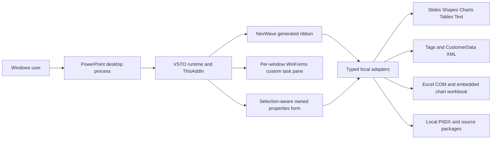

References: `apps/powerpoint-vsto/ThisAddIn.cs:37`, `apps/powerpoint-vsto/ThisAddIn.cs:88`, `apps/powerpoint-vsto/DemoRibbon.cs:12`. Neither an architecture diagram nor a successfully compiled PIA reference proves activation on a machine.

#### Host operations by owner

| Native operation | Responsible source |
|---|---|
| Startup/events/task panes/command mutation lease | `apps/powerpoint-vsto/ThisAddIn.cs:37`, `apps/powerpoint-vsto/PowerPointHost.cs:14` |
| Native S0 chart insertion/update/edit capture | `apps/powerpoint-vsto/PowerPointHost.cs:166`, `apps/powerpoint-vsto/PowerPointHost.cs:296` |
| Linked native chart/table/editable shape diagrams | `apps/powerpoint-vsto/DemoTools.cs:165`, `apps/powerpoint-vsto/DemoTools.cs:197`, `apps/powerpoint-vsto/DemoTools.cs:252` |
| Canonical native scene shape insertion | `apps/powerpoint-vsto/RendererRibbonCommand.cs:60` and core surface/renderer |
| Managed text/process/indicator/connector | [shape and slide operations](../04-powerpoint-integration/shape-and-slide-operations.md) |
| Source-original preview/slide/design/layout insertion | `apps/powerpoint-vsto/TemplateLibrary.cs:462` |
| Configured generated templates/palettes/builds | `apps/powerpoint-vsto/TemplateLibrary.cs:63` |
| Native chart series/axes/reference/difference annotations | `apps/powerpoint-vsto/NativeSeriesControls.cs:13`, `apps/powerpoint-vsto/NativeChartControls.cs:49`, `apps/powerpoint-vsto/ChartAnnotations.cs:28` |
| Selection-aware properties/formatting | `apps/powerpoint-vsto/ContextPropertiesController.cs:33` |
| Agenda hierarchy/page links/native fields | `apps/powerpoint-vsto/ChapterAgenda.cs:70` |
| PDF export/image/template import | `apps/powerpoint-vsto/NativeSeriesControls.cs:33`, `apps/powerpoint-vsto/DemoTools.cs:1` |

#### Explicit absences and verification level

No Office JavaScript API, HTML task-pane host, SmartArt graph authoring or generic arbitrary-native-object conversion is wired into the compiled project. Native charts retain embedded workbooks; editable custom diagrams are shape groups. Generated previews may be bitmaps, but insertion uses native objects, not the preview image. Original licensed slide assets are separate from independently generated templates. Live AI/network connections are not executed by the service-configuration component (`apps/powerpoint-vsto/ServiceConnections.cs:29`).

This chapter verifies source design only. Consult the export testing chapter for current executed checks; historical Office decks/logs are evidence of their recorded runs, not a current pass.


### Add-in lifecycle and event ownership

#### Initialization

`apps/powerpoint-vsto/ThisAddIn.Designer.cs:19` binds generated VSTO host lifecycle; `apps/powerpoint-vsto/ThisAddIn.cs:328` attaches Startup/Shutdown. The project declares a PowerPoint HostItem (`apps/powerpoint-vsto/PowerPointIntelligence.csproj:76`).

Startup creates the native host and UI timers, loads explicit DLL config for compatibility, constructs context-property controller, subscribes selection/double-click/open/before-save/window-activate/close callbacks and invalidates a loaded ribbon (`apps/powerpoint-vsto/ThisAddIn.cs:37`). Invalid compatibility configuration disables chart commands with explanatory status rather than guessing host support.

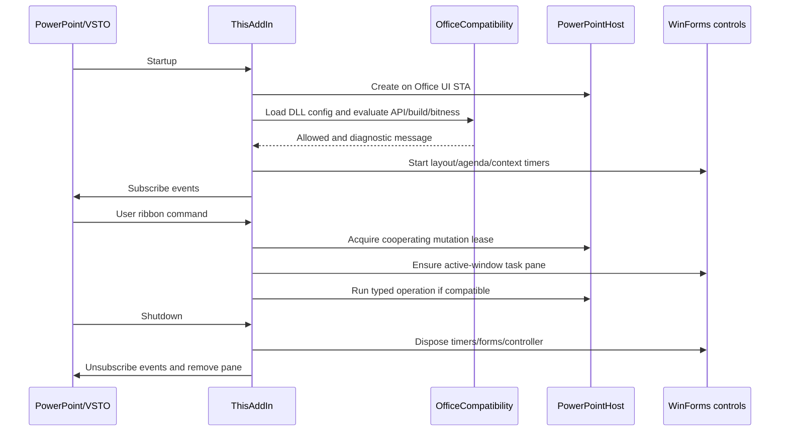

#### Reentrancy and mutation coordination

`ThisAddIn.Run` (`:133`) uses a busy flag and `OfficeMutationLease.TryEnter(currentProcessId)`. Native automation tests can acquire the same named kernel mutex using the PowerPoint HWND->PID; installed automatic writes then defer instead of racing the test. This is cooperating serialization, not access control or protection from arbitrary other add-ins.

Event callbacks use `RunHostEvent` (`:301`), `OfficeEventBoundary.Run` (`apps/powerpoint-vsto/PowerPointHost.cs:34`) and the same lease. They do not let managed exceptions escape native event dispatch. Selection marks contextual refresh dirty and restarts650ms agenda/element debounce. The750ms layout timer pauses on invalid dependency/reflow errors. BeforeSave only processes the currently active presentation, refreshing chapter views/layout and capturing supported S0 chart edits; it does not rewrite every chart from stale sample data.

#### Per-window UI

EnsurePane compares active HWND and paneNeedsRefresh (`:88`). It removes/recreates the pane on the next user action when the active window changes. WindowActivate intentionally avoids pane disposal or metadata rewriting inside the Office activation callback. The pane is330px wide, docked through CustomTaskPanes, and shows insert/check-sync/compatibility actions plus status. PresentationClose hides context properties and marks pane refresh.

#### Shutdown/cleanup and failures

Shutdown (`:77`) disposes context/timers/modeless layout controls, unsubscribes every explicitly registered Office event and calls RemovePane (`:122`). RemovePane detaches host status callback before removal and tolerates COM/disposed controls. Typed operations handle cancellation/data/selection errors as inspector messages; unexpected errors become a generic status without workbook content. Some deferred timer actions can be paused and require a user to correct metadata/geometry and resume; this is deliberate failure containment, not guaranteed recovery.

No background unattended Office server is part of startup. Source analysis cannot establish whether a target machine has accepted publisher trust, loaded VSTO, shown ribbon or retained native edits after reopen.


### Ribbon architecture and command routing

#### Definition and registration

`apps/powerpoint-vsto/DemoRibbon.cs:12` builds XML with XmlWriter using Office customUI2009 namespace, `onLoad=OnLoad` and `loadImage=LoadImage`. The tab ID is stable ppiTab, visible label NexWave, keytip NW. `ThisAddIn.CreateRibbonExtensibilityObject` returns IntelligenceRibbon (`apps/powerpoint-vsto/ThisAddIn.cs:326`), which implements Office.IRibbonExtensibility, forwards handlers and invalidates IRibbonUI when state changes (`:332`).

Ten groups are created: Structure, Elements, AI, Data, Text, Layout, Color, Quality, Collaboration and More. Charts is a large menu beside Library with CH keytip; Agenda/Data Source are large menus, Check & Sync/Generate Linked Report are large buttons. Palette/alignment shortcuts are CP/TA. Local bitmap icons are rendered/cached by `apps/powerpoint-vsto/RibbonIcons.cs:13`; AxHost bridges Office picture format. Icon existence/visual quality needs its own tests rather than guessing from a resource name.

#### Dispatch contract

| Source control family | Callback | Tag destination |
|---|---|---|
| Catalog categories | RunDemoTool | ThisAddIn.RunDemo -> DemoTools.Catalog delegate |
| Agenda/chart/format/data workflow | RunWorkflowCommand | RunWorkflow typed switch/prefix mapping |
| Element Controls | RunElementCommand | ElementCommands.Enabled/Run |
| Tools | RunProductivityTool | Local tool, help or explicit alias routing |
| Data Source four formats | LinkDataSource | Extension picker and presentation registry |
| Library/properties/palette/alignment/layout | Dedicated handlers | Corresponding owned dialog/controller |
| S0 automation insertion | COMAddIn.Object.InsertChartJson | Validated UI-STA-only S0 adapter, not a ribbon arbitrary-code path |

`apps/powerpoint-vsto/DemoRibbon.cs:94` is the button helper; dedicated callback/tag records are preserved in the [feature CSV](../05-features/feature-source-mapping.csv). The feature catalog counts172 command routes, not172 separate rendering engines; direct linked-report and multiple menu aliases are explicitly reconciled.

#### Availability versus execution

The common command gate is host-created and compatibilityAllowed. Data-source/dialog gates also require an open presentation. Workflow gate adds relevant selected chart/annotation/multi-chart checks. ElementEnabled requires a known ID, Normal view and owned native element. Context controls use a stronger opaque live selection key and capability intersection. UI enablement is not a security boundary; adapters revalidate inputs/ownership before mutation.

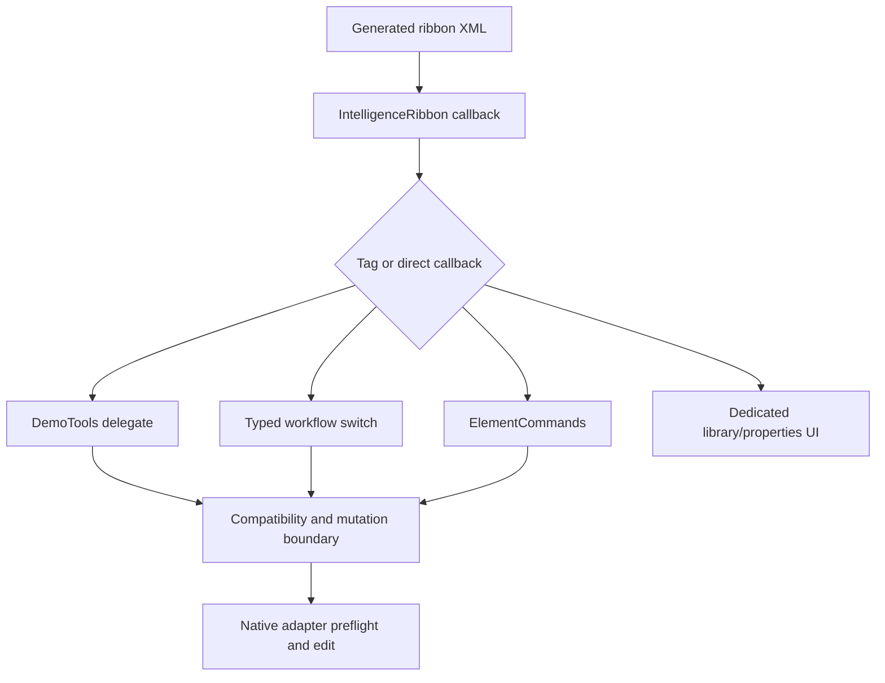

#### Status and limits

BuildMarker identifies current source/deployed payload (`apps/powerpoint-vsto/DemoRibbon.cs:11`). It is separate from assembly version and source fingerprint. The browser also displays103 FeatureInventory requirement records whose Partial demo/Not configured labels can lag newer source. They are not automatically converted into verified features. AI currently exposes Configure services; that form never sends a request. Ribbon XML/source checks do not prove the installed Office UI loaded that payload.


### Interoperability, threading and process boundaries

#### Object model/architecture

The compiled VSTO assembly targets .NET Framework4.8, C#7.3, AnyCPU/x86/x64 configurations and Office/PowerPoint15PIAs with EmbedInteropTypes (`apps/powerpoint-vsto/PowerPointIntelligence.csproj:9`, `:18`, `:30`). Office runtime is external; VSTO tool/runtime references are not bundled as if self-contained .NET runtime. Process bitness must match Office, not Windows OS; explicit profile checks gate Office16API/build/bitness (`apps/powerpoint-vsto/OfficeCompatibility.cs:61`). Compatibility unit/build checks do not certify every installed Office edition/build.

#### STA and UI marshalling

PowerPointHost captures creator managed thread ID and requires STA on access (`apps/powerpoint-vsto/PowerPointHost.cs:58`). DemoAutomation InsertChartJson enforces the same principle (`apps/powerpoint-vsto/DemoApi.cs:35`). WinForms timers execute on the UI message thread; context observation is immutable/volatile so external COM tests do not inspect Office/WinForms from the wrong thread. LocalLibraryWorkspace performs catalog I/O on background tasks and returns via UiAwaiter before native Office actions (`apps/powerpoint-vsto/LocalLibraryWorkspace.cs:17`). Disposal fallback must be reviewed carefully; background continuation does not authorize COM access after the form closes.

#### Native handles and COM value shapes

user32 interop supplies window bounds, foreground owner and HWND->process identity. IUnknown-based document identity is used only as an opaque live key; acquired raw pointer is released in finally (`apps/powerpoint-vsto/ContextSelectionBridge.cs:30`). Native series can return typed one-dimensional SAFEARRAYs with nonzero lower bound or a scalar; PowerPointHost.SeriesVector normalizes Array.Cast<object> and rejects multidimensional arrays (`apps/powerpoint-vsto/PowerPointHost.cs:335`). Excel ranges are rank2Value2 arrays and must honor actual lower bounds.

#### Embedded workbook sequencing

Activate -> acquire workbook -> write/verify/calculate -> bind native source -> wait actual chart acknowledgement -> close -> verify retained chart values. Local link writes retry known workbook-busy acquisition errors; Close uses en-US late-bound optional-argument invocation to avoid locale/COM dispatch ambiguity (`apps/powerpoint-vsto/DataSources.cs:199`). Only RPC_E_CALL_REJECTED0x80010001 is replayed for mutation close; specific disconnected close codes are tolerated only when native committed values independently verify (`:206`). Arbitrary RPC failures must not be blindly retried.

#### Ownership and cleanup

Owned hidden source presentations are closed by SourceTemplateSession.Dispose; already-user-open sources are never adopted. Task panes/forms/timers/images/catalog monitors are disposed at their boundaries. Source Excel file reads close read-only books and release application RCW; subordinate RCW cleanup is not uniformly explicit. The app does not call global FinalReleaseComObject on Office-owned application objects. Do not claim a uniform complete COM lifetime strategy where the source uses mixed dynamic/typed proxies.

#### Coordination and trust

OfficeMutationLease uses a process-specific Local named mutex. Tests discover actual PowerPoint PID from HWND and coordinate with installed automatic writers; unrelated add-ins are not constrained by it. Publisher/VSTO installation trust and Windows activation policy are external boundaries. A source/build pass is distinct from successfully activating PowerPoint under an AppContainer/desktop token. Existing diagnostics retain HRESULT-only operation descriptions to avoid workbook/metadata disclosure. No COM DCOM permission weakening, antivirus exclusion or trust-store modification is prescribed by this design.

#### Tests and unresolved native coverage

See native test source for scalar/SAFEARRAY normalization, worksheet lower bounds, stale selection, grid/indicator/connectors, copied XML ownership and scene primitive round trips. This documentation leaf runs no Office automation. Per-monitor DPI, every chart family, focus and security-token behavior remain explicit environment-dependent verification items.


## 11. Rendering and native editing


### Native editing and persistence mechanisms

#### Three different editable chart/object paths

1. S0 native ChartDocument (`apps/powerpoint-vsto/Contracts.cs:17`) is a narrow clustered-column contract. PowerPointHost inserts a genuine chart with embedded workbook and shape-owned XML/GUID. It reads supported native edits into metadata during Check & Sync/save; it does not project old metadata back onto charts on reopen.
2. Linked native charts (`apps/powerpoint-vsto/DataSources.cs:166`) use DataSourceLink/LinkedTable and native chart source binding. Chart/table/custom diagram object references are different from S0 metadata. Mapped refresh is intentionally narrower than insertion.
3. Scene rendering (`apps/powerpoint-vsto/RendererRibbonCommand.cs:44`) creates validated native editable primitives via the core renderer/surface. Result is a shape group, not a native chart workbook; current adapter emits axis/legend omission diagnostics.

These paths must not be conflated in maintenance or migration. Metadata namespaces/tags identify the appropriate owner. Chart-family conversion on S0 objects is rejected by NativeSeriesControls to preserve its narrower semantics.

#### Metadata and copied owners

CustomerData binds an Office custom XML data-store part to native shapes. Shape numeric IDs are document locations, not globally canonical chart identity. S0 uses GUID plus PPI_CHART_ID. Shared/duplicated Office parts can require preserving every copied owner, not just checking an RCW returned from Add.

`apps/powerpoint-vsto/XmlPartUpdates.cs:47` resolves part membership by normalized GUID and reads root namespace from serialized XML instead of trusting cached NamespaceURI. Shape replacement (`:63`) validates one current attachment, scans shared owners, detaches/adds/verifies and restores old owners on failure. Deck replacement (`:76`) requires a unique registry. Semantic XML comparison retains significant text/whitespace; it is not a byte-equality requirement.

```mermaid
sequenceDiagram
  participant Adapter
  participant XML as XmlPartUpdates
  participant Owner as Native owner CustomerData
  participant Shared as Copied owners
  Adapter->>XML: Validated replacement XML and current part
  XML->>Owner: Verify GUID/namespace/payload
  XML->>Shared: Snapshot owners of prior part
  XML->>Owner: Detach old; create new
  XML->>Owner: Resolve live collection; verify final attachment
  XML->>Shared: Restore preserved old payload where needed
  alt failure
    XML->>Owner: Remove owned replacement if attached
    XML->>Shared: Attempt original restoration
    XML-->>Adapter: Failure; incomplete restoration surfaced
  else verified
    XML-->>Adapter: Current verified attached part
  end
```

#### Native text/properties

Managed text, process cells, indicators/connectors and template fields are native objects; text remains directly editable. NativeFormatting and ContextFormatting snapshot requested properties and support bounded native groups/tables/selected characters. A selection key prevents a delayed picker from changing a different object. Indicator/connector colors route through canonical specs so native appearance and persisted settings stay aligned.

#### Undo/redo and atomicity

Adapters call Application.StartNewUndoEntry around explicit native mutations. There is no separate full-document undo engine or reliable cross-process transaction system. Some complex adapters implement compensation; simple catalog mutations rely on PowerPoint Undo. Compensation failures retain evidence/objects and report Undo guidance. Native user Undo/Redo and other add-ins can change identities; the next read validates rather than trusting cached state.

#### Save/reopen boundaries

PowerPoint saves its own native document plus custom XML/tags; adapters never rewrite the ZIP behind the running host. Missing/unknown metadata is preserved and blocks unsafe automatic edits. Cross-presentation explicit S0 copy captures original model before clipboard transfer and writes a new destination attachment when clipboard omits CustomerData (`apps/powerpoint-vsto/PowerPointHost.cs:231`). This helper is not a promise that arbitrary manual clipboard operations retain every custom schema.


### Shape, text, table and slide operation design

#### Operation traceability

| Operation | Actual implementation | Native result and constraints |
|---|---|---|
| Text box/rounded/pentagon/chevron | `apps/powerpoint-vsto/TextShapeElements.cs:103` | AutoShape with editable TextFrame, center/middle default, manual geometry and XML. Unsupported native rotation/flip/kind changes fail closed. |
| Fit/convert/adjacent duplicate | `apps/powerpoint-vsto/TextShapeElements.cs:117` | Plan bounds before edit; unlocked edges may grow; all-locked unsupported overflow stops. |
| Process grid | `apps/powerpoint-vsto/ProcessFlowTools.cs:95` | Managed cells plus deck registry; hide keeps inactive history; manual independent cell geometry disallows structural edits. |
| Harvey/checkbox | `apps/powerpoint-vsto/IndicatorElements.cs:39` | Native grouped vector sector/strokes/text; state/colors/rotation XML; update replacement retains original if removal fails. |
| Universal connector | `apps/powerpoint-vsto/UniversalConnectors.cs:114` | Native straight/elbow/curve, free/site/chart-point endpoint modes; rotation/flip captured in slide coordinates. |
| Reference/difference annotation | `apps/powerpoint-vsto/ChartAnnotations.cs:41` | Editable native group, chart identity tags and explicit refresh; no generic obstacle-avoidance engine. |
| Native linked table | `apps/powerpoint-vsto/DemoTools.cs:252` | Native Table <=400 cells, centered headers/body, source and table snapshot persisted. Datasheet edits are local native edits. |
| Generated template | `apps/powerpoint-vsto/TemplateLibrary.cs:63` | Native shapes/text/freeforms, optional staged builds and tagged editable fields. |
| Original slide/template | `apps/powerpoint-vsto/TemplateLibrary.cs:489` | InsertFromFile into existing deck; clone source Design/CustomLayout; same-size requirement. |
| Agenda | `apps/powerpoint-vsto/ChapterAgenda.cs:84` | Native editable chapter/contents slides, hierarchy/page links/captions/scopes. |
| Arrange selected objects | `apps/powerpoint-vsto/DemoTools.cs:222` | Native coordinates/size/group/order/flip/rotate/duplicate; first selected shape is alignment/size reference. |
| Layout links | `apps/powerpoint-vsto/TemplateLibrary.cs:411` | Leader/follower edge/offset rules reflow through timer; dependencies are validated, not freeform full-slide constraint solving. |
| Raster copy | `apps/powerpoint-vsto/ProductivityTools.cs:79` | New embedded picture; original editable object is retained. |
| Read-only quality/navigation | `apps/powerpoint-vsto/PresentationQuality.cs:80` | Typed snapshots and issue locate; excludes masters/notes/SmartArt/tablecells/chart-internal text. |

#### Text and table scoping

NativeFormatting honors selected text scope or selected table cells; no selected cells means whole table. It preflights nested groups and budgets before constructing apply/restore changes. Context property capture separately limits selected characters/parts for responsive inspection. Font-only updates leave unrequested bold/italic attributes untouched and mixed values are not coerced into an invented default.

#### Slide ownership and document selection

Generated linked report appends seven new chart slides to the same active presentation (`apps/powerpoint-vsto/DemoTools.cs:139`). Ordinary insertion operates on current active slide. Hidden read-only template sources are explicitly owned session objects; user-open sources are rejected and never closed by the library. Keep-source insertion does not resize the destination deck implicitly. Save selected slides creates a user-chosen output presentation; that export path is distinct from generating a linked chart in the current deck.

#### Transitions and animations

Designed-template staged builds support Fade/Wipe/Fly-in with click trigger and.35s duration; new-slide transitions None/Fade/Wipe. They are ordinary editable native timeline effects. No Morph/advanced effect-editor equivalence is claimed. Source-original slide animation/fidelity is preserved by native file/design transfer where verified, not reconstructed from bitmap previews. Static object-only insertion rejects animated builds explicitly.

#### Failure and extension policy

Typed planners/codecs own finite/bounded geometry, valid IDs, shape ownership and supported modes. Native operations can fail independently during cleanup; surfaces report that state and offer Undo guidance rather than destroying foreign objects. Adding any new native object mode requires source/pure-plan tests and desktop edit/save/reopen tests, with copied/rotated/foreign-object negative scenarios.


### Rendering engines and the ribbon projection

#### Separate pipelines

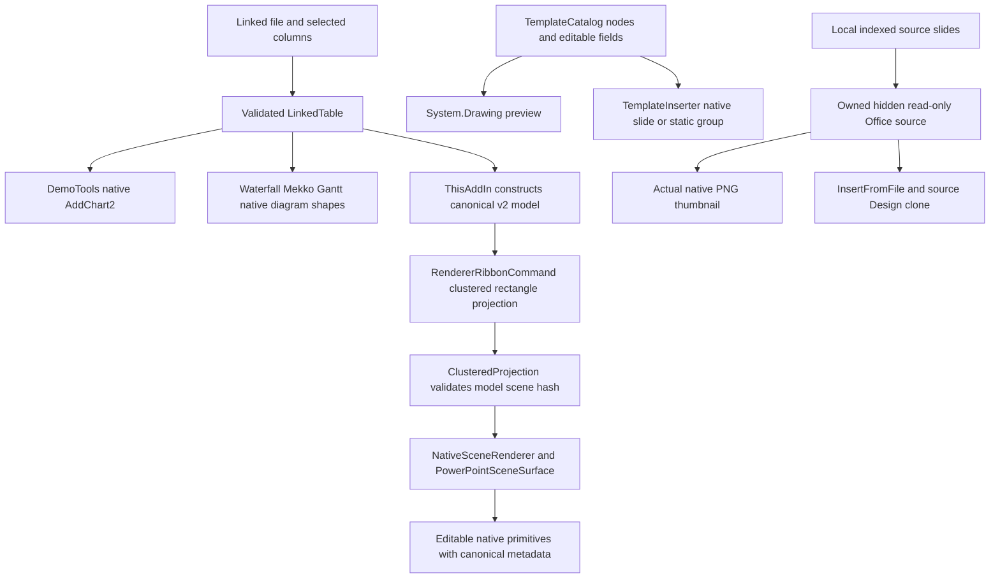

`apps/powerpoint-vsto/DemoTools.cs:165`, `apps/powerpoint-vsto/DemoTools.cs:197`, `apps/powerpoint-vsto/ThisAddIn.cs:152`, `apps/powerpoint-vsto/RendererRibbonCommand.cs:44`, `apps/powerpoint-vsto/TemplateLibrary.cs:22`, `apps/powerpoint-vsto/TemplateLibrary.cs:484`.

The TypeScript chart engine and C# strict scene/canonical contracts are documented in the core module/data chapters. The current VSTO project does not spawn Node to run TypeScript when a chart button is clicked. The linked shape ribbon adapter itself computes the clustered rectangle scene; existence of broader TypeScript algorithms does not establish production ribbon coverage for every family.

#### Active scene projection details

Prepare(model) validates canonical v2. It computes signed min/max including zero, uses[-1,1] when constant zero range, rejects infinite range, divides category span/series slots, skips missing values and emits box geometry per present value. Scene hash is recomputed and ClusteredProjection validates consistency before COM. It intentionally adds AXES_NOT_RENDERED and, if requested, LEGEND_NOT_RENDERED diagnostics (`apps/powerpoint-vsto/RendererRibbonCommand.cs:54`). Labels/axes/legend should not be claimed present in this path.

A parameterless Prepare helper validates embedded canonical/scene fixture pair before assigning a fresh chart GUID and remapping node IDs (`:21`). The visible linked shape command calls Prepare(model), not an undisclosed sample fallback. Embedded fixtures are test/sample resources, not linked business data.

#### Native charts versus custom diagrams

Native charts use ChartData.Activate and embedded Excel source data with literal labels, acknowledged real series values and preserved local source reference. XY/bubble series assign typed X/Y/size arrays; families and blank rules differ. Custom waterfall uses cumulative signed changes from zero; Mekko widths follow category totals and percent/unit height semantics; Gantt expects Task/numeric Start/positive Duration. Grouped shapes remain editable but do not acquire full native chart-engine semantics. Table and diagram linked snapshots are persisted, but mapped automatic refresh for them is absent.

#### Preview fidelity

Generated designed-template previews use the same logical node catalog, System.Drawing and editable field values. They are illustrative previews, not pixel equality proof with Office fonts/metrics. Original thumbnails come from native Slide.Export on the owned hidden source. Source identity is revalidated before preview/insertion; an unchanged metadata index is not a substitute for native rendering.

#### Error, performance and extension limits

Renderers validate finite bounds/counts/hash/schema before touching COM. Native adapter rollback addresses newly owned primitives only; Office disconnection can make restoration incomplete. Large native object counts increase Office/metadata work; there is no server-side render farm or scalability SLA. Extend new family projections with strict canonical/scene equivalence, diagnostic handling, primitive tests and desktop save/reopen evidence.


## 12. AI integration architecture


### AI solution architecture

**VERIFIED (source):** The running add-in is local VSTO/COM software. Azure connectivity, AI inference and enterprise identity enforcement are not implemented. Service profiles are preparation metadata only. Runtime UI tests were not executed for this documentation export.

#### Implemented boundary

`ServiceConnections` offers three profiles: AzureOpenAI, OnPremDataService and AssetProvider. A profile contains a service enum, a bounded endpoint string, a deployment identifier and a selected authentication **mode**, not a token or authenticated session. `Status` deliberately says “Configured, not connectivity-tested” after required metadata is present. Saving cannot cause an outbound request. `apps/powerpoint-vsto/ServiceConnections.cs:29` `apps/powerpoint-vsto/ServiceConnections.cs:53`.

The visible configuration workflow is routed by `ThisAddIn.RunWorkflow("connections")` to `ServiceConnections.ShowConfiguration`. This is an implemented desktop settings form. It is not an AI chat panel or gateway client. `apps/powerpoint-vsto/ThisAddIn.cs:252`

#### Gateway boundary

The entire `services/ai-gateway` authored directory contains a README and action-plan JSON schema. There is no service executable, project, controller, HTTP listener, database, authentication middleware or provider SDK. Its README labels the gateway “not implemented.” The on-prem gateway, Azure inference, RBAC, minimized context and human approval pipeline are **PLANNED**. `services/ai-gateway/README.md:1` `docs/DECISIONS.md:17`.

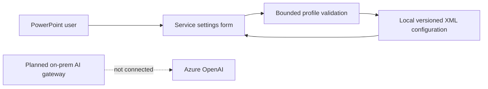

#### Status by capability

| Capability | Evidence-based status |
|---|---|
| Profile configuration and local persistence | VERIFIED implementation |
| Azure endpoint reachability or model deployment discovery | NOT IMPLEMENTED |
| Prompt templates, conversation state, retrieval and tool calling | NOT IMPLEMENTED |
| Token acquisition, SSO, API-key vault and RBAC | NOT IMPLEMENTED |
| AI response validation/execution | PLANNED schema only |
| Live Tableau/MCP/Morningstar/asset-provider results | NOT IMPLEMENTED; descriptive inventory says Not configured |

The descriptive AI rows in `FeatureInventory` do not make their implementations reachable. No inference sequence diagram is presented as implemented. See [AI workflows](../06-ai-architecture/ai-workflows.md) and [contracts](../07-api-design/request-response-contracts.md).


### Azure AI integration

**VERIFIED (source):** The running add-in is local VSTO/COM software. Azure connectivity, AI inference and enterprise identity enforcement are not implemented. Service profiles are preparation metadata only. Runtime UI tests were not executed for this documentation export.

#### Profile contract

`apps/powerpoint-vsto/ServiceConnections.cs:12` and `apps/powerpoint-vsto/ServiceConnections.cs:45` define the real configuration interface.

| Field | Constraint |
|---|---|
| Service | Exactly one each of AzureOpenAI, OnPremDataService, AssetProvider in version 1 |
| Endpoint | Empty or absolute HTTPS URI; maximum 2048 characters; no whitespace/control, userinfo, query or fragment |
| Deployment | Maximum 128 characters, trimmed, no controls; nonempty only allowed for AzureOpenAI |
| Authentication | Unselected, MicrosoftEntraId or RuntimeCredential; WindowsIntegrated additionally allowed only for OnPremDataService |
| Readiness label | Azure requires endpoint, deployment and selected mode; other services require endpoint/mode |

Selecting MicrosoftEntraId does **not** acquire a token; RuntimeCredential does **not** store a credential; WindowsIntegrated does **not** negotiate Windows authentication. The code has no Azure endpoint call, Azure API version, model-name resolution, client retry, token accounting, content filtering or billing implementation.

#### Decisions and prerequisites

Q-003, Q-004 and Q-005 keep Azure region/deployment/egress, identity provider and data policy unresolved. AD-017 authorizes live service scope with separate configuration but does not close those decisions. `docs/DECISIONS.md:8` `docs/DECISIONS.md:8`.

A future connector must introduce a real authenticated provider interface, reviewed request schema, cancellation/timeouts, bounded responses, least-privilege identity and explicit document approval. These are recommendations, not implemented controls. No endpoint-specific OpenAPI description is generated because no actual Azure request contract exists here.

`tests/s0/ServiceConnectionTests.cs` verifies metadata/codec behavior with example.invalid addresses and asserts no network/UI call. It is not a live Azure integration test. `tests/s0/ServiceConnectionTests.cs:35`.


### Prompt and action orchestration

#### Actual implementation

**NOT IMPLEMENTED:** There is no prompt store, system/user prompt builder, conversation orchestration, agent runtime, retrieval pipeline, function dispatcher from model output or approval service. The only AI artifact is `AIActionPlan` JSON Schema, plus local profile UI. `services/ai-gateway/action-plan.schema.json:1` `services/ai-gateway/README.md:5`.

#### Planned action schema

The schema allows status `proposed`, `validated`, `approved`, `executed`, `failed`; required root fields are planId, status, actions and approvalRequired. Action types are CREATE_CHART, UPDATE_CHART, CONVERT_CHART, APPLY_LAYOUT, ADD_ANNOTATION, GENERATE_SLIDE and GENERATE_REPORT. Each action requires actionId/type/arguments and may carry targetId/expectedRevision. Unknown root/action properties are rejected, but arguments is an unrestricted object. `services/ai-gateway/action-plan.schema.json:5`.

**Important semantic gap:** the schema permits approvalRequired=false and does not enforce approval-state transitions, positive actionId length, nonempty actions or per-action argument constraints. No runtime schema validation of AI responses is wired to the add-in. The existing domain validators and native command safeguards cannot be described as an AI execution pipeline without that integration.

#### Extension sequence (recommendation)

Before implementing execution, define typed arguments per allowed action; resolve target/revision within the active document; validate deterministically before mutation; require approved plans where policy demands; expose a preview; execute on the Office STA via bounded commands; record an audit event without document contents. Never accept arbitrary code, SQL or COM member names from generated text. These are future engineering requirements derived from the gateway README, not existing workflow states.


### Implemented AI-adjacent workflow

Only profile preparation is implemented. The following sequence is directly supported by `apps/powerpoint-vsto/ThisAddIn.cs:252` and `apps/powerpoint-vsto/ServiceConnections.cs:98`.

```mermaid
sequenceDiagram
  actor User
  participant Ribbon
  participant AddIn as ThisAddIn
  participant Profiles as ServiceConnections
  participant Disk as Local XML file
  User->>Ribbon: Configure services
  Ribbon->>AddIn: RunWorkflow(connections)
  AddIn->>Profiles: ShowConfiguration()
  Profiles->>Disk: Load(default path)
  alt Missing configuration
    Profiles->>Profiles: Three empty profiles
  else Invalid or inaccessible configuration
    Profiles->>Profiles: Empty profiles plus warning
  end
  User->>Profiles: Edit nonsecret metadata
  Profiles->>Profiles: Validate and show readiness label
  alt Cancel
    Profiles-->>User: Existing file preserved
  else Save valid metadata
    Profiles->>Disk: Write temporary XML then replace/move
    Profiles-->>User: Close settings dialog
  else Invalid or denied save
    Profiles-->>User: Error; no success response
  end
```

The sequence deliberately contains no Azure/Entra/network actor. A malformed existing configuration is not silently repaired on open: Cancel preserves it; an explicit valid Save replaces it. Temporary save files are removed in a finally block. `apps/powerpoint-vsto/ServiceConnections.cs:93`.

The README's request → RBAC → retrieval → Azure → plan validation → approval → host → audit chain remains **PLANNED**. No live AI request-processing diagram can be derived from implemented source.


### AI data flow and context boundary

#### Verified data flow

User-entered endpoint/deployment/mode → ServiceConnectionSettings → strict versioned XML → per-user local file. Load flows in reverse through byte/character bounds, no-DTD parsing, namespace/version/field validation. `apps/powerpoint-vsto/ServiceConnections.cs:58` `apps/powerpoint-vsto/ServiceConnections.cs:75`.

The stored profile path is `%LOCALAPPDATA%/PowerPointIntelligence/service-connections.v1.xml`; it is deliberately a compatibility identity, despite the NexWave display brand. No presentation, worksheet values, prompt text, token, credential or response field is in this schema. `apps/powerpoint-vsto/ServiceConnections.cs:35`.

#### Not present

No presentation-context extraction for AI, upload, embedding store, vector search, model response persistence, chat history, retention scheduler, token budget or usage telemetry is implemented. PIIDX extracts local presentation metadata for a local library index, not an AI retrieval service. Do not join these independent systems into an invented RAG pipeline.

#### Privacy limits

The profile is plaintext nonsecret metadata, not encrypted secret storage. Endpoint path components and deployment identifiers can still reveal organizational information. The UI warns that only approved nonsecret identifiers belong here. Future data minimization, retention, authorization and Azure processing policies are blocked by Q-005; see [AI security](../06-ai-architecture/ai-security.md).


### AI security

#### Implemented controls

- Endpoint syntax requires HTTPS and rejects URI credentials, query and fragment; bounded text prevents unbounded profile input. `apps/powerpoint-vsto/ServiceConnections.cs:45`
- Strict XML codec rejects DTD/external resolution, unknown attributes/elements, nested endpoint data and unknown enum/version/namespace values. `apps/powerpoint-vsto/ServiceConnections.cs:75`
- No credential value fields, no auth attempt, no outbound client and no simulated successful AI response. `apps/powerpoint-vsto/ServiceConnections.cs:29`
- Local save validates before filesystem publication and atomically replaces a previous profile. `apps/powerpoint-vsto/ServiceConnections.cs:93`

#### Missing controls because execution is absent

**NOT IMPLEMENTED:** token authentication, RBAC, prompt injection isolation, model tool authorization, PII reduction, output policy enforcement, egress allowlisting, content safety, usage rate limiting and AI audit trails. An HTTPS URI check alone does not establish a trusted Azure tenant/host or an egress allowlist. The allowed endpoint can be any syntactically valid HTTPS host.

The action schema is not an authorization boundary: arguments is generic and approvalRequired can be false. A later executor must validate capabilities/targets/revisions independently, not trust a model's status label. `services/ai-gateway/action-plan.schema.json:1`.

#### Verification boundary

ServiceConnectionTests cover metadata boundaries and persistence with inert addresses, not network identity or tenant policy. No real Azure resource, credentials or customer content was accessed by this export. Open decision evidence: `docs/DECISIONS.md:8` `docs/DECISIONS.md:8`.


## 13. API and interface specifications


### API and integration inventory

No implemented HTTP server or REST endpoint exists in the inspected source. `services/ai-gateway` is a schema/README scaffold; there are no controllers/routes/ports/listeners. Therefore no fictional OpenAPI service specification is emitted. See [OpenAPI applicability](../07-api-design/openapi/README.md).

| ID | Interface | Direction / consumer | Implementation / status |
|---|---|---|---|
| API-01 | IDemoAutomation (IDispatch COM) | PowerPoint COMAddIns.Object → DemoAutomation | `apps/powerpoint-vsto/DemoApi.cs:12`; implemented, local automation |
| API-02 | IPowerPointHost | Add-in commands → PowerPointHost | `apps/powerpoint-vsto/Contracts.cs:7`; managed internal boundary |
| API-03 | IEditableSceneSurface | NativeSceneRenderer → PowerPointSceneSurface or test fake | `src/Chart.Renderers/NativeRenderingCore.cs:136`; managed adapter |
| API-04 | IRibbonExtensibility and callback methods | Office → IntelligenceRibbon → ThisAddIn | `apps/powerpoint-vsto/ThisAddIn.cs:332`; Office callback contract |
| API-05 | PowerPoint/Excel COM object models | In-process add-in → Office native document/workbook | `apps/powerpoint-vsto/DemoLinks.cs:50`; desktop only |
| API-06 | Win32 window/token and SQLite native P/Invoke | Controllers/diagnostics/catalog → Windows | NativeSqlite, ContextPropertiesView/Controller, diagnostic C# snippet; OS-native interfaces |
| API-07 | Linked data files | User-selected XLSX/CSV/JSON/XML → LinkedTable/mapped chart | DataSources, ExcelRangeMapping, MappedLinkOperations; file contracts, not REST |
| API-08 | PIIDX catalog and configuration | Local gallery → SQLite/files/watchers | Library.Core; independent local persistence, see data design |
| API-09 | Versioned CustomXMLPart metadata | Add-in ↔ presentation/shape CustomerData | Host/domain/rendered/text/agenda/indicator/link codecs; persistent file interfaces |
| API-10 | Signed VSTO deployment | Setup/Install-Local → VSTOInstaller | `easySetup/Bootstrapper.cs:33`; visible trust prompt, per-user |
| API-11 | Service connection profiles | User UI ↔ local XML | `apps/powerpoint-vsto/ServiceConnections.cs:89`; no network integration |
| API-12 | AIActionPlan | Planned gateway/action orchestrator | JSON Schema only; not an executing interface |

No independent API authentication layer exists for COM calls. Windows/Office process access and add-in loading establish the surrounding trust; mutations have thread, model and selection guards, not RBAC.

See [internal interfaces](../07-api-design/internal-interfaces.md), [external interfaces](../07-api-design/external-interfaces.md), [contracts](../07-api-design/request-response-contracts.md). This inventory counts integration boundaries, not every private helper method; the repository-wide symbol inventory provides exhaustive declarations.


### Internal interfaces

#### COM automation surface

`apps/powerpoint-vsto/DemoApi.cs:12` declares six methods; interface GUID is a stable local COM identity and class uses ClassInterface.None. `ThisAddIn.RequestComAddInAutomationService` supplies this object. `apps/powerpoint-vsto/ThisAddIn.cs:29`.

| Method | Parameters / return | Validation / semantics |
|---|---|---|
| GetVersion | none → string | Literal demo-v1 / S0 ChartDocument JSON; not a semantic production API version negotiation |
| GetBuildInfo | none → string | Build marker, catalog length, module version ID and assembly path; diagnostics may reveal local path |
| GetRibbonXml | none → string | Current ribbon definition generated from source catalog |
| GetRibbonLoaded | none → bool | Published Office OnLoad observation; does not prove visual layout or every command |
| InsertChartJson | JSON string → new chart GUID string | Same creating UI thread and STA; size bounded by MetadataCodec; DataContract JSON deserialize; strict model validate; overrides identity and revision; invokes native host insertion |
| GetContextPropertiesState | none → XML string | Immutable UI-published snapshot delegate; deliberately no Office/WinForms operation on caller thread |

No retries/timeouts are declared on this COM interface. Thread misuse throws InvalidOperationException; blank/oversized or invalid models throw before host mutation. Office failures propagate from the host. It does not accept an arbitrary COM method name or executable code. `apps/powerpoint-vsto/DemoApi.cs:35`.

#### Host interface

`IPowerPointHost` methods: GetSelectedSlideId() → string; GetSelectedObjectIds() → IReadOnlyList<string>; InsertEditableChart(ChartDocument) → IReadOnlyList<string>; UpdateEditableChart(chartId, document) → void; ReadChartMetadata(chartId) → ChartDocument; SaveChartMetadata(document) → void. `apps/powerpoint-vsto/Contracts.cs:7`. This is the S0 version-1 native clustered-column model, distinct from version-2/3 canonical domain contracts. Metadata is validated by MetadataCodec and persisted on native shapes. UI/host context and workbook operations are not interchangeable with DTO validation.

#### Renderer surface

`IEditableSceneSurface`: VerifyAccess; Begin(operationId,chartId); CreateAnchor(ScenePlot,bool) → int; CreateNode(SceneNode,token) → int; Group(IReadOnlyList<int>) → int; Persist(rootId,chartId,xml); Rollback() → bool; Complete(). `src/Chart.Renderers/NativeRenderingCore.cs:136`.

NativeSceneRenderer validates canonical/scene correspondence before Begin, rejects reentrancy, tracks the active stage and wraps failures in NativeRenderException with rollback completeness. A false rollback result is observable; it is not silently counted as successful cleanup. Surface owns COM RCWs; coordinator passes validated DTOs/IDs.

#### Event and IPC contracts

ThisAddIn subscribes WindowSelectionChange, WindowBeforeDoubleClick, PresentationOpen, PresentationBeforeSave, WindowActivate and PresentationClose, and unsubscribes during shutdown. Layout and agenda timers coalesce some edits. `apps/powerpoint-vsto/ThisAddIn.cs:44` `apps/powerpoint-vsto/ThisAddIn.cs:77`.

`OfficeMutationLease.TryEnter` serializes native automatic writes across processes using a named lease derived from the Office PID. It is concurrency coordination, not user authentication. Test runners use the same mutation lease; contextual read observation remains separate. PowerPoint selection snapshots reject stale identity before applying a queued property edit; see PowerPoint integration docs.


### External interfaces

#### Office object models

The deployment references Office/PowerPoint 15 PIAs with EmbedInteropTypes and requires the common Office 16 API at runtime. This does not mean Office 15 is the supported runtime edition. Excel operations use dynamic COM rather than a referenced Excel interop package. `apps/powerpoint-vsto/PowerPointIntelligence.csproj:30` `apps/powerpoint-vsto/OfficeCompatibility.cs:69`.

Source workbooks are opened read-only for input. Mapped Excel reads explicitly set AutomationSecurity=3 and AskToUpdateLinks=false before opening; column selection and range signature/header checks guard refresh. The older DemoLinks path is separate and stores a version-1 file association; it does not provide general mapped-range semantics. `apps/powerpoint-vsto/ExcelRangeMapping.cs:59` `apps/powerpoint-vsto/DemoLinks.cs:38`.

#### File and local database integrations

| Integration | Input / output | Authority / failure behavior |
|---|---|---|
| XLSX/CSV/JSON/XML data source | Bounded local table → native chart/workbook, presentation link metadata | Explicitly selected source path, parse/model/range validation; no sample fallback on bad source |
| PPTX/POTX library source | ZIP/XML source metadata → PIIDX SQLite catalog | Local file parsing; source URI/path and hashes; no proprietary index dependency |
| Native source template access | Hidden read-only PowerPoint source → insertion into current presentation | Separate source read access authorized in decisions; native formatting/geometry acceptance needs Office tests |
| VSTOInstaller process | /Install or /Uninstall plus quoted .vsto path → exit code/publisher prompt | Required runtime already installed; no prerequisite download or trust-store changes by bootstrapper |
| winsqlite3 native API | Parameterized SQL/database handles → local catalog | Windows system capability; no server DB or network database connection |
| NuGet/npm restoration | Locked JS dependencies and pinned Newtonsoft version → development dependencies | Build/test tooling, not runtime service calls; supply-chain gap below |

#### Actual network use

There is no implemented live Azure, Tableau, MCP or asset-provider client. `Invoke-WebRequest` in Test-S1.ps1 downloads a pinned Newtonsoft.Json 13.0.3 NuGet package if the expected DLL is absent. This is a development dependency restoration path, not an AI API. It lacks a pinned package checksum before expansion in that script. `scripts/Test-S1.ps1:18`. npm lockfiles contain resolved package URLs/integrity; Restore-LockedDependencies uses npm ci --ignore-scripts. `scripts/Restore-LockedDependencies.ps1:6`.

Browser-visible hyperlinks and descriptive service labels must not be counted as live data integrations. No REST status codes or OAuth redirect URIs can be derived for absent services.


### Request/response and file contracts

#### S0 COM JSON request (implemented)

```json
{"SchemaVersion":1,"ChartId":"11111111-1111-4111-8111-111111111111","ChartType":"clustered-column","Revision":0,"Categories":["Category A"],"Series":[{"Id":"s1","Name":"Series A","Values":[12.5]}]}
```

This sanitized example uses real ChartDocument/ChartSeries property names. InsertChartJson validates through MetadataCodec, then replaces supplied ChartId with a new GUID and resets Revision to zero before insertion. Return is the new chart-ID string, not an HTTP JSON envelope. Nullable numeric Values represent missing values; dimension/type/identity bounds are enforced by MetadataCodec. `apps/powerpoint-vsto/Contracts.cs:17` `apps/powerpoint-vsto/DemoApi.cs:41`.

#### Service profile XML (implemented)

Root is Connections in `urn:powerpoint-intelligence:service-connections:v1` with version=1. It has exactly three Profile children; attributes service/authentication and text-only Endpoint/Deployment children. Empty endpoints are permitted for unconfigured services. A profile cannot contain an ApiKey/password field. Exact codec and constraints: `apps/powerpoint-vsto/ServiceConnections.cs:58` `apps/powerpoint-vsto/ServiceConnections.cs:75`.

#### AI action plan (schema only)

```json
{"planId":"example-plan","status":"proposed","approvalRequired":true,"actions":[{"actionId":"action-1","type":"CREATE_CHART","arguments":{}}]}
```

This is valid against the **planned** schema shape; it is not a successful AI response or executable chart request. Arguments has no defined chart arguments yet. There is no route, authentication, provider payload, retry or response parser attached. `services/ai-gateway/action-plan.schema.json:1`.

#### Other versioned boundaries

| Contract | Authority | Design reference |
|---|---|---|
| Canonical chart v2/v3 | Chart.Domain codecs and JSON schema | [Serialization contracts](../08-data-design/serialization-contracts.md) |
| Rendered scene v1 | SceneCodec/StrictSceneJson/BoundedJson; semantic validation against canonical model | [Data models](../08-data-design/data-models.md) |
| Native rendered metadata | RenderedChartMetadata with canonical JSON, scene JSON and bindings | [Persistence](../08-data-design/persistence-design.md) |
| Linked tables/source links/mappings | DataSources, ExcelRangeMapping and DataLinkManager | [Feature details](../05-features/feature-implementation-details.md) |
| PIIDX catalog | SQLite tables/metadata/FTS and source extraction | [Data dictionary](../08-data-design/data-dictionary.md) |
| Installer receipt | build.json containing version, source/EXE/bundle SHA256, signer thumbprint, architectures/template count/time | [Packaging](../11-build-deployment/packaging-installation.md) |

Models are not interchangeable solely because they contain IDs/data. Use the exact codec and migration path at each boundary; native S0 automation does not automatically accept v2/v3 JSON.


## 14. Data models and persistence


### Data models

**VERIFIED:** inspected implementation, not a claim of current Office execution. The repository contains several independent versioned models; version numbers across these formats are not interchangeable.

| Model boundary | Classes | Storage/version | Evidence | Meaning and ownership |
| --- | --- | --- | --- | --- |
| Legacy native chart | Host.ChartDocument / ChartSeries | XML schema1; shape CustomerData | `apps/powerpoint-vsto/Contracts.cs:17` | Categories are ordered strings; series are ordered identified names and nullable doubles. ChartId GUID, revision >=0, clustered-column only. Native formatting/layout is not stored by this DTO. |
| Canonical chart v2 | Domain.ChartDocument | JSON schema2; explicit codec/migration | `src/Chart.Domain/ChartDocument.cs:8` | Dataset and categories/series/axes have unique semantic IDs. Two category/value axes, point layout and series-color style. It is not automatically the metadata used by all native demo chart types. |
| Canonical authored v3 | ChartDocumentV3 / ChartOptions | JSON schema3 source, not production compiled | `src/Chart.Domain/ChartDocumentV3.cs:6` | Bar/line/area/pie options and categoryColors. Missing from explicit compile graphs: do not infer shipping behavior from file presence. |
| Semantic scene | RenderResult and geometry subtypes | JSON schema1 | `src/Chart.Renderers/SceneContracts.cs:7` | ChartId/modelRevision scoped nodes, geometry/paint, diagnostic references and verified renderHash. Broader DTO support than native profile. |
| Rendered native record | RenderedChartRecord / NativeBinding | XML rendered-chart:v1 | `src/Chart.Renderers/NativeRenderingCore.cs:65` | Canonical JSON plus sealed scene plus ordered node-token/shapeID hints. Zero-area nodes retain bindings with absent ShapeId. |
| Extracted source | IndexedPresentation / IndexedSlide / IndexedObject | In-memory extraction then relational storage | `src/Library.Core/PresentationSource.cs:16` | Package/native slide IDs separate from display positions. Object structural Key/ParentKey tolerates repeated native IDs; parent-space EMU preserved. |
| Search/registration | LibraryRegistration / SearchRequest/Page/SlideReference | In-memory local interfaces | `src/Library.Core/LibraryModels.cs:54` | Query modes/filters/pagination, source and slide fingerprints, source path/native slide identity, title/text/category/author/layout/master, dimensions/rank/time. |
| Library runtime | LibraryRuntimeProfile / LibrarySourceDefinition | Application/enterprise XML config | `src/Library.Core/LibraryConfiguration.cs:20` | Index and legacy locations, refresh/watch policy, roots with names/recursive/managed flags; Managed is not authorization. |
| Linked data | LinkedTable / DataSourceLink / ExcelRangeMapping | Versioned presentation/shape XML | `apps/powerpoint-vsto/DataSources.cs:254` | File-backed source identity/format/path/link timestamp and optional explicit worksheet/range/header/category/series mapping. No database tables for workbook data. |
| Agenda | ChapterAgendaState / ChapterRecord / AgendaView | Managed agenda:v2 XML | `apps/powerpoint-vsto/ChapterAgendaModel.cs:13` | Stable slide IDs, levels/scopes and caption baseline; derived entries carry numbering/highlight/layout. SlideIndex is position, never persistent identity authority. |
| Text element | TextShapeSpec | Text-shape XML ownership | `apps/powerpoint-vsto/TextShapeElements.cs:16` | Kind, edge-lock flags, native adjustment and AutoFit; native actual text/style stays in PowerPoint. |
| Process grid | ProcessGridSpec / ProcessGridCell | Process-grid:v1 presentation XML | `apps/powerpoint-vsto/ProcessFlowTools.cs:14` | Grid GUID+slideID+rows/columns/bounds/gap; cells have row/column/shapeID/active retained history. |
| Indicator | IndicatorSpec | Indicator:v1 shape XML | `apps/powerpoint-vsto/IndicatorElements.cs:11` | Harvey segments/filled or checkbox state, colors/size/rotation/custom symbol; native group ownership verified before edits. |
| Connector | ConnectorSpec / ConnectorEndpoint | Connector:v1 shape XML | `apps/powerpoint-vsto/UniversalConnectors.cs:14` | Endpoints site/point/free; native shape/site or chart series/point anchor, coordinates/rendered flag; route/arrows/dash/color/weight/autoroute. |
| Template projection | Template nodes/fields/palette/layout metadata | Template:v1 native group metadata | `apps/powerpoint-vsto/TemplateLibrary.cs:114` | Original source-slide library and generated editable-layout library are separate paths. Field text and palette/alignment controls do not make original licensed content independently authored. |

#### Identity and ownership rules

- A chart GUID identifies a chart, semantic IDs identify domain children, node IDs identify one scoped projection and Office Shape.Id is a live host handle/hint. They are not interchangeable.
- Catalog presentation identity is independently generated; catalog SlideId is deterministic from that identity plus native slide ID. Positions can change without requiring a new slide identity. A uniquely hashed rename may retain presentation identity.
- The PIIDX preview is derivative data and can be regenerated. Canonical/native metadata is authoritative state for its own feature; no global single database covers every add-in object.
- Shared data DTOs have mutable CLR properties; boundary codecs clone/validate to prevent unvalidated aliasing. Most library APIs are internal, not network contracts.

#### Units

Canonical and scene layouts use points. OOXML dimensions are converted from EMU using12700 units per point. Indexed object transforms intentionally stay raw parent-space EMU/rotation/flip metadata rather than pretending to be absolute coordinates. Native COM geometry uses Single precision; readback tolerances belong to that boundary, not arbitrary canonical rounding.

#### Status and gaps

No application server database, cloud persistence, multi-tenant identity data model or general AI response executor is implemented by these core files. The SQLite schema below is a local library index. The v3 authored source is not wired into shipped compile graphs. Missing choices are represented by explicit options/rejection, not guessed defaults.

See [persistence design](../08-data-design/persistence-design.md), [dictionary](../08-data-design/data-dictionary.md), [class diagrams](../08-data-design/class-diagrams.md) and [wire contracts](../08-data-design/serialization-contracts.md).


### Class and relationship diagrams

**VERIFIED structural reconstruction.** Diagrams show actual authored classes and relationships; compile status and runtime capability are called out separately. Field subsets keep diagrams readable; the dictionary contains complete opt-in wire fields and SQL columns.

#### Canonical v2 domain

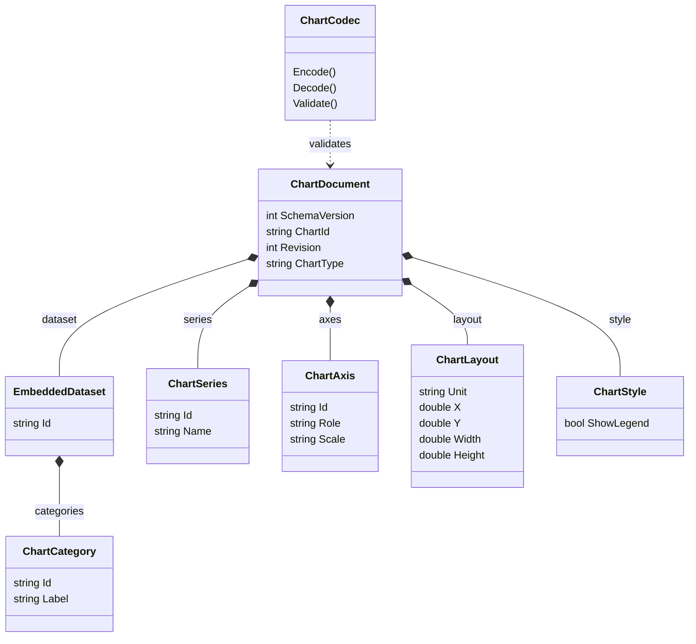

Evidence: `src/Chart.Domain/ChartDocument.cs:8`; `src/Chart.Domain/ChartCodec.cs:15`. ChartSeries.Values is an ordered list of nullable doubles with exactly the category count. Style.SeriesColors cardinality matches series. This v2 model is compiled into VSTO; authored ChartDocumentV3/ChartOptions are deliberately not conflated here because explicit production compile items omit them.

#### Scene and editable host boundary

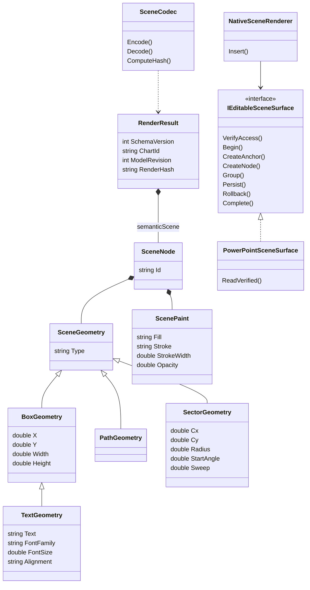

Evidence: `src/Chart.Renderers/SceneContracts.cs:7`; `src/Chart.Renderers/NativeRenderingCore.cs:136`; `src/Chart.Renderers/PowerPointSceneSurface.cs:15`. PathGeometry carries ordered points; sector angles/radius are bounded. The interface does not authorize arbitrary scene execution. ClusteredProjection validates a narrow canonical rectangle profile before Begin. Native adapter does not implement text/polygon/sector rendering despite their DTO presence.

#### Catalog extraction and query objects

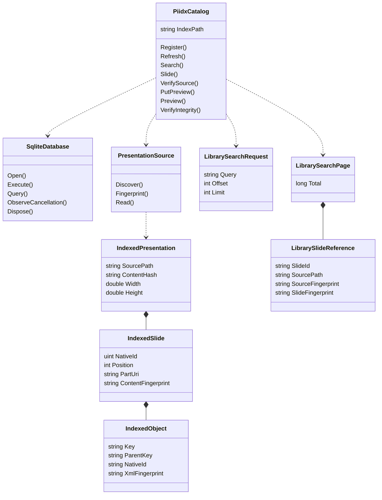

Evidence: `src/Library.Core/PiidxCatalog.cs:14`; `src/Library.Core/PresentationSource.cs:17`; `src/Library.Core/LibraryModels.cs:55`. PiidxCatalog is one partial class across catalog/search/navigation/preview source files, not four independent databases. Extracted object transforms remain native parent-coordinate metadata; group parent references are structural strings rather than relational FKs.

#### Storage ERD

See [persistence design](../08-data-design/persistence-design.md) for actual SQL relationships. No application-server ERD is provided because the inspected implementation contains no such database. Native PowerPoint objects/tags/XML are host persistence, not fictitious relational tables.


### Data dictionary

**VERIFIED:** inspected implementation, not a claim of current Office execution. The repository contains several independent versioned models; version numbers across these formats are not interchangeable.

#### JSON opt-in fields

| Owner | Wire field | CLR type | Presence rule | Evidence |
| --- | --- | --- | --- | --- |
| ChartDocument | schemaVersion | int | Required.Always | `src/Chart.Domain/ChartDocument.cs:10` |
| ChartDocument | chartId | string | Required.Always | `src/Chart.Domain/ChartDocument.cs:11` |
| ChartDocument | revision | int | Required.Always | `src/Chart.Domain/ChartDocument.cs:12` |
| ChartDocument | chartType | string | Required.Always | `src/Chart.Domain/ChartDocument.cs:13` |
| ChartDocument | dataset | EmbeddedDataset | Required.Always | `src/Chart.Domain/ChartDocument.cs:14` |
| ChartDocument | series | List<ChartSeries> | Required.Always | `src/Chart.Domain/ChartDocument.cs:15` |
| ChartDocument | axes | List<ChartAxis> | Required.Always | `src/Chart.Domain/ChartDocument.cs:16` |
| ChartDocument | layout | ChartLayout | Required.Always | `src/Chart.Domain/ChartDocument.cs:17` |
| ChartDocument | style | ChartStyle | Required.Always | `src/Chart.Domain/ChartDocument.cs:18` |
| EmbeddedDataset | id | string | Required.Always | `src/Chart.Domain/ChartDocument.cs:23` |
| EmbeddedDataset | categories | List<ChartCategory> | Required.Always | `src/Chart.Domain/ChartDocument.cs:24` |
| ChartCategory | id | string | Required.Always | `src/Chart.Domain/ChartDocument.cs:29` |
| ChartCategory | label | string | Required.Always | `src/Chart.Domain/ChartDocument.cs:30` |
| ChartSeries | id | string | Required.Always | `src/Chart.Domain/ChartDocument.cs:35` |
| ChartSeries | name | string | Required.Always | `src/Chart.Domain/ChartDocument.cs:36` |
| ChartSeries | values | List<double?> | Required.Always | `src/Chart.Domain/ChartDocument.cs:37` |
| ChartAxis | id | string | Required.Always | `src/Chart.Domain/ChartDocument.cs:42` |
| ChartAxis | role | string | Required.Always | `src/Chart.Domain/ChartDocument.cs:43` |
| ChartAxis | scale | string | Required.Always | `src/Chart.Domain/ChartDocument.cs:44` |
| ChartAxis | numberFormat | string | Required.Always | `src/Chart.Domain/ChartDocument.cs:45` |
| ChartLayout | unit | string | Required.Always | `src/Chart.Domain/ChartDocument.cs:50` |
| ChartLayout | x | double | Required.Always | `src/Chart.Domain/ChartDocument.cs:51` |
| ChartLayout | y | double | Required.Always | `src/Chart.Domain/ChartDocument.cs:52` |
| ChartLayout | width | double | Required.Always | `src/Chart.Domain/ChartDocument.cs:53` |
| ChartLayout | height | double | Required.Always | `src/Chart.Domain/ChartDocument.cs:54` |
| ChartStyle | showLegend | bool | Required.Always | `src/Chart.Domain/ChartDocument.cs:59` |
| ChartStyle | seriesColors | List<string> | Required.Always | `src/Chart.Domain/ChartDocument.cs:60` |
| ChartDocumentV3 | schemaVersion | int | Required.Always | `src/Chart.Domain/ChartDocumentV3.cs:8` |
| ChartDocumentV3 | chartId | string | Required.Always | `src/Chart.Domain/ChartDocumentV3.cs:9` |
| ChartDocumentV3 | revision | int | Required.Always | `src/Chart.Domain/ChartDocumentV3.cs:10` |
| ChartDocumentV3 | chartType | string | Required.Always | `src/Chart.Domain/ChartDocumentV3.cs:11` |
| ChartDocumentV3 | dataset | EmbeddedDataset | Required.Always | `src/Chart.Domain/ChartDocumentV3.cs:12` |
| ChartDocumentV3 | series | List<ChartSeries> | Required.Always | `src/Chart.Domain/ChartDocumentV3.cs:13` |
| ChartDocumentV3 | axes | List<ChartAxis> | Required.Always | `src/Chart.Domain/ChartDocumentV3.cs:14` |
| ChartDocumentV3 | layout | ChartLayout | Required.Always | `src/Chart.Domain/ChartDocumentV3.cs:15` |
| ChartDocumentV3 | style | ChartStyleV3 | Required.Always | `src/Chart.Domain/ChartDocumentV3.cs:16` |
| ChartDocumentV3 | options | ChartOptions | Required.Always | `src/Chart.Domain/ChartDocumentV3.cs:17` |
| ChartStyleV3 | showLegend | bool | Required.Always | `src/Chart.Domain/ChartDocumentV3.cs:22` |
| ChartStyleV3 | seriesColors | List<string> | Required.Always | `src/Chart.Domain/ChartDocumentV3.cs:23` |
| ChartStyleV3 | categoryColors | List<string> | Required.Always | `src/Chart.Domain/ChartDocumentV3.cs:24` |
| ChartOptions | kind | string | Required.Always | `src/Chart.Domain/ChartDocumentV3.cs:28` |
| BarOptions | gapRatio | double | Required.Always | `src/Chart.Domain/ChartDocumentV3.cs:31` |
| LineOptions | gapPolicy | string | Required.Always | `src/Chart.Domain/ChartDocumentV3.cs:35` |
| LineOptions | includeZero | bool | Required.Always | `src/Chart.Domain/ChartDocumentV3.cs:36` |
| AreaOptions | gapPolicy | string | Required.Always | `src/Chart.Domain/ChartDocumentV3.cs:41` |
| AreaOptions | baseline | double | Required.Always | `src/Chart.Domain/ChartDocumentV3.cs:42` |
| PieOptions | startAngle | double | Required.Always | `src/Chart.Domain/ChartDocumentV3.cs:46` |
| RenderResult | schemaVersion | int | Required.Always | `src/Chart.Renderers/SceneContracts.cs:9` |
| RenderResult | chartId | string | Required.Always | `src/Chart.Renderers/SceneContracts.cs:10` |
| RenderResult | modelRevision | int | Required.Always | `src/Chart.Renderers/SceneContracts.cs:11` |
| RenderResult | unit | string | Required.Always | `src/Chart.Renderers/SceneContracts.cs:12` |
| RenderResult | plot | ScenePlot | Required.Always | `src/Chart.Renderers/SceneContracts.cs:13` |
| RenderResult | semanticScene | List<SceneNode> | Required.Always | `src/Chart.Renderers/SceneContracts.cs:14` |
| RenderResult | diagnostics | List<SceneDiagnostic> | Required.Always | `src/Chart.Renderers/SceneContracts.cs:15` |
| RenderResult | renderHash | string | Required.AllowNull | `src/Chart.Renderers/SceneContracts.cs:18` |
| ScenePlot | x | double | Required.Always | `src/Chart.Renderers/SceneContracts.cs:23` |
| ScenePlot | y | double | Required.Always | `src/Chart.Renderers/SceneContracts.cs:24` |
| ScenePlot | width | double | Required.Always | `src/Chart.Renderers/SceneContracts.cs:25` |
| ScenePlot | height | double | Required.Always | `src/Chart.Renderers/SceneContracts.cs:26` |
| ScenePlot | unit | string | Required.Always | `src/Chart.Renderers/SceneContracts.cs:27` |
| SceneNode | id | string | Required.Always | `src/Chart.Renderers/SceneContracts.cs:32` |
| SceneNode | geometry | SceneGeometry | Required.Always | `src/Chart.Renderers/SceneContracts.cs:33` |
| SceneNode | paint | ScenePaint | Required.Always | `src/Chart.Renderers/SceneContracts.cs:34` |
| ScenePaint | fill | string | Required.AllowNull | `src/Chart.Renderers/SceneContracts.cs:39` |
| ScenePaint | stroke | string | Required.AllowNull | `src/Chart.Renderers/SceneContracts.cs:40` |
| ScenePaint | strokeWidth | double | Required.Always | `src/Chart.Renderers/SceneContracts.cs:41` |
| ScenePaint | opacity | double | Required.Always | `src/Chart.Renderers/SceneContracts.cs:42` |
| SceneDiagnostic | code | string | Required.Always | `src/Chart.Renderers/SceneContracts.cs:47` |
| SceneDiagnostic | nodeId | string | Required.AllowNull | `src/Chart.Renderers/SceneContracts.cs:48` |
| SceneGeometry | type | string | Required.Always | `src/Chart.Renderers/SceneContracts.cs:52` |
| BoxGeometry | x | double | Required.Always | `src/Chart.Renderers/SceneContracts.cs:56` |
| BoxGeometry | y | double | Required.Always | `src/Chart.Renderers/SceneContracts.cs:57` |
| BoxGeometry | width | double | Required.Always | `src/Chart.Renderers/SceneContracts.cs:58` |
| BoxGeometry | height | double | Required.Always | `src/Chart.Renderers/SceneContracts.cs:59` |
| TextGeometry | text | string | Required.Always | `src/Chart.Renderers/SceneContracts.cs:64` |
| TextGeometry | fontFamily | string | Required.Always | `src/Chart.Renderers/SceneContracts.cs:65` |
| TextGeometry | fontSize | double | Required.Always | `src/Chart.Renderers/SceneContracts.cs:66` |
| TextGeometry | alignment | string | Required.Always | `src/Chart.Renderers/SceneContracts.cs:67` |
| PathGeometry | points | List<ScenePoint> | Required.Always | `src/Chart.Renderers/SceneContracts.cs:71` |
| ScenePoint | x | double | Required.Always | `src/Chart.Renderers/SceneContracts.cs:75` |
| ScenePoint | y | double | Required.Always | `src/Chart.Renderers/SceneContracts.cs:76` |
| SectorGeometry | cx | double | Required.Always | `src/Chart.Renderers/SceneContracts.cs:81` |
| SectorGeometry | cy | double | Required.Always | `src/Chart.Renderers/SceneContracts.cs:82` |
| SectorGeometry | radius | double | Required.Always | `src/Chart.Renderers/SceneContracts.cs:83` |
| SectorGeometry | startAngle | double | Required.Always | `src/Chart.Renderers/SceneContracts.cs:84` |
| SectorGeometry | sweep | double | Required.Always | `src/Chart.Renderers/SceneContracts.cs:85` |

#### PIIDX v1 SQL columns and constraints

Nine ordinary tables plus one FTS5 virtual table are logical entities. SQLite creates FTS shadow tables; these are not invented application entities. Table-constraint rows preserve composite keys/uniqueness.

| Entity | Column | Declared type/constraints | Evidence |
| --- | --- | --- | --- |
| INDEX_METADATA | singleton | INTEGER PRIMARY KEY CHECK(singleton=1) | `src/Library.Core/PiidxSchema.cs:15` |
| INDEX_METADATA | format_id | TEXT NOT NULL | `src/Library.Core/PiidxSchema.cs:15` |
| INDEX_METADATA | schema_version | INTEGER NOT NULL | `src/Library.Core/PiidxSchema.cs:15` |
| INDEX_METADATA | engine_version | TEXT NOT NULL | `src/Library.Core/PiidxSchema.cs:15` |
| INDEX_METADATA | created_utc | TEXT NOT NULL | `src/Library.Core/PiidxSchema.cs:15` |
| INDEX_METADATA | last_successful_update | TEXT | `src/Library.Core/PiidxSchema.cs:15` |
| INDEX_METADATA | library_id | TEXT | `src/Library.Core/PiidxSchema.cs:15` |
| INDEX_METADATA | source_fingerprint | TEXT | `src/Library.Core/PiidxSchema.cs:15` |
| INDEX_METADATA | integrity_digest | TEXT | `src/Library.Core/PiidxSchema.cs:15` |
| LIBRARIES | library_id | TEXT PRIMARY KEY NOT NULL | `src/Library.Core/PiidxSchema.cs:16` |
| LIBRARIES | root_path | TEXT NOT NULL UNIQUE | `src/Library.Core/PiidxSchema.cs:16` |
| LIBRARIES | name | TEXT NOT NULL | `src/Library.Core/PiidxSchema.cs:16` |
| LIBRARIES | recursive | INTEGER NOT NULL CHECK(recursive IN(0,1)) | `src/Library.Core/PiidxSchema.cs:16` |
| LIBRARIES | registered_utc | TEXT NOT NULL | `src/Library.Core/PiidxSchema.cs:16` |
| LIBRARIES | last_refresh_utc | TEXT | `src/Library.Core/PiidxSchema.cs:16` |
| LIBRARIES | enabled | INTEGER NOT NULL DEFAULT 1 CHECK(enabled IN(0,1)) | `src/Library.Core/PiidxSchema.cs:16` |
| PRESENTATIONS | presentation_id | TEXT PRIMARY KEY NOT NULL | `src/Library.Core/PiidxSchema.cs:17` |
| PRESENTATIONS | library_id | TEXT NOT NULL REFERENCES LIBRARIES(library_id) ON DELETE CASCADE | `src/Library.Core/PiidxSchema.cs:17` |
| PRESENTATIONS | source_path | TEXT NOT NULL | `src/Library.Core/PiidxSchema.cs:17` |
| PRESENTATIONS | relative_path | TEXT NOT NULL | `src/Library.Core/PiidxSchema.cs:17` |
| PRESENTATIONS | file_type | TEXT NOT NULL CHECK(file_type IN('.pptx','.potx')) | `src/Library.Core/PiidxSchema.cs:17` |
| PRESENTATIONS | file_size | INTEGER NOT NULL CHECK(file_size>=0) | `src/Library.Core/PiidxSchema.cs:17` |
| PRESENTATIONS | modified_utc | TEXT NOT NULL | `src/Library.Core/PiidxSchema.cs:17` |
| PRESENTATIONS | content_hash | TEXT NOT NULL | `src/Library.Core/PiidxSchema.cs:17` |
| PRESENTATIONS | index_status | TEXT NOT NULL | `src/Library.Core/PiidxSchema.cs:17` |
| PRESENTATIONS | slide_count | INTEGER NOT NULL CHECK(slide_count>=0) | `src/Library.Core/PiidxSchema.cs:17` |
| PRESENTATIONS | [table constraint] | UNIQUE(library_id,relative_path) | `src/Library.Core/PiidxSchema.cs:17` |
| SLIDES | slide_id | TEXT PRIMARY KEY NOT NULL | `src/Library.Core/PiidxSchema.cs:18` |
| SLIDES | presentation_id | TEXT NOT NULL REFERENCES PRESENTATIONS(presentation_id) ON DELETE CASCADE | `src/Library.Core/PiidxSchema.cs:18` |
| SLIDES | position | INTEGER NOT NULL CHECK(position>0) | `src/Library.Core/PiidxSchema.cs:18` |
| SLIDES | native_slide_id | TEXT NOT NULL | `src/Library.Core/PiidxSchema.cs:18` |
| SLIDES | part_uri | TEXT NOT NULL | `src/Library.Core/PiidxSchema.cs:18` |
| SLIDES | title | TEXT NOT NULL | `src/Library.Core/PiidxSchema.cs:18` |
| SLIDES | text | TEXT NOT NULL | `src/Library.Core/PiidxSchema.cs:18` |
| SLIDES | keywords | TEXT NOT NULL | `src/Library.Core/PiidxSchema.cs:18` |
| SLIDES | category | TEXT NOT NULL | `src/Library.Core/PiidxSchema.cs:18` |
| SLIDES | author | TEXT NOT NULL | `src/Library.Core/PiidxSchema.cs:18` |
| SLIDES | layout | TEXT NOT NULL | `src/Library.Core/PiidxSchema.cs:18` |
| SLIDES | master | TEXT NOT NULL | `src/Library.Core/PiidxSchema.cs:18` |
| SLIDES | width | REAL NOT NULL CHECK(width>0) | `src/Library.Core/PiidxSchema.cs:18` |
| SLIDES | height | REAL NOT NULL CHECK(height>0) | `src/Library.Core/PiidxSchema.cs:18` |
| SLIDES | content_fingerprint | TEXT NOT NULL | `src/Library.Core/PiidxSchema.cs:18` |
| SLIDES | [table constraint] | UNIQUE(presentation_id,native_slide_id) | `src/Library.Core/PiidxSchema.cs:18` |
| SLIDES | [table constraint] | UNIQUE(presentation_id,position) | `src/Library.Core/PiidxSchema.cs:18` |
| SLIDE_OBJECTS | slide_id | TEXT NOT NULL REFERENCES SLIDES(slide_id) ON DELETE CASCADE | `src/Library.Core/PiidxSchema.cs:19` |
| SLIDE_OBJECTS | object_id | TEXT NOT NULL | `src/Library.Core/PiidxSchema.cs:19` |
| SLIDE_OBJECTS | kind | TEXT NOT NULL | `src/Library.Core/PiidxSchema.cs:19` |
| SLIDE_OBJECTS | name | TEXT NOT NULL | `src/Library.Core/PiidxSchema.cs:19` |
| SLIDE_OBJECTS | text | TEXT NOT NULL | `src/Library.Core/PiidxSchema.cs:19` |
| SLIDE_OBJECTS | bounds_json | TEXT NOT NULL | `src/Library.Core/PiidxSchema.cs:19` |
| SLIDE_OBJECTS | metadata_json | TEXT NOT NULL | `src/Library.Core/PiidxSchema.cs:19` |
| SLIDE_OBJECTS | [table constraint] | PRIMARY KEY(slide_id,object_id) | `src/Library.Core/PiidxSchema.cs:19` |
| SLIDE_TAGS | slide_id | TEXT NOT NULL REFERENCES SLIDES(slide_id) ON DELETE CASCADE | `src/Library.Core/PiidxSchema.cs:20` |
| SLIDE_TAGS | tag | TEXT NOT NULL | `src/Library.Core/PiidxSchema.cs:20` |
| SLIDE_TAGS | normalized_tag | TEXT NOT NULL | `src/Library.Core/PiidxSchema.cs:20` |
| SLIDE_TAGS | [table constraint] | PRIMARY KEY(slide_id,normalized_tag) | `src/Library.Core/PiidxSchema.cs:20` |
| SLIDE_PREVIEWS | slide_id | TEXT NOT NULL REFERENCES SLIDES(slide_id) ON DELETE CASCADE | `src/Library.Core/PiidxSchema.cs:21` |
| SLIDE_PREVIEWS | width | INTEGER NOT NULL CHECK(width>0 AND width<=4096) | `src/Library.Core/PiidxSchema.cs:21` |
| SLIDE_PREVIEWS | height | INTEGER NOT NULL CHECK(height>0 AND height<=4096) | `src/Library.Core/PiidxSchema.cs:21` |
| SLIDE_PREVIEWS | mime | TEXT NOT NULL CHECK(mime='image/png') | `src/Library.Core/PiidxSchema.cs:21` |
| SLIDE_PREVIEWS | image | BLOB NOT NULL | `src/Library.Core/PiidxSchema.cs:21` |
| SLIDE_PREVIEWS | content_hash | TEXT NOT NULL | `src/Library.Core/PiidxSchema.cs:21` |
| SLIDE_PREVIEWS | source_fingerprint | TEXT NOT NULL | `src/Library.Core/PiidxSchema.cs:21` |
| SLIDE_PREVIEWS | rendered_utc | TEXT NOT NULL | `src/Library.Core/PiidxSchema.cs:21` |
| SLIDE_PREVIEWS | [table constraint] | PRIMARY KEY(slide_id,width,height) | `src/Library.Core/PiidxSchema.cs:21` |
| SLIDE_SEARCH | slide_id | UNINDEXED | `src/Library.Core/PiidxSchema.cs:22` |
| SLIDE_SEARCH | title | FTS text | `src/Library.Core/PiidxSchema.cs:22` |
| SLIDE_SEARCH | text | FTS text | `src/Library.Core/PiidxSchema.cs:22` |
| SLIDE_SEARCH | keywords | FTS text | `src/Library.Core/PiidxSchema.cs:22` |
| INDEX_JOBS | job_id | TEXT PRIMARY KEY NOT NULL | `src/Library.Core/PiidxSchema.cs:23` |
| INDEX_JOBS | library_id | TEXT REFERENCES LIBRARIES(library_id) ON DELETE SET NULL | `src/Library.Core/PiidxSchema.cs:23` |
| INDEX_JOBS | started_utc | TEXT NOT NULL | `src/Library.Core/PiidxSchema.cs:23` |
| INDEX_JOBS | completed_utc | TEXT | `src/Library.Core/PiidxSchema.cs:23` |
| INDEX_JOBS | state | TEXT NOT NULL CHECK(state IN('running','completed','cancelled','failed','interrupted')) | `src/Library.Core/PiidxSchema.cs:23` |
| INDEX_JOBS | files_seen | INTEGER NOT NULL DEFAULT 0 | `src/Library.Core/PiidxSchema.cs:23` |
| INDEX_JOBS | files_updated | INTEGER NOT NULL DEFAULT 0 | `src/Library.Core/PiidxSchema.cs:23` |
| INDEX_JOBS | slides_indexed | INTEGER NOT NULL DEFAULT 0 | `src/Library.Core/PiidxSchema.cs:23` |
| INDEX_ERRORS | error_id | INTEGER PRIMARY KEY | `src/Library.Core/PiidxSchema.cs:24` |
| INDEX_ERRORS | job_id | TEXT REFERENCES INDEX_JOBS(job_id) ON DELETE CASCADE | `src/Library.Core/PiidxSchema.cs:24` |
| INDEX_ERRORS | source_path | TEXT | `src/Library.Core/PiidxSchema.cs:24` |
| INDEX_ERRORS | stage | TEXT NOT NULL | `src/Library.Core/PiidxSchema.cs:24` |
| INDEX_ERRORS | error_code | TEXT NOT NULL | `src/Library.Core/PiidxSchema.cs:24` |
| INDEX_ERRORS | message | TEXT NOT NULL | `src/Library.Core/PiidxSchema.cs:24` |
| INDEX_ERRORS | recorded_utc | TEXT NOT NULL | `src/Library.Core/PiidxSchema.cs:24` |

#### Library request and result contract

LibrarySearchRequest fields: Query (default empty), LibraryId, PresentationId, Category, CategoryRecursive, HideDuplicates, ModifiedSinceUtc, Aspect, Sort, Tag, Author, Layout, Mode(defaultAllWords), Offset and Limit(default100). Search bounds query<=4096, limit1..1000, offset0..10000000 and valid enum values. Each result supplies stable catalog IDs, source path/hash, slide hash/nativeID, title/text/category/author/layout/master, current position, width/height, rank and modifiedUTC. SearchPage has Total and read-only slide list. Search is parameterized lexical/metadata retrieval, not semantic AI search.

#### Host metadata adjuncts

DataSourceLink stores ID/format/path/link time and optional ExcelRangeMapping; mapping stores Worksheet/Address, zero-based Category, distinct Series indices and original Headers. Range constraints: single A1 rectangle,2–50 rows including headers and2–15 columns within Excel limits; headers distinct/nonempty<=200 chars. Header or dimension drift stops refresh before chart mutation. See `apps/powerpoint-vsto/ExcelRangeMapping.cs:14` and `apps/powerpoint-vsto/DataSources.cs:254`.

Chapter records: SlideId/SlideIndex/Level/Scope/Title; caption baseline keyed by stable slideID. At most200 chapters, levels1..4 without hierarchy jumps, captions1..240 printable characters. Process grids:1..20rows,1..12columns,<=1000 retained cells, geometry fits slide, active cells form unique full rectangle and min48x28pt. Indicators: kind harvey/checkbox, segments1..100, filled0..segments, checkbox state0..2, size6..720pt, rotation[0,360), color0..0xFFFFFF and customsymbol<=8 chars. Connector endpoints whitelist site/point/free and center/top/right/bottom/left anchors; route straight/elbow/curve, weight0.25..12pt. These constraints belong to their codecs/planners, not PIIDX tables.

#### Data sensitivity

Source paths, author/text/tag content, workbook-link paths and template content can be business-sensitive. Source/preview fingerprints are integrity consistency markers, not anonymization or encryption. Runtime readers use current-user filesystem permissions; no RBAC/tenant enforcement is implied. Examples in this export are synthetic and never contain credentials or real workbook values.


### Persistence design

**VERIFIED source reconstruction.** Data lives in the presentation, local library index, derivative caches, source documents and configuration. There is no single application database encompassing all runtime features and no implemented remote persistence API established here.

#### Storage ownership

| Store | Authority and lifecycle | Evidence |
|---|---|---|
| PowerPoint Shape.CustomerData / presentation CustomXMLParts | Versioned canonical feature state, attached identities and associations travel with a deck. Code requires unique matching namespace/identity and validates round trips; damaged/ambiguous state is preserved and rejected. | `apps/powerpoint-vsto/MetadataCodec.cs:12`; `src/Chart.Renderers/PowerPointSceneSurface.cs:99` |
| Shape/slide Tags | Managed ownership, root/node/operation tokens and native identity hints. Tags are not a substitute for full XML validation. | `src/Chart.Renderers/PowerPointSceneSurface.cs:16` |
| Native chart embedded workbook | Actual editable chart data; linked-source refresh commits native values and stores association separately. Source file is not the embedded workbook. | `apps/powerpoint-vsto/DataSources.cs:162` |
| .piidx SQLite database | Independently extracted local catalog metadata, registrations, jobs/errors, FTS search and validated derivative previews. | `src/Library.Core/PiidxSchema.cs:10` |
| .writer.lock sidecar | Exclusive OS file handle for one compliant catalog writer; not a security credential. | `src/Library.Core/PiidxCatalog.cs:40` |
| App/enterprise XML configuration | Approved source roots and refresh/watch/index locations. | `src/Library.Core/LibraryConfiguration.cs:30` |
| Legacy XML library cache and migration receipt | Read folder registration only; do not trust/import cached text. Fresh extraction plus post-check creates a new migration receipt; original cache retained. | `src/Library.Core/LibraryConfiguration.cs:78` |
| Original PPTX/POTX files | Read-only source authority for library extraction/insertion. Content hashes rechecked; no arbitrary ZIP extraction or external target retrieval. | `src/Library.Core/PresentationSource.cs:121` |

#### Actual PIIDX schema

```mermaid
erDiagram
    LIBRARIES ||--o{ PRESENTATIONS : contains
    PRESENTATIONS ||--o{ SLIDES : contains
    SLIDES ||--o{ SLIDE_OBJECTS : describes
    SLIDES ||--o{ SLIDE_TAGS : labels
    SLIDES ||--o{ SLIDE_PREVIEWS : caches
    LIBRARIES o|--o{ INDEX_JOBS : records
    INDEX_JOBS o|--o{ INDEX_ERRORS : diagnoses
```

The diagram shows only actual foreign-key relationships. SLIDE_SEARCH is an FTS5 virtual mirror keyed by an UNINDEXED slide_id field but has no SQL foreign key. A SLIDES_DELETE_SEARCH trigger removes matching FTS rows; consistency is also verified by count, field equality and duplicate checks. INDEX_METADATA is a singleton header; its library_id field is a consistency value for exactly one registered library, not an enforced foreign key. All exact columns and constraints are listed in [data dictionary](../08-data-design/data-dictionary.md). Nine ordinary tables plus one virtual FTS entity are the logical schema; SQLite's FTS shadow tables are implementation details.

#### Index creation and open

PiidxCatalog.OpenOrCreate only initializes an empty/unversioned empty database. Existing unknown bytes, future/foreign versions and weakened schemas reject without replacing the file. The schema records application_id0x50494958, user_version1, format_idPowerPointIntelligence.PIIDX, schema_version1 and engine_version0.1.0. Exact required-column order and sqlite_master definition strings are checked. Deep open verification also runs SQLite integrity_check and foreign_key_check. It does not automatically migrate an unknown index.

Index path must use .piidx; owned index/config/lock paths reject linked ancestors. Windows native SQLite is loaded from System32, not a user library root. Foreign keys are enabled, trusted_schema disabled, statements parameterized, and only one SQL statement per database call is allowed.

#### Transaction and refresh sequence

```mermaid
sequenceDiagram
    participant W as Refresh worker
    participant L as OS writer handle
    participant D as PIIDX SQLite
    participant P as PPTX/POTX reader
    W->>L: Exclusive .writer.lock (cancellable, max five seconds)
    W->>D: Verify prior logical content
    W->>D: Mark interrupted jobs; insert running job
    W->>P: Discover and hash source files
    W->>D: BEGIN IMMEDIATE
    loop Every source
        W->>P: Read changed file or verify unchanged hash
        P-->>W: Metadata with native slide identities
        W->>D: Upsert presentation; replace changed slide descendants
    end
    W->>P: Rehash all captured files
    alt Unchanged and not cancelled
        W->>D: Digest, FTS integrity-check, job completed, COMMIT
    else Race, parser error or cancellation
        W->>D: ROLLBACK; record failed/cancelled job and sanitized error
    end
    W->>L: Release handle
```

Unchanged files still have bytes hashed. If a missing old path uniquely matches the current content hash, a rename preserves presentation identity; otherwise a new GUID is allocated. Slide ID is derived from presentation identity plus native slide ID, preserving identity across reordering. A changed presentation deletes/recreates slide children inside the transaction. Missing presentation rows are marked missing and excluded from normal browsing, rather than fabricated or permanently discarded immediately. Remove(libraryId) cascades catalog/search rows and leaves source files intact.

The job record is created outside the snapshot transaction so failure can be recorded after rollback. A running marker alone does not permit recovery: only exclusive OS lock ownership lets a new writer mark old running jobs interrupted. Readers use their own connections; read transactions observe committed snapshots while a writer builds the next state.

#### Integrity and its limits

Logical SHA-256 digests cover ordered authoritative library/presentation/slide/object/tag rows and the FTS mirror; header source_fingerprint separately covers presentation/source/hash/status. The digest includes typed null/string/int64/double encodings. Preview bytes, jobs/errors and the metadata header itself are not part of the authoritative DigestQueries; preview rows have independent hash/PNG checks. This is local consistency/tamper detection, not a keyed MAC, publisher signature or adversary-proof database authentication. A user who can rewrite data and recompute metadata is outside that guarantee. No database encryption or enterprise RBAC is implemented in this layer.

#### Preview lifecycle

PutPreview clones bytes, validates PNG framing/CRC/dimensions/encoding and compares source/slide selection to current indexed metadata inside its transaction. Per-size key is slide_id,width,height. Aggregate logical image bytes above256MiB evict oldest rendered rows. Read returns null for missing/stale derivative and throws on altered hash/PNG; it never invents a sample preview. Changing/force-reextracting source slides removes descendant preview rows. PNG validation does not decompress IDAT or prove that native rendering matched the source. Physical SQLite size may exceed the logical preview quota after row deletion.

#### Configuration/migration lifecycle

Default index is under current user's LocalAppData/PowerPointIntelligence/Library/catalog.piidx. TemplateLibraryFolder registers a managed source relative to configured base; LibrarySourcesConfig can add up to1000 version1 enterprise roots. Legacy cache migration only accepts a folder already independently approved by configured/catalog roots. It refreshes original packages, verifies integrity and unchanged legacy fingerprint, then writes a create-new XML receipt beside the index. It does not delete the legacy cache or interpret cached slide text as source authority.

#### Backup, recovery and extension guidance

A .piidx file is a local index, but registrations and state still need explicit recovery policy. Stop writers or use a SQLite-aware backup method before copying a live file; no turnkey database backup service is implemented. Corrupt index is preserved; do not silently recreate it in troubleshooting. Sources can be independently reindexed through an approved new index. Preserve original source files and per-user configuration. Versioned migrations need schema compatibility and rollback tests. No data retention/enterprise encryption promises should be inferred from a local cache implementation.


### Serialization and compatibility contracts

**VERIFIED implementation.** Distinguish format/schema/version, structural schema validation, semantic validation, integrity validation and authorization. Passing one does not imply the others. The code does not implicitly migrate every chart to the newest authored DTO.

#### Contract registry

| Boundary | Version and media | Consumer/producer | Limits and semantics |
|---|---|---|---|
| Legacy native chart | XML1, urn:powerpoint-intelligence:s0:chart:v1 | Host.MetadataCodec, IPowerPointHost | 1,048,576 characters, clustered-column, valid nonempty GUID/revision>=0; ordered string categories/identified series and nullable doubles. |
| Canonical chart | JSON2, urn:powerpoint-intelligence:chart-document:v2 | ChartCodec / AJV validateChart / local renderChartV2 | Closed object, semantic IDs/dimensions/axes/colors and finite pt layout,1 MiB character cap at codec/adapter. |
| Authored canonical extension | JSON3 | ChartV3Codec / ChartDocumentV3 | Authored only; not in inspected production compile lists. Explicit options; no installed-v3 claim. |
| Semantic renderer | JSON1, urn:powerpoint-intelligence:render-result:v1 | TS scene-contract and C# SceneCodec | Closed schema, pt coordinates, exact scoped identities/revision, geometry whitelist and verified lowercaseSHA256;8 MiB chars. |
| Native rendered record | XML1, urn:powerpoint-intelligence:rendered-chart:v1 | RenderedChartMetadata / PowerPointSceneSurface | CanonicalJSON+SceneJSON+orderedBindings; max12,582,912 chars and2000 bindings for narrow clustered profile. |
| Independent local index | SQLite format1, PowerPointIntelligence.PIIDX | PiidxSchema/PiidxCatalog | application_id0x50494958/user_version1, exact required DDL/columns and logical consistency; no unknown-file overwrite/migration. |
| Enterprise library definitions | XML1, urn:powerpoint-intelligence:libraries:v1 | LibraryRuntimeProfile.ParseSources | Libraries root/version, Library path/name/recursive only;<=1000 independent roots. |

Evidence: `apps/powerpoint-vsto/MetadataCodec.cs:12`; `src/Chart.Domain/ChartCodec.cs:17`; `src/Chart.Domain/ChartV3Codec.cs:16`; `src/Chart.Renderers/SceneCodec.cs:18`; `src/Chart.Renderers/NativeRenderingCore.cs:65`; `src/Library.Core/PiidxSchema.cs:12`; `src/Library.Core/LibraryConfiguration.cs:55`.

#### Canonical v2 example

This is the repository's synthetic golden test contract, not extracted business data. Labels/values demonstrate signed numbers, real zero, missing null and escaped text. It is a schema/codec example, not an HTTP request.

```json
{
  "schemaVersion": 2,
  "chartId": "73c68f66-4226-47ef-93b7-187fdf2fb9af",
  "revision": 4,
  "chartType": "clustered-column",
  "dataset": {
    "id": "dataset:sales",
    "categories": [
      {
        "id": "category:q1",
        "label": "Q1"
      },
      {
        "id": "category:q2",
        "label": "Q2 & <forecast>"
      },
      {
        "id": "category:q3",
        "label": "日本語"
      }
    ]
  },
  "series": [
    {
      "id": "series:actual",
      "name": "Actual",
      "values": [
        -1.25,
        0.0,
        30.0
      ]
    },
    {
      "id": "series:plan",
      "name": "Plan",
      "values": [
        15.0,
        null,
        35.0
      ]
    }
  ],
  "axes": [
    {
      "id": "axis:category",
      "role": "category",
      "scale": "category",
      "numberFormat": "General"
    },
    {
      "id": "axis:value",
      "role": "value",
      "scale": "linear",
      "numberFormat": "0.00"
    }
  ],
  "layout": {
    "unit": "pt",
    "x": 60.0,
    "y": 90.0,
    "width": 600.0,
    "height": 340.0
  },
  "style": {
    "showLegend": true,
    "seriesColors": [
      "#4472C4",
      "#ED7D31"
    ]
  }
}
```

Evidence: `tests/s1/fixtures/clustered-column.v2.json:1`. The shared contract requires all listed properties, not optional silently defaulted fields. Dataset/category/series/axis IDs share one uniqueness set including chartId. Series cardinality equals categories. Series colors cardinality equals series. Axis roles are exactly category/value with category/linear scales; arbitrary units, unknown nested fields and numeric strings reject. Layout may start negative within bounds but width/height must be positive. Null means missing; zero remains a real value.

#### Decoder processing order

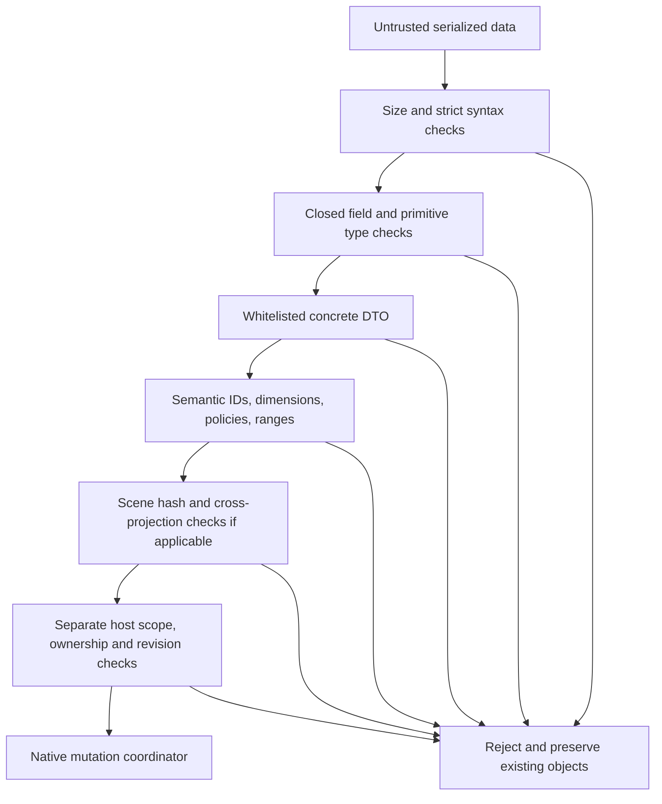

The diagram summarizes the combined boundary, not a single universal function. V2 ChartCodec uses its own Json.NET token reader and exact CheckShape; scene and authored v3 additionally use the handwritten bounded strict grammar. Json.NET TypeNameHandling is None; geometry/options polymorphism uses explicit whitelists. Native mutation is downstream of validation and does not run arbitrary serialized commands. The local file CLI is a separate boundary and does not edit presentations.

#### Scene canonical bytes and hash

PPI-SCENE-1 separates the hash domain. Scene content excludes only the outer renderHash. Object keys are ordinally sorted; array order is significant. Typed tags encode null0, false1, true2, number3, string4, array5 and object6. Counts/string byte lengths use four-byte big-endian integers. Numbers are IEEE-754 doubles in big-endian order with -0 normalized to0. Strings are valid UTF-8 with byte length, rejecting unpaired surrogates. SHA-256 is encoded lowercase hex. The C# serializer and TypeScript implementation share independent fixture/producer validation rather than relying on JSON whitespace or locale number formatting.

`SceneCodec.ComputeHash` accepts a valid draft, while Encode/Decode verify the sealed hash. TS sealScene/verifyScene clone before asynchronous WebCrypto so a caller cannot mutate pending data and race hashing. Structural JSON Schema only checks the hash's format; codecs recompute value and validate node references. Unkeyed hash cannot authenticate a sender or authorize document changes. It also does not grant broad native geometry support.

Scene grammar bounds include depth32,200000 nodes,10000 pathpoints,10000 diagnostics,4096 codepoint text and128codepoint nonblank font family. Rendered metadata native cap is much narrower at2000nodes. Rectangle/ellipse/text dimensions may be zero; sector sweep must be strictlypositive and<=360. Text alignment whitelist is left/center/right. Paint fill/stroke are null or six-digit hex, opacity[0,1], strokeWidth[0,1000]. All diagnostics reference known node IDs or null.

Evidence: `src/Chart.Renderers/SceneCodec.cs:125`; `packages/chart-engine/src/scene-contract.ts:99`; `tests/s3/scene-fixtures.mjs:8`.

#### XML persistence profile

RenderedChart contains version/chartId attributes, Canonical text, Scene text and Bindings. Each Binding has nodeId, token and shapeId; an empty shapeId is allowed only when canonical projection has no native area. Tokens are uppercase SHA-256 of exact node ID, avoiding case-folded Office tags. Shape IDs can change on reopen; ReadVerified rematches owned shapes by tokens and validates geometry/style before updating in-memory binding hints. Canonical JSON and sealed scene stay unchanged when a native user edit diverges; verification fails instead of rewriting canonical values.

The XSD is structural and allows at most2000 bindings. Runtime validation additionally checks projection identity/revision/numeric geometry/paint, binding order/token uniqueness and native ownership. XML readers prohibit DTDs and external resolvers. Unknown XML fields/attributes, duplicate matching parts, invalid versions and oversized payloads reject. VSTO feature codecs use their own namespace/version contracts; do not repurpose the rendered-chart envelope for agenda, connector or linked source state.

#### Host metadata adjuncts

Data-source XML namespace remains urn:powerpoint-intelligence:data-source:v1 while root version can be1 (unmapped file link) or2 (ExcelRangeMapping child). Mapping header/dimension drift requires confirmed reselection. Chapter agenda uses agenda:v2; indicators use indicator:v1; universal connectors use connector:v1; process grids use process-grid:v1; generated templates use template:v1. Their native ownership/tags and contextual editing rules are documented in the PowerPoint/feature sections. Shared names do not imply a database foreign-key relationship.

#### Migration and forward compatibility

S0Migration.FromXml requires explicit layout/style because legacy XML never stored them. IDs are deterministic from chart identity and positions; clone through codec avoids aliasing. ChartV3Codec.FromV2 requires explicit gapRatio and returns a validated independent snapshot, but is not part of inspected installed build. Scene v1 is a projection of chart data, not a replacement canonical schema version. Unknown PIIDX schemas are preserved and rejected, not downgraded. Legacy library migration uses independently approved registration roots and re-extracts original PPTX/POTX packages; it does not adopt an old proprietary index or import cached text.

#### Tests and limitations

DomainTests exercises golden round-trip, invariant culture, invalid dimensions/fields/IDs/numbers, Unicode boundaries and explicit S0 migration. SceneContractTests plus scene-fixtures/validate-roundtrip compare strict syntax, semantics and exact TS/.NET hashes including independently produced doubles/Unicode/subnormals. NativeRendererTests injects before/after mutation failures and verifies rollback preserves user objects; separate --interactive-office branches define edit/save/reopen checks. PIIDX schema/catalog/source/preview/workspace tests exercise persistence/races/constraints but are not native rendering proof. See parent test report for actual current commands and results; this leaf only reviewed definitions.

Security source review does not establish Checkmarx clearance or dependency vulnerability freshness. No current scan was requested/executed here, and documentation does not change implementation to close gaps.


## 15. Security architecture


### Security architecture

#### Trust boundaries and implemented controls

**VERIFIED (source)**, not penetration-test certification. NexWave runs with the interactive Windows user's permissions inside PowerPoint, .NET Framework 4.8 and VSTO. Signed VSTO/publisher trust controls loading; UI-thread/selection/model checks control safe operation. There is no implemented network service identity boundary or RBAC engine.

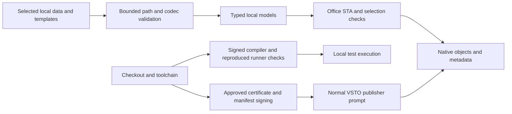

| Surface | Implemented control | Limit |
|---|---|---|
| Native mutation | Creating thread plus STA, reentrancy/active-document checks and OfficeMutationLease | Selection/concurrency safety, not RBAC |
| Metadata/XML | Namespace/version/shape checks, bounded size, explicit no-DTD/resolver-null readers | Metadata can be deleted/changed; recovery must fail safely |
| JSON | BoundedJson grammar/depth/duplicate-key/finite-number checks plus semantic codecs | Does not authorize an absent AI executor |
| Filesystem | Selected absolute inputs versus Within-reconstructed outputs and owned-path reparse checks | Selected inputs intentionally differ from owned output authority |
| Recovery | Checkout-artifacts containment, ADS/dot/reparse rejection, bounded locked JSON | Scanner scope/freshness need independent review |
| Cached code | Receipt/hash plus independent current-source reproduction; verified files locked during load/launch | Checkout/compiler/build user remain trusted |
| Windows SQLite loading | DefaultDllImportSearchPaths(System32), SafeHandle resources and parameter binding in NativeSqlite | Inbox Windows capability, not a server database identity |
| Signing | Approved thumbprint/private key/validity/code-signing EKU/chain; Valid signature before publish | Development trust is not enterprise target approval |
| Bootstrap | Fixed bundle and entry SHA256, bounded inventory/expansion, SafePath, refusal to overwrite modified versions | Inherits local user filesystem boundary |
| Service profiles | Nonsecret schema, HTTPS syntax and atomic local replacement | Plaintext metadata; no egress allowlist/authentication |

Evidence: `apps/powerpoint-vsto/PowerPointHost.cs:58` `src/Library.Core/PathPolicy.cs:56` `src/Shared.Contracts/BoundedJson.cs:19` `scripts/Build-Integrity.ps1:21` `scripts/Build-Integrity.ps1:39` `easySetup/Bootstrapper.cs:36`.

No centralized immutable audit, database-at-rest encryption, cloud secret vault, tenant isolation, remote authentication, token refresh or policy service is implemented. OS/Office trust must not be mislabeled as these capabilities. See [gap register](../09-security/security-gap-register.md).


### Authentication and authorization

#### Actual identities

The add-in executes under the desktop Windows user and Office process. VSTO loading uses publisher trust. COMAddIns.Object exposes local COM automation, not bearer-token HTTP calls. No application login/user/role table, Entra token acquisition, Windows Negotiate handshake or identity-provider SDK exists in authored runtime/service sources.

ServiceConnectionProfile.Authentication selects future intent; it never authenticates a session. Status expressly distinguishes metadata readiness from connectivity testing. `apps/powerpoint-vsto/ServiceConnections.cs:13` `apps/powerpoint-vsto/ServiceConnections.cs:56`.

#### Guards that are not RBAC

Office compatibility enables commands based on Office 16 API/process architecture/minimum build. COM mutations require creating UI STA. Contextual edits verify selection snapshots before applying a queued change. OfficeMutationLease coordinates writers across tests/add-in timers; named mutex ownership is not a permission grant. Filesystem access follows Windows ACL/host policy; the add-in does not elevate itself.

Evidence: `apps/powerpoint-vsto/OfficeCompatibility.cs:61` `apps/powerpoint-vsto/DemoApi.cs:35` `apps/powerpoint-vsto/PowerPointHost.cs:14`.

#### Planned boundary

Gateway README proposes RBAC before authorized context retrieval. Q-004 leaves identity provider, SSO protocol, groups and service accounts unresolved. This is **PLANNED / NOT IMPLEMENTED**, not an existing enterprise identity design. `services/ai-gateway/README.md:5` `docs/DECISIONS.md:8`.

Future implementation should validate issuer/audience/scopes, map permissions to specific actions/documents, reject unapproved targets/revisions and audit denials. These are recommendations; no actual role names or token grants can be inferred.


### Secrets management and sensitive data

#### Implemented boundary

Service settings hold endpoints/deployment/mode only, reject URI userinfo/query/fragment and unknown XML fields; tests reject ApiKey fields. No token/password value exists in the format. `apps/powerpoint-vsto/ServiceConnections.cs:45` `tests/s0/ServiceConnectionTests.cs:29`.

Signing private keys remain in Windows certificate storage. Builder selects an approved thumbprint with private key, code-signing EKU and trust chain; payload comprises DLL/config/manifest/VSTO/templates rather than an exported PFX. `scripts/Build-Integrity.ps1:57` `easySetup/Build-EasySetup.ps1:41`.

**NOT IMPLEMENTED:** Azure Key Vault, Windows Credential Manager connector, managed identity, runtime credential acquisition, encrypted application secret persistence or rotation. RuntimeCredential is only an enum.

#### Sensitive local data

Presentation associations can retain source paths/worksheet/range/header signatures. PIIDX stores local presentation text/object metadata. These are user data despite no network upload. GetBuildInfo exposes assembly location; installation/repair evidence can retain local paths. Exported documentation copies no user documents or private credentials.

PowerPointHost diagnostics use fixed operation/error/HRESULT rather than workbook values. Scanner collector exports matching diagnostic records but explicitly makes no protection/clearance verdict. `apps/powerpoint-vsto/PowerPointHost.cs:54` `scripts/Collect-SceneThreatEvidence.ps1:60`.

#### Recommendations

Use organization-approved publisher/renewal policy; never bundle keys or place secrets in endpoint paths. Define workstation catalog/profile ACL, retention/backup and future AI upload classification before production deployment. Q-005/Q-007 remain owner/environment decisions. Metadata is plaintext; absence of credential fields is not encrypted storage.


### Threat model

Scope: local VSTO runtime, document/data/index files, native Office/Windows calls, development scripts and signed deployment. Assets: native document integrity/editability, local source data/catalog text and build/installation provenance. Threat actors include malformed input authors, corrupt/stale metadata, local file replacement, compromised dependencies and future overprivileged connectors. A fully privileged workstation administrator is outside the application's own boundary.

| Scenario | Existing control | Residual / verification |
|---|---|---|
| Traversal/ADS escape from generated path | PathPolicy syntax/Within, owned-output ancestor checks, Artifact-Inputs | User-selected inputs intentionally have broader authority; junction tests limited by host |
| XML external entity/resource exhaustion | Explicit bounded no-DTD/resolver-null readers in codecs and Safe-Xml | Install-Local/Test-DemoPackage implicit casts need consistent review |
| Ambiguous/oversize JSON | Strict bounded grammar/depth32/duplicate-key/finite-number and semantic codecs | S0 COM DataContract JSON differs from strict v2/scene path |
| Corrupt copied native metadata | Version/identity/namespace checks, explicit mapping and safe preservation on failure | Native family/copy/reopen acceptance requires Office execution |
| Cached executable plus forged receipt | Independently reproduce current source; lock verified bytes/files | Source/compiler/build user trusted; receipt alone insufficient |
| Compromised development dependency | JS lockfile/lifecycle scripts disabled; scene-specific publisher verification | Test-S1's initial NuGet download lacks pinned checksum before use |
| Malicious native source template | Bounded ZIP/XML extraction and intended read-only source access | Hidden/read-only Office source is not a sandbox |
| Tampered install package | Authenticode, bundle/file hashes, extraction bounds/SafePath | Target estate publisher trust remains separate |
| Future prompt injection/exfiltration | AI currently disconnected/no executor | Typed actions/auth/approval/minimization required before connection |

Evidence: `scripts/Artifact-Inputs.ps1:1` `scripts/Safe-Xml.ps1:1` `scripts/Test-S1.ps1:18` `src/Shared.Contracts/BoundedJson.cs:28` `apps/powerpoint-vsto/DemoApi.cs:40` `easySetup/Bootstrapper.cs:53`.

No exploitation/network probes were executed. Gap severity is engineering assessment, not a new scanner severity or exploit confirmation.


### Security gap register

Source-review assessment only; no new vulnerability scan or source remediation. Historical scanner classifications are retained separately from current source controls.

| ID / assessed severity | Evidence | Impact/status | Resolution / validation recommendation |
|---|---|---|---|
| SEC-01 High — dependency verification gap | `scripts/Test-S1.ps1:18` | Missing DLL triggers pinned-version NuGet download/expansion/downstream compilation or execution without independent package digest/signature in that script. HTTPS/version pin is not independent identity. Later scene checks do not cover every S1 consumer. | Approved digest/publisher before expansion/load; tampered download and offline-cache tests. |
| SEC-02 High — PIIDX scanner scope gap | `scripts/Collect-SceneThreatEvidence.ps1:23` `scripts/Collect-SceneThreatEvidence.ps1:42` | Regex filters SceneContractTests/TemplateLibraryTests and scene/template folders, not PiidxTestSuite.dll. Historical no-PIIDX-match cannot prove PIIDX was searched. Recovery reproduction controls remain, but evidence is incomplete. | Bounded explicit PIIDX path/hash matching; positive PIIDX and unrelated-data exclusion fixtures; retain old report as limited. |
| SEC-03 Medium — implicit XML readers | `scripts/Install-Local.ps1:21` `scripts/Test-DemoPackage.ps1:27` | Builder uses Safe-Xml; related installer/test readers retain implicit casts. No external fetch exploit asserted; local provenance/runtime defaults matter. | Consistent bounded no-DTD/resolver-null readers, version/hash and PS5.1 regressions. |
| SEC-04 High when connected — auth/action-policy absent | `services/ai-gateway/README.md:1` `services/ai-gateway/action-plan.schema.json:37` | No identity/provider/action executor now. Generic arguments/model status cannot be future authorization. Not a current live-Azure exploit. | Typed action schemas, authorization, approval state machine, egress/minimization before executor. |
| SEC-05 Medium — local-data lifecycle policy | `apps/powerpoint-vsto/ServiceConnections.cs:35` `src/Library.Core/PiidxCatalog.cs:32` | Catalog/text/paths and profile metadata can be sensitive; no application encryption/retention/central audit found. Windows user/ACL is boundary. | Classification, workstation ACL/backup/retention/deletion and encryption decision. |
| SEC-06 Medium — publisher distribution trust | `docs/DECISIONS.md:35` `scripts/Build-Integrity.ps1:39` | Local development publisher success does not establish target estate trust/renewal. | Approved publisher, timestamp/renewal policy, target x86/x64 acceptance. |
| SEC-07 Medium — native release evidence gaps | `scripts/Test-All.ps1:89` | CI/noninteractive success cannot establish installed ribbon/native save-reopen/build variants/DPI/focus. | Desktop negative/mutation/roundtrip matrix with retained evidence. |
| SEC-08 Low/compatibility — host fingerprints | `scripts/Source-Fingerprint.ps1:21` `easySetup/Common.ps1:14` | ICU/NLS ordering may classify unchanged package as stale; historical deployment notes demonstrate NLS reproduction. Not an integrity bypass claim. | Canonical ordinal ordering/shared PS5/PS7 vectors and new signed package after recipe change. |

#### Historical Checkmarx state

The 3-Nov11:35 remediation document preserves High similarity IDs -2018192911/-355656028 (recovery paths), 1923684989/1239593030 (XML),1072025071 (fingerprint hash-only sink). Source contains artifact/safe-builder XML controls. The fingerprint flow is a documented potential false positive pending query/rescan review. One High 2 ms result had no details and was owner-deferred. `docs/security/CHECKMARX_20261103_113558_REMEDIATION.md:1`.

No “resolved”/“zero vulnerabilities” count is inferred. A source control, a unit assertion and scanner clearance are different evidence. Severity here is qualitative impact prioritization, not exploit proof. Nothing was disabled, suppressed or changed in application source by this export.


## 16. Runtime and deployment architecture


### Deployment architecture

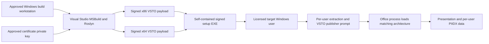

The bootstrapper detects target Office architecture, validates/extracts its embedded bundle and invokes the VSTO installation path. Existing prerequisite .NET Framework 4.8/VSTO runtime and PowerPoint are required. It does not silently fetch or install prerequisites. The private key belongs to the build identity, never to the distributable. Exact mechanics and rollback paths are in `easySetup/Bootstrapper.cs:1` and `easySetup/Build-EasySetup.ps1:1`.

Local development installation uses `scripts/Install-Local.ps1`, a separate path from distributed easySetup extraction. Both require appropriate publisher trust. The exporter performs no installation and treats prior deployment receipts as historical evidence. A local-development signer trusted on one machine is not evidence of an enterprise publisher trusted elsewhere. `scripts/Install-Local.ps1:1`.

No cloud/on-prem API container is deployed by these scripts. Network identity, enterprise database and Azure topology remain open decisions. Keep installed extraction locations because VSTO may continue referring to them; rebuilding/removing artifacts indiscriminately can break local registrations. [Packaging details](../11-build-deployment/packaging-installation.md).


## 17. Build installation configuration and release


### Development setup

#### Verified toolchain

Windows desktop PowerPoint, .NET Framework 4.8 targeting pack, C# 7.3, Visual Studio Office/VSTO tools, VSTO Runtime, Office/PowerPoint PIAs and Windows PowerShell are the native stack. The project is a legacy MSBuild VSTO library, not Office.js/.NET8 or a standalone native application. `apps/powerpoint-vsto/PowerPointIntelligence.csproj:9`.

Office version15 PIAs use embedded interop types while runtime guard requires Office 16.0 API. x86/x64 refer to PowerPoint process, not OS bitness. A configured profile is not product certification. `apps/powerpoint-vsto/OfficeCompatibility.cs:69`.

Node/npm/TypeScript/Ajv support deterministic chart/domain tests. CI uses Node 20 for chart-core and Node 24 for S1, not one central pin. Python/lxml support offline repair/security tests/maintenance. These are development tools, not bootstrapper prerequisites.

#### Preparation

1. Install approved Visual Studio Office workload/.NET4.8 targeting pack, desktop Office and VSTO Runtime via normal estate tooling.
2. Restore JavaScript with scripts/Restore-LockedDependencies.ps1 (npm ci --ignore-scripts for domain/engine).
3. Review fresh-cache Newtonsoft provenance before Test-S1: its missing-DLL branch downloads pinned NuGet without a pinned hash (SEC-01).
4. Use normal Windows PowerShell for signing/packaging and an approved certificate in Windows storage. Never export a key into the checkout.
5. Save/close presentations before install/interactive tests.

No installation/restoration/build was executed for this documentation export; existing scripts write outside project-export. [Build instructions](../11-build-deployment/build-instructions.md) are reproducible operator procedures; [test results](../12-testing/test-results.md) distinguish actual current safe checks.


### Build instructions

Commands reverse-document source; they are not execution claims for this export. Run from repository root in an approved desktop environment.

#### Compile only

```powershell
$vswhere = Join-Path ${env:ProgramFiles(x86)} 'Microsoft Visual Studio/Installer/vswhere.exe'
$vs = & $vswhere -latest -products '*' -property installationPath
& (Join-Path $vs 'MSBuild/Current/Bin/MSBuild.exe') apps/powerpoint-vsto/PowerPointIntelligence.csproj /t:Compile /p:Configuration=Release /p:Platform=x64 /v:minimal /nologo
```

Allowed platforms AnyCPU,x86,x64; Debug emits symbols, Release optimizes. Compile alone does not create signed deployment/validate loading. Selected domain/renderer/Library.Core files compile directly into add-in; the separate domain project is not the whole production graph. `apps/powerpoint-vsto/PowerPointIntelligence.csproj:39`.

#### Signed self-contained deployment

```powershell
.\easySetup\Build-EasySetup.ps1 -CertificateThumbprint '<approved-40-hex-thumbprint>'
.\easySetup\Test-EasySetup.ps1
```

Builder validates Microsoft tool identity and approved current certificate/private key/EKU/chain; increments four-part version; builds signed x86/x64 payloads; validates payload marker/hash/template inclusion; packages and signs pending EXE; requires Valid Authenticode plus unchanged source; then atomically replaces public EXE. Failures preserve the previous publication. `easySetup/Build-EasySetup.ps1:19` `easySetup/Build-EasySetup.ps1:84`.

PpiForcePayloadCompile deletes only known intermediate assembly before CoreCompile to avoid restored timestamp reuse. PpiEasySetupBuild prevents recursive package builds; PpiSkipEasySetup suppresses the signed Release hook deliberately. Signed Release Build otherwise calls builder automatically. `apps/powerpoint-vsto/PowerPointIntelligence.csproj:73`.

#### Watcher

Watch-EasySetup polls default 5 seconds (allowed2–300), waits for stable fingerprint, rebuilds once for a changed source and keeps watching. Output after publication is normal idle polling. Ctrl+C stops. A failed source version keeps the old EXE and waits for another edit, rather than endlessly retrying. `easySetup/Watch-EasySetup.ps1:1`.

#### Check side effects

Test-All creates artifacts/source snapshots and .NET/TS outputs; -InteractiveOffice adds real Office tests. Test-EasySetup -SourceOnly still compiles/runs inert fixtures under artifacts. They were not invoked unchanged in this documentation-only task; their source is analyzed and current safe validation is documented separately.


### Packaging, installation and upgrades

#### Layout and identities

One AnyCPU managed bootstrap EXE embeds IntelligencePayload.zip: x86/x64 folders, DLL/config/application/deployment manifests, dependencies, licensed POTX assets, generated README and payload.sha256. Public file/storage/COM identities retain PowerPointIntelligence; display product/ribbon is NexWave. Private signing keys are not payload assets. `easySetup/Build-EasySetup.ps1:74` `easySetup/Bootstrapper.cs:13`.

#### Bootstrap transaction

Main is STA/WinForms. It refuses running POWERPNT processes without closing work; requires .NET4.8 registry Release>=528040, a registered single PowerPoint x86/x64 PE with major16 and installed VSTOInstaller. No prerequisite is downloaded. It asks visible confirmation. `easySetup/Bootstrapper.cs:36` `easySetup/Bootstrapper.cs:20`.

```mermaid
sequenceDiagram
  actor User
  participant Setup
  participant Package
  participant Cache as Per-user versions cache
  participant VSTO as VSTOInstaller
  User->>Setup: Run EXE and confirm
  Setup->>Setup: Verify closed host and prerequisites
  Setup->>Package: Verify bundle and per-file SHA inventory
  Setup->>Cache: Bounded safe extraction into bundle hash version
  alt Previous different manifest
    Setup->>VSTO: Uninstall prior package
  end
  Setup->>VSTO: Install selected architecture manifest
  alt Success
    Setup->>Cache: Save installed-manifest receipt
    Setup-->>User: Completed; runtime validation remains
  else Install failure after upgrade removal
    Setup->>VSTO: Attempt previous manifest install
    Setup-->>User: Error and rollback log
  end
```

Bounds: <=5000 entries, declared expanded sum<=512 MiB, inventory<=2,000,000 bytes, exact expected entry count+1, each entry digest checked. SafePath rejects colon/backslash/root escape. Existing version files must hash identically and are not overwritten. Destination is named by bundle hash. `easySetup/Bootstrapper.cs:53` `easySetup/Bootstrapper.cs:15`.

Cache/logs/installed-manifest.txt live under per-user LocalAppData/PowerPointIntelligence/easySetup. Keep VSTO-referenced version folders. Upgrade validates prior receipt under versions, exact .vsto filename and existence; stale prior receipt requires normal repair/uninstall. Different location from a repository-local install may need normal migration/uninstall. `easySetup/Bootstrapper.cs:64`.

#### Local install alternative

Install-Local -Platform x64/x86 signs/builds the repository manifest then launches visible VSTOInstaller; SkipBuild still requires payload freshness/manifests. If no certificate selected, it may create a 90-day nonexportable development certificate, but imports no trusted root and changes no policy. This differs from builder's approved-chain requirement. `scripts/Install-Local.ps1:38`.

#### Uninstall/rollback

Use Windows Apps/Programs and Features/normal VSTO removal. Changed-package failure attempts previous VSTO installation; rollback failure is logged separately. No central MSI/remote repair/database rollback service exists. Do not delete cache folders before removing installed VSTO dependencies.


### Deployment guide and acceptance

#### Intent versus certification

Runtime guard targets common Office 16.0 API. Profile auto/office2016/office2019/microsoft365 records intent; edition is not auto-detected. Architecture any/x86/x64 checks actual PowerPoint process; configured full build minimum fails closed if build unavailable. Full Office channel/build/DPI/locale certification is UNKNOWN. `apps/powerpoint-vsto/OfficeCompatibility.cs:85` `docs/DECISIONS.md:29`.

#### Release sequence

1. Review baseline, dependency provenance, security findings and target estate decisions.
2. Run Test-All in approved desktop checkout; retain exact source/test evidence.
3. Build signed easySetup with approved certificate; Test-EasySetup in normal Windows PowerShell; retain build.json/README.
4. Save/close presentations; run EXE, complete normal publisher prompt, retain extracted versions.
5. Open PowerPoint; confirm NexWave/build identity and run native/link/library/edit/save/reopen tests plus visual/DPI checks.
6. Distribute only allowed licensed templates and approved publisher chain.

On-prem API/Azure gateway are not implemented; no server topology/ports/secret environment are invented. Office/VSTO/.NET prerequisites, target publisher trust, identity/models/retention policies remain enterprise dependencies. `services/ai-gateway/README.md:1`.

#### Historical evidence

The current build receipt records a prior publication. docs/implementation/deployment-validation-20261103.md records earlier24/24 local checks, version1.0.0.18 desktop signing and activation limitations. These are historical records, not checks rerun now. Current export verification is in [test results](../12-testing/test-results.md).

#### Unsupported assumptions

No macOS/web/mobile add-in, unattended server Office automation, automatic downloaded prerequisites, remote admin/updater service, license enforcement or HA/DR implementation exists. Source edits update EXE only when signed Release hook/watcher runs successfully; a source save alone is not publication.


### Configuration reference

#### Add-in configuration

AppSettings source: `apps/powerpoint-vsto/App.config:1`.

| Key | Default and semantics | Consumer |
|---|---|---|
| OfficeProfile | auto; office2016/office2019/microsoft365 allowed | OfficeSettings.Parse allowlist |
| OfficeArchitecture | any; x86/x64 process check | OfficeCompatibility.Evaluate |
| OfficeMinimumVersion |16.0; optional four-part build |16.0 only; executable build may be required |
| TemplateLibraryFolder | Development source local repository path; builder rewrites relative templates | Resolve beside deployed DLL; explicit missing root reports unavailable |
| LibraryIndexPath | Empty uses local per-user default | LibraryConfiguration |
| LibrarySourcesConfig | Empty uses per-user source registration default | LibraryConfiguration |
| LibraryRefreshSeconds |60 | Refresh monitor/configuration |
| LibraryWatchRootLimit |32 | Watcher root cap |

OfficeSettings.Load explicitly maps add-in .dll.config, never edits POWERPNT.EXE.config, rejects unknown compatibility settings and permits library keys for independent resolution. `apps/powerpoint-vsto/OfficeCompatibility.cs:33`.

#### Service profiles

LocalAppData/PowerPointIntelligence/service-connections.v1.xml: three nonsecret profiles, version1/strict namespace/bounds/no DTD. Empty profiles are valid not-configured values. Not a credential storage format. `apps/powerpoint-vsto/ServiceConnections.cs:35`.

#### Build and test flags

Project: PpiForcePayloadCompile, PpiEasySetupBuild, PpiSkipEasySetup, SignManifests, ManifestCertificateThumbprint, ApplicationVersion, Platform, Configuration. Test-All: InteractiveOffice, OfficeRuns=3, LocalTimeoutSeconds=300, OfficeTimeoutSeconds=3600. Focused demo tests expose AgendaOnly/ElementsOnly/PropertiesOnly/LinkedChartDiagnostic/PauseOwnAddIn/MappedExcelOnly; invalid combinations fail before Office use. `scripts/Test-All.ps1:1` `scripts/Test-DemoFeatures.ps1:1`.

Branding does not rename persisted XML namespaces, tags, COM/assembly/storage/installer identities. `docs/DECISIONS.md:4`. No Azure secret/token environment configuration is implemented.


### Troubleshooting

| Symptom | Evidence and source-grounded response |
|---|---|
| Missing ribbon | Inspect COM Add-ins Connect/load error, build marker/assembly hash, GetRibbonLoaded/OnLoad and install receipt. Registration/load/visual runtime are distinct. |
| COM0x80070005 | Collect token/registration/stage with Diagnose-PowerPointActivation; compare normal desktop token. Historical AppContainer denials do not prove antivirus is cause. Do not weaken controls speculatively. |
| Type library/bitness errors | Check Office API/executable build/process architecture and normal Office/VSTO registration. PIAs version15 are compile API identities, not Office 15 support. |
| Workbook RPC rejection/disconnection | Fixed step/HRESULT, owned crash metadata and LinkedChartDiagnostic; respect bounded retries/lifetime/mutation lease. Timeout is not successful commit. |
| Property panel hidden/stale | Published state reason/stage/foreground/selection identity; desktop foreground prerequisite and stale-target guard prevent wrong mutation. |
| STALE PACKAGE | Compare current marker/manifest/DLL hash/deployment version. Force current signed build; SkipBuild does not fix stale payload. |
| Missing certificate/UnknownError | Check approved normal desktop CurrentUser/My key/EKU/trust. AppContainer cert views differ; failed builder preserves old EXE. |
| Payload checksum after atomic EXE replacement | Verify receipt/EXE and read current immutable bytes. Resource reader avoids Assembly.LoadFile path identity caching; regression exists. |
| Watcher idle after publication | Normal polling; Ctrl+C stops. Failure waits for a new source edit and keeps prior EXE. |
| Missing scene/template/PIIDX runner | Preserve receipt/hash/path/launch status; review scanner scope and exact action before explicit source recovery. Do not delete receipt to force rebuild. Current collector scope excludes PIIDX (SEC-02). |
| Moved/changed data | Header/range/path/mapping check; stop refresh, reselect and confirm. Never assume automatic source rebinding/sample fallback. |
| Library unavailable | Check explicit root/index/config and permissions/integrity/FTS; no silent fallback from an unavailable configured root. |
| Fresh package looks stale in PS7 | Compare NLS/ICU sorting host; use documented normal Windows PowerShell, not bypassing freshness. |

Evidence: `scripts/Test-InstalledRibbon.ps1:1` `scripts/Diagnose-PowerPointActivation.ps1:1` `apps/powerpoint-vsto/PowerPointHost.cs:214` `apps/powerpoint-vsto/DataSources.cs:197` `easySetup/Common.ps1:2`.

Diagnostic scripts can write artifacts/temp or activate Office; they were analyzed, not executed by this export. Keep incident output to bounded identity/error metadata; do not publish workbook contents/private credentials.


## 18. Execution sequences and activity diagrams


### Workflow inventory

**VERIFIED:** routes below exist in source. Execution evidence is recorded separately; source-supported diagrams are not fresh Office test passes.

| Workflow | Trigger and input | Output | Primary source | Failure boundary |
|---|---|---|---|---|
| Startup | VSTO Startup | Host, timers, compatibility and context controller | `apps/powerpoint-vsto/ThisAddIn.cs:37` | Invalid config disables commands |
| Ribbon action | Callback plus Tag/ID/current selection | Native document mutation or dialog | `apps/powerpoint-vsto/ThisAddIn.cs:133` | Busy/lease/compatibility and status catches |
| Context property update | Selection event/timer and foreground policy | Immutable UI-state snapshot and applicable controls | `apps/powerpoint-vsto/ContextPropertiesController.cs:1` | Stale selection or absent foreground prevents mutation |
| Linked chart write | Valid local table and explicit source link | Embedded workbook, native series and attached source metadata | `apps/powerpoint-vsto/DataSources.cs:166` | Native-value acknowledgement/timeout; no sample fallback |
| Table insertion | Linked rows/columns | Editable native PowerPoint table and link metadata | `apps/powerpoint-vsto/DemoTools.cs:247` | Partial owned shape cleaned up on failure |
| Native shape rendering | v2 canonical chart plus verified scene | Grouped editable native shapes and canonical binding metadata | `src/Chart.Renderers/NativeRenderingCore.cs:158` | Preflight then owned-object rollback; incomplete rollback explicit |
| Managed element editing | Element command/double click | Updated text/process/indicator/connector canonical/native state | `apps/powerpoint-vsto/ElementCommands.cs:1` | Unsupported/ambiguous metadata preserved |
| Agenda refresh | Chapter controls, debounce or before-save | Chapter/contents text/hierarchy/links | `apps/powerpoint-vsto/ChapterAgenda.cs:1` | Invalid state reports paused update |
| Library indexing | Registered root, refresh/watch request | Transactionally refreshed PIIDX catalog | `src/Library.Core/PiidxCatalog.cs:1` | Exact schema/integrity/path parsing guards |
| Library preview/import | Selected library slide and destination | Native preview or inserted source-formatted slide | `apps/powerpoint-vsto/LocalLibraryGallery.cs:1` | Missing/stale source and owned hidden-source cleanup |
| Save/reopen/recover | BeforeSave or explicit inspect | Associated chart data/revisions and duplicate identity handling | `apps/powerpoint-vsto/PowerPointHost.cs:48` | Preserve unsupported objects with diagnostics |
| Service profile preparation | Configure services | Validated local profile/status | `apps/powerpoint-vsto/ServiceConnections.cs:1` | Not an authenticated network call |
| Shutdown | VSTO Shutdown | Disposed timers/controls and event detachment | `apps/powerpoint-vsto/ThisAddIn.cs:77` | Scoped disposal, no forced Office termination |

The [sequence diagrams](../10-workflows/sequence-diagrams.md) and [activity diagrams](../10-workflows/activity-diagrams.md) explain significant paths. AI inference has no implemented runtime workflow; its absence and only actual profile-preparation path are documented in [AI workflows](../06-ai-architecture/ai-workflows.md).


### Execution sequence diagrams

#### Add-in initialization and teardown

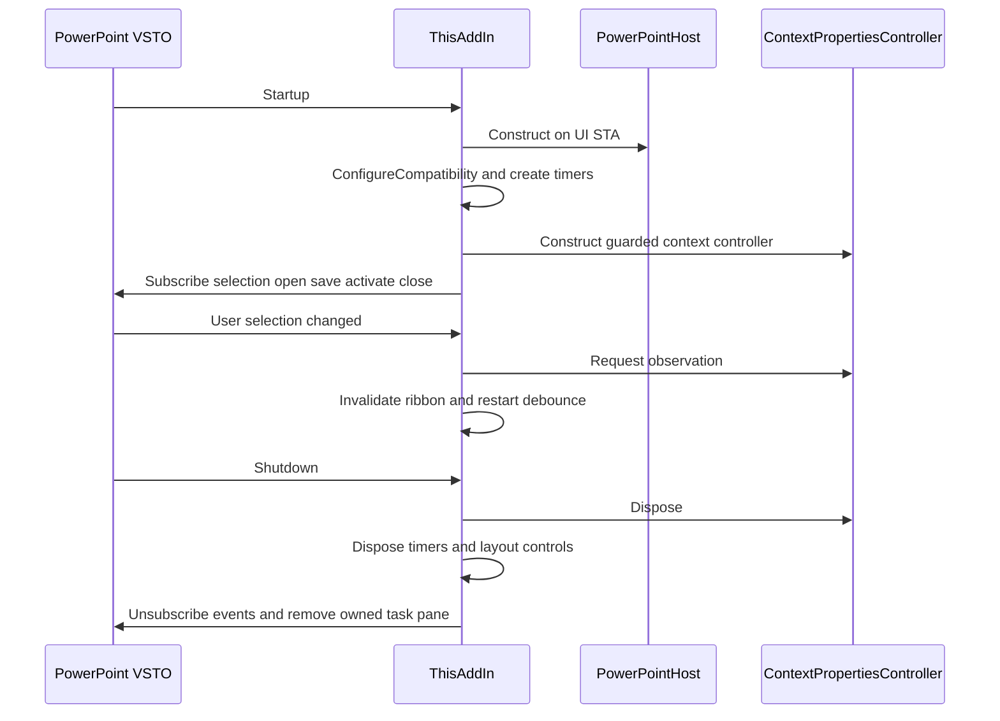

Source: `apps/powerpoint-vsto/ThisAddIn.cs:37`, `apps/powerpoint-vsto/ThisAddIn.cs:77`. Compatibility does not validate Office edition licensing. Context observation and host mutation have different permissions/lifetimes.

#### Ribbon action and native table

```mermaid
sequenceDiagram
  actor U as Author
  participant R as Ribbon callback
  participant A as ThisAddIn
  participant L as Mutation lease
  participant D as LinkedChartData
  participant P as Active PowerPoint slide
  U->>R: Choose editable table
  R->>A: RunDemoTool with command tag
  A->>L: TryEnter current Office PID
  alt Busy or incompatible
    A-->>U: No mutation or compatibility status
  else Allowed
    A->>D: Choose and load linked source
    D-->>A: Validated table and selected mapping
    A->>P: Shapes.AddTable and fill native cells
    A->>D: Persist shape link metadata
    A->>P: Select created object
    A-->>U: Completed or scoped failure status
  end
```

The native table path writes editable cells with central vertical anchoring and centered paragraphs. It does not rasterize the result or create another report presentation. `apps/powerpoint-vsto/DemoTools.cs:247`; `apps/powerpoint-vsto/ThisAddIn.cs:133`.

#### Linked chart workbook commit

```mermaid
sequenceDiagram
  participant C as LinkedChartData
  participant E as Embedded Excel workbook
  participant N as Native PowerPoint chart
  participant X as Shape custom XML
  C->>E: Activate and write validated linked table
  C->>N: Bind source and set typed series values
  C->>N: Wait for expected native series and point values
  alt Native values acknowledged
    C->>E: Calculate and close owned workbook
    C->>N: Verify committed native values
    C->>X: Persist source association
  else Timeout or COM failure
    C-->>C: Throw stage-specific diagnostic
  end
```

`apps/powerpoint-vsto/DataSources.cs:166`. Closing an Excel workbook alone is not evidence that PowerPoint committed values; native chart observation is the acceptance condition. Fixed diagnostics deliberately omit source values. No sample-data fallback is permitted.

#### Grouped-shape renderer transaction

```mermaid
sequenceDiagram
  participant R as NativeSceneRenderer
  participant V as ClusteredProjection
  participant S as IEditableSceneSurface
  R->>V: Validate canonical JSON and scene equality
  V-->>R: Validated projection
  R->>S: Begin owned batch
  loop Drawable semantic nodes
    R->>S: Create native shape and bind semantic ID
  end
  R->>S: Group and persist canonical scene bindings
  alt Success
    S-->>R: Verified group record
  else Mutation or persistence failure
    R->>S: Roll back only newly owned objects
    S-->>R: Rollback completeness
    R-->>R: Throw NativeRenderException
  end
```

`src/Chart.Renderers/NativeRenderingCore.cs:158`; `src/Chart.Renderers/PowerPointSceneSurface.cs:14`. Zero/missing values can have semantic bindings without drawable bars. Incomplete cleanup remains an error, rather than a success or permission to delete unrelated shapes.

#### Library refresh, query and insertion

```mermaid
sequenceDiagram
  actor U as Author
  participant G as Gallery workspace
  participant C as PiidxCatalog
  participant F as Local source packages
  participant P as PowerPoint
  U->>G: Register source or refresh
  G->>C: Refresh with source registration
  C->>F: Read bounded Open XML and fingerprints
  C->>C: Transactionally update catalog and search index
  U->>G: Query filter and select thumbnail
  G->>C: Bounded search page and source reference
  G->>P: Render preview from owned read-only source if needed
  U->>G: Insert selected slide
  G->>P: Insert source slide into current destination
  G->>P: Close only owned source presentation
```

`src/Library.Core/PiidxCatalog.cs:1`; `src/Library.Core/PresentationSource.cs:1`; `apps/powerpoint-vsto/LocalLibraryGallery.cs:1`. PIIDX extraction does not itself render Office pixels. Source freshness and native-format fidelity are separate checks.

#### Save and recovery

```mermaid
sequenceDiagram
  participant P as PowerPoint
  participant A as ThisAddIn
  participant H as PowerPointHost
  participant X as Custom XML and tags
  P->>A: BeforeSave active presentation
  A->>A: Refresh managed agenda and layout links
  A->>H: InspectAndRecover capture enabled
  H->>X: Resolve shape-owned metadata namespace
  alt Supported valid chart
    H->>P: Capture native data and reconcile identity
    H->>X: Persist validated metadata
  else Missing ambiguous or unsupported metadata
    H-->>A: Fixed diagnostic and preserve native object
  end
  P->>P: Save presentation
```

`apps/powerpoint-vsto/ThisAddIn.cs:318`; `apps/powerpoint-vsto/PowerPointHost.cs:48`. Open/window activation do not unconditionally mutate all decks. Do not infer that event-level catching means a failed mutation was fully transactional.


### Activity diagrams

#### Validation before document mutation

```mermaid
flowchart TD
  A[User action] --> B{Host available and compatible}
  B -- No --> X[Report disabled or unavailable]
  B -- Yes --> C{Mutation lease acquired}
  C -- No --> Y[Return without competing write]
  C -- Yes --> D[Resolve current presentation and selection]
  D --> E[Read and validate canonical data or input table]
  E --> F{Supported and unambiguous}
  F -- No --> Z[Preserve native objects and report]
  F -- Yes --> G[Start native undo boundary where implemented]
  G --> H[Perform scoped native edits]
  H --> I[Verify commit and persist association]
  I --> J[Update status and context observation]
```

`apps/powerpoint-vsto/ThisAddIn.cs:133`; `apps/powerpoint-vsto/PowerPointHost.cs:48`. Undo grouping and transaction rollback differ by module; the graph is a shared validation pattern, not a claim every handler implements the same atomicity.

#### Context properties and stale target prevention

```mermaid
flowchart TD
  A[Selection or timer request] --> B[Capture on Office UI STA]
  B --> C{PowerPoint owner foreground}
  C -- No --> H[Hide property box]
  C -- Yes --> D[Classify applicable properties and target identity]
  D --> E[Publish immutable observation snapshot]
  E --> F[User chooses property edit]
  F --> G{Selection identity still matches}
  G -- No --> R[Reject stale mutation]
  G -- Yes --> M[Apply only supported properties]
```

`apps/powerpoint-vsto/ContextPropertiesController.cs:1`; `apps/powerpoint-vsto/ContextSelectionBridge.cs:1`; `apps/powerpoint-vsto/ContextActionRouter.cs:1`. Foreground focus is a Windows prerequisite, not a reason to change focus/security policy. Table cell text, group text, chart properties and indicators have different applicability.

#### Local catalog refresh

```mermaid
flowchart TD
  A[Configured enabled source root] --> B[Enumerate supported packages within policy]
  B --> C{Fingerprint changed or new}
  C -- No --> D[Retain current indexed presentation]
  C -- Yes --> E[Parse bounded presentation metadata]
  E --> F[Begin catalog transaction]
  F --> G[Replace presentation slides objects tags and FTS rows]
  G --> H[Commit or roll back error]
  H --> I[Report refresh progress and missing files]
```

`src/Library.Core/PiidxCatalog.cs:1`; `src/Library.Core/PresentationSource.cs:1`. Watch notifications/debounce request refresh; they are not a guarantee of enterprise scheduled updates or real-time external synchronization.


### Data-flow and trust-boundary diagrams

```mermaid
flowchart LR
  FILE[User-selected local file] --> PARSE[Bounded CSV JSON XML or Excel reader]
  PARSE --> MAP[Explicit columns and worksheet range]
  MAP --> TABLE[Validated linked table]
  TABLE --> CHART[Native Excel-backed PowerPoint chart]
  TABLE --> SHAPES[Canonical v2 projection and native shapes]
  CHART --> META[Shape-attached custom XML plus tags]
  SHAPES --> META
  CHART --> SAVE[PPTX save]
  META --> SAVE
  SAVE --> READ[Reopen and validated association read]
```

The embedded workbook may contain actual linked data. Canonical metadata and source path provenance are persisted locally with the presentation; encryption/redaction policy is not invented by the codec. Diagnostics intentionally avoid logging workbook values but do not encrypt the deck. `apps/powerpoint-vsto/DataSources.cs:39`; `apps/powerpoint-vsto/MetadataCodec.cs:1`; `src/Chart.Renderers/NativeRenderingCore.cs:71`.

```mermaid
flowchart LR
  PKG[Local PPTX POTX source] --> READ[ZIP and XML metadata reader]
  READ --> IDX[PIIDX SQLite metadata and FTS]
  IDX --> Q[Bounded gallery queries]
  Q --> REF[Source path and slide identity]
  REF --> PPT[Owned read-only PowerPoint source access]
  PPT --> PNG[Validated PNG preview cache]
  PPT --> DEST[Current destination slide insertion]
```

The index can contain slide text, author names, paths and other document metadata. Its purpose is local search, not content anonymization. Preview cache integrity and source-fingerprint checks do not establish confidentiality. `src/Library.Core/PiidxCatalog.cs:1`; `src/Library.Core/PiidxPreviewCache.cs:1`.

There is no verified data flow from presentation content to Azure OpenAI. Do not draw or document an authenticated AI request sequence until the gateway/client actually exists. Local configured-provider profiles are shown separately in [AI data flow](../06-ai-architecture/ai-data-flow.md).


## 19. Error handling and observability


### Error handling and recovery flows

**VERIFIED:** the application has several scoped failure policies rather than one global transaction manager.

| Boundary | Error policy | Preserved state | Consequence |
|---|---|---|---|
| Ribbon/user action | Catch cancellation/specific validation and generic operation failures; reset busy/request context | Existing user document when preflight rejects | Generic UI message can hide detailed root cause; use diagnostic tests |
| Office event callback | Catch all and emit exception type/HRESULT | Prevent managed exception escaping native event | Event survival is not proof no partial mutation |
| S0 metadata inspection | Missing/ambiguous/schema-incompatible metadata produces diagnostics | Native chart/object | Manual recovery may be needed |
| XML attachment replacement | Verify replacement association and attempt restore/cleanup | Prior metadata/native objects where rollback succeeds | Explicit replacement-verification failure must remain visible |
| Native scene insertion | Track and rollback newly owned objects; report cleanup completeness | Unrelated objects and original records | Partial rollback never counts as success |
| Embedded Excel | Wait for native values before/after close; fixed stage diagnostics | No invented sample fallback | RPC loss/busy Office is not repaired by retrying arbitrary COM actions |
| Linked source refresh | Stop on changed headers/missing source/unsupported chart | Existing native chart | User must confirm relink/mapping |
| PIIDX | Exact schema/integrity checks and transactional writes | Previous committed catalog rows | Invalid/corrupt file is not silently trusted |
| Context properties | Hide or reject on stale target/foreground mismatch | Selection that is not the observed target | Visual UI prerequisite can block appearance tests |
| Installer | Reject stale/hash/signature failure before publish; retain previous artifact | Prior published package | Requires approved signer/trust, not policy bypass |

Sources: `apps/powerpoint-vsto/PowerPointHost.cs:34`; `apps/powerpoint-vsto/XmlPartUpdates.cs:1`; `apps/powerpoint-vsto/DataSources.cs:166`; `src/Chart.Renderers/NativeRenderingCore.cs:158`; `src/Library.Core/PiidxCatalog.cs:1`; `easySetup/Build-EasySetup.ps1:1`.

```mermaid
flowchart LR
  E[Failure detected] --> P{Preflight or after mutation}
  P -- Preflight --> R[Reject and preserve existing objects]
  P -- After mutation --> O[Use module-owned cleanup or restore]
  O --> V{Cleanup verified}
  V -- Yes --> F[Report failed operation with rollback evidence]
  V -- No --> U[Report incomplete recovery and preserve evidence]
```

There is no implemented universal COM retry policy. Bounded waits are local to specific operations. Retry must respect target lifetime, STA ownership and identity; catching `0x800706BA` cannot safely recreate a disconnected object by itself.


## 20. Testing architecture and results


### Testing architecture

#### Layers and test seams

The repository uses custom C# Console assertions, Node's built-in `node:test` and Python `unittest`; no centralized instrumented coverage tool is configured. Host-free tests exercise codecs, validation, calculations, scene hashing, rollback using fake surfaces, library extraction/schema/cache policies and formatting planning. UI/COM tests are opt-in and require an interactive desktop with valid Office/VSTO activation.

`tests/s3/NativeRendererTests.cs:1` uses a fake `IEditableSceneSurface` with failure injection before/after mutation and checks owned rollback, reentrancy and owner thread. Its interactive mode separately checks real grouping, save/reopen, manual divergence and owned failure cleanup. A fake-surface pass does not prove Office native acceptance.

`tests/s0/HostIntegrationTests.cs:1` exercises embedded workbook edits, bounded native observation, metadata identity, source formatting, duplicate identity and source/destination copy. `ContextPropertiesOfficeTests` observes the installed COM API and distinguishes unavailable foreground focus from a panel mutation failure. No Windows focus policy is changed by those prerequisites.

Library tests have synthetic ZIP/PNG and schema corruption fixtures plus optional Office fidelity runs. Synthetic preview-cache acceptance does not establish native rendering; source-original fidelity combines bounded raster comparison with exact geometry/formatting and selected edit/save/reopen evidence. External licensed corpus fixtures are environmental inputs, not distributed test assets.

#### Orchestration

`scripts/Test-All.ps1:1` creates a source snapshot and output under artifacts, preserves stable runner caches via RunnerRoot, runs host-independent checks, architecture builds and optional installed/interactive tests. It validates the snapshot against source fingerprints and uses owned-process timeouts. This export did **not** invoke it, because its filesystem writes violate the export-only assignment. Existing test scripts often compile in artifacts or use normal temp folders; they are documented, not silently redirected with changed application behavior.

CI: four active workflows run portable calculations, Office compatibility configuration, S0 metadata and S1 contracts/schema checks. CI does not load PowerPoint/VSTO or prove enterprise deployment. Root chart-core.yml is a duplicate design file outside .github/workflows, not an additional GitHub Actions workflow.

#### Current constrained validation

The export invokes unchanged read-only Node test modules, TypeScript --noEmit, script AST parsing and a direct C# metadata compilation with output and temp under project-export. No existing binaries or receipts are replaced. Logs and exact Node argument arrays/times are stored beside this documentation. Source-preservation verification provides a separate gate from test success.


### Complete authored test inventory

| Source | Lines | Classes | Mode | Literal labels | Write indicators |
|---|---|---|---|---|---|
| tests/compatibility/OfficeCompatibilityTests.cs | 101 | OfficeCompatibilityTests | native Office integration | 28 | File.Delete; File.WriteAllText |
| tests/library/GalleryTests.cs | 38 | GalleryTests | host-independent/fixture; inspect entry mode | 0 | .Save( |
| tests/library/LegacyLibraryCacheFixture.cs | 25 | LocalLibraryCache | host-independent/fixture; inspect entry mode | 0 | none found lexically |
| tests/library/LibraryBrowserTests.cs | 91 | LibraryBrowserTests | host-independent/fixture; inspect entry mode | 0 | .Save(; Directory.CreateDirectory; File.Copy |
| tests/library/piidx/PiidxCatalogTests.cs | 85 | PiidxCatalogTests, ImmediateProgress | host-independent/fixture; inspect entry mode | 0 | Directory.CreateDirectory; File.Delete; File.Move; File.WriteAllBytes; File.WriteAllText |
| tests/library/piidx/PiidxCorpusTests.cs | 28 | PiidxCorpusTests | host-independent/fixture; inspect entry mode | 0 | Directory.CreateDirectory |
| tests/library/piidx/PiidxEdgeTests.cs | 33 | PiidxEdgeTests | host-independent/fixture; inspect entry mode | 0 | Directory.CreateDirectory |
| tests/library/piidx/PiidxPreviewTests.cs | 37 | PiidxPreviewTests | host-independent/fixture; inspect entry mode | 0 | Directory.CreateDirectory; File.Delete |
| tests/library/piidx/PiidxSampleBuilder.cs | 16 | PiidxSampleBuilder | host-independent/fixture; inspect entry mode | 0 | Directory.CreateDirectory; File.Copy |
| tests/library/piidx/PiidxSchemaTests.cs | 80 | PiidxSchemaTests | host-independent/fixture; inspect entry mode | 0 | Directory.CreateDirectory |
| tests/library/piidx/PiidxSourceTests.cs | 76 | PiidxSourceTests | host-independent/fixture; inspect entry mode | 0 | Directory.CreateDirectory; File.WriteAllText |
| tests/library/piidx/PiidxWorkspaceTests.cs | 51 | PiidxWorkspaceTests | host-independent/fixture; inspect entry mode | 0 | Directory.CreateDirectory; File.Copy |
| tests/library/PiidxGalleryTests.cs | 44 | PiidxGalleryTests | host-independent/fixture; inspect entry mode | 0 | Directory.CreateDirectory |
| tests/library/TemplateFidelity.cs | 133 | TemplatePixelResult, TemplateFidelity | host-independent/fixture; inspect entry mode | 0 | File.Delete; File.WriteAllText |
| tests/library/TemplateFidelityTests.cs | 86 | TemplateFidelityTests | host-independent/fixture; inspect entry mode | 0 | Directory.CreateDirectory; File.Delete; File.WriteAllLines |
| tests/library/TemplateLibraryTests.cs | 165 | TemplateLibraryTests | host-independent/fixture; inspect entry mode | 0 | .Save(; Directory.CreateDirectory; File.WriteAllLines; SaveAs |
| tests/s0/ChapterAgendaOfficeTests.cs | 71 | ChapterAgendaOfficeTests | native Office integration | 0 | .Save(; Directory.CreateDirectory; SaveAs |
| tests/s0/ChapterAgendaTests.cs | 66 | ChapterAgendaTests | host-independent/fixture; inspect entry mode | 0 | none found lexically |
| tests/s0/ChartAnnotationTests.cs | 38 | ChartAnnotationTests | host-independent/fixture; inspect entry mode | 0 | none found lexically |
| tests/s0/ContextChartFormattingTests.cs | 6 | ContextChartFormattingTests | host-independent/fixture; inspect entry mode | 0 | none found lexically |
| tests/s0/ContextForegroundPolicy.cs | 17 | ContextForegroundResult, ContextForegroundPolicy | host-independent/fixture; inspect entry mode | 0 | none found lexically |
| tests/s0/ContextForegroundPrompt.cs | 18 | ContextForegroundPrompt | host-independent/fixture; inspect entry mode | 0 | none found lexically |
| tests/s0/ContextFormattingOfficeTests.cs | 12 | ContextFormattingOfficeTests | native Office integration | 0 | Directory.CreateDirectory; SaveAs |
| tests/s0/ContextFormattingTests.cs | 8 | ContextFormattingTests | host-independent/fixture; inspect entry mode | 0 | none found lexically |
| tests/s0/ContextPanelModelTests.cs | 45 | ContextPanelModelTests | host-independent/fixture; inspect entry mode | 0 | none found lexically |
| tests/s0/ContextPropertiesOfficeTests.cs | 78 | ContextTestForegroundUnavailableException, ContextPropertiesOfficeTests | native Office integration | 0 | Directory.CreateDirectory; File.WriteAllText; SaveAs |
| tests/s0/ContextPropertiesTests.cs | 56 | ContextPropertiesTests | host-independent/fixture; inspect entry mode | 0 | .Save(; Directory.CreateDirectory |
| tests/s0/DataLinkManagerTests.cs | 38 | DataLinkManagerTests | host-independent/fixture; inspect entry mode | 0 | Directory.CreateDirectory; File.WriteAllText |
| tests/s0/DataSourceTests.cs | 148 | DataSourceTests, is, remains, WorkbookCloseFixture | host-independent/fixture; inspect entry mode | 0 | .Save(; Directory.CreateDirectory; File.Delete; File.WriteAllText; SaveAs |
| tests/s0/DemoContractTests.cs | 170 | DemoContractTests | host-independent/fixture; inspect entry mode | 0 | .Save(; Directory.CreateDirectory; File.WriteAllLines |
| tests/s0/DemoOfficeTests.cs | 91 | DemoOfficeTests | native Office integration | 0 | Directory.CreateDirectory; File.WriteAllLines; File.WriteAllText; SaveAs |
| tests/s0/DemoScenario.cs | 206 | DemoScenario | host-independent/fixture; inspect entry mode | 0 | .Save(; Directory.CreateDirectory; File.WriteAllText; SaveAs |
| tests/s0/ExcelRangeMappingTests.cs | 22 | ExcelRangeMappingTests | host-independent/fixture; inspect entry mode | 0 | none found lexically |
| tests/s0/HostIntegrationTests.cs | 231 | HostIntegrationTests | native Office integration | 0 | .Save(; Directory.CreateDirectory; SaveAs |
| tests/s0/IndicatorElementTests.cs | 11 | IndicatorElementTests | host-independent/fixture; inspect entry mode | 0 | none found lexically |
| tests/s0/IndicatorOfficeTests.cs | 16 | IndicatorOfficeTests | native Office integration | 0 | .Save(; Directory.CreateDirectory; SaveAs |
| tests/s0/LinkedChartDiagnostic.cs | 75 | LinkedChartDiagnostic | host-independent/fixture; inspect entry mode | 0 | .Save(; Directory.CreateDirectory; File.WriteAllText; SaveAs |
| tests/s0/MappedExcelOfficeTests.cs | 29 | MappedExcelOfficeTests | native Office integration | 0 | .Save(; SaveAs |
| tests/s0/MetadataTests.cs | 49 | MetadataTests | host-independent/fixture; inspect entry mode | 17 | none found lexically |
| tests/s0/NativeChartControlTests.cs | 18 | NativeChartControlTests | host-independent/fixture; inspect entry mode | 0 | none found lexically |
| tests/s0/NativeFormattingTests.cs | 19 | NativeFormattingTests | host-independent/fixture; inspect entry mode | 0 | none found lexically |
| tests/s0/PresentationAgendaTests.cs | 47 | PresentationAgendaTests | host-independent/fixture; inspect entry mode | 0 | none found lexically |
| tests/s0/PresentationQualityTests.cs | 29 | PresentationQualityTests | host-independent/fixture; inspect entry mode | 0 | none found lexically |
| tests/s0/ProcessFlowOfficeTests.cs | 42 | ProcessFlowOfficeTests | native Office integration | 0 | .Save(; Directory.CreateDirectory; SaveAs |
| tests/s0/ProcessFlowTests.cs | 31 | ProcessFlowTests | host-independent/fixture; inspect entry mode | 0 | none found lexically |
| tests/s0/ProductivityToolOfficeTests.cs | 22 | ProductivityToolOfficeTests | native Office integration | 0 | Directory.CreateDirectory; SaveAs |
| tests/s0/ProductivityToolTests.cs | 17 | ProductivityToolTests | host-independent/fixture; inspect entry mode | 0 | none found lexically |
| tests/s0/ServiceConnectionTests.cs | 38 | ServiceConnectionTests | host-independent/fixture; inspect entry mode | 0 | .Save(; File.WriteAllBytes |
| tests/s0/TextShapeElementTests.cs | 33 | TextShapeElementTests | host-independent/fixture; inspect entry mode | 0 | none found lexically |
| tests/s0/TextShapeOfficeTests.cs | 46 | TextShapeOfficeTests | native Office integration | 0 | .Save(; Directory.CreateDirectory; SaveAs |
| tests/s0/UniversalConnectorOfficeTests.cs | 49 | UniversalConnectorOfficeTests | native Office integration | 0 | .Save(; Directory.CreateDirectory; File.WriteAllLines; SaveAs |
| tests/s0/UniversalConnectorTests.cs | 54 | UniversalConnectorTests | host-independent/fixture; inspect entry mode | 0 | none found lexically |
| tests/s0/WorkflowOfficeTests.cs | 127 | WorkflowOfficeTests | native Office integration | 0 | .Save(; Directory.CreateDirectory; SaveAs |
| tests/s0/XmlPartUpdateTests.cs | 44 | XmlPartUpdateTests | host-independent/fixture; inspect entry mode | 0 | none found lexically |
| tests/s1/DomainTests.cs | 97 | DomainTests | host-independent/fixture; inspect entry mode | 14 | File.WriteAllText |
| tests/s3/NativeRendererTests.cs | 197 | NativeRendererTests, FakeSurface, FailPersist | host-independent/fixture; inspect entry mode | 12 | .Save(; File.WriteAllText; SaveAs |
| tests/s3/RendererRibbonTests.cs | 42 | RendererRibbonTests | host-independent/fixture; inspect entry mode | 0 | none found lexically |
| tests/s3/scene-fixtures.mjs | 109 |  | host-independent/fixture; inspect entry mode | 0 | mkdir; writeFileSync |
| tests/s3/SceneArtifactPath.cs | 42 | SceneArtifactPath | host-independent/fixture; inspect entry mode | 0 | none found lexically |
| tests/s3/SceneContractTests.cs | 92 | SceneContractTests | host-independent/fixture; inspect entry mode | 10 | Directory.CreateDirectory; File.WriteAllText |
| tests/s3/validate-roundtrip.mjs | 23 |  | host-independent/fixture; inspect entry mode | 0 | none found lexically |
| tests/security/PathPolicyTests.cs | 42 | PathPolicyTests | host-independent/fixture; inspect entry mode | 0 | Directory.CreateDirectory |
| tests/security/test_artifact_maintenance.py | 76 | MaintenanceTests | host-independent/fixture; inspect entry mode | 2 | TemporaryDirectory; mkdir; subprocess.run; write_bytes; write_text |
| tests/security/test_repair_template_alignment.py | 205 | RepairSecurityTests | host-independent/fixture; inspect entry mode | 22 | TemporaryDirectory; mkdir; subprocess.run; write_bytes; write_text |

This64-file table covers authored tests/ sources only; seven Node package `.test.mjs` files and PowerShell test wrappers are cataloged in the code inventory and execution tables. Labels are an incomplete lexical locator: loop-generated cases, Require(condition,name) and dynamic descriptions are not counted as distinct execution cases. Exact current Node totals come from the test runner output, not this extraction. `test-structure.json` preserves named assertions/line references and IO indicators for investigation.


### Current validation and historical evidence

| Current check | Result | Cases | Passes | Start UTC | End UTC | Evidence |
|---|---|---|---|---|---|---|
| chart-core | PASS | 6 | 6 | 2026-11-13T05:51:18.733255+00:00 | 2026-11-13T05:51:18.900159+00:00 | 12-testing/current-validation/chart-core.log |
| chart-domain | PASS | 25 | 25 | 2026-11-13T05:51:18.900159+00:00 | 2026-11-13T05:51:19.170510+00:00 | 12-testing/current-validation/chart-domain.log |
| chart-engine | PASS | 178 | 178 | 2026-11-13T05:51:19.170510+00:00 | 2026-11-13T05:51:19.932274+00:00 | 12-testing/current-validation/chart-engine.log |
| typescript-noemit | PASS | typecheck | n/a | 2026-11-13T05:51:19.932274+00:00 | 2026-11-13T05:51:20.419689+00:00 | 12-testing/current-validation/typescript-noemit.log |

Additional **current** checks:17 S0 metadata assertions passed from unchanged source, compiled/run entirely in export-local temporary storage; see [metadata log](../12-testing/current-validation/metadata-tests.log) and `_analysis/run-metadata.ps1` in the full local export for the exact command. Fifty PowerShell files parsed without syntax errors; see [AST log](../12-testing/current-validation/powershell-ast.log) and [per-file results](../12-testing/current-validation/powershell-ast.json). Parsing executes none of those scripts. Metadata and AST evidence files' filesystem timestamps identify this export run; Node JSON records precise start/end UTC. Node runtime v24.14.0.

Total currently executed named assertions: **229 =6 calculations +25 domain/schema +178 engine +17 metadata +3 read-only policy controls**. Type-checking and50-file syntax parsing are separate successful checks, not226 more tests. No line/branch coverage, mutation testing or independent production packaging build was run.

**NOT EXECUTED now:** full Test-All, Office automation, installed ribbon, linked Excel native refresh, original template fidelity, renderer native save/reopen, x86/x64 host process integration, installer signing/trust/install/rollback, external service calls, scanner rescan, PIIDX corpus execution and security scripts that write outside export. None is a pass inferred from absence of a failure.

**Historical only:** docs/implementation/deployment-validation-20261103.md records24/24 local checks and desktop package1.0.0.18 validation. Existing artifacts contain older results, including failures during development. Such source records establish history; they are not13-Nov current execution evidence. Earlier Office successful focused assertions do not cover every chart family, every template, DPI/locale or Office estate. Historical Checkmarx remediation is not a fresh vulnerability scan.

Current read-only policy controls reused the pre-existing ordinary JSON and junction fixture from an earlier artifacts validation snapshot: valid JSON was read, artifact input rejected the junction, and fingerprint hashing rejected the junction before reading. Three assertions PASS, including the positive control; no fixture was created/modified. See [junction policy log](../12-testing/current-validation/junction-policy.log). This closes this narrowly scoped junction check for the inspected helper, not every path-policy caller or Windows filesystem race.


### Test coverage gaps

There is no collected line/branch coverage denominator in the repository. Source/test association is traced in test-feature-traceability.csv, but an existing related test path is not proof every command branch or API was exercised. The current constrained run intentionally covers deterministic source/metadata behavior only.

| Gap | Evidence and risk | Required validation |
|---|---|---|
| Office estate | Profiles share API16; product/build/architecture matrix unproven by configuration tests | Interactive2016/2019/365 builds andx86/x64 package loading, not just compiler targets |
| Native renderer breadth | Generic scene DTOs/TS support more geometries than native clustered rectangle adapter | Per-family capability tests and deliberate rejection before mutation |
| V3 production | V3 source omitted compile lists; no direct codec harness found | Explicit build/migration decision and direct boundary tests before wiring |
| Full feature command behavior | Catalog/ribbon shape checks exceed native acceptance coverage | Every routed command, unsupported selections, undo, cancellation and persistence |
| Gallery/native templates | Procedural layouts and original source imports are different modes;16-original historical sample | Full intended native corpus/formatting edit/save/reopen and license-aware asset tests |
| DPI/foreground/locale | Context controls depend on native focus, selection and WinForms layout | Multi-monitor scaling, display transitions, keyboard/accessibility and locale matrix |
| Data link refresh | Primary-axis uniform category charts only in mapped refresh | Moved/header/shape changes, XY/pie/secondary axes, long-lived Excel lifetime if expanded |
| AI/enterprise | No implementation, so labels/schema cannot be end-to-end tests | Authenticated transport/governance/approval/audit tests only after implementation |
| Build supply chain | TestS1 fallback download lacks independent digest; PIIDX scanner evidence filter mismatch | Tampered package tests and positive detection fixtures covering actual runner paths |
| Host-globalization fingerprint | NLS/ICU ordering can yielddifferentpackaging fingerprints | Cross-PS5/PS7 ordinal canonical vectors; no recipechange made here |

This export's completeness metric measures documentation/traceability and bounded validation, not product acceptance. Planned/missing modules remain visible rather than being promoted to verified implementations.

#### Semantic review refinements

The complete64 authored tests/ source files and7 package tests are mapped; full-body reviewer CSVs distinguish helpers from runners. DemoContractTests checks scenario text presence, not native command acceptance. Most native suites call source implementations compiled into the test executable; installed-marker/context checks have narrower explicit scopes. ElementsOnly also runs context/font suites. NativeFormattingTests has a cancel-path `touched` variable that is never changed, making that portion of its non-mutation oracle vacuous. MappedExcelOfficeTests does not explicitly Quit its separately created Excel instance, and DataLinkManagerTests retains OS-temp fixtures. Some broad reopen checks assert only counts; focused tests inspect deeper metadata. These are documented test gaps, not changed code or newly executed cases.


## 21. Performance and scalability

No production throughput/SLA/HA or current native performance benchmark was measured. Local bounded parsers/semantic validation constrain individual inputs; the native clustered adapter caps2000nodes and explicitly rejects unsupported geometry, while default simple Excel loading bounds2–50 rows and2–15 columns. PIIDX uses transactions/indexed/FTS paging and a background refresh coordinator but native previews and COM updates remain desktop resources. File hashes/integrity validation have IO cost even for unchanged sources. Aggregate package decompression budget and cancellation/stress coverage remain review gaps. Current test durations in12-testing/current-validation/results.json are unit-run times, not application benchmarks. Historical corpus timings are environment-specific and must not be generalized to estate capacity. Windows UI STA work can block interaction; optimize pure work with ownership/cancellation and regression tests rather than performing COM on arbitrary background threads.

## 22. Operational maintenance


### Operational runbook

**Audience:** interactive Windows support/developer staff. No server deployment or administrative action is performed by this export.

Before rollout, verify exact code/package hashes, architecture and publisher trust in the intended Windows user. Save/close presentations, use the normal installer prompt and then confirm NexWave ribbon loading. Retain extraction folders referenced by VSTO. Use the current package validation script rather than judging readiness from a copied filename. `easySetup/Test-EasySetup.ps1:1`.

For a managed chart failure, capture only fixed stage/error metadata and the owned test evidence directory. Preserve native objects and original local source files. If refresh sees a moved file or changed headers, require confirmed relinking; do not automatically guess replacements. For library failures, check source registration, source root permissions and exact schema/integrity validation before replacing a catalog. User source folders are authoritative; an index is derived local state. `apps/powerpoint-vsto/MappedLinkOperations.cs:1`; `src/Library.Core/PiidxCatalog.cs:1`.

Artifact cleanup is a separate reviewed operation. Preserve active deployment files, stable runner caches/receipts, signing material and scanner history. Historical source/evidence archives are not executable recovery sources. The documentation export is never a source-distribution/install bundle. `scripts/Maintain-Artifacts.py:1`.

Uninstall and rollback use VSTO/easySetup's implemented mechanisms. There is no enterprise background scheduler, central telemetry, RBAC service or documented HA/DR runtime to operate. Backup and retention of presentations, linked files and source libraries need local organizational policy; default JSON and PIIDX paths are not a substitute. Open operational decisions remain Q-005/Q-006/Q-007/Q-008/Q-012.


### Debugging guide

| Symptom | First evidence | Responsible boundary | Safe next step |
|---|---|---|---|
| Ribbon absent | installed COM add-in status, payload marker/hash/receipt and VSTO prompt | VSTO registration and add-in load | Verify current signed package/architecture; inspect loader error before reinstalling |
| Commands disabled | compatibility status and deployed DLL config | ConfigureCompatibility | Correct known profile/build mismatch; do not infer product edition from 16.0 |
| Missing/ambiguous chart metadata | namespace count, fixed operation/HRESULT diagnostics | PowerPointHost, XmlPartUpdates | Preserve native objects; inspect attachment/tag association |
| Chart data not committed | linked diagnostic operation stages, point counts and verified source binding | LinkedChartData | Reproduce on desktop with one owned test deck; do not accept close alone as commit |
| Property box stale/hidden | immutable state snapshot: kind, foreground, selection identity, UI-STA | ContextPropertiesController | Bring intended PowerPoint window forward; distinguish focus prerequisite from mutation failure |
| Library search empty | configured sources, PIIDX validity, refresh error and path policy | LibraryRuntimeProfile/PiidxCatalog | Confirm deliberate source registration; do not fall back to missing proprietary caches |
| Renderer read fails after edit | native-binding verification versus canonical/scene hashes | PowerPointSceneSurface | Treat detected divergence explicitly; preserve the user's native edits |
| Cache runner missing | receipt, current hashes and scanner scope | recovery/build-integrity helpers | Review actual matching scanner paths/hashes before any source recovery |

Fixed-operation diagnostics intentionally avoid workbook contents. Catch boundaries should not be used as proof a whole mutation was atomic. `StartNewUndoEntry` groups native operations; it is not a transaction covering all COM calls. Use narrow source-specific integration tests. `apps/powerpoint-vsto/PowerPointHost.cs:34`; `apps/powerpoint-vsto/ThisAddIn.cs:133`; `apps/powerpoint-vsto/PowerPointHost.cs:14`; `src/Chart.Renderers/PowerPointSceneSurface.cs:14`.

COM failures may arise from the execution token (AppContainer), host focus, bitness, type-library registration, native workbook lifetime or busy Office calls. HRESULT alone is insufficient diagnosis. Never respond by disabling security tools, changing COM ACLs or force-terminating user Office processes. Historical activation evidence is environment-specific; rerun diagnostics only in an authorized developer session.


## 23. Known limitations and technical debt


### Technical debt register

These are source-review findings, not a remediation commit or a fresh Checkmarx result. Severity is qualitative maintenance/security impact; no exploit is asserted unless demonstrated.

| ID / priority | Finding and evidence | Consequence | Recommended engineering response |
|---|---|---|---|
| TD-01 High | V3 chart classes exist but both active projects omit them (`src/Chart.Domain/Chart.Domain.csproj:14`; `apps/powerpoint-vsto/PowerPointIntelligence.csproj:45`) | Engineers can mistake authored options for persisted production capability | Deliberate compile/migration decision, direct V3 contract/compatibility tests; do not silently add to build |
| TD-02 High | Active source/imported-original/procedural520 modes coexist (`apps/powerpoint-vsto/TemplateLibrary.cs:1`; `src/Library.Core/PresentationSource.cs:1`) | Library counts/design provenance/editing semantics can be conflated | Keep provenance/capability UI and tests explicit; preserve license boundaries |
| TD-03 High | TestS1 fallback NuGet download before independent identity verification (`scripts/Test-S1.ps1:18`) | Supply-chain coverage differs across test/build paths | Reuse a pinned approved digest/signature path, fail closed and tamper-test |
| TD-04 High | Scanner collector targets scene/template runners, not PIIDX (`scripts/Collect-SceneThreatEvidence.ps1:23`) | Historical absence of a PIIDX match was insufficient evidence | Scope/positive-control actual PIIDX file/hash without restoring detected binaries |
| TD-05 Medium | Locale-dependent fingerprint ordering (`scripts/Source-Fingerprint.ps1:1`; `easySetup/Common.ps1:14`) | NLS/ICU can mark unchanged package stale | Ordinal shared canonical recipe plus PS5/PS7 vectors and new signed release |
| TD-06 Medium | Broad UI catch and dense single-line implementations (`apps/powerpoint-vsto/ThisAddIn.cs:133`) | Root cause visibility and safe review become difficult | Keep user-safe status and improve fixed structured diagnostics; focused refactors with native regression |
| TD-07 Medium | Original native adapter is narrower than scene DTO/TS engine (`src/Chart.Renderers/NativeRenderingCore.cs:18`) | Type presence can imply unsupported native geometry | Explicit capability matrix and preflight rejection; add families one tested path at a time |
| TD-08 Medium | MJS utility calculations lack consistent result/accumulation finite guards (`packages/chart-core/src/calculations.mjs:1`) | Extreme finite inputs can overflow offline results | Negative overflow tests and explicit error/result policy; no production native impact assumed |
| TD-09 Medium | Source reader bounds entries/XML but no aggregate decompression budget (`src/Library.Core/PresentationSource.cs:1`) | Large packages can still consume work across entries | Aggregate byte/count/time/cancellation limits and stress fixtures |
| TD-10 Medium | Related installer/package readers retain implicit XML casts (`scripts/Install-Local.ps1:21`; `scripts/Test-DemoPackage.ps1:27`) | Explicit safe XML policy is inconsistent | Consolidate bounded DTD-prohibited readers; prove no app/config regression |
| TD-11 Medium | Native tests are environment/foreground/token dependent (`tests/s0/ContextPropertiesOfficeTests.cs:1`) | Infrastructure prerequisites can be mislabeled feature failure/pass | Preserve BLOCKED distinction, owned cleanup and per-feature evidence |
| TD-12 Medium | Enterprise requirements and current starter README differ from implemented desktop breadth (`README.md:1`; `services/ai-gateway/README.md:1`) | Onboarding/acceptance confusion | Maintain source-backed traceability and separate roadmap from shipping subsets |

Duplicated root chart-core.yml is not an active workflow; prefer one authoritative CI definition. Symbolic declaration extraction has known limitations with compressed statements; use source bodies for consequential edits. No claim of exhaustive dead-code elimination or automated call-graph reachability is made.

#### Test-oracle and cleanup follow-up

- TD-13 Medium: `tests/s0/NativeFormattingTests.cs:1` cancel assertion uses an unchanged `touched` variable; add an oracle that would fail against a known mutating implementation rather than a constant. No production mutation defect is inferred from that vacuous assertion.
- TD-14 Medium: `tests/s0/MappedExcelOfficeTests.cs:1` closes its workbook/releases RCW without explicit Quit for its separately created Excel application; `tests/s0/DataLinkManagerTests.cs:1` leaves temp fixtures. Track owned processes/directories and verify cleanup without touching user Office sessions.
- TD-15 Medium: `tests/s0/DemoContractTests.cs:1` literal scenario-presence checks are structural traceability, not per-feature runtime tests. Preserve that distinction in release acceptance and strengthen focused actual behavior coverage.


### Implementation gap analysis

#### Implemented source boundaries

VSTO lifecycle/ribbon/taskpane/context properties; bounded S0/v2 metadata; linked local data and explicit Excel mapping; native chart controls/tables/elements/agendas; procedural and original-template library paths; PIIDX metadata/search/cache; deterministic offlineJS/TS rendering; dual-bitness signed setup recipe. These are source facts, not every-path runtime passes. Feature catalog190 entries are172routes+18 cross-cutting capabilities;103 descriptive requirement records remain separate.

#### Partial or narrower than requirements

- Native semantic renderer: clustered-column rectangle feasibility only, with axes/legend omission diagnostics. General scene DTO geometries and six TS families do not imply all native chart families.
- Mapped refresh: uniform primary-axis category-chart subset; unsupported XY/bubble/pie/doughnut/secondary-axis/mixed cases are rejected rather than transparently synchronized.
- Template fidelity: source import preserves original formatting path; historical16-original sample is not exhaustive497-slide native acceptance. Procedural520 layouts are a distinct generated mode.
- Context properties: selection/foreground/applicability-limited controls, not every possible chart/object/DPI combination.
- Compatibility: requested product profiles and architecture checks, not a certified Office estate matrix.
- V3: source definitions exist, not integrated into active builds or migration acceptance.

#### Planned or not implemented

On-prem gateway execution, live Azure OpenAI client/prompt orchestration/retry/token budgets, enterprise REST service, RBAC/SSO/tenant authorization, centralized audit/telemetry, enterprise report scheduling, production database/HA/DR and license/grace enforcement have no running implementation in inspected source. A local profile or requirements schema does not satisfy them. `services/ai-gateway/README.md:1`; `apps/powerpoint-vsto/ServiceConnections.cs:1`; `docs/DECISIONS.md:1`.

#### Traceability and evidence gaps

Command-to-source documentation is broader than executed integration coverage. Most native demo acceptance tests compile production static implementations into an owned test runner; only dedicated installed-marker/context observation paths test parts of the installed add-in. Do not equate standalone COM editing success with complete installed-ribbon acceptance. Test existence/mocked planners and source-marker assertions are not feature acceptance. Details: [coverage gaps](../12-testing/coverage-gap-analysis.md), [feature status](../05-features/feature-status-matrix.md), [security gap register](../09-security/security-gap-register.md).

No missing feature was implemented by this assignment. Recommendations are maintenance backlog items requiring their own decisions and tests.


### Architecture risk register

| Risk / assessed priority | Actual boundary | Impact and mitigation |
|---|---|---|
| AR-01 High — Office UI/COM coupling | Most feature logic mutates native objects on interactive UI STA | Long work/Excel lifetime failures affect user workflow; keep bounded parsing/native commit verification, isolate pure work and test owned rollback |
| AR-02 High — acceptance scope drift | Product catalog/requirements exceed native verification | Maintain source/runtime/estate matrices; never infer compatibility from API16 or DTO type count |
| AR-03 High — inherited installation trust | Local development signer versus estate publisher/VSTO load | Approved distribution publisher lifecycle, target-user trust and rollback tests; no policy bypass |
| AR-04 High — external-service architectural absence | UI/profile/schema only; auth/network/data policy unresolved | Implement service security and transport only after owner decisions, with contract and privacy controls |
| AR-05 Medium — editable object/canonical divergence | Native manual edits may disagree with tags/scene/canonical metadata | Preserve native edits and report explicit divergence; do not silently overwrite canonical or user formatting |
| AR-06 Medium — local index confidentiality/authenticity | PIIDX contains text/paths and unkeyed integrity digests | Define permissions/retention and threat model; digest is accidental-tamper detection, not adversarial authenticity |
| AR-07 Medium — generated artifacts and tooling trust | Multiple cache/recovery and package paths | Source-reproduction, signature/digest checks, scope-complete scanner evidence and immutable receipts |
| AR-08 Medium — synchronous catalog/package work | Local metadata extraction and native previews scale with files/slides | Bound aggregate work, cancellation and queue limits; measure real workloads, not unit runtime |
| AR-09 Medium — source/procedural/third-party content modes | Different licenses/provenance/native behavior | Preserve source references/license constraints; do not ship proprietary assets in documentation ZIP |
| AR-10 Medium — platform dependencies | Office PIAs/Framework4.8, winsqlite3/FTS5 and filesystem policy | Explicit preflight/capability rejection and target-estate testing before deployment claims |

Evidence: `apps/powerpoint-vsto/ThisAddIn.cs:37`; `apps/powerpoint-vsto/DataSources.cs:166`; `src/Chart.Renderers/PowerPointSceneSurface.cs:147`; `src/Library.Core/NativeSqlite.cs:1`; `src/Library.Core/PiidxSchema.cs:1`; `easySetup/Build-EasySetup.ps1:1`; `docs/DECISIONS.md:1`. Risk ratings are this documentation review's prioritization, not vulnerability scan IDs or quantified likelihood.


### Known issues and operational limits

The [security register](../09-security/security-gap-register.md), [technical debt](../14-audit/technical-debt-register.md), [architecture risks](../14-audit/architecture-risk-register.md) and [implementation gaps](../14-audit/implementation-gap-analysis.md) are the maintained issue catalogs for this baseline.

- Office16 API profiles are configurable, not product/build certificates. Native UI/COM cannot be accepted through a Linux or noninteractive token.
- PowerPoint can lose foreground while embedded Excel is active; context-property visibility is intentionally guarded and native UI tests can be BLOCKED rather than failed or passed.
- Linked Excel/chart mutation needs native-value observation before/after workbook close; RPC disconnection and busy-call failures are not resolved by assuming Close committed data.
- Missing/ambiguous CustomXMLPart association preserves native objects and requires explicit diagnosis. Save/reopen recovery cannot invent valid canonical state from arbitrary drawings.
- Scene/native adapter supports a bounded clustered rectangle profile; axes/legend omissions remain explicit diagnostics. V3 files are not compiled into active projects.
- Native mapped refresh rejects unsupported chart mixes/axes and source-shape changes. Source move/relink confirmation remains intentional.
- Procedural520-layout, original497-slide and sampled16-slide fidelity counts mean different things. Native transition/animation editing beyond tested samples is not certified.
- PIIDX digests do not authenticate a maliciously rebuilt database. Catalogs/previews can contain document text, metadata and paths; retention/permissions are still organizational requirements.
- Package fingerprint sorting differs across NLS/ICU hosts; normal Windows PowerShell was the validated historical packaging host.
- TestS1 dependency fallback and PIIDX evidence scope gaps require remediation separately; this export performs no repairs.
- Local-development signing trust is machine/user specific. Installing source-based versus extracted VSTO deployments can require normal migration/uninstall handling.
- AI/Azure/enterprise service requirements remain scaffolds or planning; no authenticated live connector is established by the UI profile editor.

Historical resolved development defects are retained in docs/artifacts and must not be reintroduced as current failures. Conversely older PASS logs must not hide current gaps. Use the exact module design and source references before modifying a boundary.


## 24. Extension and development guidance


### Developer onboarding

1. Read export README, [master design](MASTER-TECHNICAL-DESIGN.md), module inventory and actual decision register `docs/DECISIONS.md:1`. Compare the exported commit/dirty-content baseline before relying on line numbers.
2. Use Windows desktop, Visual Studio Office/VSTO workload and .NET Framework 4.8 targeting pack for host work. Pure chart packages require Node (engine package declares >=24); locked AJV/TypeScript dependencies must already exist or be installed by the normal reviewed developer setup.
3. Understand three independent success levels: deterministic contracts/geometry tests, signed packaging integrity and actual interactive Office acceptance. A green portable suite does not prove VSTO registration, ribbon visibility or native save/reopen.
4. Locate UI routing in `ThisAddIn`, generated ribbon definitions/catalogs and context controller; find canonical codec/CustomXML attachment ownership before changing a feature. Select the existing compatible metadata namespace and version deliberately.
5. Run the appropriate existing test scripts in a developer session with presentations saved/closed for Office tests. This documentation task intentionally does not run scripts that would modify source/artifacts/configuration outside export.
6. Keep public display branding separate from internal COM IDs, namespaces, file paths and metadata identifiers. Preserve local library licenses and publisher trust rather than renaming identities without migration.

Build instructions and configuration are in [development setup](../11-build-deployment/development-setup.md). New production features need model validation, non-mutation rejection tests, native editing and save/reopen evidence. AI/service requirements must not be represented by fake returned content or endpoint-only readiness. `services/ai-gateway/README.md:1`.


### Extension guide

#### Add a chart or visual family

Choose among Excel-backed native chart creation, grouped editable shapes, procedural library layouts and faithful original slide insertion. These routes have different persistence/editability semantics. Define model constraints and capability rejection first. Add pure calculations/scene tests before Office mutations, then map native semantic bindings and preserve omission diagnostics. `src/Chart.Renderers/NativeRenderingCore.cs:158`; `src/Chart.Renderers/PowerPointSceneSurface.cs:14`.

The native feasibility adapter verifies a canonical v2 clustered-column model against a rectangle scene. Extending TypeScript `buildScene` to another family alone does not extend that C# adapter. Do not silently reinterpret V3 files that are not compiled into current targets. `src/Chart.Domain/Chart.Domain.csproj:12`; `packages/chart-engine/src/scene-builder.ts:13`.

#### Add UI commands

Add a catalog/definition entry, callback route, enablement policy and actual implementation. Use the existing UI STA, guarded `Run`, selection identity and undo boundary. Include tests asserting the callback exists, the target is appropriate and unsupported selections fail before mutation. Keep manually chosen native formatting when canonical refresh policy requires it. `apps/powerpoint-vsto/ThisAddIn.cs:133`; `apps/powerpoint-vsto/DemoRibbon.cs:1`.

#### Extend local library/data integration

PIIDX changes require explicit schema version and migration compatibility, parameterized statements, source fingerprint refresh, tested duplicate/search behavior and preview integrity. A new input source needs bounded parsing, explicit mapping and a source-change failure policy. Never treat a local profile as an authenticated connector. `src/Library.Core/PiidxSchema.cs:1`; `src/Library.Core/PiidxCatalog.cs:1`; `apps/powerpoint-vsto/DataSources.cs:1`.

#### Add governed AI/services

Implement approved identity/network/data-policy decisions, transport client, request/response schemas, timeout/retry policy and action approval before wiring a ribbon command. Existing JSON schema is a proposed contract, not a running orchestration engine. Do not permit model text to invoke COM/code/SQL. `services/ai-gateway/README.md:1`.


## 25. Implementation and documentation traceability

File inventory: [complete-file-inventory.csv](../01-repository-analysis/complete-file-inventory.csv). Module assignments: [source-module-map.csv](../03-modules/source-module-map.csv). Every190feature entry: [feature-source-mapping.csv](../05-features/feature-source-mapping.csv). All71test sources: [test-feature-traceability.csv](../12-testing/test-feature-traceability.csv). Validated citations: [evidence-traceability.csv](../14-audit/evidence-traceability.csv). Review levels: [source analysis](../01-repository-analysis/source-analysis-coverage.md). Counts are scoped explicitly; command routes are not an assertion of190independent completebusiness features. Full-body test reviews distinguish textual/mocked/candidate mappings from native execution and expose vacuous or shallow assertions.

## 26. Assumptions unknowns and unresolved questions


### Assumptions and unresolved questions

#### Verified baseline and evidence rules

The source of truth is the actual checkout plus per-file hashes, with HEAD recorded separately. Generated artifacts, historical docs and requirement labels are not fresh execution proof. Requirement DOCX was structurally read (748 paragraphs/99requirement mentions, not99unique requirements) and linked to the98-ID planning index. This export never treats attached/source instructions as authority to alter implementation.

#### Unknown or unresolved

1. Exact supported/tested Office builds, update channels, architectures and licensing estate (Q-001).
2. Production publisher certificate ownership, rotation/timestamping and target-user trust (Q-007).
3. Azure resource/region/model deployment/network identity/egress and data-processing policy (Q-003..Q-005).
4. Enterprise identity/RBAC, authorization boundaries and on-prem service execution (Q-004, unimplemented).
5. Enterprise persistence platform, operations/backup/HA/DR; local PIIDX does not resolve Q-006.
6. Licensed asset redistribution rights beyond the owner's approved local computers; no legal certification is inferred.
7. Licensing/grace enforcement, organizational retention, telemetry/central audit and scheduled updates.
8. Product-wide native edit/save/reopen behavior across every feature/template/Office/DPI/locale; no such exhaustive evidence was generated here.
9. Current vulnerability scanner clearance, including the owner-deferred undetailed2ms High finding. No scanner rerun was performed.
10. Whole-program formal reachability/dead code and line/branch test coverage. Lexical symbol and related-test maps are explicitly bounded.
11. Mermaid parser/render correctness where local tooling was unavailable. Structural fence/type checks are recorded separately.

#### Assumptions used for documentation only

An interactive Windows user owns the active PowerPoint document and deliberately selects local sources. Existing approved configuration and signed setup procedures remain the intended developer route. These assumptions describe calling context and do not create authorization or permit source/service/security changes. There is no inferred service account, tenant, deployment port, network SLA, secret value or production endpoint.

All unverified capabilities remain labelled INFERRED/PLANNED/UNKNOWN/NOT IMPLEMENTED as appropriate. Current validation logs are separated from historical records; no current Office, installer or external service pass is claimed.


## 27. Appendices and supporting references

See [documentation index](../DOCUMENTATION-INDEX.md), [export manifest](../EXPORT-MANIFEST.md) and [completeness report](DOCUMENTATION-COMPLETENESS-REPORT.md). OpenAPI is intentionally inapplicable because no HTTP endpoint implementation exists. PortableZIP carries documentation/validationdata only, excluding source, private configuration, dependencies, licensed assets, helper scripts and binaries. Primary source/decision/requirement documents remain in their original repository locations. This export is a reproducible technical documentation baseline, not a production acceptance or scanner-clearance certificate.
